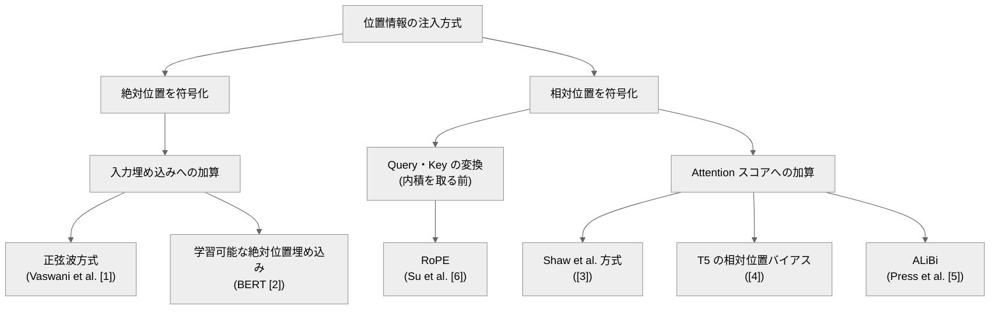

# 003. 位置エンコーディング(Positional Encoding)/ RoPE

**分類の枠組みから RoPE(Rotary Position Embedding)の導出まで**
*From a Unified Taxonomy of Positional Encoding to the Derivation of RoPE*

`theories/01_foundations/003_positional_encoding_rope.ipynb`

## 1. 概要 / Overview

[002](https://zenn.dev/kojikojiprg/books/ai-theories-roadmap/viewer/002_transformer_block) では、Transformer Block(多頭注意機構と順伝播ネットワークの組み合わせ)が単体では入力の並び替えに対して置換同変(permutation equivariant)であることを述べ、系列の順序情報を与えるために正弦波(sinusoidal)方式の位置エンコーディング(Positional Encoding)を暫定的に導入した。

本ノートブックでは、位置情報の注入方式を統一的に分類したうえで、学習可能な絶対位置埋め込み(Learned Absolute Positional Embedding)・相対位置エンコーディング(Relative Positional Encoding、Shaw et al. 方式・T5 の相対位置バイアス)・ALiBi(Attention with Linear Biases)・RoPE(Rotary Position Embedding)を数式レベルで比較する。中心は RoPE の数学的導出であり、「Query・Key の内積が相対位置のみに依存する」という要請から回転行列による解を導き、効率的な実装まで扱う。

学習を伴う実験では、可変長の copy task を用いて学習長内での表現力(実験 B-1)と、学習長を超える外挿(length extrapolation)性能(実験 B-2)を分けて評価する。

## 2. 参考論文 / References

| # | 著者 / Authors | タイトル / Title | 会議・媒体 / Venue | URL |
|---|---|---|---|---|
| [1] | Vaswani, Shazeer, Parmar, Uszkoreit, Jones, Gomez, Kaiser, Polosukhin | Attention Is All You Need | NeurIPS 2017 | https://arxiv.org/abs/1706.03762 |
| [2] | Devlin, Chang, Lee, Toutanova | BERT: Pre-training of Deep Bidirectional Transformers for Language Understanding | NAACL 2019 | https://arxiv.org/abs/1810.04805 |
| [3] | Shaw, Uszkoreit, Vaswani | Self-Attention with Relative Position Representations | NAACL 2018 | https://arxiv.org/abs/1803.02155 |
| [4] | Raffel, Shazeer, Roberts, Lee, Narang, Matena, Zhou, Li, Liu | Exploring the Limits of Transfer Learning with a Unified Text-to-Text Transformer | JMLR 2020 | https://arxiv.org/abs/1910.10683 |
| [5] | Press, Smith, Lewis | Train Short, Test Long: Attention with Linear Biases Enables Input Length Extrapolation | ICLR 2022 | https://arxiv.org/abs/2108.12409 |
| [6] | Su, Lu, Pan, Murtadha, Wen, Liu | RoFormer: Enhanced Transformer with Rotary Position Embedding | Neurocomputing 2024 | https://arxiv.org/abs/2104.09864 |
| [7] | Haviv, Ram, Press, Izsak, Levy | Transformer Language Models without Positional Encodings Still Learn Positional Information | Findings of EMNLP 2022 | https://arxiv.org/abs/2203.16634 |

- **[1] が正弦波方式の原典**(原論文の 3.5 節)であり、002 で暫定導入した方式に対応する。
- [2] は学習可能な絶対位置埋め込みの代表例(BERT)として参照する。
- [3] は Shaw et al. 方式の相対位置エンコーディングの原典。
- [4] は T5 の相対位置バイアス(原論文の 2.1 節)の原典。
- [5] は ALiBi の原典。原論文タイトルの "Train Short, Test Long" が示す通り、外挿を明示的な設計目標とする。
- **[6] が本トピックの中心である RoPE の原典**(原論文 2 節の要請の定式化・3 節の導出・3.4.3 節の遠距離減衰の議論に基づく)。
- [7] は、位置エンコーディングを持たない因果的な言語モデルでも位置情報を獲得できることを報告する。実験 B の対照群の精度解釈に参照する(3.1 節)。

## 3. 理論 / Theory

**表記の約束**: 本ノートブックでも 002 と同様、系列を行方向に並べた行ベクトル規約を用いる。

**記号 / Notation**(本セクション全体で共通)

| 記号 | 意味 |
|---|---|
| $L$ | 系列長 |
| $d_{\text{model}}$ | モデル次元 |
| $h$ | ヘッド数 |
| $d_k = d_{\text{model}} / h$ | ヘッドあたりの次元 |
| $m$ | Query 側の位置インデックス |
| $n$ | Key 側の位置インデックス |

### 3.1 動機・課題 / Motivation

001 で見た通り、Scaled Dot-Product Attention は $e_{mn} = q_m^{\top} k_n / \sqrt{d_k}$ という **すべての位置対に対称な** 演算であり、入力を並び替えると出力も同じように並び替わる(置換同変。因果マスクを課す場合は後述の通り異なる)。したがって Attention・順伝播ネットワークだけでは系列の順序を区別できない(002・3.6 節)。002 では対処として正弦波(sinusoidal)方式を **足場として暫定導入した**。本トピックでは、位置情報の注入方式を網羅的に分類し、現代の大規模言語モデルがなぜ特定の方式(多くの場合 RoPE)を採用するのかを扱う。

**因果マスクとの関係について**: 上記の置換同変性は双方向の自己注意で厳密に成り立つが、実験 B が用いる **因果マスク付き decoder-only 構成** では位置 $m$ の Query が参照できる Key の集合が $\{0, \dots, m\}$ に制限され、**位置ごとに参照可能なトークンの数が異なる**。この非対称性自体が暗黙の位置情報であり、因果的な自己注意は厳密には置換同変ではない。実際、位置エンコーディングを持たない因果的な言語モデルでも位置情報を獲得することが報告されている(Haviv et al. [7])。したがって実験 B の対照群は「位置情報がゼロ」ではなく「明示的な位置エンコーディングを持たない」条件と解釈する(6.2 節)。

もう 1 つの課題が **長さの外挿(length extrapolation、学習時の最大系列長を超えた性能維持)** であり、実験 B-2 で扱う。

### 3.2 位置情報の注入点による分類 / Taxonomy by Injection Point

位置情報をどこに注入するかで、各方式は次の 3 グループに分類できる。

| 注入点 | 該当方式 | 絶対 / 相対 |
|---|---|---|
| 入力埋め込みへの加算 | 正弦波、学習可能な絶対位置埋め込み | 絶対位置 |
| Query・Key の線形射影後、内積を取る前の変換 | RoPE | 相対位置(絶対位置 $m$ を作用させるが、内積は相対位置 $n-m$ のみに依存する) |
| Attention スコアへの加算 | Shaw et al. 方式、T5 の相対位置バイアス、ALiBi | 相対位置 |

この分類は 4 節「実装方針」のインターフェース設計(`QueryKeyPositionalTransform`と`AttentionScoreBias`の 2 種類)に対応する。

### 3.3 正弦波方式の再訪 / Sinusoidal Positional Encoding Revisited

002・3.6 節で、正弦波方式は次元ペア $(2i, 2i+1)$ ごとに周波数 $\omega_i = 1/10000^{2i/d_{\text{model}}}$ の正弦波を割り当てており、固定オフセット $k$ だけ位置をずらす操作が

$$
\mathrm{PE}(\mathrm{pos}+k) = M_i(k) \, \mathrm{PE}(\mathrm{pos})
$$

という $2\times2$ 回転行列 $M_i(k)$(角度 $k\omega_i$、$\mathrm{pos}$ に非依存)で表現できることを導出した。この性質は RoPE の回転行列 $R(m\theta)$ と同じ構造を持つが、**回転の作用先が決定的に異なる**:

- **正弦波方式**: 回転(相当パターン)を **トークン埋め込みに加算する** 副産物であり、Attention の内積計算には回転として現れない。
- **RoPE**: 回転を **Query・Key そのものに作用させる**(内積直前に $R(m\theta)$ を乗じる)。これにより内積 $(R(m\theta)q)^{\top}(R(n\theta)k)$ は相対位置 $n-m$ のみに **必然的に** 依存する(3.8 節)。加算ではなく **乗法的** な回転にすることで、この依存が「たまたま成り立つ性質」ではなく「設計上保証される性質」になる。

### 3.4 学習可能な絶対位置埋め込み(Learned Absolute Positional Embedding)

**定義**: 学習可能な行列 $P \in \mathbb{R}^{L_{\max} \times d_{\text{model}}}$($L_{\max}$: 学習時の最大系列長)を用意し、位置 $m$ のトークン埋め込みに $P_m$(行列 $P$ の $m$ 行目)を加算する。BERT [2] などが採用する。

$$
x_m \leftarrow x_m + P_m
$$

**パラメータ数**: $d_{\text{model}} \cdot L_{\max}$ に比例する(正弦波方式はパラメータを持たない)。

**外挿性**: $P$ は $L_{\max}$ 行しか持たないため、$m \ge L_{\max}$ に対応する行が存在しない。**原理的に外挿できない**(実験 B-2 で、この制約を実際に超えた場合の挙動を確認する)。

### 3.5 Shaw et al. 方式の相対位置エンコーディング

Attention スコアを次のように定義する [3]:

$$
e_{mn} = \frac{(x_m W^Q)(x_n W^K + a^K_{mn})^{\top}}{\sqrt{d_k}}, \qquad
a^K_{mn} = w^K_{\mathrm{clip}(n-m,\ k_{\text{clip}})}
$$

- $\mathrm{clip}(x, k) = \max(-k, \min(k, x))$ は相対距離を $[-k_{\text{clip}}, k_{\text{clip}}]$ に切り詰める関数。$k_{\text{clip}}$ より遠い相対距離はすべて境界値として扱われる(「これ以上遠い」という情報だけが残る)。
- $w^K \in \mathbb{R}^{(2k_{\text{clip}}+1) \times d_k}$ が学習可能パラメータで、相対距離のバケット数($2k_{\text{clip}}+1$ 通り)に比例する。

上式を展開すると

$$
e_{mn} = \underbrace{\frac{q_m^{\top} k_n}{\sqrt{d_k}}}_{\text{standard score}} + \underbrace{\frac{q_m^{\top} a^K_{mn}}{\sqrt{d_k}}}_{\text{relative bias}}
$$

となり、第 2 項は Query の内容 $q_m$ と相対位置ベクトル $a^K_{mn}$ の内積であり、$q_m$ に依存するため、位置のみに依存する「スコアへのバイアス」という枠組み(T5・ALiBi と共通のインターフェース)には厳密には収まらない(詳細は 4 節)。

**原論文は Value 側にも同様の項を加算する定式化を持つ**:

$$
z_m = \sum_n a_{mn} (v_n + a^V_{mn}), \qquad a^V_{mn} = w^V_{\mathrm{clip}(n-m,\ k_{\text{clip}})}
$$

この項は Attention 重み $a_{mn}$ による Value の集約そのものに介入するため「スコアへのバイアス」という枠組みには収まらず、後続研究では寄与が小さいとして省略されることが多い。5.5 節で直接実装し、Key 側のみの場合との差を数値例で確認する。

### 3.6 T5 の相対位置バイアス

T5 [4] は、Attention スコアにヘッドごとに学習可能な **スカラー** $b_{h,\, \mathrm{bucket}(n-m)}$ を加算する:

$$
e_{mn} = \frac{q_m^{\top} k_n}{\sqrt{d_k}} + b_{h,\, \mathrm{bucket}(n-m)}
$$

相対距離 $n-m$ は $\mathrm{bucket}(\cdot)$ によってバケット化される。近距離は **線形スケール** で 1 だけ違う距離も別バケットとして区別し、遠距離は **対数スケール** で大きく異なる距離をまとめて 1 つのバケットにすることで、任意の遠さの相対距離もバケット数の上限内に収める。双方向(Encoder)ではバケット数を前半・後半に 2 分割して $n>m$ と $n<m$ を区別し、因果的(Decoder)では $n \le m$ のみでよいため全バケットを片側に使う。

**Shaw et al. 方式との違い**:

| | Shaw et al. 方式 | T5 |
|---|---|---|
| 加算する項 | ベクトル $a^K_{mn} \in \mathbb{R}^{d_k}$(Query との内積が必要) | スカラー $b_{h,\, \mathrm{bucket}(n-m)}$ |
| 相対距離の扱い | クリップ(境界を超えると一定値) | 対数バケット化(境界を超えても粗く区別) |
| 層間の共有 | 層ごとに独立が一般的 | 原論文では層間共有が多いが、本ノートブックでは層ごとに独立した`T5RelativePositionBias`を持たせる(4 節) |

### 3.7 ALiBi(Attention with Linear Biases)

ALiBi [5] は、Attention スコアに **学習可能パラメータを持たない** 線形バイアスを加算する:

$$
e_{mn} = \frac{q_m^{\top} k_n}{\sqrt{d_k}} - m_h \cdot (m - n)
$$

$m_h$ はヘッド $h$ ごとに固定された傾き(slope)で、幾何数列として定める(ヘッド数を $H$ とする):

$$
m_h = 2^{-8h/H} \qquad (h = 1, \dots, H)
$$

例えば $H=8$ なら傾きは $2^{-1}, \dots, 2^{-8}$ の等比数列になる。傾きが小さいヘッドほど遠い位置まで緩やかに減衰するバイアスを持ち(遠距離担当)、大きいヘッドほど近い位置に強く減衰するバイアスを持つ(近距離担当)。これによりヘッドごとに異なる距離スケールを担当させ、単一の減衰スケールでは表現しきれない距離依存性をカバーする。

学習可能パラメータを持たず $m_h$ は系列長によらず定義できるため **任意の系列長にそのまま適用できる**(原論文タイトル "Train Short, Test Long" の通り外挿性能を明示的な設計目標とする)。$H$ が 2 のべき乗でない場合、原論文は直近の 2 のべき乗の傾きを補間して残りを埋めており、`ALiBiPositionBias._compute_slopes`(5.3 節)もこれに従う。

### 3.8 RoPE(Rotary Position Embedding)

本トピックの中心。Su et al. [6] の導出を追う。

#### 3.8.1 要請の定式化

位置 $m$ の Query と位置 $n$ の Key を作る関数 $f_q(x_m, m)$, $f_k(x_n, n)$ について、その内積が **相対位置のみに依存する** ことを要請する:

$$
\langle f_q(x_m, m),\ f_k(x_n, n) \rangle = g(x_m, x_n,\ m-n)
$$

すなわち、$m, n$ 自体ではなく差 $m-n$ だけが内積に影響するような $f_q, f_k$ を探すという問題設定である($g$ は任意関数なので、以降の導出では符号を反転した $n-m$ の形で表しても要請自体は変わらない)。

#### 3.8.2 2 次元の場合の解

$d_k=2$ の場合、回転行列

$$
R(\theta) = \begin{pmatrix} \cos\theta & -\sin\theta \\ \sin\theta & \cos\theta \end{pmatrix}
$$

を用いて $f_q(x_m, m) = R(m\theta)\,(W^Q x_m)$、$f_k(x_n, n) = R(n\theta)\,(W^K x_n)$ と定めると、回転行列の直交性 $R(\theta)^{\top} = R(-\theta)$ と加法定理 $R(\alpha)R(\beta) = R(\alpha+\beta)$ から

$$
R(m\theta)^{\top} R(n\theta) = R(-m\theta) R(n\theta) = R((n-m)\theta)
$$

が成り立つ。したがって

$$
\langle R(m\theta) q,\ R(n\theta) k \rangle = q^{\top} R(m\theta)^{\top} R(n\theta)\, k = q^{\top} R((n-m)\theta)\, k
$$

となり、内積は相対位置 $n-m$ のみの関数になる。これが 3.8.1 節の要請を満たす具体解である。

#### 3.8.3 複素数表現

2 次元の回転は複素数の乗算としても書ける:$q = W^Q x_m$ を複素数とみなすと $f_q(x_m, m) = (W^Q x_m)\, e^{im\theta}$ であり、角度 $m\theta$ の回転そのものである(オイラーの公式が 3.8.2 節の回転行列に対応する)。

#### 3.8.4 $d_k$ 次元への一般化

$d_k$ 次元の Query・Key を $d_k/2$ 個の 2 次元部分空間に分割し、部分空間 $i$ ($i=0, \dots, d_k/2-1$)に角周波数

$$
\theta_i = \mathrm{base}^{-2i/d_k}
$$

の回転を適用する。$\mathrm{base}$ の既定値は $10000$(正弦波方式と同じ値)であり、部分空間ごとの回転速度の分布を決める:$i$ が小さい部分空間ほど速く回転し(高周波)、$i$ が大きい部分空間ほどゆっくり回転する(低周波)。この分布は $\mathrm{base}$ を変えることで調整でき、長文脈拡張(トピック 014)のスケーリング手法群(NTK-aware スケーリング・YaRN など)の出発点になる。

全部分空間の回転をまとめたブロック対角行列を $R_{\Theta,m}$ とする:

$$
R_{\Theta,m} = \begin{pmatrix}
R(m\theta_0) & & \\
& \ddots & \\
& & R(m\theta_{d_k/2-1})
\end{pmatrix} \in \mathbb{R}^{d_k \times d_k}
$$

#### 3.8.5 内積が相対位置のみに依存することの証明

$R_{\Theta,m}$ はブロック対角行列であり、各ブロックが直交行列 $R(m\theta_i)$ なので、転置との積もブロックごとに独立に計算できる:

$$
R_{\Theta,m}^{\top} R_{\Theta,n} =
\begin{pmatrix}
R(m\theta_0)^{\top} R(n\theta_0) & & \\
& \ddots & \\
& & R(m\theta_{d_k/2-1})^{\top} R(n\theta_{d_k/2-1})
\end{pmatrix}
= R_{\Theta,\, n-m}
$$

(各ブロックに 3.8.2 節の関係を適用した)。したがって

$$
(R_{\Theta,m}\, q)^{\top} (R_{\Theta,n}\, k) = q^{\top} R_{\Theta,m}^{\top} R_{\Theta,n}\, k = q^{\top} R_{\Theta,\, n-m}\, k
$$

となり、回転後の Query・Key の内積は相対位置 $n-m$ のみに依存する(3.8.1 節の要請を $d_k$ 次元で満たす)。

#### 3.8.6 遠距離減衰(long-term decay)

RoPE には、相対距離 $|n-m|$ が大きくなるにつれて内積の絶対値の上界が減衰するという性質がある(厳密な証明には Abel 変換による上界評価が必要で本ノートブックでは立ち入らない、原論文 [6] の 3.4.3 節)。この傾向は実験 A-4 で数値的に確認する。

#### 3.8.7 効率的な実装

ブロック対角行列 $R_{\Theta,m}$ との明示的な行列積は $O(d_k^2)$ かかり非効率である。実務上は、次元を前半・後半に 2 分割して要素を入れ替える演算 $\mathrm{rotate\_half}$ と、$\cos$・$\sin$ の要素ごとの積(ブロードキャスト)で等価に計算する($[q_1, q_2]$ を $d_k/2$ 次元の前半・後半とする):

$$
\mathrm{rotate\_half}([q_1, q_2]) = [-q_2, q_1]
$$

$$
R_{\Theta,m}\, q \;\;\hat{=}\;\; q \odot \cos(m\boldsymbol{\theta}) + \mathrm{rotate\_half}(q) \odot \sin(m\boldsymbol{\theta})
$$

ここで $\boldsymbol{\theta} = [\theta_0, \dots, \theta_{d_k/2-1}, \theta_0, \dots, \theta_{d_k/2-1}]$($\theta_i$ を前半・後半に複製したベクトル)、$\odot$ は要素ごとの積である。この実装は次元ペアの取り方が 3.8.4 節のブロック対角行列と異なる($i$ 番目と $i+d_k/2$ 番目を組にする、GPT-NeoX / LLaMA 系の実装で広く使われる変形)が、Query と Key に **同一の置換** を適用するため、3.8.5 節の相対位置のみへの依存という性質は保たれる(実験 A-3a で数値検証する)。

隣接ペアの取り方(3.8.4 節)と前半・後半ペアの取り方(本節)は、座標の固定置換 $P$ によって $R^{\text{half}}_{\Theta,m} = P^{\top} R^{\text{interleaved}}_{\Theta,m} P$ と厳密に結ばれ(実験 A-3c で数値確認)、この置換は線形射影 $W^Q, W^K$ の再パラメータ化(列の並べ替え)に吸収されるため **モデルの表現力としては両者は等価** である。ただし置換を揃えずに同一の $q, k$ を両方の取り方で回転させると、内積の値そのものは一致しない(実験 A-3b で確認)。

#### 3.8.8 適用対象

RoPE は **Query と Key のみに適用し、Value には適用しない**。狙いは「内積という演算そのものに相対位置を持ち込む」ことであり、Value は Attention 重みによる加重平均の対象で内積の計算には関与しないため対象にならない。

### 3.9 アルゴリズム / Algorithm

RoPE は、角周波数 $\theta_i$ から位置ごとの余弦と正弦の表を事前に計算し、Query と Key のそれぞれを、自分の位置の表の値で(3.8.7 節の効率的な実装により)回転させる。

相対位置バイアス(Shaw et al. 方式・T5・ALiBi)は、Query 側の位置 $m$ と Key 側の位置 $n$ について相対位置 $n - m$ の行列を作り、方式ごとにバイアスを求める。Shaw et al. 方式は、相対位置を切り詰めて(`k_clip`)対応する学習した埋め込みを引く。T5 は、相対位置を距離のバケットに写し、バケットとヘッドに対応する学習したバイアスを引く。ALiBi は、ヘッドごとに決めた傾きと相対位置の積をバイアスとする。

擬似コードは付録 A.1。

## 4. 実装方針 / Implementation Plan

### `src/`に切り出すもの

`src/layers/positional_encoding.py`に、注入点に応じた 2 種類の抽象基底クラスと各方式の実装クラスを追加する(`SinusoidalPositionalEncoding`はそのまま残す)。

| クラス | 役割 | 注入点(3.2 節) |
|---|---|---|
| `QueryKeyPositionalTransform`(抽象基底クラス) | `apply(query, key, positions=None) -> (query, key)` | Query・Key の変換 |
| `RotaryPositionEmbedding` | 上記の実装。RoPE(3.8 節) | 同上 |
| `AttentionScoreBias`(抽象基底クラス) | `bias(query_length, key_length, device, dtype) -> Tensor` | スコアへの加算 |
| `T5RelativePositionBias` | 上記の実装。T5(3.6 節) | 同上 |
| `ALiBiPositionBias` | 上記の実装。ALiBi(3.7 節) | 同上 |
| `ShawRelativePositionBias` | `AttentionScoreBias`を継承するが、`bias()`ではなく`relative_vectors()`を主に使う(下記の設計判断を参照) | 同上(ただし特別扱い) |
| `LearnedAbsolutePositionalEmbedding` | `forward(x, positions=None) -> x` | 入力埋め込みへの加算 |

`positions`引数は任意引数で、省略時は $0$ から系列長 $-1$ までの連番として扱う。外部から渡せるようにしている理由は、KV キャッシュを用いた逐次推論(トピック [010](https://zenn.dev/kojikojiprg/books/ai-theories-roadmap/viewer/010_kv_cache_and_inference_compute))では生成の各ステップで Query の絶対位置がキャッシュ長だけずれるため、位置インデックスを明示的に指定できる必要があるからである。

**`ShawRelativePositionBias`に関する設計判断**: 3.5 節の通り、Shaw et al. 方式の Key 側の項 $a^K_{mn}$ は Query の内容 $q_m$ と内積を取るため、位置のみに依存する`bias(query_length, key_length, device, dtype)`という統一インターフェース(T5・ALiBi と共通)では計算できない。そこで`ShawRelativePositionBias`は`AttentionScoreBias`を継承しつつ`bias()`は例外を送出し、代わりに相対位置ベクトル $a^K_{mn}$ のみを返す`relative_vectors(query_length, key_length, device, dtype) -> Tensor`(形状`(S_q, S_k, d_k)`)を提供し、`MultiHeadAttention`側の`isinstance`判定でこのクラスの場合だけ Query との内積 $q_m \cdot a^K_{mn}$ を直接計算する特別扱いを追加する。

`src/layers/attention.py`の`MultiHeadAttention`は、既存の引数・挙動を変えずに拡張する:

- コンストラクタに`positional_transform: QueryKeyPositionalTransform | None = None`と`attention_score_bias: AttentionScoreBias | None = None`を追加(既定値`None`)。
- `forward`に`positions: Tensor | None = None`を追加する。
- 引数が渡されたときだけ、対応する処理を Attention 計算の該当箇所(Query・Key の線形射影の直後、スコアの softmax の直前)に挟む。
- `scaled_dot_product_attention()`にも`bias: Tensor | None = None`を追加し、スケーリング後のスコアに加算できるようにする。

**後方互換性**: これらの引数をすべて省略した場合、001・002 は変更前と同一 seed で完全に同一の数値を出力する。両ノートブックを再実行して数値を比較した結果は 5.1 節末尾で報告する。

`src/layers/transformer_block.py`(`EncoderBlock`)は変更しない。実験 B では構築後に`self_attn`属性を`positional_transform`/`attention_score_bias`を指定した`MultiHeadAttention`に差し替え、残差接続・層正規化・順伝播ネットワークの構造をそのまま再利用する。

### ノートブック内に直接書くもの

- Shaw et al. 方式の **Value 側の項** $a^V_{mn}$(3.5 節)。スコアへのバイアスという枠組みに収まらず(Value の集約に直接介入するため)、`src/`のインターフェースからは意図的に外す。5.5 節で直接実装し、Key 側のみの場合との数値的な差を確認する。
- 実験 B・C 用の可変長 copy task のデータ生成、モデル定義、学習ループ、評価コード。

## 5. 実装 / Implementation

### 5.1 環境セットアップ

**001・002 の後方互換性の確認について**:`MultiHeadAttention`に`positional_transform`/`attention_score_bias`/`positions`を追加するにあたり、これらをすべて省略した場合に 001・002 が変更前と完全に同一の数値を出力することを別途確認済みである(`jupyter nbconvert --execute`で両ノートブックを変更前後で再実行し、損失・精度・パラメータ数などの全出力を比較した。壁時計時間の実測値のみ実行環境依存で異なり、それ以外の数値はすべて一致した)。

### 5.2 RoPE(Rotary Position Embedding)の実装確認

### 5.3 相対位置バイアス(Shaw et al. 方式・T5・ALiBi)の実装確認

因果的(`bidirectional=False`)なバケット化のため、$n > m$(未来を参照する側)はすべて同じバケット(バケット 0)に潰れており、値も同一になっている。これは因果マスクによってどのみち参照されない領域なので実害はない。

### 5.4 位置エンコーディングを統合した`MultiHeadAttention`の確認

### 5.5 Shaw et al. 方式の Value 側の項(ノートブック内実装)

3.5 節で述べた通り、Value 側の項 $a^V_{mn}$ は Attention 重みによる Value の集約 $z_m = \sum_n a_{mn} (v_n + a^V_{mn})$ に直接介入するため、`src/`の`AttentionScoreBias`インターフェースには収まらない。ここでは小規模な数値例で、Key 側のみの場合との差を確認する。

**確認できたこと**: Value 側の項を加えると、出力ベクトルは Key 側のみの場合から無視できない差(相対差にして数 % 〜 十数 %程度)を持つ。原論文が Value 側の項を持つ定式化であること自体は無視できないが、後続研究で省略されることが多いのは、(a) スコアへのバイアスという単純な枠組みに収まらず実装が煩雑になること、(b) 経験的に性能への影響が小さいことの両方が理由とされる。本ノートブックの実験 B では、`src/`の設計判断に合わせて Key 側のみの`ShawRelativePositionBias`を使用する。

## 6. 実験 / Experiments

> **実行環境について**: 以下の実測値は本ノートブックを CPU 上で実行して得たものである(GPU 未使用)。損失・精度は乱数シードを固定しているため同一環境では再現するが、学習時間などハードウェア依存の数値は実行環境によって変わる(Google Colab の T4 GPU では一致しない)。

### 6.1 実験 A: RoPE の理論的性質の数値検証

学習を伴わない検証。3.8 節で導出した性質が数値的に成り立つことを確認する。

**検証 A-1**: $R_{\Theta,m}^{\top} R_{\Theta,n} = R_{\Theta,\, n-m}$ が機械精度で成り立つことを確認する。

**検証 A-2**: 回転を適用した Query・Key の内積が、絶対位置をずらしても相対位置が同じであれば不変であることを確認する(例: $(m,n)=(3,7)$ と $(10,14)$ で内積が一致する、いずれも相対位置は $n-m=4$)。

**検証 A-3a**: ブロック対角行列との明示的な行列積による実装(`block_diag_rotation_half_split`、3.8.7 節の rotate_half に対応するペアの取り方)と、`rotate_half`+ 要素ごとの積による効率的な実装(`RotaryPositionEmbedding.apply`)が機械精度で一致することを確認する。

**検証 A-3b**: 隣接ペア版(`block_diag_rotation_interleaved`、3.8.4 節の定義通り)と前半・後半ペア版(`block_diag_rotation_half_split`)は、次元ペアの取り方が異なる。同一の $q, k$ に対して、2 つの取り方が **一致しない** 内積を与えることを数値で確認する。

**検証 A-3c**: 2 つの取り方は、座標の固定置換 $P$(前半・後半ペアの添字 $i \to$ 隣接ペアの添字 $2i$、$i+d_k/2 \to 2i+1$ に対応させる置換行列、$P^{\top}=P^{-1}$)によって厳密に結ばれている。以下を確認する。

1. $R^{\text{half}}_{\Theta,m} = P^{\top} R^{\text{interleaved}}_{\Theta,m} P$ が機械精度で成り立つこと。
2. $q, k$ に同じ置換 $P$(半空間表現から隣接ペア表現への埋め込み)を適用すれば、隣接ペア版の内積が前半・後半ペア版と機械精度で一致すること(A-3b で「一致しない」ことを確認した設定に、置換だけを追加する)。

**検証 A-4**: 遠距離減衰(long-term decay、3.8.6 節)は、同一の Query ベクトルを固定し、相対距離 $t$ だけ離れた位置における自己相関 $\langle R_{\Theta,0}\,q,\ R_{\Theta,t}\,q \rangle$ が $t$ とともに減衰する傾向として観察できる。3.8.4 節の通り $\theta_i$ は $i$ が大きいほど回転が遅く、$d_k=16$・$\mathrm{base}=10000$ では最も遅い周波数が 1 周するのに $2\pi/\theta_{\max i} \approx 20000$ ステップ以上を要するため、狭い相対距離レンジで平均すると低周波成分がほとんど回転せず減衰が観測できない。ここでは相対距離のレンジを $0$〜$2000$ 程度まで広げ、同一ベクトルの自己相関を見ることで、この減衰傾向を可視化する。

    

    

#### 実験 A の結果・考察

- **A-1**: $R_{\Theta,m}^{\top} R_{\Theta,n}$ と $R_{\Theta,\,n-m}$ の最大要素誤差は $5.960 \times 10^{-8}$ で機械精度一致し、3.8.5 節の証明が数値的にも成立した。
- **A-2**: 相対位置が同じ 4 組 $(m,n) \in \{(3,7), (10,14), (0,4), (50,54)\}$($n-m=4$ で共通)の内積はいずれも $-0.6933$ 付近に一致(最大差 $1.192 \times 10^{-6}$)し、3.8.1 節の要請(内積が相対位置のみに依存する)を確認した。
- **A-3a**: 明示的な行列積による実装(前半・後半ペア版、3.8.7 節)と`rotate_half`による効率的な実装の最大要素誤差は $2.384 \times 10^{-7}$ で機械精度一致した。
- **A-3b**: 同一の $q, k$ に対し、前半・後半ペア版(3.8.7 節)の内積は $-0.6933$、隣接ペア版(3.8.4 節)の内積は $-1.3158$ で **一致しなかった**(次元ペアの取り方が異なれば数値そのものは変わる)。
- **A-3c**: 座標の固定置換 $P$ について、(1) $R^{\text{half}}_{\Theta,m} = P^{\top} R^{\text{interleaved}}_{\Theta,m} P$ の最大要素誤差は $0.000 \times 10^{0}$(完全に一致)、(2) $q, k$ に同じ置換 $P$ を適用すると隣接ペア版の内積は $-0.6933$ となり、A-3b の前半・後半ペア版の値と機械精度で一致した。3.8.7 節で述べた「両者はモデルの表現力として等価」であることの数値的な裏付けになる(A-3b の「一致しない」という結果は、置換を揃えていないことによるもので表現力の違いを意味しない)。
- **A-4**: 相対距離 $t=0$ での平均絶対自己相関は $15.71$ であったのに対し、$t \approx 1980$〜$2000$ 近傍(末尾 10 点の平均)では $4.58$ まで減衰した。最も低い周波数 $\theta_{7} \approx 3.16\times10^{-4}$ の周期が約 $20000$ ステップ(3.8.6 節・6.1 節参照)であることと整合し、相対距離のレンジを広げたことで遠距離減衰の傾向を可視化できた。

### 6.2 実験 B: 位置エンコーディング方式の比較(学習を伴う)

**タスク設計についての注記**: 006「小型 GPT の事前学習」は本トピック(003)を前提とするため、ここで言語モデリングを扱うと前提関係が逆転する。そのため、位置情報が本質的に効く合成タスクとして **可変長 copy task** を用いる。

**タスク**: 系列 $[x_1, \dots, x_L, \mathrm{SEP}, x_1, \dots, x_L]$ を構成し、因果マスク付き Decoder のみの構成(`EncoderBlock`を因果マスクで使い、cross-attention を持たない GPT スタイル、002・実験 1 と同じ手法)で後半部分(2 回目の $x_1, \dots, x_L$)を予測し、損失・精度は後半部分のみで計算する。系列長 $L$ を学習の各ステップでランダムに変え、モデルが「相対的な参照パターン」を学習するよう促す。

**語彙サイズについての設計判断**: 語彙サイズを大きく取ると、系列内で重複がほとんど発生しないため、「直前に出た同じトークンの次を見る」という **内容に基づく induction 機構**(位置情報なしで学習できる)だけでタスクがある程度解けてしまい、方式間の差が出にくい。そこで語彙サイズを $6$ と小さく設定し、同じトークンが複数回出現するようにした。これにより induction 機構だけでは参照先が曖昧になり、位置情報(絶対位置または相対位置)に基づく参照が本質的に必要になる。

**モデル**: 002 の`EncoderBlock`(因果マスク付き、正規化前置)を 2 層積んで使う。加算方式(正弦波・学習可能な絶対位置埋め込み)は埋め込み層に、RoPE・Shaw et al. 方式・T5・ALiBi は各層`self_attn`を対応する`MultiHeadAttention`に差し替えて組み込む。`EncoderBlock`自体は変更しない。

#### 実験 B-1: 学習長内での性能

学習時と同じ範囲(ここでは $L = L_{\max} = 16$)での精度を比較する。ここで測っているのは **位置情報の表現力そのもの** である(学習長を超えないため、外挿性能は問わない)。

    

    

#### 実験 B-2: 学習長を超える外挿性能

学習時の最大系列長($L_{\max}=16$)の 1.5, 2, 3, 4 倍の複数の長さで評価する。ここで測っているのは **外挿(length extrapolation)性能** である。

    

    

**T5 の相対距離バケットの補足分析**: T5(`num_buckets=32`・`max_distance=64`・`bidirectional=False`)が学習中に実際に受け取る相対距離の範囲と、評価時に受け取る範囲を比較する。学習時の入力系列長は最大でも $2 L_{\max} = 32$ であり、causal な自己注意で意味を持つ相対距離(Key が Query 以前にある場合)は高々 $31$ である。

#### 実験 B の結果・考察

実測値(6.2 節の実行結果より、$3$ seed(0, 1, 2)の平均値、括弧内は最小値・最大値)は以下の通り。

**実験 B-1(学習長内 $L=16$、3.2〜3.8 節との対応)**:

| 条件 | 損失(平均) | 精度(平均 [最小, 最大]) |
|---|---:|---|
| なし(対照群) | 0.9653 | 0.6340 [0.5869, 0.6677] |
| 正弦波方式 | 0.0356 | 0.9863 [0.9822, 0.9907] |
| 学習可能な絶対位置埋め込み | 0.4737 | 0.8129 [0.7874, 0.8477] |
| Shaw et al. 方式 | 0.1126 | 0.9591 [0.9292, 0.9753] |
| T5 の相対位置バイアス | 0.7192 | 0.7253 [0.5757, 0.8616] |
| ALiBi | 0.0940 | 0.9666 [0.9639, 0.9692] |
| RoPE | 0.0348 | 0.9878 [0.9829, 0.9917] |

$3$ seed の範囲で比較すると、**RoPE(0.988)・正弦波方式(0.986)** の最小値(0.983・0.982)が **ALiBi(0.967)・Shaw et al. 方式(0.959)** の最大値(0.969・0.975)を上回り、他条件よりはっきり高い精度に達した。ALiBi と Shaw et al. 方式は範囲が重なり($[0.964, 0.969] \subset [0.929, 0.975]$)$3$ seed では区別できない。**学習可能な絶対位置埋め込み(0.813)** はこの 2 条件より明確に低く(最大値 0.848 が Shaw et al. 方式の最小値 0.929 を下回る)、**T5(0.725)・対照群(0.634)** も範囲が重なり($[0.587, 0.668] \subset [0.576, 0.862]$)区別できない。ただし T5 は分散が非常に大きく(範囲 $0.29$)、seed によって対照群並みから学習可能な絶対位置埋め込みに匹敵する精度まで大きくばらついた。

**対照群がチャンスレベル($\approx 0.167$)を大きく上回る理由**: 3.1 節の通り因果マスクの下では位置 $m$ の Query が参照できる Key の集合が $\{0, \dots, m\}$ に制限され、この非対称性自体が暗黙の位置情報として働くためである。加えて内容ベースの induction 機構(位置エンコーディング不要)も一定の精度に寄与しうる(語彙サイズ $6$ に絞ったことで単独では解けないが、部分的な寄与までは排除できていない)。Haviv et al. [7] の知見と整合する結果である。

**実験 B-2(学習長超、3.4・3.7・3.8 節との対応)**:

| 条件 | L=24 | L=32 | L=48 | L=64($4\times$) |
|---|---|---|---|---|
| なし | 0.478 [0.448, 0.501] | 0.390 [0.352, 0.424] | 0.308 [0.284, 0.342] | 0.266 [0.246, 0.298] |
| 正弦波方式 | 0.221 [0.187, 0.248] | 0.238 [0.214, 0.269] | 0.242 [0.230, 0.254] | 0.213 [0.203, 0.225] |
| 学習可能な絶対位置埋め込み | nan | nan | nan | nan |
| Shaw et al. 方式 | 0.891 [0.798, 0.947] | 0.813 [0.674, 0.904] | 0.642 [0.489, 0.756] | 0.505 [0.392, 0.595] |
| T5 | 0.376 [0.344, 0.424] | 0.451 [0.269, 0.631] | 0.275 [0.258, 0.286] | 0.277 [0.229, 0.323] |
| ALiBi | 0.920 [0.913, 0.925] | 0.855 [0.849, 0.863] | 0.711 [0.692, 0.722] | 0.603 [0.578, 0.615] |
| RoPE | 0.330 [0.280, 0.367] | 0.311 [0.299, 0.329] | 0.173 [0.168, 0.177] | 0.167 [0.163, 0.175] |

学習可能な絶対位置埋め込みは、3.4 節の通り`max_len`($=2L_{\max}+1=33$)を超える位置で`ValueError`が送出され評価は全域`nan`となった。「性能が劣化する」のではなく「原理的に動作しない」という 3.4 節の議論をそのまま裏付ける。

実験前の想定(「$L=48$・$L=64$ あたりで対照群を下回る」程度の緩やかな劣化)より厳しく、**正弦波方式・RoPE はいずれも $1.5$ 倍長($L=24$)の時点ですでに対照群を下回り、$4$ つの外挿長すべてで下回り続けた**(全長で $3$ seed の範囲に重なりなし。例えば $L=24$: $0.221$/$0.330$ vs 対照群 $0.478$、$L=64$: $0.213$/$0.167$ vs $0.266$、上表参照)。T5 も $L=24$ で対照群を下回り(重なりなし)、$L=32$〜$L=64$ では区別できない水準まで落ち込んだ。この結果は 3.1 節の議論と整合する:因果マスクだけが与える暗黙の位置情報(「位置 $m$ は $m+1$ 個の Key しか参照できない」)は学習長を超えても意味を失わないのに対し、正弦波方式・RoPE・T5 が学習した位置パターンは学習長の範囲でのみ意味を持つよう最適化されており、学習長を超えた位置には **学習時に見たことのない、意味をなさない信号** を Attention に持ち込む。この信号が、暗黙の位置情報だけに頼るよりも有害に働きうる、というのが今回の結果である。

対照的に、**ALiBi(0.603 @ $L=64$)・Shaw et al. 方式(0.505 @ $L=64$)は最も緩やかな劣化を示し、全外挿長で対照群を明確に上回り続けた**(両者の範囲は重なり、$3$ seed では優劣を確定できない)。ALiBi は分散が小さく安定して高い精度を維持し、Shaw et al. 方式も $k_{\text{clip}}=16$ のクリップ(3.5 節)のおかげでクリップ範囲を超えた遠距離で新しい情報が増えず対照群を上回った。これは 3.7 節の通り **ALiBi が外挿を明示的な設計目標としている手法である**([5])ことの帰結であり、RoPE が素の状態では学習長を大きく超えると急激に劣化しやすいという既知の傾向と整合する(**「ALiBi の方が優れた手法である」ことを意味しない** — 実験 B-1 の表現力では RoPE・正弦波方式が ALiBi を上回っており、測っている軸が異なる、7 節)。一方 T5 は、5.3 節の補足分析(6.2 節末尾)によると学習中に一度も勾配を受けないバケットが存在し(全 $32$ 個中 $8$ 個)、評価時 $L=64$ で相対距離が未学習のオーバーフローバケットに落ちることが、T5 の外挿性能の低さ(むしろ $L=24$ では対照群も下回る)の具体的な要因だと考えられる。

### 6.3 実験 C: Attention 重みの可視化

正弦波方式・ALiBi・RoPE(および対照群)について、copy task が「参照すべき位置に注目できているか」を定量指標で確認し、代表例をヒートマップで可視化する。学習長内($L=16$)と学習長を超える系列($L=32$、学習長の 2 倍)の両方で評価し、外挿時に何が壊れるかを確認する。モデルは 2 層(`N_LAYERS_B`)・ヘッド数 $4$(`N_HEADS_B`)であり、指標は特定の層・ヘッドに決め打ちせず **全層・全ヘッド** を対象に計算する。

**参照すべき位置のオフセットについて**:`make_copy_batch`(6.2 節)が構成する系列は`[x_1, ..., x_L, SEP, x_1, ..., x_L]`であり、`input_ids`はこの系列の末尾 1 トークンを除いたもの(長さ $2L$、0-indexed で位置 $0$〜$2L-1$)である。位置 $L$ が`SEP`、位置 $L+1+j$($j=0,\dots,L-1$)が 2 回目の $x_{j+1}$ に対応する。後半の位置 $m$($m \ge L$)の次のトークンを予測するための正解は`target_ids[m] = full_sequence[m+1]`であり、$m=L+j$ のとき`full_sequence[L+j+1] = x_{j+1} = \text{full\_sequence}[j]`(前半の位置 $j = m - L$ の値)と一致する。したがって、位置 $m$ が参照すべき前半の位置は $m - L$ である(以下の指標計算はこの値を用いる)。

    

    

#### 実験 C の結果・考察

**表 1(重みが最大の (層, ヘッド) における重み・argmax 一致率、6.3 節の実行結果より、$3$ seed の平均 [最小, 最大])**: 参照位置への重みが最大となる (層, ヘッド) を seed ごとに特定し、同一の (層, ヘッド) における重みと argmax 一致率を並べている(2 つの指標を別々に最大化すると異なる (層, ヘッド) が選ばれうるため)。

| 条件 | $L$ | 参照位置への重み(最大の (層, ヘッド)) | argmax 一致率(同一の (層, ヘッド)) | チャンスレベル |
|---|---:|---|---|---:|
| なし(対照群) | 16 | 0.1553 [0.1410, 0.1767] | 0.2500 [0.2188, 0.2969] | 0.0424 |
| なし(対照群) | 32 | 0.0559 [0.0551, 0.0566] | 0.0977 [0.0703, 0.1250] | 0.0214 |
| 正弦波方式 | 16 | 0.5760 [0.5529, 0.6058] | 0.9010 [0.8594, 0.9375] | 0.0424 |
| 正弦波方式 | 32 | 0.0583 [0.0434, 0.0674] | 0.0859 [0.0625, 0.1055] | 0.0214 |
| ALiBi | 16 | 0.5971 [0.5725, 0.6222] | 0.8594 [0.8438, 0.8906] | 0.0424 |
| ALiBi | 32 | 0.4815 [0.4739, 0.4945] | 0.8307 [0.8203, 0.8477] | 0.0214 |
| RoPE | 16 | 0.7018 [0.6635, 0.7396] | 0.9193 [0.8984, 0.9453] | 0.0424 |
| RoPE | 32 | 0.1553 [0.1000, 0.2132] | 0.2161 [0.1406, 0.2891] | 0.0214 |

チャンスレベルは、位置 $m$ が因果マスクの下で参照可能な $m+1$ 個の Key に一様な重みを置く場合の値($\mathrm{chance}(L) = (1/L)\sum_{m=L}^{2L-1} 1/(m+1)$、$L=16$ で $0.0424$、$L=32$ で $0.0214$)。表 2(層・ヘッド別、$3$ seed 平均)では、いずれの条件も 1 層目(`layer=0`)はチャンスレベル前後にとどまり(最も高い RoPE の`layer=0`head 2 でも約 $1.35$ 倍)、copy に関わる集中は 2 層目(最終層)に現れる。

**表 1 を主指標とする理由**: 正弦波方式・RoPE は精度が seed 間でほぼ一定(6.2 節末尾の表)にもかかわらず、$L=16$ で重みが最大となる (層, ヘッド) は seed ごとに異なり(表 3。RoPE は $3$ seed すべてで異なるヘッドが最大で、最終層 head 0 単体の値も $[0.0993, 0.7396]$ と大きく振れる)、対照群(`none`)は $L=16$・$L=32$ とも $3$ seed すべてが同じ (層, ヘッド) で一致する。すなわち copy 機構がどの (層, ヘッド) に載るかは **seed にも依存しうる**。以降はこの依存を避けるため、seed ごとに重み最大の (層, ヘッド) を特定して集計した表 1 を主指標とする。

**正弦波方式・RoPE**: 学習長内($L=16$)では最大値・argmax 一致率ともにチャンスレベルの $13$〜$22$ 倍に達し、明確な集中を示した(ヒートマップでも SEP からのオフセット分ずれた対角線として観察できる)。学習長の 2 倍($L=32$)では正弦波方式が約 $2.7$〜$4.0$ 倍、RoPE が約 $7.3$〜$10.1$ 倍まで低下し、$L=16$ の水準(十数倍以上)から大きく後退した。RoPE の方が倍率を高く保っており、実験 B-2 の精度($L=32$ で正弦波方式 $0.238$・RoPE $0.311$、6.2 節)と整合する。

**ALiBi**: 学習長内で重み・一致率ともにチャンスレベルの約 $14$〜$20$ 倍に達し、正弦波方式・RoPE と同水準の集中を示した。$L=32$ でも約 $22$〜$39$ 倍とほとんど低下せず、正弦波方式・RoPE と対照的に集中を維持し、実験 B-2 の緩やかな精度低下($L=16$ で $0.967$、$L=32$ で $0.855$)と整合する。表 2 より`layer=1`の各ヘッドの重み($3$ seed 平均、$L=16$)は head 0 の $0.0138$ から head 3 の $0.4546$ まで、傾き $m_h$(3.7 節、$[0.25, 0.0625, 0.015625, 0.00390625]$)が小さいヘッドほど単調に大きい($L=32$ でも同じ順序)。チャンスレベル比では head 0 のみ約 $0.33$ 倍で **下回り**、他の 3 ヘッドは約 $6.4$〜$10.7$ 倍で明確に上回る。傾きが大きい head 0・head 1 が最大となる seed は $3$ seed × $2$ 系列長のどの組み合わせにもなく、常に head 2・head 3 のいずれかが最大となる(どちらかは seed に依存、表 3)。これは ALiBi の傾きが **学習可能パラメータを持たない固定値**(3.7 節)であることによる構造的な帰結であり、「傾きが小さいヘッドが長距離を担当する」という設計上の帰結は実測で裏付けられるが、そのうちどちらが最大かは seed に依存する。

**対照群との比較**: $L=16$ での対照群は重み・一致率ともにチャンスレベルの約 $3.7$〜$5.9$ 倍に達し、**明示的な位置エンコーディングがなくても参照位置への集中はチャンスレベルを明確に上回る**。これは 3.1 節の「因果マスク自体が暗黙の位置情報を与える」という議論の裏付けであり、実験 B-1 で対照群の精度が $0.634$ に達したこと(6.2 節)とも整合する。$L=32$ では正弦波方式が対照群と **ほぼ同水準**(argmax 一致率はむしろ下回る)まで低下し、実験 B-2 で正弦波方式が全外挿長で対照群を下回ったこと(6.2 節)と整合する。一方 RoPE は $L=32$ でも対照群を明確に上回るにもかかわらず精度では下回る(6.2 節)。すなわち **参照位置への集中度の高さと精度は単調に対応しない**。この乖離は本実験の結果だけからは断定できないが、本指標が重みが最大となる $1$ つの (層, ヘッド) しか見ていないこと、また copy には注目だけでなく参照した値を正しく出力に反映する処理(値の読み出し・変換)も必要であることが可能性として考えられる。

可視化に用いたモデルは代表として seed $0$ で学習したものであり、上記の定量指標は $3$ seed の平均値である点に注意(個別の seed の値は表 3 が示す通り大きく異なりうる)。

## 7. 結果・考察 / Results and Discussion

各実験の詳細は実験セクション末尾(6.1・6.2・6.3 節)に記載した。ここでは実験 B-1・B-2 と実験 C の結果を統合し、位置エンコーディング方式全体の位置づけを整理する。

**1. 学習長内での表現力(実験 B-1、3.2〜3.8 節)**: 位置エンコーディングを持たない対照群(精度 $0.634$)が最も低く、RoPE($0.988$)・正弦波方式($0.986$)が最も高い精度に達した($3$ seed でも明確に区別できる差、6.2 節)。これは Attention の内積構造(RoPE)または埋め込み(正弦波)に密な位置情報を与えられることの帰結だと考えられる。対照群の精度もチャンスレベル($\approx 0.167$)を大きく上回るのは因果マスクそのものが暗黙の位置情報を与えるためであり(3.1 節)、実験 C でも対照群の Attention 集中度がチャンスレベルの約 $3.7$〜$5.9$ 倍に達することでこの議論を挙動レベルで裏付けている(6.3 節)。

**2. 外挿性能(実験 B-2、3.4・3.7・3.8 節)**: 学習可能な絶対位置埋め込みは原理的に外挿できず(3.4 節)実験でもそのまま動作しなかった。RoPE・正弦波方式は学習長内の高い表現力とは対照的に $4$ つの外挿長すべてで対照群を下回り、ALiBi・Shaw et al. 方式は最も緩やかな劣化を示し全外挿長で対照群を上回り続けた(両者の優劣は $3$ seed では確定できない、6.2 節)。これは ALiBi が外挿を明示的な設計目標としている手法である([5])ことの帰結であり、**「ALiBi の方が優れた手法である」という結論には直結しない**(実験 B-1 は表現力、実験 B-2 は外挿性能という異なる軸を測っている)。

**3. 統合的な考察**: RoPE は 3.8.5 節で証明した通り相対位置を Attention の内積構造そのものに埋め込む設計であり、これが学習長内での高い精度(実験 B-1)の帰結だと考えられる一方、外挿性能は保証せず学習長を超えると急激に劣化する(実験 B-2)。この不足は、角周波数 $\theta_i$(3.8.4 節)のスケールを調整する **RoPE のスケーリング**(NTK-aware スケーリング・YaRN・位置補間、トピック 014「長文脈拡張」)で対処されることが多く、現代の多くの大規模言語モデルが RoPE を採用しつつ長文脈への対応を別の技術で行っている理由につながる。

**4. 想定との整合性**: 実験前の想定(「RoPE は表現力に優れる一方、素の状態では外挿に劣り ALiBi が優位」)はこの傾向を裏付けたが、想定より厳しく、**RoPE・正弦波方式は $1.5$ 倍長($L=24$)の時点ですでに対照群を下回った**(想定は $L=48$・$L=64$ あたりでの劣化だった、6.2 節)。暗黙の位置情報(因果マスク由来)は学習長を超えても意味を失わないのに対し、明示的な位置信号は学習長を超えると意味をなさなくなり有害に働きうるという 3.1 節の議論と整合する。T5 の外挿性能の低さは、学習中に一度も勾配を受けないバケットの存在(全 $32$ 個中 $8$ 個)で説明でき、学習長内の精度のばらつきも大きく(範囲 $[0.576, 0.862]$)、本タスク・本設定との相性が悪かったと考えられる。

**5. 実験 C の結果**: 想定外だった結果が $2$ 件、実験 B・3.1 節の議論を Attention 挙動レベルで裏付ける結果が $1$ 件得られた(6.3 節)。想定外の $1$ つ目は、精度が seed 間でほぼ一定な条件(正弦波方式・RoPE)でも copy 機構がどの (層, ヘッド) に載るかは seed に依存しうる点、$2$ つ目は ALiBi の copy 機構が傾きの小さい $2$ ヘッド(head 2・head 3)のいずれかに載るが、どちらに載るかは seed に依存する点である(3.7 節の「傾きが小さいヘッドが長距離を担う」という帰結自体は裏付けられた)。想定を裏付ける結果としては、$L=32$ で正弦波方式の Attention 集中度が対照群とほぼ同水準まで低下したことが実験 B-2 の精度低下と対応し、「意味をなさない明示的な位置信号が有害に働きうる」という主張を集中度の面からも裏付けている。ALiBi は学習長内・学習長超のいずれでも高い集中度を維持し、実験 B-2 の緩やかな精度低下と対応する結果が得られたが、この対応関係は観測された相関であり、集中度が精度を直接決定する因果関係までは実測値から結論づけられない。

付録(実行の手順・パイロット・設計の改訂の記録など)は、GitHub のノートブックを参照。

https://github.com/kojikojiprg/ai-theories/blob/main/theories/01_foundations/003_positional_encoding_rope.ipynb
