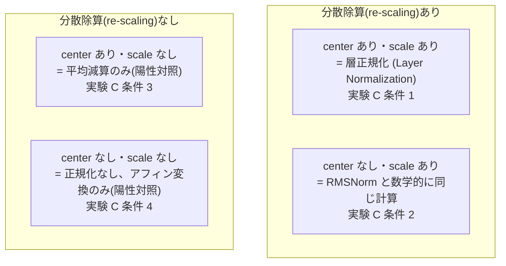
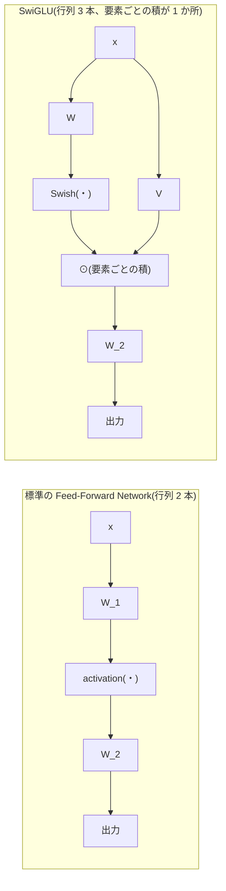
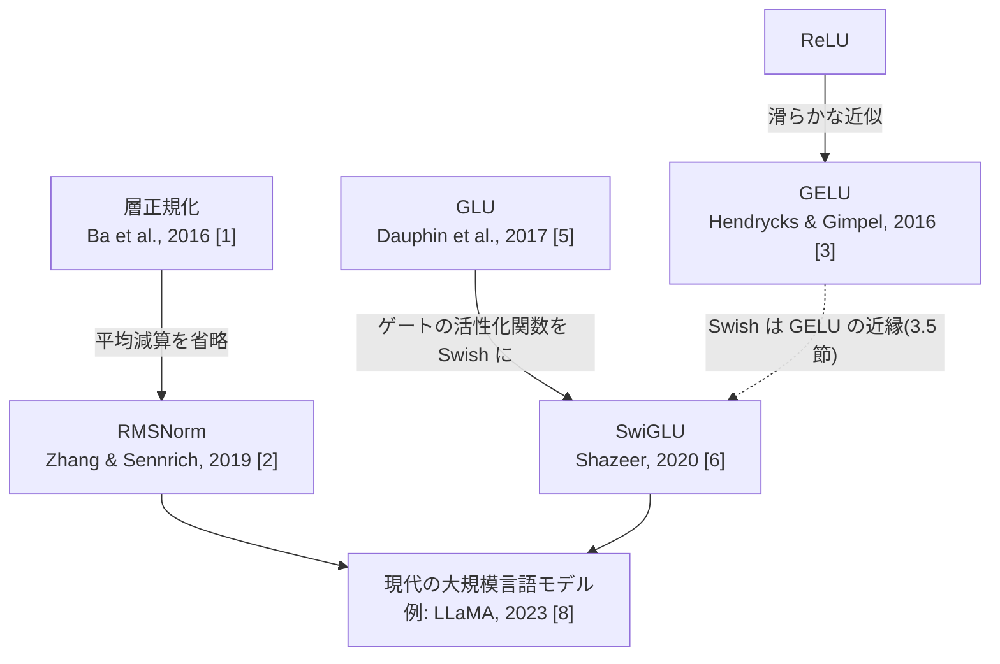

# 004. 正規化と活性化の系譜

**層正規化・RMSNorm と ReLU・GELU・SwiGLU — 除去実験と合成タスクによる機構の切り分け**
*From Layer Normalization to RMSNorm, and from ReLU through GELU to SwiGLU*

`theories/01_foundations/004_normalization_and_activation.ipynb`

## 1. 概要 / Overview

[002](https://zenn.dev/kojikojiprg/books/ai-theories-roadmap/viewer/002_transformer_block) でスクラッチ実装した層正規化(Layer Normalization)は、平均減算(re-centering)と分散除算(re-scaling)の 2 つの操作から成る。RMSNorm(Root Mean Square Normalization、二乗平均平方根正規化)[2] は、このうち平均減算を省略し分散除算のみを行う簡略版であり、現代の大規模言語モデルの多くが層正規化の代わりに採用している。同様に、順伝播ネットワーク(Feed-Forward Network)の活性化関数も ReLU から GELU(Gaussian Error Linear Unit)[3] を経て、GLU(Gated Linear Unit)[5] 系のゲート機構を組み込んだ SwiGLU [6] へと発展してきた。

本ノートブックは、これらの変遷を「性能が上がったから」で済ませず、**何が本質的な変化で、何がそうでないか** を除去実験(ablation)・不変性の数値検証・小規模合成タスクによって切り分けることを目的とする。特に、文字レベル言語モデリングという 1 つの最終指標だけに頼らず、複数の実験を機構ごとに独立させることで、「効果があった」ことと「その機構が寄与した」ことを混同しないように設計する。

## 2. 参考論文 / References

| # | 著者 / Authors | タイトル / Title | 会議・媒体 / Venue | URL |
|---|---|---|---|---|
| [1] | Ba, J., Kiros, J. R., Hinton, G. E. | Layer Normalization | arXiv:1607.06450, 2016 | https://arxiv.org/abs/1607.06450 |
| [2] | Zhang, B., Sennrich, R. | Root Mean Square Layer Normalization | NeurIPS 2019 | https://arxiv.org/abs/1910.07467 |
| [3] | Hendrycks, D., Gimpel, K. | Gaussian Error Linear Units (GELUs) | arXiv:1606.08415, 2016 | https://arxiv.org/abs/1606.08415 |
| [4] | Ramachandran, P., Zoph, B., Le, Q. V. | Searching for Activation Functions | arXiv:1710.05941, 2017 | https://arxiv.org/abs/1710.05941 |
| [5] | Dauphin, Y. N., Fan, A., Auli, M., Grangier, D. | Language Modeling with Gated Convolutional Networks | ICML 2017 | https://arxiv.org/abs/1612.08083 |
| [6] | Shazeer, N. | GLU Variants Improve Transformer | arXiv:2002.05202, 2020 | https://arxiv.org/abs/2002.05202 |
| [7] | Narang, S. et al. | Do Transformer Modifications Transfer Across Implementations and Applications? | EMNLP 2021 | https://arxiv.org/abs/2102.11972 |
| [8] | Touvron, H. et al. | LLaMA: Open and Efficient Foundation Language Models | arXiv:2302.13971, 2023 | https://arxiv.org/abs/2302.13971 |

[2] が正規化パート、[6] が活性化パートの原典である。[7] は、小規模な比較実験ではアーキテクチャ変更の優劣が観測できないことがある、という本ノートブックの結論の枠づけの根拠として使う。[8] は、現代の大規模言語モデルが RMSNorm と SwiGLU を実際に採用している例として、7 節末尾で参照する。

## 3. 理論 / Theory

**表記の約束**: 本ノートブックでは 002 と同様に、系列中の 1 トークンの隠れ状態を行ベクトル $a \in \mathbb{R}^{d_{\text{model}}}$ として扱う($d_{\text{model}}$: モデルの隠れ次元)。正規化・活性化はいずれもトークンごと・チャネル方向(特徴次元方向)に独立に作用するため、以下の数式はバッチ・系列長の次元を省略し 1 ベクトル $a$ に対する定義として記述する。

### 3.1 層正規化(Layer Normalization)の復習と一般形

[002](https://zenn.dev/kojikojiprg/books/ai-theories-roadmap/viewer/002_transformer_block) で導入した層正規化(Ba et al. [1])は、

$$
\mu = \frac{1}{d_{\text{model}}} \sum_{i=1}^{d_{\text{model}}} a_i, \qquad
\sigma^2 = \frac{1}{d_{\text{model}}} \sum_{i=1}^{d_{\text{model}}} (a_i - \mu)^2
$$

$$
\mathrm{LayerNorm}(a) = \gamma \odot \frac{a - \mu}{\sqrt{\sigma^2 + \varepsilon}} + \beta
$$

と定義される。ここで $\gamma, \beta \in \mathbb{R}^{d_{\text{model}}}$ は学習可能なパラメータ、$\varepsilon$ は分散がゼロに近いときの数値安定化のための微小定数、$\odot$ は要素ごとの積である。

この定義は 2 つの独立した操作の合成として読み直せる。

1. **平均減算(re-centering)**: $a \mapsto a - \mu$。各成分から平均を引き、平均を 0 にそろえる。
2. **分散除算(re-scaling)**: $a \mapsto a / \sqrt{\sigma^2 + \varepsilon}$。標準偏差で割り、分散を 1 にそろえる。

`src/layers/normalization.py`(004 で拡張)の`LayerNormalization`は、この 2 つの操作をそれぞれ`center`・`scale`という bool 引数で独立に無効化できるようにしてある。4 通りの組み合わせ(いずれも $\gamma, \beta$ 自体は保持する)を実験 C で比較する。

### 3.2 RMSNorm(Root Mean Square Normalization、二乗平均平方根正規化)

RMSNorm(Zhang, Sennrich [2])は、層正規化から平均減算を落とし、分散除算のみを残した簡略版である。まず 2 乗平均平方根(RMS)を

$$
\mathrm{RMS}(a) = \sqrt{\frac{1}{d_{\text{model}}} \sum_{i=1}^{d_{\text{model}}} a_i^2}
$$

と定義すると、

$$
\mathrm{RMSNorm}(a) = \gamma \odot \frac{a}{\sqrt{\mathrm{RMS}(a)^2 + \varepsilon}}
$$

学習パラメータは $\gamma \in \mathbb{R}^{d_{\text{model}}}$ のみで、層正規化の $\beta$ に相当するシフトパラメータを持たない。

$\mathrm{RMS}(a)^2 = \frac{1}{d_{\text{model}}} \sum_i a_i^2$ は「平均 0 まわりの分散」ではなく「原点まわりの 2 乗平均」であることに注意する。もし $a$ がすでに平均 0 であれば($\mu = 0$)、$\mathrm{RMS}(a)^2 = \sigma^2$ となり、RMSNorm は層正規化から $\beta$ を除いたものと完全に一致する。この関係は、`LayerNormalization(center=False, scale=True)`と`RMSNorm`が初期化直後($\beta = 0$)に同じ出力を返すことに対応し、2 つの実装の相互検証として実験 B で確認する。

### 3.3 不変性の比較(平行移動不変性の喪失)

層正規化と RMSNorm の違いを、入力の変換に対する **不変性(invariance)** という観点から導出する。入力 $a$ に対して、スカラー $\alpha > 0$ とスカラー $b$ を用いた変換

$$
a \mapsto \alpha a + b \mathbf{1}, \qquad \mathbf{1} = (1, 1, \dots, 1) \in \mathbb{R}^{d_{\text{model}}}
$$

を考える(全成分を同じ倍率 $\alpha$ でスケールし、同じ量 $b$ だけシフトする)。以下、$\varepsilon \to 0$ の理想化した極限で考える($\varepsilon$ 自体は数値安定化のための項であり、不変性の議論の本質には影響しない)。

**層正規化は $\alpha$・$b$ の両方に不変である。** 変換後の平均・分散は $\mu' = \alpha \mu + b$、$\sigma'^2 = \alpha^2 \sigma^2$ となるため、

$$
\frac{(\alpha a_i + b) - \mu'}{\sqrt{\sigma'^2}} = \frac{\alpha (a_i - \mu)}{\alpha \sqrt{\sigma^2}} = \frac{a_i - \mu}{\sqrt{\sigma^2}}
$$

($\alpha > 0$ より $\sqrt{\alpha^2} = \alpha$)。$b$ は平均減算で厳密に打ち消され、$\alpha$ は分子・分母の両方に現れて厳密に打ち消される。

**RMSNorm は $\alpha$ にのみ不変で、$b$ には不変ではない。** 変換後の RMS は

$$
\mathrm{RMS}(\alpha a + b\mathbf{1})^2 = \frac{1}{d_{\text{model}}}\sum_i (\alpha a_i + b)^2 = \alpha^2 \mathrm{RMS}(a)^2 + 2\alpha b\,\bar{a} + b^2
$$

($\bar{a} = \mu$ は $a$ の平均)であり、$b \neq 0$ のとき $\mathrm{RMS}(\alpha a + b\mathbf{1})$ は $\mathrm{RMS}(a)$ の単純な定数倍にならない。したがって

$$
\mathrm{RMSNorm}(\alpha a + b\mathbf{1}) \neq \mathrm{RMSNorm}(\alpha a) = \mathrm{RMSNorm}(a) \quad (b \neq 0)
$$

($\alpha$ のみのスケーリング、$b=0$ の場合は $\mathrm{RMS}(\alpha a) = \alpha \,\mathrm{RMS}(a)$ となり厳密に不変)。

すなわち **RMSNorm は平行移動不変性(shift invariance)を失う**。この「失った性質」が実際の学習で問題になるかどうかは、理論だけでは決まらない実証的な問題である。実験 B で数値的に不変性の有無そのものを検証し、実験 D で実際の隠れ状態においてこの喪失が実害になっているかどうかを検証する。

### 3.4 演算回数とパラメータ数

$d_{\text{model}}$ 次元のベクトル 1 本を正規化するのに必要な演算回数(概算、定数個の演算は除く)とパラメータ数を比較する。

| | 加算・減算 | 乗算 | 除算 | 平方根 | パラメータ数 |
|---|---:|---:|---:|---:|---:|
| 層正規化(Layer Normalization) | $\approx 4 d_{\text{model}}$ | $\approx 2 d_{\text{model}}$ | $\approx 2 d_{\text{model}} + 1$ | $1$ | $2 d_{\text{model}}$($\gamma, \beta$) |
| RMSNorm | $\approx d_{\text{model}}$ | $\approx 2 d_{\text{model}}$ | $\approx d_{\text{model}} + 1$ | $1$ | $d_{\text{model}}$($\gamma$ のみ) |

RMSNorm は平均を計算する 1 パス($d_{\text{model}}$ 回の加算 + 中心化の $d_{\text{model}}$ 回の減算)と $\beta$ の加算($d_{\text{model}}$ 回)を省略できるため、層正規化よりおおむね加算・減算の回数が少なく、パラメータ数もちょうど半分になる。

> **注意: 本ノートブックでは実行時間の実測は行わない。** 理由は 2 つある。(1) [002](https://zenn.dev/kojikojiprg/books/ai-theories-roadmap/viewer/002_transformer_block) の実験でも述べた通り、Colab の共有 GPU 上での単一試行の計測はノイズが大きく、条件間の実行時間の差を主張する根拠にならない。(2) 正規化層はテンソル全体に対する演算量が小さく、演算密度(演算数 ÷ メモリアクセス量)が低いためメモリ帯域律速になりやすい。この場合、上表のような演算回数の削減がそのまま実測速度の改善に直結するとは限らない(この論点は 013 の Flash Attention でタイリングと合わせて再訪する)。したがって本ノートブックは演算回数・パラメータ数という理論値の比較に留め、実測時間による優劣は主張しない。

### 3.5 活性化関数: ReLU・GELU・Swish

**ReLU**: $\mathrm{ReLU}(x) = \max(0, x)$。原点で微分不可能、負領域で導関数が恒等的に 0 になる。

**GELU(Gaussian Error Linear Unit、Hendrycks, Gimpel [3])**: 標準正規分布(平均 0、分散 1)の累積分布関数(CDF)を $\Phi(x)$ として、

$$
\mathrm{GELU}(x) = x \, \Phi(x), \qquad \Phi(x) = \frac{1}{2}\left(1 + \mathrm{erf}\!\left(\frac{x}{\sqrt{2}}\right)\right)
$$

これが厳密形である($\mathrm{erf}$: 誤差関数)。計算コストの高い $\mathrm{erf}$ を避けるため、原論文は tanh を使った近似形も提示している。

$$
\mathrm{GELU}(x) \approx \frac{1}{2} x \left(1 + \tanh\!\left(\sqrt{\tfrac{2}{\pi}}\,(x + 0.044715\,x^3)\right)\right)
$$

**Swish / SiLU(Sigmoid Linear Unit、Ramachandran et al. [4])**: シグモイド関数 $\sigma(z) = 1/(1+e^{-z})$ を用いて、形状パラメータ $\beta$ を持つ

$$
\mathrm{Swish}_\beta(x) = x \, \sigma(\beta x)
$$

$\beta = 1$ のとき SiLU と呼ばれる形になる。$\beta \to \infty$ の極限で $\sigma(\beta x)$ はステップ関数(Heaviside 関数、$x<0$ で $0$、$x>0$ で $1$)に収束するため、

$$
\lim_{\beta \to \infty} \mathrm{Swish}_\beta(x) = x \cdot \mathbb{1}[x > 0] = \mathrm{ReLU}(x)
$$

すなわち **Swish は $\beta$ を介して ReLU を連続的に含む族になっている**。この収束の様子は実験 A で複数の $\beta$ について数値的に確認する。

### 3.6 GLU から SwiGLU へ

**GLU(Gated Linear Unit、Dauphin et al. [5])** は、線形変換の出力を別の線形変換にシグモイドを通した値で要素ごとに変調(ゲーティング)する機構である。

$$
\mathrm{GLU}(x, W, V, b, c) = (xW + b) \odot \sigma(xV + c)
$$

Shazeer [6] は、ゲート側の活性化関数 $\sigma$ を他の活性化関数に置き換えた一群の変種(ReGLU、GEGLU、SwiGLU など)を提案し、**SwiGLU** ではゲート側に Swish を使う。

$$
\mathrm{FFN}_{\text{SwiGLU}}(x) = \left(\mathrm{Swish}(x W) \odot x V\right) W_2
$$

ここで $W, V \in \mathbb{R}^{d_{\text{model}} \times d_{\text{ff}}'}$、$W_2 \in \mathbb{R}^{d_{\text{ff}}' \times d_{\text{model}}}$ であり($d_{\text{ff}}'$: SwiGLU の中間次元。標準の順伝播ネットワークの $d_{\text{ff}}$ と区別するためダッシュを付ける)、$\odot$ は要素ごとの積である。標準の順伝播ネットワーク(3.7 節で復習)が行列 2 つ($W_1, W_2$)なのに対し、SwiGLU は行列 3 つ($W, V, W_2$)を持つ。$\mathrm{Swish}(xW)$ が「$xV$ の各成分をどれだけ通すか」を決めるゲートとして働く。

### 3.7 パラメータ数を揃えるための中間次元の導出

[002](https://zenn.dev/kojikojiprg/books/ai-theories-roadmap/viewer/002_transformer_block) で実装した標準の順伝播ネットワーク(バイアスを省略して考える)は

$$
\mathrm{FFN}(x) = \mathrm{activation}(x W_1) W_2, \qquad W_1 \in \mathbb{R}^{d_{\text{model}} \times d_{\text{ff}}},\ W_2 \in \mathbb{R}^{d_{\text{ff}} \times d_{\text{model}}}
$$

でパラメータ数は $2\, d_{\text{model}}\, d_{\text{ff}}$。一方 SwiGLU は行列を 3 つ持つため、中間次元を同じ $d_{\text{ff}}$ のまま置き換える(**素朴な置換**)と、パラメータ数は $3\, d_{\text{model}}\, d_{\text{ff}}$ となり **ちょうど 1.5 倍** に増える。

「ゲート機構そのものの寄与」と「単純にパラメータが増えたことによる寄与」を混同しないためには、パラメータ数を揃えた比較が必要になる。SwiGLU の中間次元を $d_{\text{ff}}'$ として、

$$
3\, d_{\text{model}}\, d_{\text{ff}}' = 2\, d_{\text{model}}\, d_{\text{ff}} \quad \Longrightarrow \quad d_{\text{ff}}' = \frac{2}{3}\, d_{\text{ff}}
$$

原論文([Vaswani et al., 2017])の設定 $d_{\text{ff}} = 4\, d_{\text{model}}$ を使うと、$d_{\text{ff}}' = \frac{8}{3}\, d_{\text{model}} \approx 2.667\, d_{\text{model}}$ となる(Shazeer [6] も同じ $\frac{2}{3}$ 倍の調整を採用している)。

$d_{\text{ff}}'$ は整数でなければならないため、実装では丸め込みが必要になる。本ノートブックの実験(共通ハイパーパラメータ: $d_{\text{model}} = 256$、$d_{\text{ff}} = 1024$)での実際の値を計算すると、

| | 中間次元 | 順伝播ネットワーク部分のパラメータ数 |
|---|---:|---:|
| 標準(GELU) | $d_{\text{ff}} = 1024$ | $2 \times 256 \times 1024 = 524{,}288$ |
| SwiGLU(パラメータ数を揃えた条件) | $d_{\text{ff}}' = \mathrm{round}(2/3 \times 1024) = 683$ | $3 \times 256 \times 683 = 524{,}544$ |
| SwiGLU(素朴な置換、中間次元そのまま) | $d_{\text{ff}} = 1024$ | $3 \times 256 \times 1024 = 786{,}432$($1.5$ 倍) |

丸め込みの結果、「パラメータ数を揃えた条件」も $524{,}544$ 対 $524{,}288$ で **256 個(約 0.05%)だけ厳密には一致していない**。この程度の差は無視できるが、「揃えた」という表現が近似であることは明記しておく。実験 E ではこの 2 つの SwiGLU 条件(揃えた条件・素朴な置換)の両方を比較し、素朴な置換だけでは「ゲートの寄与」と「パラメータ数の寄与」が交絡することを実験 G で機構レベルから、実験 E ではモデル全体のパラメータ数の観点から補強する。

### 3.8 図: 正規化の 4 条件・順伝播ネットワークのデータフロー・手法の系譜

以下は本ノートブックの構造を視覚的に整理するための Mermaid 図である。**Google Colab やローカル Jupyter 上ではコードブロックのまま表示され図として描画されない**(GitHub 上のノートブックプレビューでは描画される)。そのため、以下の図がなくても 3.1〜3.7 節の数式・文章だけで理論が理解できるように書いてある。

**図 1: 正規化の 4 条件(平均減算 × 分散除算)**

**図 2: 標準の順伝播ネットワークと SwiGLU のデータフロー比較**

**図 3: 手法の系譜**

### 3.9 アルゴリズム / Algorithm

RMSNorm は、入力の 2 乗平均 $\mathrm{RMS}(a)^2$ に $\varepsilon$ を加えた値の平方根で入力を割り、ゲイン $\gamma$ を要素ごとにかける(シフトパラメータ $\beta$ は持たない)。SwiGLU の順伝播ネットワークは、入力に Swish を通したゲートと、入力の別の線形射影との要素ごとの積をとり、出力射影をかける。擬似コードは付録 A.1。

## 4. 実装方針 / Implementation Plan

**`src/`に切り出すもの**(理論的に本質的で、他トピック・`apps/`からも再利用する部品):

- 正規化層: `src/layers/normalization.py`に`LayerNormalization`(`center`・`scale`引数を追加)と`RMSNorm`を実装する。
- 活性化関数: `src/layers/activation.py`に`gelu_exact`・`gelu_tanh_approximation`・`swish`をスクラッチ実装する。
- 順伝播ネットワークの変種: `src/layers/feedforward.py`に`SwiGLUFeedForwardNetwork`を追加する。`FeedForwardNetwork`は活性化関数の指定方法を`activation_fn`(Callable)引数 1 つに一本化する(既定値`None`のとき ReLU、001・002・003 と同一の挙動)。
- ブロックへの注入点: `src/layers/transformer_block.py`の`EncoderBlock`・`DecoderBlock`に`normalization_factory`・`feed_forward_factory`・`activation_fn`を追加する。003 で`MultiHeadAttention`に位置エンコーディングを注入したのと同じ設計方針で、注入点がブロック内部にあるため、ラッパークラスを増やすのではなく optional 引数で拡張する。
- データ処理: `src/data/text.py`に文字レベルの`CharacterLevelTokenizer`と Tiny Shakespeare のロード関数を実装する。
- 測定関数: `src/utils/statistics.py`に、隠れ状態の平均/RMS 比・常に負のユニットの割合・ユニット群ごとの勾配ノルム・層ごとの勾配ノルムを計算する関数を実装する。
- 可視化: `src/utils/visualization.py`に、複数シードの散布図・層ごとの棒グラフ・関数曲線の描画関数を追加する。

**ノートブック内に直接書くもの**:

- 条件比較用の最小構成の言語モデル(`CausalCharacterLevelLanguageModel`、下記参照)と学習ループ。
- 実験ごとのデータ収集・統計量集計のグルーコード(隠れ状態やユニット活性化前の値を集めるための forward hook など)。
- 実験の実行・可視化コード。

**モデル本体と学習ループを`src/`に出さない理由**: 本格的な自己回帰言語モデリング(Autoregressive Language Modeling)の事前学習ループは 006(小型 GPT の事前学習)で扱う。004 の目的はあくまで正規化・活性化という **条件の比較** であり、汎用的な学習基盤の整備ではないため、比較に必要な最小構成のモデル・学習ループをこのノートブック内に閉じて実装する。

モデル構成(decoder-only 構成の作り方、正規化の配置の固定)、評価用バッチを固定する理由、`CausalCharacterLevelLanguageModel`の設計は付録 B。

## 5. 実装 / Implementation

### 5.1 環境セットアップ

### 5.2 正規化層の実装確認: `center`・`scale`と`RMSNorm`

`LayerNormalization`の`center=True, scale=True`(既定値)は 002 と完全に同一の計算になっていることを確認し、続けて`center=False, scale=True`(RMSNorm と数学的に同じ計算)が初期化直後(`beta=0`)に`RMSNorm`と一致することを確認する(これは実験 B でも扱う相互検証だが、実装確認の時点でも確かめておく)。

### 5.3 活性化関数の実装確認: スクラッチ実装と`torch.nn.functional`の数値一致

GELU・Swish は`torch.nn.functional`を使わずスクラッチ実装した(`src/layers/activation.py`)。正しさの確認として、対応する組み込み実装との最大絶対誤差を計測する。

### 5.4 順伝播ネットワークの変種の実装確認: `SwiGLUFeedForwardNetwork`

3.7 節で導出したパラメータ数を揃える中間次元 $d_{\text{ff}}' = \mathrm{round}(2/3 \times d_{\text{ff}})$ を、共通ハイパーパラメータ($d_{\text{model}}=256$、$d_{\text{ff}}=1024$)で実際に計算し、理論値どおりのパラメータ数になっていることを確認する。`FeedForwardNetwork`は`activation_fn`(Callable)引数に一本化してあるため(004 で、文字列引数との併存を解消)、GELU を使いたい場合は`activation_fn=gelu_exact`を渡す(既定値`None`は ReLU、001・002・003 と同一の挙動)。

### 5.5 `EncoderBlock`への注入点の実装確認

`normalization_factory`・`feed_forward_factory`を指定しない場合、002・003 と完全に同じ`LayerNormalization` + `FeedForwardNetwork`(ReLU)が使われることを確認する。

### 5.6 データ: Tiny Shakespeare の文字レベル分割

`src/data/text.py`の`CharacterLevelTokenizer`(文字単位の最小限の処理。サブワード分割は 005 で扱う)で、Andrej Karpathy の char-rnn リポジトリで配布されている Tiny Shakespeare データセットを文字 ID 列に変換し、学習用・検証用に分割する。

### 5.7 `CausalCharacterLevelLanguageModel`: 条件比較用の最小構成の言語モデル

4 節で述べた通り、本格的な事前学習ループは 006 で扱うため、ここでは条件比較に必要な最小構成のみを実装する。`normalization_factory`・`feed_forward_factory`を通じて、正規化・順伝播ネットワークの実装を差し替えられるようにしてある。`record_layer_outputs=True`を渡すと、各`EncoderBlock`の出力に`retain_grad()`を呼んで`self.layer_outputs`に記録する(実験 D で`compute_gradient_norm_per_layer()`と組み合わせて使う)。

### 5.8 評価用バッチの固定(評価ノイズの除去)

4 節で述べた通り、最終検証損失に評価バッチのサンプリングノイズが混入しないよう、**評価用バッチの集合を独立した乱数生成器で 1 度だけ固定生成し、以降の全条件・全シードでこの同じ集合を使い回す**。評価は固定集合全体にわたるトークン数で重み付けした平均損失とする。

### 5.9 学習ループ

線形 warmup + cosine 減衰の学習率スケジュール、勾配クリッピングを備えた最小限の学習ループを実装する。損失が非有限(NaN / Inf)になった場合は打ち切り、`diverged=True`として発散した事実をそのまま記録する(実験 C の陽性対照条件で使う。ハイパーパラメータは条件によらず共通のものを使う)。検証損失の計算は 5.8 節で固定した`evaluation_batches`を使う。

## 6. 実験 / Experiments

> **実行環境について**: 以下の実験は、Google Colab の T4 GPU 上で実行して得た実測値である。文字レベル言語モデリングの学習(実験 C・E)の採用 step 数は **950**(warmup 95 step)である。この step 数を較正で決めた手順と、較正の不具合の修正は付録 C。

**判定基準(実験の実行前に定める)**: 複数シードを使う実験(実験 C・E・G)では、各条件を **5 個(実験 C・E)または 10 個(実験 G)の乱数シード(seed)** で実行し、平均・標準偏差に加えて **個々のシードの値をすべてプロットに重ねる**(`plot_seed_scatter`)。条件間で 5(または 10)シードの最小値〜最大値の区間が重なる場合、優劣を主張せず「この規模では差を検出できなかった」と記述する。この基準は実験の実行前に定めたものであり、結果を見てから閾値を調整することはしない。最終評価損失の計算には 5.8 節で固定した評価用バッチ集合を全条件・全シードで共通に使うため、評価バッチのサンプリングノイズはこの判定基準の信頼性を損なわない。

### 6.1 実験 A: 活性化関数の形状(学習不要)

ReLU・GELU(厳密形・tanh 近似形)・Swish(複数の$\beta$)の関数値と導関数を描画し、3.5 節の理論(GELU の 2 つの近似の一致度、Swish の$\beta \to \infty$での ReLU への収束)を数値で確認する。

    

    

#### 実験 A の結果・考察

実測値: GELU の厳密形と tanh 近似形の最大絶対差は $4.734 \times 10^{-4}$($x \in [-4, 4]$)であり、3.5 節で述べた近似が実用上ほぼ無視できる精度であることを裏づけた。Swish($\beta$)と ReLU の最大絶対差は $\beta=0.5$ で $0.557$、$\beta=1.0$ で $0.279$、$\beta=2.0$ で $0.139$、$\beta=8.0$ で $0.035$ と、$\beta$ を大きくするにつれて単調に減少しており、3.5 節で導出した $\beta \to \infty$ での ReLU への収束を数値的に確認した。ReLU の導関数は $x=-10^{-4}$ で $0$、$x=+10^{-4}$ で $1$ となり原点付近で不連続であること、$x=-2.0$ で $0$ となり負領域で恒等的に $0$ であることも実測値で確認できた。

### 6.2 実験 B: 正規化の不変性の数値検証(学習不要)

3.3 節で導出した不変性を数値で検証する。ランダムな入力$a$に対して$a \mapsto \alpha a + b \mathbf{1}$の変換を施し、層正規化(Layer Normalization)と RMSNorm の出力がどれだけ変化するかを測る。あわせて、初期化直後($\beta = 0$)において`RMSNorm`と`LayerNormalization(center=False, scale=True)`の出力が一致することを検証し、2 つの実装の相互検証とする(5.2 節でも簡単に確認したが、ここでは複数のシードで再確認する)。

#### 実験 B の結果・考察

不変性の検証は 3.3 節の理論的な予測と一致した。層正規化は $\alpha$ を変えたときの出力差(最大絶対値)が $2.092 \times 10^{-3}$、$b$ を変えたときの出力差は $8.345 \times 10^{-7}$ であり、$b$ に対してはほぼ完全に不変(数値誤差の水準)、$\alpha$ に対してもごく小さい残差しか出なかった(この $\alpha$ 側の残差は数値安定化のための $\varepsilon$ に起因し、3.3 節で置いた理想化された極限 $\varepsilon \to 0$ からのずれである)。一方 RMSNorm は $\alpha$ を変えたときの出力差が $2.086 \times 10^{-3}$ と層正規化の $\alpha$ 側の残差とほぼ同水準(同じ $\varepsilon$ に由来する誤差)だったのに対し、$b$ を変えたときの出力差は $4.023$ と **3 桁以上大きい**。これは、3.3 節で導出した「RMSNorm は平行移動不変性を失う」という結論を、$\varepsilon$ に由来する数値誤差と明確に区別できる規模で裏づけている。また、初期化直後($\beta=0$)における`LayerNormalization(center=False, scale=True)`と`RMSNorm`の出力差は $0$(完全一致)であり、3.2 節で述べた関係、および 2 つの実装の相互検証が成立していることを確認した。

### 6.3 実験 C: 正規化の除去実験(文字レベル言語モデリング)

以下の 4 条件(いずれも活性化関数は GELU、正規化の配置は正規化前置(Pre-Layer Normalization)に固定)を、共通ハイパーパラメータ($d_{\text{model}}=256$、4 層、ヘッド数 4、$d_{\text{ff}}=1024$、系列長 128)、学習率$10^{-2}$で比較する。**この学習率は AdamW を用いる Transformer としてはやや高めであり、これは正規化なし条件を破綻させる十分な負荷を確保するために選んだものである。したがって、以下で観測される正規化なし・平均減算のみの条件の劣化には、「この学習率に耐えられない」という側面が含まれることに留意する** (より小さい学習率でも同様に劣化するかどうかは本ノートブックでは確認していない)。

1. 層正規化(Layer Normalization)
2. RMSNorm
3. 平均減算のみ(分散除算なし、`LayerNormalization(center=True, scale=False)`)
4. 正規化なし(アフィン変換のみ、`LayerNormalization(center=False, scale=False)`)

条件 3・4 は明確に劣化または発散することが期待される **陽性対照(positive control)** であり、測定系(この学習ループ・この規模のモデルで、正規化の欠如を検出できること)の感度を示す役割を持つ。発散した場合は損失が発散した事実そのものを結果として記録し、ハイパーパラメータを条件ごとに変更することはしない。

条件 1(層正規化)と条件 2(RMSNorm)の間に差が出ない場合、それは「差を検出できなかった」ではなく、**この学習率($10^{-2}$)のもとでは平均減算(re-centering)が不要であることを示した** と解釈する。条件 3・4 で明確な劣化が観測されることが、この解釈(測定系に十分な感度がある)を支える根拠になる。

まず、1 run の所要時間を実測し、実験 C・実験 E 合わせて 35 run が目標(70 分以内)に収まる step 数を決定する(較正の方法は付録 C)。

    

    

#### 実験 C の結果・考察

以下の実験 C は、採用 step 数 **950** で実行したものである(較正の経緯と実測精度は付録 C)。

4 条件 × 5 seed の最終評価損失は以下の通り(この語彙サイズでのランダム推測の損失は $\ln 65 \approx 4.174$)。

| 条件 | 平均 ± 標準偏差 | [最小, 最大] |
|---|---:|---:|
| 層正規化 | $1.7159 \pm 0.0151$ | $[1.7069,\ 1.7459]$ |
| RMSNorm | $1.7190 \pm 0.0100$ | $[1.7015,\ 1.7277]$ |
| 平均減算のみ | $2.4190 \pm 0.4652$ | $[1.6171,\ 2.8813]$ |
| 正規化なし | $2.2895 \pm 0.5466$ | $[1.5984,\ 2.9009]$ |

**観察できたこと**

1. **判定基準(最小値〜最大値の区間の重なり)に厳密に従う限り、陽性対照(条件 3・4)は「明確に機能した」とは言えない。** 平均減算のみの範囲 $[1.6171, 2.8813]$・正規化なしの範囲 $[1.5984, 2.9009]$ は、層正規化の範囲 $[1.7069, 1.7459]$・RMSNorm の範囲 $[1.7015, 1.7277]$ を完全に包含している。正規化なし条件の最小値 $1.5984$ は、層正規化の 5 seed のどの値よりも小さい(良い)。200 step の実行では陽性対照が判定基準上も明確に機能していたが(本節末尾を参照)、950 step ではこの結論は変わった。
2. **ただし平均で見れば差は依然として明確である。** 平均減算のみ($2.4190$)・正規化なし($2.2895$)は、層正規化・RMSNorm の平均($1.7159$・$1.7190$)より大幅に悪い。区間が重なる原因は、正規化を欠いた条件の **シード間のばらつきが極端に大きいこと** にある。標準偏差は平均減算のみ $0.4652$・正規化なし $0.5466$ であり、正規化条件の標準偏差($0.0151$・$0.0100$)の $30$〜$55$ 倍に達する。
3. **したがって 950 step で観測されたのは「正規化がないと学習が破綻する」ではなく、「正規化がないと学習が不安定になる」という現象である。** シードによっては正規化ありと同等以上の損失に達する一方、別のシードでは大きく劣る。**ただしシード間の分散は 6 節冒頭で事前に定めた判定指標ではないため、これは事後的な観察であり、本ノートブックでは正式な主張としては扱わない。**
4. **方法論上の知見**: 最小値〜最大値による判定基準は、条件間で分散が桁違いに異なる場合には適さない。分散が近い条件どうしでは非重複が意味のある差を示す一方、分散が極端に大きい条件が含まれると、平均に明確な差があっても区間の重なりだけでは検出できない。ただし 6 節冒頭で定めた判定基準そのものは実験前に固定したものであり、本ノートブックでは変更しない。
5. **前方参照**: この「正規化の欠如による学習の不安定化」は、007 で扱う学習の安定化技術の主題そのものである。

**200 step の実行時との比較(参考)**: 以前(採用 step 数 200)の実行では、平均減算のみ・正規化なしの条件はそれぞれ平均損失 $21.3$・$26.0$ まで完全に破綻し、層正規化・RMSNorm の範囲と全く重ならなかった。**同じ実験設定でも採用 step 数によって定性的な挙動が変わりうる** ことを示す実例として記録しておく。**この 200 step の数値は以前の実行時の値であり、本ノートブックの現在の出力(950 step)には対応するものがない。**

### 6.4 実験 D: 隠れ状態の統計量(学習不要、実験 C の学習済みモデルを使用)

実験 C の条件 1(層正規化)・条件 2(RMSNorm)の学習済みモデル(5 seed 分)について、検証データ上で (a) 各層の隠れ状態の平均の絶対値と二乗平均平方根(RMS)の比、(b) 層ごとの勾配ノルムを測定する。

**測定箇所についての注記**: ここで言う「各層の隠れ状態」は、各`EncoderBlock`の出力(正規化前置の構成では、次のブロックの正規化層への入力に相当する)を指す。最初のブロックの正規化層への入力(トークン埋め込み + 位置埋め込みの出力そのもの)は測定対象に含まれていない。

(a) の測定の主眼は **RMSNorm 条件の値** にある。層正規化条件は各ブロック内部で平均を明示的に除去する計算を経ているため、その隠れ状態の |mean|/RMS 比が小さいこと自体はほぼ自明であり、これは「平均除去を明示的に行った場合の下限」に相当する **比較のための参照点** にすぎない。議論の実質を担うのは、平均をそろえる操作を一切行っていない RMSNorm 条件の隠れ状態が、学習後にどれだけゼロ平均から外れているか(あるいは自然にゼロ平均に近いままか)という測定値の方である。これが、3.3 節で導出した「RMSNorm が失った平行移動不変性」が実際の学習では実害にならない理由の根拠になる。

(b) は 002(`theories/01_foundations/002_transformer_block.ipynb`実験 2)で導入した、「最終層を基準にした相対勾配」の手法(`compute_gradient_norm_per_layer`として再実装)を学習済みモデルに適用する。

    

    

#### 実験 D の結果・考察

層 1〜4(入力に近い順)の |mean|/RMS 比(5 seed 平均)は、層正規化で $[0.0122,\ 0.0104,\ 0.0100,\ 0.0099]$、RMSNorm で $[0.0546,\ 0.0531,\ 0.0532,\ 0.0552]$ であった。

層正規化条件の値が小さいこと自体は、各ブロック内部で平均を明示的に除去しているため測定するまでもなくほぼ自明であり、これは「平均除去を明示的に行った場合の下限」に相当する **比較のための参照点** にすぎない。議論の実質を担うのは RMSNorm 条件の値である: **平均をそろえる操作を一切行っていない RMSNorm 条件でも、学習後のモデルの隠れ状態は自然に、層正規化の参照値のおよそ 5 倍という範囲に収まった |mean|/RMS 比(最大でも $5.5\%$)にとどまり、ゼロ平均から大きくは外れていなかった。** これが、3.3 節で導出した「RMSNorm が失った平行移動不変性(shift invariance)」が実際の学習では実害にならない理由だと考えられる。

なお、ここでの測定対象は各`EncoderBlock`の出力(正規化前置の構成では、次のブロックの正規化層への入力に相当する)であり、最初のブロックの正規化層への入力(トークン埋め込み + 位置埋め込みの出力そのもの)は測定していない。

層ごとの相対勾配ノルム(最終層を 1 として正規化、5 seed 平均)は、層正規化で $[10.4961,\ 3.8678,\ 2.0291,\ 1.0000]$、RMSNorm で $[12.3004,\ 4.1546,\ 2.0666,\ 1.0000]$ とほぼ同じ形状のパターンを示した(いずれも入力に近い層ほど勾配が大きく、[002](https://zenn.dev/kojikojiprg/books/ai-theories-roadmap/viewer/002_transformer_block) の実験 2 で見た正規化前置の傾向と整合する)。層 1 の相対勾配ノルムは 200 step の実行時(層正規化で $5.39$)より大きくなっている($10.50$)が、本ノートブックはこの値の大小自体を主張の根拠にしていないため深追いしない。RMSNorm へ切り替えても勾配伝播の基本的な挙動は層正規化と変わらないことが確認できた。

### 6.5 実験 E: 活性化関数の比較(文字レベル言語モデリング)

正規化は RMSNorm に固定し、以下の 4 条件を比較する。

1. ReLU
2. GELU(RMSNorm 固定という条件が実験 C の条件 2 と完全に一致するため、その 5 run をそのまま再利用する)
3. SwiGLU(パラメータ数を揃えた中間次元、$d_{\text{ff}}' = 683$)
4. SwiGLU(中間次元をそのままにした素朴な置換、$d_{\text{ff}} = 1024$、パラメータ数 約 1.5 倍)

条件 4 を含める理由は、条件 3(揃えた条件)だけでは「パラメータを揃えたら差が消えた」としか言えず、逆に条件 4 だけでは gating の寄与とパラメータ数の寄与が交絡してしまうためである。両方を並べることで、この 2 つの要因を切り分けられる。

    

    

#### 実験 E の結果・考察

最終評価損失(5 seed、GELU 条件は実験 C の RMSNorm 条件を再利用):

| 条件 | 平均 ± 標準偏差 | [最小, 最大] |
|---|---:|---:|
| GELU | $1.7190 \pm 0.0100$ | $[1.7015,\ 1.7277]$ |
| ReLU | $1.7314 \pm 0.0178$ | $[1.7021,\ 1.7557]$ |
| SwiGLU(パラメータ数を揃えた条件) | $1.7123 \pm 0.0380$ | $[1.6606,\ 1.7631]$ |
| SwiGLU(素朴な置換) | $1.6883 \pm 0.0366$ | $[1.6534,\ 1.7471]$ |

**6 通りの条件ペアすべてで最小値〜最大値の区間が重なっている。** 200 step の実行で観測された ReLU vs SwiGLU(素朴な置換)の 1 ペアの非重複は、950 step では再現しなかった。

**多重比較についての注記(結果を踏まえた振り返り)**: 200 step の考察では、4 条件・6 通りのペアを同時に比較しているため、そのうち 1 ペアが偶然に非重複となる確率は 1 ペアだけを比較する場合より高い、という留保を付けたうえで ReLU vs SwiGLU(素朴な置換)の非重複を記録していた。950 step の結果はこの非重複が再現しなかったことを示しており、**6 通りの同時比較で見つかった単独の非重複に強い解釈を与えなかった判断が妥当だった** ことが確認された。この多重比較についての注記自体は、複数条件を同時比較する実験一般に有効な留意点として残す。

結論は「この規模・この採用 step 数(950)では、4 つの活性化関数の間に評価損失の差を検出できなかった」となる。これは Narang et al. [7] が報告した「小規模な比較実験ではアーキテクチャ変更の優劣が既存の指標に表れないことがある」という観察と整合する。

**プラトー仮説の検証結果(棄却)**: 200 step の実行では ReLU の標準偏差($0.0059$)が他 3 条件($0.095$〜$0.096$)より際立って小さく、「ReLU が採用 step 数の時点で既にプラトー(頭打ち)に達しており、他条件はまだ下降中でシード間のばらつきが大きい」という仮説を立てた。ローカル環境(MPS)での暫定的な再現実行では、ReLU の標準偏差が学習後半を通じて拡大しない一方、他条件は終盤にかけて標準偏差が拡大するという、仮説を支持する所見が得られていた。**しかし 950 step の結果では、ReLU の標準偏差($0.0178$)はもはや外れ値ではなく、むしろ GELU($0.0100$)より大きい。** 「ReLU の標準偏差だけが他条件より 1 桁小さい」という 200 step 特有のパターンは消えており、**プラトー仮説は 950 step の結果によって支持されなかった。** 仮説を立てて検証し、より長い学習では支持されなかったという経緯そのものは、200 step の結果を過大解釈しなかった根拠として記録しておく(ローカル再現実行の詳細な数値は 200 step 特有の現象についての補足だったため、ここでは割愛する)。

実験 F との関係も整理し直す。200 step の考察では、ReLU の標準偏差の小ささを、実験 F で観測した ReLU の常に負のユニット比率の高さと、プラトー仮説を介して整合する仮説として結びつけていた。950 step ではプラトー仮説自体が棄却され、かつ実験 F で観測される常に負のユニット比率も大きく減少・変化している(6.6 節)。**したがって、標準偏差・プラトー・常に負のユニット比率を結びつけるこの解釈は撤回する。** 実験 F で機構として確認されている「ReLU は常に負のユニットの勾配を厳密に遮断する」という事実自体は本節の結論に影響しないが、それが実験 E の評価損失のばらつきに表れているという主張はしない。

### 6.6 実験 F: 常に負のユニット(always-negative unit)の割合と、それが受け取る勾配(実験 E の学習済みモデルを使用)

実験 E の条件 1(ReLU)・条件 2(GELU)の学習済みモデル(5 seed 分)について、順伝播ネットワークの中間層(`feed_forward.linear1`の出力、活性化関数を通す前の値)を検証データ全体にわたって集め、`compute_always_negative_unit_ratio()`で「一度も正にならなかったユニット」の割合を層ごとに集計する。

**この比率が意味することは活性化関数によって異なる。** ReLU は負領域で導関数が恒等的に 0 になるため、常に負のユニットは実際に勾配を受け取れない(いわゆる「死んだユニット(dead unit)」)。GELU は負領域でも導関数が非零であるため、同じ「常に負」という条件を満たしていても勾配は伝わり続ける。したがって、この比率の値そのものを ReLU と GELU の間で比較しても、それだけでは「どちらがより深刻か」を意味しない。

そこで、比率という代理指標に加えて、**実際に勾配が伝わっているかどうかを直接測定する**。学習済みモデルに検証バッチを 1 つ通して逆伝播し、`feed_forward.linear1`の重み勾配を、常に負のユニットに対応する行とそれ以外の行に分けて、それぞれのノルムを`compute_gradient_norm_by_unit_group()`で計算する。ReLU 条件では常に負のユニットに対応する行の勾配ノルムがほぼ厳密に 0 になることが期待される。

    

    

#### 実験 F の結果・考察

常に負のユニット(always-negative unit)の割合(層 1〜4、5 seed 平均)は、ReLU で $[0,\ 0,\ 0.0148,\ 0.0049]$、GELU で $[0,\ 0,\ 0.0027,\ 0.0010]$ であった。**200 step の実行では層 4 で ReLU $15.16\%$・GELU $6.33\%$ に達し、入力から遠い層ほど割合が増える傾向を示していたが、950 step ではいずれも 1.5% 以下まで減少し(層 4 で ReLU $0.49\%$(200 step 時点の約 30 分の 1)・GELU $0.10\%$(同じく約 60 分の 1))、層 4 の割合が層 3 より低くなる(両条件とも)など、深さに対する単調な増加傾向も消えている。** 常に負のユニットは、学習が十分に進んだこの設定では **学習初期に生じる一時的な現象という側面が強く**、ReLU の恒常的な病理として提示するのは適切でない。

**一方、決定的な測定である勾配ノルムの結論は変わらない。** 実際の言語モデリング損失を 1 バッチ逆伝播した結果、

- **ReLU**: 常に負のユニットの勾配ノルムは層 1〜4 すべてで **厳密に $0$**($[0,\ 0,\ 0,\ 0]$)。それ以外のユニットの勾配ノルムは $[0.0701,\ 0.0269,\ 0.0194,\ 0.0200]$ と非零。
- **GELU**: 常に負のユニットの勾配ノルムは $[0,\ 0,\ 2.16\times 10^{-5},\ 8.84\times 10^{-6}]$ と、桁は小さいものの **明確に非零**(層 1・2 で $0$ なのは、その層に常に負のユニットが 1 つもなかったため)。それ以外のユニットの勾配ノルムは $[0.0734,\ 0.0332,\ 0.0228,\ 0.0230]$。

これは、代理指標(比率)の比較を、直接の検証に置き換えた結果である。**ReLU と GELU はいずれも常に負のユニットを一定割合生むが、そのユニットが勾配を受け取れるかどうかが決定的に異なる、という主張 3 の機構的な核は保たれている。** ReLU では常に負のユニットの勾配が厳密に $0$ になり、そのユニット自身の重み行を通した勾配経路からは回復できない。GELU では負領域でも導関数が非零であるため、常に負のユニットであっても非零の勾配を受け取り続け、この経路は閉じない。**ただし、実際に影響を受けるユニットの割合は 1.5% 以下にとどまることから、機構としては明確に存在するが、この設定での実質的な影響はごく限定的であると評価を調整する。**

200 step の考察では、「他層の学習によって当該層への入力分布が変化すれば、いずれにせよ『常に負』という状態自体が変わりうる」という留保を付けていた。**200 step から 950 step にかけて常に負のユニットの割合が約 30 分の 1 に減ったことは、この復活が実際に起きていることの傍証と言える。** ただし 200 step の実行と 950 step の実行は採用 step 数が異なる別々の学習実行であり、同一の学習を 2 時点で観測したものではないため、この解釈は断定しない。

**この機構の差は、実験 E の評価損失には検出されなかった**(6.5 節、950 step では 6 通りの条件ペアすべてで区間が重なった)。常に負のユニットの割合がごく一部(最大でも層 3 の $1.48\%$)にとどまることを踏まえると、これは自然な結果である。「機構は確かに存在するが、この規模・この指標にはほとんど転写されない」という 6.5 節の結論と整合する。

### 6.7 実験 G: 乗法的相互作用の合成タスクと陰性対照(negative control)タスク(小規模回帰)

実験 E は文字レベル言語モデリングという 1 つの最終指標に集約されるため、SwiGLU のゲート機構そのものが寄与しているかどうかを直接には切り分けられない。そこで、gating が有利になるように意図的に設計した小規模な回帰タスクで、機構の存在を最終指標から独立に確認する。

**乗法的相互作用タスク**: 入力$x \in \mathbb{R}^{d}$($d = 32$、標準正規分布からサンプリング)に対し、固定したランダムベクトル$w_{1j}, w_{2j} \in \mathbb{R}^d$($j = 1, \dots, d$)を使って

$$
y_j = (w_{1j}^\top x)(w_{2j}^\top x), \qquad j = 1, \dots, d
$$

を目標とする回帰タスク(目標は成分ごとに標準偏差で正規化する)。**この目標関数は、SwiGLU の関数形$(\mathrm{Swish}(xW) \odot xV)W_2$にほぼそのまま含まれる形をしている**(ゲート側とバリュー側の 2 本の線形射影を要素ごとに掛け合わせるという構造が、目標そのものの構造と一致する)。したがって、このタスク単体での SwiGLU の優位は、「SwiGLU の仮説クラスに元々含まれる関数を、SwiGLU がうまく表現できた」という以上の主張をするには弱い。

**陰性対照タスク**: 乗法的相互作用を含まない対照として、固定したランダムな射影$w_j \in \mathbb{R}^d$を使った

$$
y_j = \tanh(w_j^\top x), \qquad j = 1, \dots, d
$$

を用意する(こちらも目標は成分ごとに標準偏差で正規化する)。単一の線形射影に要素ごとの非線形性をかけただけであり、乗法的相互作用を必要としない。入力次元・データ数・step 数・シード数・中間次元の水準は乗法的相互作用タスクと完全に揃える。**乗法的相互作用タスクで SwiGLU が優位を示し、陰性対照タスクで優位を示さない場合に限り、「gating は乗法的相互作用を必要とするタスクでのみ低いパラメータコストで優位を示す」と主張できる。** 陰性対照タスクでも SwiGLU が優位を示した場合は、その事実をそのまま記録し、主張を「乗法的相互作用に限定した優位」とは述べない。

**条件**: 標準の順伝播ネットワーク(GELU)と`SwiGLUFeedForwardNetwork`(パラメータ数を揃えた条件)を、中間次元$d_{\text{ff}} \in \{8, 16, 32, 64\}$(SwiGLU 側は 3.7 節の$2/3$倍を丸めた値)の 4 水準、2 つのタスクで比較する。各条件・各水準・各タスクで 10 シード、合計$2 \times 4 \times 2 \times 10 = 160$ run。

**評価指標**: 検証データ上の平均二乗誤差を目標の分散で正規化した値(正規化 MSE。1.0 でモデルが目標の分散を全く説明できていない水準、0.0 で完全に説明できている水準に対応する)。

    

    

#### 実験 G の結果・考察

**乗法的相互作用タスク** では、4 つの中間次元水準すべてで、SwiGLU(パラメータ数を揃えた条件)が標準の順伝播ネットワーク(GELU)を明確に上回った。

| 中間次元 | GELU 平均 ± 標準偏差 | SwiGLU 平均 ± 標準偏差 |
|---:|---|---|
| 8  | $0.864 \pm 0.005$ | $0.832 \pm 0.003$ |
| 16 | $0.763 \pm 0.006$ | $0.650 \pm 0.006$ |
| 32 | $0.577 \pm 0.007$ | $0.357 \pm 0.004$ |
| 64 | $0.240 \pm 0.005$ | $0.032 \pm 0.001$ |

**陰性対照タスク($y_j = \tanh(w_j^\top x)$)では、結果が逆転した。** SwiGLU は標準の順伝播ネットワークに優位を示さないどころか、**4 水準すべてで明確に下回った**(標準誤差に対して大きな差)。

| 中間次元 | GELU 平均 ± 標準偏差 | SwiGLU 平均 ± 標準偏差 |
|---:|---|---|
| 8  | $0.565 \pm 0.001$ | $0.874 \pm 0.004$ |
| 16 | $0.360 \pm 0.002$ | $0.761 \pm 0.008$ |
| 32 | $0.285 \pm 0.002$ | $0.611 \pm 0.004$ |
| 64 | $0.264 \pm 0.010$ | $0.481 \pm 0.005$ |

これは「差を検出できなかった」ではなく、**SwiGLU が陰性対照タスクにおいて標準の順伝播ネットワークより明確に劣る** という積極的な結果である。単一の線形射影に要素ごとの非線形性をかけるだけの目標に対しては、ゲート機構(2 本の線形射影の積)を持つ SwiGLU の構造がむしろ最適化・表現の面で不利に働いたと考えられる(標準の順伝播ネットワークは、この目標を近似するのに十分な素直な構造を持つ)。

この対比は 6.7 節冒頭で述べた「乗法的相互作用タスクの目標関数は SwiGLU の関数形にほぼそのまま含まれる」という懸念に対する直接の反証になる。もし乗法的相互作用タスクでの SwiGLU の優位が単に「目標が SwiGLU の仮説クラスに含まれているから」だけで説明されるなら、SwiGLU は陰性対照タスクでも(不利にはならず)少なくとも標準の順伝播ネットワークと同程度には機能するはずである。しかし実際には陰性対照タスクで明確に劣っており、**SwiGLU の優位性は「その特定のタスクを表現できるかどうか」ではなく「そのタスクが乗法的相互作用を必要とするかどうか」に紐づいている** ことを、より強い形で裏づけている。

## 7. 結果・考察 / Summary

実験 A〜G を通じて、以下の 4 点を主張できる。

1. **正規化の本質は分散除算(re-scaling)であることを示唆する結果は得られたが、200 step の実行時ほど強い形では主張しない**(実験 C)。層正規化と RMSNorm の最終評価損失は判定基準上「差を検出できなかった」(範囲が重なる)。分散除算を欠いた 2 条件(平均減算のみ・正規化なし)は平均で見れば明確に劣化した($2.42$・$2.29$ 対 $1.72$)ものの、シード間のばらつきが極端に大きく(標準偏差が正規化条件の $30$〜$55$ 倍)、判定基準上は層正規化・RMSNorm の範囲を完全に包含してしまい、陽性対照として「明確に機能した」とは言えなかった(6.3 節)。したがって、事前に定めた判定基準では陽性対照の非重複を示せなかったため、平均で見れば測定系に一定の感度はあると考えられるものの、**「この学習率のもとでは平均減算(re-centering)が不要である」という結論は積極的には主張しない。** これは 200 step の実行時の結論からの後退であり、正規化の欠如は「学習の破綻」ではなく「学習の不安定化(シード間のばらつきの増大)」として現れるという観察が得られた。**ただしシード間の分散は 6 節冒頭で事前に定めた判定指標ではないため、これは事後的な観察であり、本ノートブックでは正式な主張としては扱わない(残された課題を参照)。**
2. **RMSNorm は平行移動不変性(shift invariance)を失うが、実際の隠れ状態ではそれが実害にならない**(実験 B・D)。不変性の数値検証では、RMSNorm の平行移動に対する出力差($4.023$)が層正規化の残差誤差の水準($10^{-3}$ オーダー)より 3 桁以上大きく、理論(3.3 節)通りの不変性の喪失を確認した。しかし実験 D で測定した実際の隠れ状態の |mean|/RMS 比は、RMSNorm でも最大 $5.5\%$ 程度に留まり、隠れ状態がもともとほぼゼロ平均に近いために不変性の喪失が実害を及ぼしていないことがわかった。層ごとの相対勾配ノルムのパターンも両者でほぼ一致した。
3. **ReLU と GELU では常に負のユニット(always-negative unit)に対応する重み行が勾配を受け取れるかどうかが決定的に異なるが、この設定での実質的な影響はごく限定的である**(実験 F)。ReLU では常に負のユニットに対応する重み行の勾配ノルムが層 1〜4 すべてで厳密に $0$ になったのに対し、GELU では同じ条件のユニットでも $10^{-6}$〜$10^{-5}$ オーダーの非零の勾配を受け取り続けていた。3.5 節で述べた「ReLU は負領域で導関数が恒等的に 0」という理論的懸念を、代理指標の比較ではなく実際の勾配の直接測定によって確認した。ただし常に負のユニットの割合は 950 step では最大でも $1.48\%$ にとどまり(200 step 時点の最大値である層 4 の $15.16\%$ の約 10 分の 1)、深さに対して単調に増加する傾向も消えており、学習初期に生じる一時的な現象という側面が強い。この機構の差は実験 E の評価損失には検出されなかった。
4. **gating(ゲート機構)は乗法的相互作用を必要とするタスクでのみ低いパラメータコストで優位を示す**(実験 G)。パラメータ数をほぼ揃えた条件で、乗法的相互作用タスクでは SwiGLU が標準の順伝播ネットワーク(GELU)を試した 4 つの中間次元水準すべてで明確に上回った一方、乗法的相互作用を含まない陰性対照タスク($y_j = \tanh(w_j^\top x)$)では **逆に 4 水準すべてで明確に下回った**。この対比は、乗法的相互作用タスクでの優位が単に「目標関数が SwiGLU の仮説クラスに含まれているから」ではなく、gating の機構そのものが乗法的相互作用の表現に特化した利点であることを裏づけている。

一方、以下は **主張できない、または限定的にしか主張できない**。

- **SwiGLU が文字レベル言語モデリングの最終指標(評価損失)を改善することは、この規模・この採用 step 数(950)では示せなかった**(実験 E)。6 通りの条件ペアすべてで 5 シードの最小値〜最大値の範囲が重なった。**200 step の実行で観測された ReLU vs SwiGLU(素朴な置換)の 1 ペアの非重複は、950 step では再現しなかった。** これは、4 条件・6 通りのペアを同時に比較する場合、そのうち 1 ペアが偶然に非重複となる確率が単独比較より高いという、以前付けた留保(6.5 節)が妥当だったことを示している。全体としては Narang et al. [7] が報告した「小規模な比較実験ではアーキテクチャ変更の優劣が既存の指標に表れないことがある」という既知の現象と整合しており、実装や実験設計の失敗を意味しない。実験 F で機構自体の存在(ただし影響は限定的)は確認できているため、結論は「機構は確かに存在するが、この規模の文字レベル言語モデリングでは最終指標にはほとんど転写されない」となる。
- **実行時間の優劣は本ノートブックでは一切主張しない**(3.4 節)。実験 C の条件ごとの所要時間は 1 run あたり $47.6$〜$54.4\,\text{s}$ とばらつきが小さく、Google Colab の T4 GPU 上では持続負荷下でも比較的安定した速度が観測された。

**残された課題**:

- **200 step と 950 step で、複数の結論が定性的に変わった**(陽性対照が判定基準上「明確に機能した」と言えるかどうか、実験 E の ReLU vs SwiGLU(素朴な置換)の非重複の有無、常に負のユニットの割合の大きさと深さへの依存)。したがって本ノートブックの結論は採用 step 数に依存しており、さらに長い学習で再び変わる可能性を否定できない。
- 6.3 節で見た通り、最小値〜最大値による判定基準は、条件間で分散が桁違いに異なる場合には適さない。次回の再実行に向けて、判定基準に分散の違いを考慮した調整(例えば標準偏差に基づく検定の併用)を組み込むかどうかを検討する余地がある。**ただし改訂するとしても、今回の結果に合わせるためではなく方法論上の一般的な理由によるものとし、改訂は必ず次の実験の実行前に行う。** **シード間の分散(標準偏差)は今回、事後的に観察した指標にとどまっており(6.3 節・主張 1)、これを事前登録された正式な判定指標として測る(例えば標準偏差そのものに閾値を設ける)ことも、次回の実験設計で合わせて検討する。**

最後に、現代の大規模言語モデル(LLaMA、Touvron et al. [8])は RMSNorm と SwiGLU の両方を採用している。本ノートブックが機構レベルで示せたのは、(a) RMSNorm が層正規化と同等に機能する理由(実験 B・D)、(b) ReLU と GELU で常に負のユニットの勾配の扱いが決定的に異なること(実験 F)、(c) SwiGLU のゲート機構が乗法的相互作用を必要とするタスクに特化して効率的に機能すること(実験 G、陰性対照との対比)である。一方、文字レベル言語モデリングという小規模かつ学習不足な設定では、これらの機構の差を最終指標上でほとんど再現できなかった(実験 E)。LLaMA のような大規模言語モデルでの採用は、より大きなモデル・データ規模、より長い学習、多様なタスクの集約といった、本ノートブックの実験設計の外側にある要因によって初めて優位性が顕在化する可能性が高く、本ノートブックはその「機構が存在すること」までを示す位置づけにとどまる。

付録(実行の手順・パイロット・設計の改訂の記録など)は、GitHub のノートブックを参照。

https://github.com/kojikojiprg/ai-theories/blob/main/theories/01_foundations/004_normalization_and_activation.ipynb
