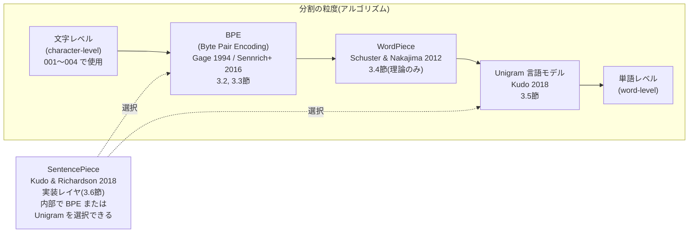
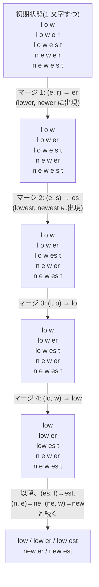
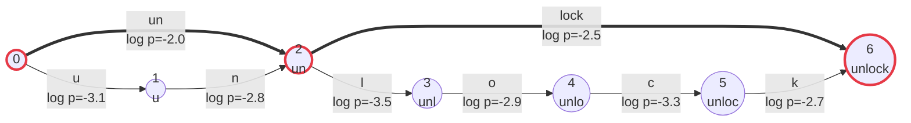

# 005. トークナイザと部分語分割

**Byte Pair Encoding・WordPiece・Unigram 言語モデル・SentencePiece — 語彙サイズと系列長のトレードオフ**
*Tokenizer and Subword Tokenization*

`theories/02_pretraining/005_tokenizer.ipynb`

## 1. 概要 / Overview

[001](https://zenn.dev/kojikojiprg/books/ai-theories-roadmap/viewer/001_attention_mechanism)〜[004](https://zenn.dev/kojikojiprg/books/ai-theories-roadmap/viewer/004_normalization_and_activation) では、条件比較を目的とした最小構成として文字レベル(character-level)の系列(`CharacterLevelTokenizer`)を前提にしてきた。しかし実際の大規模言語モデルは、文字でも単語でもなく **部分語(subword)** を入力の単位とする。本トピックでは、なぜ部分語が選ばれるのか(系列長・語彙サイズ・未知語のトレードオフ)を理論的に整理したうえで、代表的な部分語分割アルゴリズムである BPE(Byte Pair Encoding)・WordPiece・Unigram 言語モデル(Unigram Language Model)をスクラッチ実装し、アルゴリズムの一種と誤解されがちな SentencePiece の位置づけを明確にする。

英語・日本語・コードという性質の異なる 3 ドメインで語彙サイズを振った比較実験を行い、語彙サイズと圧縮効率(fertility)・系列長・計算量のトレードオフを定量的に検証する。トークナイザそのものの選定(どの方式・語彙サイズを 006 の事前学習で使うか)は本トピックでは行わず、006 で改めて選定する。

## 2. 参考論文 / References

| # | 著者 / Authors | タイトル / Title | 会議・媒体 / Venue | URL |
|---|---|---|---|---|
| [1] | Gage, P. | A New Algorithm for Data Compression | The C Users Journal, Vol. 12, Issue 2, pp. 23–38, 1994 | https://dl.acm.org/doi/10.5555/177910.177914 |
| [2] | Sennrich, R., Haddow, B., Birch, A. | Neural Machine Translation of Rare Words with Subword Units | ACL 2016 (Volume 1: Long Papers), pp. 1715–1725 | https://aclanthology.org/P16-1162/ |
| [3] | Schuster, M., Nakajima, K. | Japanese and Korean Voice Search | ICASSP 2012, pp. 5149–5152 | https://research.google/pubs/japanese-and-korean-voice-search/ |
| [4] | Kudo, T. | Subword Regularization: Improving Neural Network Translation Models with Multiple Subword Candidates | ACL 2018 (Volume 1: Long Papers), pp. 66–75 | https://aclanthology.org/P18-1007/ |
| [5] | Kudo, T., Richardson, J. | SentencePiece: A simple and language independent subword tokenizer and detokenizer for Neural Text Processing | EMNLP 2018: System Demonstrations, pp. 66–71 | https://aclanthology.org/D18-2012/ |
| [6] | Radford, A., Wu, J., Child, R., Luan, D., Amodei, D., Sutskever, I. | Language Models are Unsupervised Multitask Learners | OpenAI, 2019 | https://d4mucfpksyws.cloudfront.net/better-language-models/language-models.pdf |
| [7] | Rust, P., Pfeiffer, J., Vulić, I., Ruder, S., Gurevych, I. | How Good is Your Tokenizer? On the Monolingual Performance of Multilingual Language Models | ACL-IJCNLP 2021 (Volume 1: Long Papers), pp. 3118–3135 | https://aclanthology.org/2021.acl-long.243/ |

本文中で各理論に言及する際は、対応する番号(例:「BPE [1, 2]」)を付す。

## 3. 理論 / Theory

**表記の約束**: 本節では、テキストを構成する最小単位を **文字(character)**、分割・符号化の最終的な出力単位を **トークン(token)** または **部分語(subword)/ 部分語片(piece)** と呼ぶ。文字列 $x$ に対する分割(セグメンテーション)を $\mathbf{x} = (x_1, \ldots, x_M)$($M$ 個の部分語の列、各 $x_i$ を連結すると $x$ に戻る)と書く。

### 3.1 動機・課題 / Motivation

**文字レベルの限界**: 001〜004 では、トークナイザそのものの性能を比較対象にしないという理由から、`CharacterLevelTokenizer`による文字レベルの系列を一貫して用いてきた(004 の実装方針を参照)。しかし文字レベルには本質的な限界がある。同じ量の情報を表すのに必要な系列長 $n$ が(部分語レベルと比べて)大きくなり、001 で導出した Scaled Dot-Product Attention の計算量 $O(n^2 d_{\text{model}})$、および順伝播ネットワーク(Feed-Forward Network)の計算量 $O(n \, d_{\text{model}}^2)$([002](https://zenn.dev/kojikojiprg/books/ai-theories-roadmap/viewer/002_transformer_block))がともに $n$ に対して増加する形で効いてくる(Attention は $n$ の 2 乗)。文字レベルの系列は、この $n$ を不必要に大きくしてしまう。

**単語レベルの限界**: 逆の極端である単語(word)を単位にすると、$n$ は大きく減るが、別の問題が生じる。

- **語彙サイズの爆発**: 活用形・複合語・固有名詞などを考慮すると、単語の異なり数は非常に大きくなる(実質的に上限がない)。
- **未知語(Out-of-Vocabulary)**: 学習コーパスに出現しなかった単語は語彙に存在せず、推論時に表現できない。
- **単語境界の不在**: 日本語・中国語のように、単語の境界が表層(スペースなど)に現れない言語では、そもそも「単語に分割する」こと自体が形態素解析などの追加処理を要する、自明ではない問題になる。

**部分語という中間解**: 部分語(subword)は、頻出する単語やその一部を 1 つのトークンとして扱いつつ、未知の単語は既知の断片(最悪の場合は 1 文字ずつ)に分解して表現する。これにより、語彙サイズを有限に固定したまま、任意の文字列を(未知語なしに、あるいは実用上ごくわずかな未知語で)表現できる。$n$ は文字レベルより小さく、単語レベルよりは大きい、中間的な値になる。3.7 節で、この中間性を語彙サイズと系列長のトレードオフとして定量化する。

#### 図 1: 手法の系譜 / Taxonomy of tokenization methods

以下は、本ノートブックで扱う手法どうしの位置づけを整理した図である。文字レベルと単語レベルを両端に置き、BPE・WordPiece・Unigram 言語モデルは「どの粒度で分割するか」を決める **アルゴリズム** として横軸上に並ぶ。一方 SentencePiece は同じ横軸上のどこかに位置する 1 手法ではなく、BPE または Unigram 言語モデルを **内部アルゴリズムとして選択できる実装** であり、軸に対して直交する(3.6 節で詳述)。

### 3.2 BPE(Byte Pair Encoding) / 3.2 BPE

**起源**: BPE はもともと Gage [1] が提案した汎用データ圧縮アルゴリズムであり、「最も頻出するバイト対を、コーパスに未出現の 1 バイトに置き換える」ことを繰り返すものだった。Sennrich et al. [2] は、この「頻出する対を 1 つの新しいシンボルにまとめる」という操作を、圧縮(バイト数を減らす)ではなく **語彙構築**(頻出する部分文字列をひとまとまりのトークンにする)に転用した。これが自然言語処理における BPE の起源である。

**学習(learning)**: 学習コーパスを何らかの初期シンボル列(3.3 節で 2 通りの初期化を扱う)に変換したのち、以下を反復する。

1. 隣接するシンボル対 $(s_1, s_2)$ ごとに、コーパス全体での出現頻度 $c(s_1, s_2)$ を数える。
2. 頻度が最大の対 $(s_1^\ast, s_2^\ast) = \arg\max_{(s_1, s_2)} c(s_1, s_2)$ を選び、新しいシンボル $s_1^\ast \oplus s_2^\ast$(文字列としての連結)としてコーパス中のすべての出現箇所をマージする。
3. このマージ規則 $(s_1^\ast, s_2^\ast)$ を **学習順に** 記録する。
4. 目標の語彙サイズ $V$ に達するか、それ以上マージできる対が無くなるまで 1〜3 を繰り返す。

**タイブレーク規則**: 手順 2 で頻度が同点の対が複数存在する場合、どれを選ぶかを決めるルールを固定しなければ、同じ入力から実行のたびに異なるマージ順序が生成されうる。本ノートブックでは、対 $(s_1, s_2)$ をタプルとして辞書式順序(まず $s_1$ を文字列として比較し、等しければ $s_2$ を比較する)で比較し、頻度が同点の場合は辞書式に最小の対を選ぶ。この規則を固定することが再現性(reproducibility)の根拠になる(4 節・7 節で詳述)。

**符号化(encoding)**: 学習で得られたマージ規則の列 $(s_1^{(1)}, s_2^{(1)}), (s_1^{(2)}, s_2^{(2)}), \ldots$ を、**学習順に**(規則の番号が小さいものを優先して)新しい文字列に適用する。具体的には、現在のシンボル列に含まれる隣接対のうち、マージ規則の中で最も早く学習されたものを毎回選んで 1 回マージし、適用可能な規則がなくなるまで繰り返す。

**学習と符号化の非対称性**: 学習は「その時点で最も頻度が高い対」を毎回選び直す(データ依存・貪欲(greedy)な手続き)のに対し、符号化は学習で確定した規則列を優先順位表として使うだけであり、符号化対象のテキストにおける頻度は一切参照しない。この非対称性(学習は頻度ベース、符号化は規則の学習順ベース)を混同すると、実装を誤る(例えば符号化時にも頻度で対を選んでしまう、など)。

**アルゴリズム**: 学習は上の手順 1〜4、符号化は上の「符号化」の段落のとおりである。擬似コードは付録 A.1。

**計算量**: 素朴には、手順 5 でコーパス全体を毎回スキャンし直すと、1 回のマージあたり $O(N)$($N$: コーパスの総文字数)、目標語彙サイズ $V$ に達するまでに $O(V)$ 回のマージが必要なため、全体で $O(VN)$ になる。本実装では、各シンボル対がどのチャンクに含まれるかを追跡し(`pair_index`)、あるマージによって実際に変化したチャンクのみ差分更新することで、この毎回の全体スキャンを避けている(5 節参照)。

#### 図 2: BPE のマージ過程 / BPE merge process

小さな例(`"low", "lower", "lowest", "newer", "newest"`という 5 語からなるコーパス)で、マージによってシンボル列がどう成長するかを示す。初期状態では各語は 1 文字ずつのシンボル列であり、頻度最大の隣接対(この例では`e`と`r`の対、`newer`と`lower`に共通して出現する)から順にマージされていく。

実験1で、実際のコーパスに対してこの過程を(30 個程度のマージ規則として)観察する。

### 3.3 バイトレベル BPE(byte-level BPE) / 3.3 Byte-level BPE

3.2 節の学習・符号化アルゴリズムは、「初期シンボルを何にするか」に依存する。ここには 2 つの選択肢がある。

- **文字レベル初期化**: 学習コーパスに出現した Unicode 文字をそのまま初期シンボルにする。学習コーパスに出現しなかった文字は語彙に存在しないため、推論時にその文字を含む入力があると表現できない(未知語、Out-of-Vocabulary)。
- **バイトレベル初期化(byte-level BPE)**: GPT-2 [6] が採用した方式で、初期シンボルを Unicode 文字ではなく **UTF-8 の 256 バイト値** にする。任意の Unicode 文字列は UTF-8 バイト列として一意に表現できるため、初期語彙が「バイト値 0〜255 のすべて」を含む限り、コーパスに一度も出現しなかった文字(絵文字、稀な漢字など)であっても、必ずいずれかのバイトの組み合わせとして表現できる。これにより、**未知語が原理的に発生しなくなる**(実験3で検証する)。

**トレードオフ**: バイトレベル初期化には代償がある。ASCII 文字(英数字など)は UTF-8 で 1 バイトだが、日本語の文字の多くは UTF-8 で **3 バイト** を占める。文字レベル初期化であれば、頻出する日本語の 1 文字は最初から 1 個のシンボル(1 トークン)として扱えるのに対し、バイトレベル初期化ではその 1 文字を表すために 3 バイトのシンボルを毎回マージして 1 個のシンボルに統合し直す必要がある。このコストが実際にどれだけの語彙(マージ回数)を消費しているかは実験4で測定する。

ただしこの代償の大きさは語彙サイズに依存する点に注意が必要である。目標語彙サイズが十分に大きければ、バイトレベル初期化であってもマージによって頻出する日本語文字を 1 トークンに統合しきれる。一方、文字レベル初期化の側にも見落とされがちな制約がある。日本語のようにユニーク文字数が多い言語では、目標語彙サイズがそのユニーク文字数を下回る間、文字レベル初期化は **マージを 1 回も行えない**(初期シンボルの数だけで既に目標語彙サイズに達してしまうため)。したがって「バイトレベル BPE は日本語で UTF-8 の 3 バイト表現のコストを負う」という主張は、低語彙サイズ域で無条件に成り立つものではなく、両者がともにマージの余地を持つ比較可能な語彙サイズ域でどちらが有利かという、**語彙サイズに依存したトレードオフ** として検証する必要がある(実験4)。「バイトレベルは常に優れている」「文字レベルは常に優れている」のいずれの単純な結論も、実験4の結果次第では成り立たない可能性がある。

### 3.4 WordPiece / 3.4 WordPiece

WordPiece [3] は、Google が音声認識(日本語・韓国語の音声検索)のために提案した部分語分割アルゴリズムで、後に BERT 系列のモデルで広く使われた。学習の反復構造は BPE(3.2 節)と同じ(隣接対を反復的にマージし、目標語彙サイズに達したら終了)だが、**どの対をマージするかを選ぶ基準** が異なる。

BPE がペア $(A, B)$ の生の出現頻度をスコアとするのに対し($\mathrm{score}_{\text{BPE}}(A, B) = \mathrm{freq}(AB)$)、WordPiece は

$$
\mathrm{score}_{\text{WordPiece}}(A, B) = \frac{\mathrm{freq}(AB)}{\mathrm{freq}(A) \cdot \mathrm{freq}(B)}
$$

を用いる。これは点別相互情報量(pointwise mutual information)に類似した量であり、$A$ と $B$ それぞれの出現頻度に対して $AB$ の共起が「どれだけ偶然の水準を上回るか」を測る。単に頻出するというだけでなく、$A$ と $B$ が互いに強く結びついているペアを優先してマージする点が BPE との違いである(直感的には、コーパス中の尤度の増加分を近似する基準になっている)。

**実装方針の注記**: 本ノートブックでは、WordPiece は理論の説明にとどめ、スクラッチ実装は行わない。学習の反復構造は BPE と共通であり($\mathrm{score}$ 関数だけを差し替えれば得られる)、本トピックが重視する「BPE(構築手続き)と Unigram 言語モデル(確率モデル)の対比」(3.5 節)という観点からは、WordPiece は BPE と同じ「構築手続き」側に位置づけられる派生形であるため、実装による追加の学びが少ないと判断した。

### 3.5 Unigram 言語モデル(Unigram Language Model) / 3.5 Unigram Language Model

**BPE との本質的な違い**: BPE(および WordPiece)は「隣接対を反復的にマージする」という **構築手続き(procedure)** であり、それ自体は確率モデルではない。これに対し Unigram 言語モデル [4] は、部分語の列に対する明示的な **生成確率モデル** として定式化される。この対比 ――「BPE は手続き、Unigram 言語モデルはモデル」―― が両者の本質的な違いである。

**定式化**: 語彙 $V$ の各部分語(piece)$v \in V$ に生起確率 $p(v)$ が割り当てられているとする($\sum_{v \in V} p(v) = 1$)。文字列 $x$ の分割 $\mathbf{x} = (x_1, \ldots, x_M)$($x_i \in V$、$x_1 \oplus \cdots \oplus x_M = x$)に対して、各部分語が独立に生成されると仮定し、

$$
P(\mathbf{x}) = \prod_{i=1}^{M} p(x_i)
$$

と定義する。$M$ は分割 $\mathbf{x}$ に含まれる部分語の個数(分割によって異なりうる)。

**分割の非一意性と最尤分割**: 同じ文字列 $x$ に対して、複数の分割 $\mathbf{x}$ が存在しうる(例:`"unlock"`は`["un", "lock"]`とも`["u", "n", "lock"]`とも分割できる)。Unigram 言語モデルは、その中で $P(\mathbf{x})$ を最大化する分割(最尤分割)を採用する。

$$
\hat{\mathbf{x}} = \arg\max_{\mathbf{x} : x_1 \oplus \cdots \oplus x_M = x} P(\mathbf{x}) = \arg\max_{\mathbf{x}} \sum_{i=1}^{M} \log p(x_i)
$$

これは、文字位置を頂点、語彙に含まれる部分語を辺(重み $\log p(x_i)$)とする有向非巡回グラフ(分割格子、lattice)の上で最長経路(対数確率の和が最大の経路)を求める問題であり、**Viterbi アルゴリズム**(動的計画法)で厳密に解ける。本ノートブックでは、この Viterbi 最尤分割(`viterbi_segment`)をスクラッチ実装する。

**語彙学習(EM ベースの反復的縮小)**: 学習コーパスから、大きな候補語彙(頻出する部分文字列の集合)を初期状態として用意し、以下を反復する。

1. 現在の語彙・確率のもとで、EM アルゴリズム(期待値最大化法)により各部分語の確率 $p(v)$ を推定する(E ステップ: 各文の最尤分割、または分割の期待値を計算し、M ステップ: 部分語の出現期待頻度から確率を再推定する)。
2. 各部分語 $v$ について、$v$ を語彙から除いた場合にコーパス全体の対数尤度がどれだけ減少するか(その部分語の「効用」)を評価する。
3. 効用の低い部分語から一定割合(shrinking factor)を語彙から削減する。
4. 目標語彙サイズに達するまで 1〜3 を繰り返す。

本ノートブックでは、この語彙学習は sentencepiece に委ね(4 節・実装方針を参照)、Viterbi 最尤分割のみをスクラッチ実装する。

**Subword regularization**: Kudo [4] は、学習時に常に最尤分割(1 通り)だけを使うのではなく、$P(\mathbf{x})$ に応じて複数の分割候補を確率的にサンプリングして学習データに使う **subword regularization** を提案した。同じ単語が学習中に複数の分割で出現することが、部分語の境界の揺らぎに対するモデルの頑健性を高める一種のデータ拡張として働く。本ノートブックは分割(推論)のみを扱い、モデルの学習は行わないため、subword regularization 自体は実装しない。

#### 図 3: Unigram 言語モデルの分割格子(lattice)と Viterbi 経路

文字列`"unlock"`を例に、語彙に含まれる部分語ごとに 1 本の辺を持つ分割格子を示す。各辺の重みは対数確率 $\log p(v)$(値が大きい = 確率が高い)であり、Viterbi アルゴリズムは頂点 0(先頭)から頂点 6(末尾)までの重みの和が最大になる経路を動的計画法で求める。図中では、`["un", "lock"]`という分割(太字矢印)が`["u", "n", "lock"]`より高い対数確率の和を持ち、最尤分割として選ばれる例を示す。

太字(⇒)の経路が`["un", "lock"]`(対数確率の和 $-2.0 + (-2.5) = -4.5$)であり、細字の経路をすべて辿る`["u", "n", "lock"]`の和($-3.1 + (-2.8) + (-2.5) = -8.4$)より大きい。実験6で、この Viterbi 分割の実装が sentencepiece 自身の分割結果と一致することを検証する。

### 3.6 SentencePiece / 3.6 SentencePiece

**SentencePiece はアルゴリズムではなく実装である** [5]。3.2〜3.5 節で見た BPE や Unigram 言語モデルが「部分語をどう選ぶか」を定めるアルゴリズムであるのに対し、SentencePiece は、内部アルゴリズムとして BPE と Unigram 言語モデルの **どちらでも選択できる**、学習・符号化・復号を一貫して行うためのソフトウェア実装である。図1 で SentencePiece をアルゴリズムの系譜(横軸)に対して直交する位置に置いたのはこのためである。

SentencePiece のもう 1 つの特徴は、**生のテキストを直接扱い、事前分割(pre-tokenization)を必要としない設計** にある。3.2 節で実装する自作の BPE は、`chunk_split_mode`(空白の直前で事前分割するか、しないか)を明示的に指定する必要があり、この選択自体が言語依存の問題を引き起こす(3.7 節・実験5で検証する、日本語では空白による事前分割が機能しないという問題)。これに対し SentencePiece は、空白を含むテキストをあらかじめ単語に分割することを前提とせず、**空白そのものを語彙上のシンボルの 1 つ** として扱う。具体的には、入力テキスト中の空白文字を`▁`(U+2581、下線に似た専用の記号)に置き換えてから分割する。分割結果の部分語を単純に連結し、`▁`を空白に戻すだけで元のテキストを **完全に復元(lossless detokenization)** できる。

自作の BPE も、事前分割(3.2 節の`pretokenize`)の`whitespace`モードで空白をチャンクの先頭に保持する設計にしたことにより、符号化結果を単純に連結するだけで元のテキストを完全に復元できる(5.1 節の可逆性の検証を参照)。この点では SentencePiece の`▁`による可逆性と実質的に同じ性質を持つ(GPT-2 のバイトレベル BPE [6] も同じ「空白をチャンク先頭に含める」方式を採用している)。両者の違いは可逆性の **有無** ではなく、その **実現方法** にある。SentencePiece は`▁`という明示的な語彙記号を導入することで、事前分割の要否そのものをアルゴリズムから切り離している(利用者に`chunk_split_mode`のような選択を要求しない)のに対し、自作の BPE の可逆性は`chunk_split_mode="whitespace"`という特定の事前分割方式を選んだ場合に限られる(`chunk_split_mode="none"`は複数行にわたるテキストで改行が失われるため可逆ではない、5.1 節を参照)。

SentencePiece が事前分割の要否をアルゴリズムから切り離せるのは、そもそも事前分割の有無が圧縮効率(fertility)にどれだけ影響するかという点と無関係ではないはずである。事前分割の方式が fertility にどの程度影響するかは実験5で測定する。

### 3.7 語彙サイズと系列長のトレードオフ / Vocabulary size vs. sequence length

3.1 節で述べた通り、部分語は文字レベルと単語レベルの中間解であり、語彙サイズ $V$ の選び方によってこの中間性の度合いが変わる。本節では、このトレードオフをモデルのパラメータ数・計算量という観点から定式化する。

**埋め込み行列のパラメータ数**: トークン埋め込み(および出力の線形写像、多くの実装で重み共有される)のパラメータ数は

$$
\#\text{params}_{\text{embed}} = V \times d_{\text{model}}
$$

であり、$V$ に **比例して線形に増加** する($d_{\text{model}}$: モデルの隠れ次元、[001](https://zenn.dev/kojikojiprg/books/ai-theories-roadmap/viewer/001_attention_mechanism) の記法)。

**系列長に依存する計算量**: [001](https://zenn.dev/kojikojiprg/books/ai-theories-roadmap/viewer/001_attention_mechanism) で導出した Scaled Dot-Product Attention の計算量は系列長 $n$ に対して $O(n^2 d_{\text{model}})$、[002](https://zenn.dev/kojikojiprg/books/ai-theories-roadmap/viewer/002_transformer_block) の順伝播ネットワークの計算量は $O(n \, d_{\text{model}}^2)$ である。$V$ を大きくして 1 トークンあたりの表現力を上げる(圧縮効率を高める)ほど、同じ量の文字列を表すのに必要なトークン数 $n$ は **減少** する。

**fertility(1 文字あたりのトークン数)**: この圧縮効率を定量化する指標として、fertility を

$$
\mathrm{fertility} = \frac{N_{\text{tokens}}}{N_{\text{chars}}}
$$

と定義する(Rust et al. [7] の定義に基づく)。fertility が小さいほど、同じ文字数のテキストをより少ないトークンで表現できている。

**単語ではなく文字を分母にする理由**: Rust et al. [7] を含む多くの先行研究では、fertility を「1 単語あたりのトークン数」として定義することが多い。しかし本リポジトリは日本語(単語境界が表層に現れない言語、3.1 節)を扱うため、そもそも「単語数」を言語に依存せず一貫して数える手段がない。そこで本ノートブックでは、分母を単語数ではなく **文字数** に統一する。これにより、英語・日本語・コードという性質の異なるドメイン間でも同じ定義で比較できる。

**トレードオフの構造**: 固定量の文字列(文字数 $C$)を処理する際の系列長は $n \approx C \times \mathrm{fertility}(V)$ と書ける。$V$ を増やすと $\mathrm{fertility}(V)$ は減少する(圧縮効率が上がる)ため $n$ は減り、Attention・順伝播ネットワークの計算量は下がる。しかし埋め込み行列のパラメータ数 $V \times d_{\text{model}}$ は増え続ける。したがって、

- $V$ が小さい領域では、$V$ を増やすことで系列長由来の計算量が大きく減る一方、埋め込みパラメータの増加は緩やか(直線的)である。
- $V$ が大きい領域では、fertility の減少が鈍化する(3.2 節の圧縮効率が収穫逓減する、実験2で検証する)一方、埋め込みパラメータは増え続ける。

このため、埋め込みパラメータと系列長由来の計算量の和を最小化する $V$ が(少なくとも数値的には)存在しうる。ただし、fertility(V) の関数形はドメイン(英語・日本語・コード)によって大きく異なるため、最適点の位置もドメインに依存する。実験7で、実験2で得た実測の fertility を用いてこれを数値的に確認する。

## 4. 実装方針 / Implementation Policy

トークナイザの学習(BPE の学習など)を手段として使う場合は`tokenizers`などの既存ライブラリを活用してよいが、**本トピックはトークナイザそのものを主題とする** ため、この例外規定は適用せず、BPE の学習・符号化と Unigram 言語モデルの Viterbi 最尤分割はスクラッチ実装する。

| 機能 | 配置場所 | 実装/委譲 |
|---|---|---|
| BPE の学習(`learn_bpe`)・符号化(`BPETokenizer`)、バイトレベル初期化 | `src/data/tokenizer.py` | スクラッチ実装 |
| 事前分割(`pretokenize`、`chunk_split_mode`) | `src/data/tokenizer.py` | スクラッチ実装 |
| Unigram 言語モデルの Viterbi 最尤分割(`viterbi_segment`) | `src/data/tokenizer.py` | スクラッチ実装 |
| Unigram 言語モデルの語彙学習(EM ベースの反復的縮小)、`UnigramTokenizer`・`train_unigram_model` | `src/data/tokenizer.py` | **sentencepiece に委譲**(理由は下記) |
| WordPiece | (実装なし、3.4 節で理論のみ) | — |
| 英語・日本語・コードコーパスの取得(`load_tiny_shakespeare`・`load_japanese_corpus`・`load_code_corpus`) | `src/data/text.py` | スクラッチ実装(日本語は Wikipedia API、コードは本リポジトリ自身の`src/`) |
| fertility・未知語率・チャンク長分布・分割一致率の計算 | `src/utils/statistics.py` | スクラッチ実装 |
| 語彙サイズ×fertility 曲線、チャンク長のグループ棒グラフ、語彙サイズと計算量のトレードオフ図 | `src/utils/visualization.py` | スクラッチ実装(`plot_grouped_bar`・`plot_dual_axis_curves`を新規追加) |
| BPE と Unigram 言語モデルの分割比較・可視化 | 本ノートブック(実験セル) | ノートブック内に直接記述 |

**Unigram 言語モデルの語彙学習のみをライブラリに委ねる理由**: 3.5 節で述べた通り、語彙学習は EM アルゴリズムによる反復的なパラメータ推定と語彙削減からなる、実装がそれ自体で 1 つのトピックになりうる手続きである。本トピックが検証したいのは「Unigram 言語モデルが与えられた語彙のもとでどう分割を決めるか」(Viterbi 最尤分割というアルゴリズム)であり、「語彙をどう学習するか」ではない。そこで語彙学習は sentencepiece に委譲し、**その語彙(部分語ごとの対数確率)を受け取って最尤分割を求める部分だけをスクラッチ実装する**。この設計にはもう 1 つ利点がある。sentencepiece 自身も内部で Viterbi 最尤分割を行っており(学習した語彙で`encode`すると最尤分割が返る)、自作の`viterbi_segment`の出力と sentencepiece 自身の出力を **同一の語彙に対して** 比較できる。両者が一致すれば、それ自体が自作実装の正しさの証拠になる(実験6)。

**自作 BPE の可逆性についての注記**: 3.6 節で述べた通り、SentencePiece は空白を`▁`として扱うことで可逆な復号を実現する。本ノートブックの自作 BPE も、事前分割(`pretokenize`)の`chunk_split_mode="whitespace"`で空白をチャンクの先頭に保持する設計にしたことで、符号化結果を単純に連結するだけで元のテキストを完全に復元できる(可逆性の検証を 5.1 節に置く)。ただしこの可逆性は`chunk_split_mode="whitespace"`を選んだ場合に限られ、`chunk_split_mode="none"`は複数行にわたるテキストで改行が失われるため可逆ではない(実装上の単純化、3.2 節の`pretokenize`の docstring を参照)。

## 5. 実装 / Implementation

`src/`から必要な関数・クラスを import して使う。以下のセットアップセルは 004 までと同様、Google Colab 上でのみリポジトリを clone し、リポジトリルートをカレントディレクトリにする。

### 5.1 可逆性の検証

事前分割(`pretokenize`)の`chunk_split_mode="whitespace"`は、空白の直前で分割し空白を次のチャンクの先頭に含める(3.2 節)。この結果、`BPETokenizer.encode()`の出力トークンを連結する(`byte_level=True`の場合は`BPETokenizer.decode()`で UTF-8 バイト列からデコードし直す)と、元のテキストが過不足なく復元できるはずである。`chunk_split_mode="none"`は改行のみ保持しないため、改行を含まないテキストでは同様に復元できるが、複数行にわたるテキストでは復元できない(`pretokenize`の docstring を参照)。この性質を、`byte_level`の真偽 × `chunk_split_mode`の 2 通り、計 4 通りの組み合わせで確認する。`byte_level=True`の検証をより強くするため、UTF-8 で 1 バイトの英語のみのサンプルに加え、3 バイトの日本語・4 バイトの絵文字を含むサンプルでも同様に確認する。

### 5.2 コーパスの取得

英語(`load_tiny_shakespeare`、004 と共通)・日本語(`load_japanese_corpus`、日本語版 Wikipedia の記事本文)・コード(`load_code_corpus`、本リポジトリ自身の`src/`配下の Python ソースコード)の 3 ドメインを取得する。

**日本語コーパスの出典とライセンス**: 日本語ドメインは、フリー百科事典『ウィキペディア(Wikipedia)』日本語版(https://ja.wikipedia.org/)の記事本文を、クリエイティブ・コモンズ 表示-継承 4.0 国際(CC BY-SA 4.0)ライセンスの下で使用する。記事本文は編集され続けるため、記事タイトルだけでは実行のたびに異なる文字列になりうる。そこで`load_japanese_corpus`は、記事タイトルと **リビジョン ID(特定時点の版を指す ID)を固定した組**(`src/data/text.py`の`_JAPANESE_WIKIPEDIA_REVISIONS`)から Wikimedia API(`action=parse`、`oldid`でリビジョンを指定)を用いて取得することで、実行時点によらず同一の入力を得る(6 節・実験の再現性についての注記も参照)。取得は Wikimedia API への複数回のリクエストを伴うため、初回の実行に数分かかることがある(2 回目以降はキャッシュから読むため一瞬で終わる)。

## 6. 実験 / Experiments

以下の実験はすべて Google Colab 無料枠(CPU で十分実行できる規模。学習を伴う実験は 001〜004 と異なり GPU を必要としない)で実行可能な規模で構成する。

**再現性についての注記**: 001〜004 の実験は、学習過程に乱数(重みの初期化、ミニバッチのサンプリングなど)を含むため、複数シードでの反復によって結果の安定性を確認していた。本トピックの BPE の学習・符号化、および Unigram 言語モデルの Viterbi 最尤分割は、乱数を一切使わない **決定的(deterministic)** な処理である(3.2 節のタイブレーク規則、3.5 節の動的計画法)。したがって複数シードでの反復は行わない。

ただし、アルゴリズムが決定的であっても **入力コーパスが実行のたびに変化すれば結果は再現しない**。したがって、本トピックの再現性は入力・アルゴリズムの両面から成り立つ。

- **アルゴリズム面**: タイブレーク規則を固定していること(3.2 節: 頻度同点時は対のタプルの辞書式順序で一意に決定する)。この規則を固定しない実装では、同じ入力コーパスからでも実行のたびに異なるマージ順序が得られうる。
- **入力面**: 英語(Tiny Shakespeare、`load_tiny_shakespeare`)は固定の配布ファイルであるため不変である。日本語(`load_japanese_corpus`)は、5.2 節で述べた通りタイトルとリビジョン ID の両方を固定して取得するため、記事本文が今後編集されても本ノートブックが取得するコーパスは変わらない。**コード(本リポジトリ自身の`src/`、`load_code_corpus`)はこの 2 つとは異なり不変ではない**。`src/`は 006 以降のトピック追加のたびに拡張され、`load_code_corpus`はファイルをパスの辞書順に連結するため、新しいファイルが加わると`TRAIN_SIZE`で切り出す先頭部分の内容が将来のコミットで変化しうる。コードドメインの役割は「空白・記号が多い第 3 のドメイン」として英語・日本語との質的な対比を得ることにあり、絶対値の長期的な再現を目的としていないため、この不変性の欠如は許容する。

以上により、5 節の実装(タイブレーク規則の固定)と、英語・日本語の入力の固定(コードは上記の理由により対象外)を合わせて、本トピックの実験の大部分が決定的であるといえる。

以下、実験ごとに検証事項と判定基準を先に宣言してから実行する(004 と同じ方式)。

### 実験1: BPE のマージ過程の観察

英語コーパスの一部(数 KB)で語彙サイズ 300 程度の BPE を学習し、最初の 30 個程度のマージ規則を表示する。図2(3.2 節)で示した過程が、実際のコーパスでどのように起こるかを定性的に観察する。

**観察すること**: マージ規則の前半が高頻度の 2 文字組、後半にかけて単語・接尾辞相当のシンボルに近づく傾向が見られるか。

本実験は定性的な観察のみを目的とし、**判定基準を伴う定量的な検証は行わない**。

**観察の指針**: マージ規則の前半は、頻出する 2 文字の組(`th`、`he`、`in`など英語で頻出するバイグラム)が中心になり、後半にかけて`the`、`and`のような頻出単語全体、あるいは`ing`、`ed`のような接尾辞に相当するシンボルが現れてくるはずである。実行後、実際に得られたマージ規則を確認し、この傾向が見られたかどうかを 7 節で述べる。

### 実験2: 語彙サイズと fertility の関係

3 ドメイン(英語・日本語・コード)× 語彙サイズ $\{512, 1024, 2048, 4096, 8192\}$ でバイトレベル BPE(`byte_level=True`、`chunk_split_mode="whitespace"`)を学習し、ホールドアウト部分の fertility を測定する。

**検証すること**: 圧縮効果は語彙サイズに対して収穫逓減(diminishing returns)する。

**判定基準**: 語彙サイズを 2 倍にしたときの fertility 減少幅($\mathrm{fertility}(V) - \mathrm{fertility}(2V)$)が、掃引の全区間で単調に縮小する。

**注記**: コーパスから作れるユニークなペアが尽きると、目標語彙サイズに達する前に学習が終了することがある(3.2 節)。以下の実装では、要求した語彙サイズ(`requested`)と実際に達成した語彙サイズ(`achieved`)の両方を記録し、両者が乖離した場合はそれ自体を結果として報告する。

    

    

### 実験3: 初期語彙方式と未知語

学習コーパスに存在しない文字(絵文字、稀な漢字など)を含むホールドアウト文字列を用意し、`byte_level`の真偽で未知語率を比較する。

**検証すること**: バイトレベル初期語彙は未知語を原理的に発生させない。

**判定基準**: バイトレベルで未知語率が厳密に 0、文字レベル初期語彙で厳密に正。

### 実験4: 初期語彙方式と語彙サイズの相互作用(日本語)

3.3 節で述べた通り、日本語のユニーク文字数は目標語彙サイズ(512 や 1024 など)を上回りうる。この場合、文字レベル初期語彙は最初からその文字数だけで目標語彙サイズを超えてしまい、**マージが一切発生しない**(`achieved vocab`が学習コーパスのユニーク文字数とほぼ一致し、目標語彙サイズを上回る)。この区間でバイトレベルと文字レベルを比較すると、両者は **異なる語彙予算での比較** になり(バイトレベルは要求どおりの語彙サイズで学習される一方、文字レベルはそれより大きい実効語彙サイズで学習される)、「バイトレベルが不利なのは UTF-8 の 3 バイト表現のコストゆえか、単に語彙予算が違うからか」を分離できない。

そこで、実験2 と同じ`VOCAB_SIZES`(512, 1024, 2048, 4096, 8192)で **日本語ドメインの文字レベル BPE を掃引** し、実験2 で得た日本語のバイトレベル fertility 曲線と重ね描きする。語彙サイズを掃引することで、文字レベルの`achieved vocab`が要求値と一致し始める点(= ユニーク文字数を超え、マージが発生し始める点)を境に、比較可能な区間とそうでない区間を視覚的に区別する。

**検証すること**: バイトレベル初期語彙と文字レベル初期語彙のどちらが日本語で有利かは、語彙サイズに依存する。

**判定基準**: 語彙サイズを掃引したとき、日本語の fertility の大小関係(バイトレベル 対 文字レベル)が語彙サイズによって入れ替わる区間が存在するか。入れ替わりが観測されれば「どちらが優れているか」は語彙サイズに依存するトレードオフであり、全域で一方が有利であればその旨をそのまま報告する。

マージが発生しない区間(文字レベルの`achieved vocab`が要求語彙サイズを上回っている区間)の比較は、語彙予算・その使われ方のいずれも揃っておらず、UTF-8 の 3 バイト表現のコストの有無を分離できないため **解釈不能** である。要求語彙サイズがユニーク文字数を上回り、両者ともマージ予算を持つ比較可能な区間で初めて、トレードオフの検証として意味を持つ。**「A は B より優れている」という形ではなく、どのようなトレードオフが生じるかを説明する形で 7 節の考察を書く。**

**fertility 比較の測定上の非対称性についての注記**: fertility による比較には測定上の非対称性がある。文字レベル初期語彙は、ホールドアウトに学習コーパス未出現の文字が含まれていても、それを未知語(Out-of-Vocabulary)トークン **1 個** として出力する(実験3 参照)。一方バイトレベル初期語彙は未知語を発生させないため(実験3)、同じ文字を UTF-8 の 2〜3 バイト分のトークンで表現する。つまり文字レベルは「表現できない文字」を最も安いコストで処理していることになり、その分だけ fertility が構造的に有利に出うる。**この偏りの大きさを評価するため、以下のセルでは語彙サイズごとに文字レベルのホールドアウト未知語率も測定する**(判定基準はここまでに述べたものから変更しない)。未知語率が無視できる大きさであれば fertility の比較はそのまま解釈でき、無視できない大きさであればその分を割り引いて解釈する必要がある。

**未知語を除去した対照条件について**: 未知語率の測定だけでは、それが fertility の差にどれだけ寄与しているかは分からない。そこで、文字レベルの語彙に単一文字として含まれない文字をホールドアウトから除去した対照条件でも fertility を測定する。この条件では文字レベルは未知語を出さないため、バイトレベルとの差は未知語の扱いに起因しない、符号化効率そのものの差になる。元のホールドアウトでの差(バイトレベル − 文字レベル)が、この対照条件での差と比べて大きい場合、その差分は未知語の扱いに起因する見かけのものであることになる。**この対照比較も判定基準を変更するものではなく、判定結果を機構レベルで説明するための追加測定である。**

**語彙予算の配分についての注記**: バイトレベル初期語彙は 256 バイトから出発するため、UTF-8 で 3 バイトを占める日本語の文字を単一トークンにするには、1 文字あたり 2 回のマージを要する(3.3 節)。したがって、バイトレベルの語彙の相当部分は **文字の再構成** に費やされており、真の部分語(subword)の学習に使える予算はその分少なくなる。この予算配分を直接測定するため、以下のセルでは各語彙サイズにおけるバイトレベル語彙の文字被覆率(学習コーパスのユニーク文字のうち、単一トークンとして表現できるものの割合)と、文字の再構成に費やされたマージ回数の概算を診断量として測定する。**この診断量も判定基準の一部ではなく、判定結果を機構として説明するためのものである。**

    

    

### 実験5: 空白による事前分割のネガティブコントロール

3 ドメイン × `chunk_split_mode` $\in \{$`whitespace`, `none`$\}$(語彙サイズは 2048 に固定)で、チャンク長の分布統計と fertility を比較する。

**検証すること**: 空白による事前分割は言語依存であり、日本語では機能しない。

**判定基準**: `whitespace`時のチャンク長中央値が、日本語で英語・コードの 10 倍以上。かつ英語・コードでは事前分割の有無による fertility 差が小さい(ネガティブコントロール)。**判定基準はこの 2 点から変更しない。**

英語・コードが陰性対照(negative control)として機能していること、すなわち「事前分割の方式を変えても英語・コードの fertility はほとんど変わらない」ことを 7 節の考察で明示する。**5.1 節の修正(空白をチャンク先頭に保持する方式)により、`whitespace`モードのチャンクは空白の文字数を含むようになった。** 以前の実装(空白を破棄する方式)では`none`モードのみが空白の文字数を fertility に含めており、両モードの fertility を同じ基準で比較できていなかった。この修正により、この交絡が解消されているかどうかも合わせて確認する。

**インデントを持つコードについての注記**: 上記の修正により、`whitespace`モードのチャンクは先頭の空白を含むようになった。このため、インデントを持つコードでは、チャンク長が「単語の長さ」ではなく「インデントの深さ」を反映しうる。これは日本語の「語境界の不在」とは異なる要因でチャンク長を押し上げうるということであり、判定基準の前半(チャンク長中央値の比較)がコードで不成立になった場合、それが「事前分割がコードでも機能している(語がある程度の長さを持つ)」ことを意味するのか、単に「インデントが計上されているだけ」なのかを区別する必要がある。判定基準そのものは変えず、先頭の連続空白を除いたチャンク長中央値(`compute_chunk_length_statistics`の`_without_leading_whitespace`系のキー)を診断量として併せて測定し、この区別に使う。

なお、判定基準の前半(チャンク長中央値の比較)と後半(事前分割の有無による fertility 差)は独立した測定である。前半が不成立でも後半(陰性対照としての実質的な機能)が成立していることはありうるため、7 節では **両者を分けて評価する**。

**陰性対照としての証拠力についての注記**: 判定基準の後半は「英語・コードの fertility 差が小さいこと」しか要求していない。しかし陰性対照(negative control)が証拠として機能するためには、対照群(英語・コード)で効果が出ず、処理群(日本語)で効果が出るという **対比** が必要である。日本語の fertility 差が英語・コードと同程度の大きさであれば、この測定は「事前分割の言語依存性」について何の証拠力も持たない(判定基準は形式的に満たされていても、対比が存在しないため)。7 節ではこの対比が実際に成立しているかどうかを評価する。

日本語には空白がほとんどないため、`whitespace`モードは実質的に改行でしか分割されず、`none`モードとほぼ同一の動作になる。この意味で、日本語の fertility 差が小さいことは(仮にそうなったとしても)測定結果というより、この構成上の帰結である可能性がある。

**コードコーパスの非不変性についての注記**: 6 節で述べた通り、コード(`load_code_corpus`)は本コミット時点のリポジトリ内容に依存し、将来のコミットで`src/`が拡張されると内容が変化しうる。判定基準の前半はコードのチャンク長中央値に依存するため、**`src/`の内容が変われば判定が変わりうる**。

    

    

### 実験6: スクラッチ Viterbi 分割の検証と BPE との比較

1. 日本語・英語の数十文について、`viterbi_segment`による分割が sentencepiece 自身の分割と完全一致することを確認する。
2. 同一コーパス・同一語彙サイズで BPE と Unigram 言語モデルの分割を比較し、一致率を測る。
3. 不一致箇所の具体例をいくつか表示し、定性的な傾向を読み取る。

**検証すること**: Unigram 言語モデルは BPE と体系的に異なる分割を与える。

**判定基準**: トークン境界の Jaccard 係数(`compute_segmentation_agreement_rate`)の平均が 1.0 未満であり、かつ一致率が低い文に定性的な傾向(どのような箇所で分割が分かれるか)が読み取れる。

**なぜ完全一致率ではなく境界の Jaccard 係数か**: 5.1 節の修正により、自作 BPE(`chunk_split_mode="whitespace"`)も SentencePiece と同様に空白を保持した可逆な符号化になった。したがって両者の符号化の慣習の違いは、もはや「空白を保持するかどうか」ではなく、**空白をどう表現するか**(SentencePiece は`▁`という専用記号に置き換える、自作 BPE は半角空白のまま扱う)という表層形の違いだけになる。この違いだけでも、文単位の完全一致(`compute_exact_match_rate`)を使うと、分割の大部分が同じ位置で切れていても表層形の流儀の違いだけで一致率が 0 に張り付いてしまい、一致の度合いを測れない。境界位置集合の Jaccard 係数を使うことで、部分的な一致の度合いを連続値として評価する。

**語彙サイズについての注記**: sentencepiece の Unigram 言語モデル学習は、語彙サイズが学習コーパスの文字種数(日本語)や、コーパスから抽出できる候補部分文字列数の上限(英語)を外れるとエラーになる。両ドメインで学習可能な語彙サイズとして 2048 を用いる(実験2・実験5と共通)。

**BPE との比較における`byte_level`についての注記**: 実験6-2 で BPE と Unigram 言語モデルを比較する際は、BPE を`byte_level=False`(文字レベル初期語彙)で学習し直す。バイトレベル BPE の部分語は UTF-8 バイトの表現であり、sentencepiece の Unicode 部分語とは構成上表層形が一致しえないため、同一の表現形式(Unicode 文字)で比較する必要がある。

**Viterbi 分割の文字カバレッジについての注記**: sentencepiece は既定で`character_coverage`を 100% 未満(まれな文字を除外)に設定するため、学習語彙が 1 文字も持たない文字を含む文はそもそも分割できない(自作の`viterbi_segment`は未知語へのフォールバックを持たない、3.5 節)。この検証では、学習語彙が単一文字として持つ文字のみからなるホールドアウト文を対象に選ぶ。

**不一致が生じた場合の注記**: 上記セルで不一致件数が 0 でない場合、原因として (a) `character_coverage`により一部の文字が語彙から除外されている、(b) sentencepiece 内部の Viterbi 実装が数値誤差や同点処理で自作実装と異なる経路を選んでいる、のいずれかが考えられる。実行結果を見て、実際にどちらであったかを 7 節で報告する(不一致を考察でごまかさない)。

### 実験7: 語彙サイズと計算量のトレードオフ(理論計算)

実験2で得た fertility から、固定の文字数を処理する際の系列長 $n$ を各語彙サイズについて求め、$d_{\text{model}}$ を固定した仮想的なモデルについて、埋め込み行列のパラメータ数 $V \times d_{\text{model}}$、Attention の演算量 $O(n^2 d_{\text{model}})$、順伝播ネットワークの演算量 $O(n \, d_{\text{model}}^2)$ を算出する(3.7 節)。

**これは実測(実際の実行時間の計測)ではなく、理論式による計算である。** 以下のセルは fertility という実測値を入力に使うが、算出する量そのものは実行時間の計測結果ではない。3 ドメインそれぞれで、埋め込みパラメータ数の増加曲線と系列長由来の演算量の減少曲線がどのあたりで交差するか(相対的な大小関係がどう変わるか)を確認する。

    === English ===
      V=  512  n=   458600  embed_params=    393,216  attn_flops=1.615e+14  ffn_flops=2.705e+11
      V= 1024  n=   341467  embed_params=    786,432  attn_flops=8.955e+13  ffn_flops=2.014e+11
      V= 2048  n=   284667  embed_params=  1,572,864  attn_flops=6.223e+13  ffn_flops=1.679e+11
      V= 4096  n=   263067  embed_params=  3,145,728  attn_flops=5.315e+13  ffn_flops=1.552e+11
      V= 8192  n=   250333  embed_params=  5,033,472  attn_flops=4.813e+13  ffn_flops=1.477e+11
    === Japanese ===
      V=  512  n=  1406867  embed_params=    393,216  attn_flops=1.520e+15  ffn_flops=8.298e+11
      V= 1024  n=  1035200  embed_params=    786,432  attn_flops=8.230e+14  ffn_flops=6.106e+11
      V= 2048  n=   850667  embed_params=  1,572,864  attn_flops=5.558e+14  ffn_flops=5.017e+11
      V= 4096  n=   727467  embed_params=  3,145,728  attn_flops=4.064e+14  ffn_flops=4.291e+11
      V= 8192  n=   668200  embed_params=  6,291,456  attn_flops=3.429e+14  ffn_flops=3.941e+11
    === Code ===
      V=  512  n=   621267  embed_params=    393,216  attn_flops=2.964e+14  ffn_flops=3.664e+11
      V= 1024  n=   452400  embed_params=    786,432  attn_flops=1.572e+14  ffn_flops=2.668e+11
      V= 2048  n=   345200  embed_params=  1,572,864  attn_flops=9.152e+13  ffn_flops=2.036e+11
      V= 4096  n=   293667  embed_params=  3,145,728  attn_flops=6.623e+13  ffn_flops=1.732e+11
      V= 8192  n=   272333  embed_params=  6,291,456  attn_flops=5.696e+13  ffn_flops=1.606e+11

    

    

    

    

    

    

## 7. 結果・考察 / Results and Discussion

実行環境と実行時間についての注記は付録 B。

6 節(セル24)で述べた通り、本トピックの BPE の学習・符号化、および Unigram 言語モデルの Viterbi 最尤分割は乱数を一切使わない決定的(deterministic)な処理であり、英語・日本語コーパスも固定されている。したがって以下の各実験は単一回の実行で結果が確定し、複数シードでの反復検証は行っていない。

**事前宣言した結論と事後的な解釈の区別についての注記**: 以下では、**実験ごとに事前宣言した判定基準による結論** と、**データを見た後に得られた事後的な解釈**(例: 実験5 の「事後的な観察」)を、見出しまたは段落として明確に分けて記述する。後者を前者に格上げしない(事後的な解釈を、あたかも事前に検証を計画していたかのような書き方にしない)。

### 実験1(BPE のマージ過程)

英語コーパスの一部(5,000 文字)で語彙サイズ 300 の BPE を学習したところ、達成語彙サイズは 300、マージ規則の総数は 247 であった(セル26)。最初の 30 個のマージ規則を見ると、序盤(1〜9 番目)はほぼすべて 2 文字の組(`' '`+`'t'`、`'h'`+`'e'`、`'o'`+`'u'`、`'i'`+`'t'`、`'e'`+`'n'`など)であり、その多くが空白 1 文字と英字 1 文字の組(` t`、` a`、` w`、` m`、` s`、` c`、` b`、` y`、` C`、` f`、` p`)である。これは、5.1 節で採用した「空白をチャンクの先頭に保持する」事前分割の設計が、実際のマージ規則にそのまま反映されていることを示す具体例である。もし空白を破棄する事前分割であれば、これらの「空白+1 文字」というマージ規則自体が現れない。

10 番目のマージ規則で` t`+`he`→` the`が生成され、22 番目で` y`+`ou`→` you`が生成されている。これらは単語全体(しかも先頭の空白を含んだ単語全体)に相当するシンボルであり、英語で最も頻度の高い機能語(the、you)が比較的早い段階(30 個中の 10 番目・22 番目)で 1 トークンとして統合されることを示している。29 番目には`it`+`i`→`iti`という、単語の部分的な断片(例えば`Citizen`のような語の一部)に相当するシンボルも現れている。以上より、**観察の指針**(セル27)で述べた「前半は高頻度の 2 文字組、後半にかけて単語・接尾辞相当のシンボルに近づく」という傾向は、この最初の 30 個の範囲内でも実際に観察された(ただし全 247 個のうち最初の 30 個のみを対象とした観察であり、接尾辞(`ing`、`ed`など)に相当するシンボルは この範囲では確認されなかった)。

### 実験2(語彙サイズと fertility の関係)

3 ドメイン(英語・日本語・コード)× 語彙サイズ$\{512, 1024, 2048, 4096, 8192\}$でバイトレベル BPE を学習し、ホールドアウトの fertility を測定した(セル29、合計実行時間 255.2 秒。単一試行の計測であり、Colab 無料枠で実行可能な規模であることの目安として付記する)。

**判定基準(語彙サイズを 2 倍にしたときの fertility 減少幅が全区間で単調に縮小するか)は、3 ドメインすべてで満たされた**(セル31)。

- 英語: fertility は 0.4586 → 0.3415 → 0.2847 → 0.2631 → 0.2503、減少幅は 0.1171 → 0.0568 → 0.0216 → 0.0127 で単調に縮小。
- 日本語: fertility は 1.4069 → 1.0352 → 0.8507 → 0.7275 → 0.6682、減少幅は 0.3717 → 0.1845 → 0.1232 → 0.0593 で単調に縮小。
- コード: fertility は 0.6213 → 0.4524 → 0.3452 → 0.2937 → 0.2723、減少幅は 0.1689 → 0.1072 → 0.0515 → 0.0213 で単調に縮小。

3 ドメインとも収穫逓減の傾向が確認され、語彙サイズがある程度大きくなると追加の語彙が生む圧縮効果は小さくなっていく。

**英語ドメインでは、語彙サイズ 8192 の要求に対して`achieved`が 6554 にとどまった。** 学習コーパス(60,000 文字)から作れるユニークな隣接シンボル対が尽きたため、要求語彙サイズに到達する前に学習が終了したことによる(3.2 節で述べた既知の挙動)。したがって上記の英語の fertility 曲線の最後の区間(4096 → 8192)は、実際には語彙サイズ 4096 → 6554 への変化を表しており、他の 2 ドメイン(要求どおり 8192 に到達)とは横軸の意味が異なる点に注意が必要である。

3 ドメインの fertility の絶対水準を比較すると、**英語が常に最も圧縮しやすく(fertility が最小)、日本語が常に最も圧縮しにくい(fertility が最大)、コードはその中間** という順序が全ての語彙サイズで一貫している。例えば語彙サイズ 512 では英語 0.4586・コード 0.6213・日本語 1.4069(日本語は英語の約 3.1 倍)、語彙サイズ 8192(日本語・コードは要求どおり、英語は実効値 6554)では英語 0.2503・コード 0.2723・日本語 0.6682(日本語は英語の約 2.7 倍)であり、語彙サイズを増やしても日本語の不利は解消しきらない。

### 実験3(初期語彙方式と未知語)

学習コーパス(日本語)に一切出現しない文字(絵文字 4 文字・稀な漢字 11 文字の合計 15 文字。候補プールに含めた 15 文字すべてが学習コーパスに未出現であることが動的に確認された)を含む文字列で、`byte_level`の真偽による未知語率を比較した(セル33)。

**判定基準(バイトレベルで未知語率が厳密に 0、文字レベルで厳密に正)は満たされた**: バイトレベル初期語彙の未知語率は 0.000(60 トークン全てが既知)、文字レベル初期語彙の未知語率は 0.536 であった。文字レベルのトークン列の先頭を見ると、`'これは'`の後に未知の文字 1 個につき`<unk>`トークンが 1 個ずつ出力されており(`['これは', '<unk>', '<unk>', ...]`)、未知語をまとめて 1 トークンにするのではなく、文字ごとに個別の`<unk>`として扱っていることが分かる。バイトレベル初期語彙が未知語を原理的に発生させないという 3.3 節の主張が、この実行結果によって直接裏付けられた。

### 実験4(初期語彙方式と語彙サイズの相互作用、日本語)

**比較可能な区間の特定**: 文字レベルの`achieved vocab`は、要求語彙サイズ 512・1024 ではいずれも 1715(= 学習コーパスのユニーク文字数)にとどまり、要求語彙サイズを上回った(マージが 1 回も発生しない、比較不能な区間)。要求語彙サイズ 2048・4096・8192 ではいずれも`achieved`が要求値と一致し、マージが発生する比較可能な区間となった(セル37)。以下の記述のうち、fertility の大小関係についての結論は、この比較可能な区間(2048・4096・8192)を中心に評価し、512・1024 は参考値として区別する。

**大小関係と入れ替わりの有無**: 比較可能な区間を含む全 5 点で、バイトレベルの fertility が文字レベルの fertility を常に上回った(`byte > char`が`[True, True, True, True, True]`)。**入れ替わりは観測されず、テストした範囲内では文字レベルが一貫して有利であった。**「どちらが優れているかは語彙サイズに依存する」という当初の仮説的な検証事項に対しては、少なくとも本ノートブックが検証した語彙サイズの範囲内では否定的な結果(常に文字レベルが有利)であったことを、結論を曲げずに報告する。

**未知語除去の対照条件による寄与の分離**: 未知語(ホールドアウト中で文字レベルの語彙に単一文字として含まれない文字)は、全語彙サイズで一貫して延べ 262 文字(ホールドアウト中での出現回数の合計であり、異なる文字の種類数ではない)であった(除去された出現回数が語彙サイズによらず完全に一定)。この対照条件下での byte-char 差(未知語の扱いに起因しない、符号化効率そのものの差)は、512: 0.3862(char fertility 比 38.6%)、1024: 0.0137(1.4%)、2048: 0.0153(1.9%)、4096: 0.0360(5.4%)、8192: 0.0218(3.5%)であった。元の差(未知語込み)からこの対照条件下の差を差し引いた「未知語の扱いに起因する見かけの寄与」は、512: 0.0207(元の差の 5.1%)、1024: 0.0215(61.1%)、2048: 0.0187(55.1%)、4096: 0.0172(32.4%)、8192: 0.0172(44.1%)であり、**絶対値としてはおよそ 0.017〜0.022 という狭い範囲に収まっている**(1024 から 8192 にかけて緩やかに減少する傾向はあるが、512 も含めて同じ帯域に収まる)。これは、宣言セル(セル34)で事前に述べた機構、すなわち「ホールドアウト中の未知語の絶対数がほぼ一定であり、文字レベルはそれを常に 1 トークンで処理している」ことと整合しており、除去された出現回数が厳密に延べ 262 文字で一定であったという直接の測定によって独立に裏付けられた。

**未知語除去後も残る差について**: 未知語を除去した対照条件でも差は全語彙サイズで正であった。したがって、**「文字レベルの優位は未知語の扱いだけでは説明されない」と言える。ただし主張できるのはそこまでであり**、元の差の大きさそのものは、比較可能な区間(2048・4096・8192)で見ても未知語の扱いに起因する見かけの寄与が 32.4%〜55.1%を占めており、**過大である** ことを明記する。

**語彙サイズに対する差の単調性**: 元の差(0.4069, 0.0352, 0.0340, 0.0533, 0.0391)、未知語除去後の差(0.3862, 0.0137, 0.0153, 0.0360, 0.0218)のいずれも語彙サイズに対して単調に変化していない(いったん縮小したのち拡大し、再び縮小する)。BPE の学習・符号化は決定的であるため、これはノイズではなく構造的な現象である。**語彙サイズを上げれば単調に差が縮むわけではない。**

**文字被覆率と予算配分**: バイトレベル語彙の文字被覆率(学習コーパスのユニーク文字のうち単一トークンとして表現できる割合)は、512: 11.0%(188/1715)、1024: 25.5%(438/1715)、2048: 44.5%(764/1715)、4096: 59.8%(1026/1715)、8192: 72.2%(1239/1715)であり、**テスト範囲(512〜8192)内では 1.0 に到達しなかった。** 3.3 節では「目標語彙サイズが十分に大きければ、バイトレベル初期化であってもマージによって頻出する日本語文字を 1 トークンに統合しきれる」と述べたが、これは理論上の主張であり、本ノートブックが検証した語彙サイズの範囲内では、その統合は完了していない。この結果は、日本語のように文字種の多い言語では、文字の再構成コストを解消するために本ノートブックで試した範囲より大きい語彙サイズ(例: GPT-2 が採用する 50,257 [6])が実際には必要になることを示唆している。

総マージ回数に占める文字再構成の推定割合(概算。非 ASCII 被覆文字数 × 2 マージという近似に基づく)は、512: 92.2%、1024: 95.8%、2048: 77.5%、4096: 49.8%、8192: 29.5%であった。この割合は 512 → 1024 では増加し、1024 以降は単調に減少するという推移を示した。**この予算配分の非単調でない推移(1024 以降の単調減少)は、fertility 差の非単調な推移と単純な 1 対 1 の対応を持たない**(例えば未知語除去後の差は 1024 で最小、4096 で最大となるが、文字再構成の割合は 1024 から 8192 にかけて単調に減少し続けている)。したがって、**この予算配分の観点から fertility 差の非単調性を機構として説明することはできなかった**。ただし、文字被覆率・予算配分の測定はそれ自体が診断量として意味を持ち(実際にバイトレベルが語彙予算の相当部分を文字の再構成に費やしていることを直接示している)、fertility 差の非単調性を完全に説明できないことは、実験4 の主結論(未知語除去後も文字レベルが有利であること、その優位の一部は語彙予算の使われ方の違いに起因すると推測されること)を損なうものではない。

対照として、文字レベル初期語彙の文字被覆率は全語彙サイズで 100.0%(1715/1715)であった。この文字再構成のコストはバイトレベル初期語彙に固有のものである。

**文字レベルの非可逆性というコスト**: 一方で、文字レベル初期語彙は最大の語彙サイズ(8192)でもホールドアウトの 2.78%を未知語として失っている(未知語率は 512: 1.75%、1024: 1.75%、2048: 2.14%、4096: 2.59%、8192: 2.78%と、語彙サイズが大きくなるにつれてわずかに上昇する。これは未知語となる文字の出現回数自体(延べ 262 文字)は一定でも、他の部分の圧縮が進むことでホールドアウト全体のトークン数が減り、一定数の未知語トークンが相対的に大きな割合を占めるようになるためと考えられる)。fertility の優劣とは独立に、この非可逆性そのものが実用上のコストである。

**以上をまとめると、本実験の結果は「圧縮効率」(文字レベルが本ノートブックの検証範囲では一貫して有利)と「未知語を出さないこと」(バイトレベルが原理的に優位、実験3 参照)のトレードオフとして理解すべきであり、どちらか一方が単純に優れているとは言えない。** 語彙サイズと対象言語の文字分布に依存するトレードオフとして結論づける。

### 実験5(空白による事前分割のネガティブコントロール)

#### 前半(チャンク長中央値)— 事前宣言した判定基準

`whitespace`モードのチャンク長中央値は、日本語 52.0、英語 5.0、コード 8.0 であった(セル39・セル40)。判定式に代入すると、日本語 対 英語: $52.0 \ge 5.0 \times 10 (=50.0) \to$ **True**、日本語 対 コード: $52.0 \ge 8.0 \times 10 (=80.0) \to$ **False** であった。**判定基準は英語との比較では成立したが、コードとの比較では不成立であり、前半全体としては判定基準を満たさなかった。結論を曲げずにそのまま報告する。**

英語との比較についても、閾値(50.0)からの余裕は $52.0 - 50.0 = 2.0$(閾値比 4%)しかなく、余裕は小さい。したがって「日本語のチャンク長中央値が英語の 10 倍以上」という判定は、閾値の設定次第で結果が変わりうる位置にあり、頑健な主張とは言えない。頑健に言えるのは、日本語(52.0)と英語(5.0)のチャンク長中央値の **桁が異なる** という点である。

コードとの比較が不成立であった原因を、先頭空白を除いたチャンク長中央値(セル40)と対比して調べると、コードは先頭空白を含む中央値 8.0 に対し除いた中央値は 5.0(差 3.0)であり、日本語は先頭空白を含む中央値 52.0 に対し除いた中央値は 50.0(差 2.0)であった。**先頭空白を除いた値どうしで判定式を計算し直すと、$50.0 \ge 5.0 \times 10 (=50.0) \to$ True(等号で成立)となる**(判定基準そのものは変更しない。あくまで診断としての言及である)。この結果は、コードのチャンク長中央値が実際の語の長さよりも先頭空白(インデント)の計上によって押し上げられていたこと、日本語のチャンク長中央値は先頭空白の寄与がわずか(52.0 → 50.0)であり、その大きさの主因が語境界の不在にあることを示唆している。ただし境界ちょうどの等号成立であり、これも頑健な成立とは言えない。

なお、コードのチャンク長中央値は本コミット時点の`src/`の内容(6 節)に依存する。将来`src/`が拡張されると、この判定は変わりうる(下記の事後的な観察も参照)。

#### 後半(fertility 差)— 事前宣言した判定基準

事前分割の有無(`whitespace`対`none`)による fertility 差は、英語 0.0134(相対差 4.7%)、日本語 0.0209(相対差 2.5%)、コード 0.0251(相対差 7.3%)であった(セル40)。いずれも絶対値・相対値ともに小さく、単独で見れば「英語・コードでは事前分割の有無による fertility 差が小さい」という判定基準の文言自体は形式的に満たされていると言える。

**しかし、日本語の差(相対 2.5%)を対照群(英語 4.7%、コード 7.3%)と比較すると、日本語の差は対照群のいずれよりも小さい。** 陰性対照(negative control)が証拠として機能するには、対照群(英語・コード)で効果が出ず、処理群(日本語)で効果が出るという対比が必要であるが、本実行の結果はこの対比とは **逆** であった(処理群である日本語の差が最小)。**したがって、判定基準の文言は形式的に満たされているものの、当初想定した対比による証拠力は持たない。**「陰性対照として機能した」とは言えない。

なお、5.1 節の修正(空白をチャンク先頭に保持する方式)により`whitespace`モードの fertility が空白の文字数を反映するようになったことで、以前の実装(空白を破棄する方式、両モードの fertility を同じ基準で比較できなかった)にあった交絡は解消されている。本実行で観測された 3 ドメインいずれも一桁パーセント台の相対差という結果は、この交絡が解消された状態での測定である。

#### 事後的な観察(事前宣言した検証ではないことを明示する)

以下は、上記の事前宣言した判定基準による検証ではなく、実行結果を見た後に気づいた観察である。別のコーパス・別の言語対で改めて確認する余地があり、検証済みの結論として扱わない。

**fertility 差の符号に着目すると、3 ドメインの符号は一致していない。** `whitespace`モードと`none`モードの fertility を比較すると、英語は`whitespace`の方が小さい($0.2847 < 0.2981$、事前分割が圧縮効率を改善)、日本語とコードはいずれも`none`の方が小さい($0.8507 > 0.8298$、$0.3452 > 0.3201$、事前分割が圧縮効率を悪化させている)。**すなわち符号は「英語」対「日本語・コード」で分かれる。**

この符号の分かれ方は、空白による事前分割が、空白が語境界と一致する言語(英語)では圧縮効率を改善し、そうでない場合(日本語・コード)はマージの自由度を制約するだけで圧縮効率を悪化させうる、という解釈と整合する。コードにおける空白は、インデントという構造的要素であって語を区切るものではなく、この点で日本語(語境界を示す空白がほとんどない)と同じ側に分類されたと考えられる。

**差の大きさそのものはいずれも小さい(1 桁パーセント台)にもかかわらず、符号は 3 ドメインを「英語」対「日本語・コード」に明確に区別できた。** これは、事前宣言した判定基準(差の大きさのみを参照)が捉えられなかった情報が、符号に含まれていたことを意味する。**繰り返すが、これは事後的な解釈であり、事前宣言した判定基準による検証ではない。**

`none`モードのチャンク長は改行のみで分割した結果(= 1 行の長さ)であり、事前分割の言語依存性そのものとは別の量(コーパスの改行の入れ方)を測っていることに注意する。

コードコーパスは本リポジトリ自身の`src/`に依存するため不変ではなく、実際に`src/`の拡張で fertility 差が変化した例を付録 B.3 に記す。

### 実験6(Viterbi 分割の検証・BPE との比較)

#### 実装の妥当性検証(判定基準の対象外)

実験6 の手順1(Viterbi 分割と sentencepiece 自身の分割の一致確認)は、判定基準の対象ではなく、自作の`viterbi_segment`(動的計画法による最尤分割)の実装が正しく動作していることを確認するための妥当性検証である。英語・日本語のいずれも一致率 1.000(不一致件数 0)であった(セル44、英語は候補 485 文中カバー 477 文から 30 文、日本語は候補 313 文中カバー 199 文から 30 文を対象とした)。**完全一致は狙いどおりの結果であり、スクラッチ実装の正しさを直接裏付けるものである。** 不一致が 0 件であったため、セル45 の注記が挙げる 2 つの想定原因((a)`character_coverage`による文字の除外、(b) sentencepiece 内部の Viterbi 実装との経路の違い)はいずれも該当しなかった。

#### 判定基準の評価

**BPE と Unigram 言語モデルのトークン境界 Jaccard 係数** は、英語で平均 0.602(最小 0.000、最大 1.000、n=30)、日本語で平均 0.820(最小 0.000、最大 1.000、n=30)であった(セル46)。**判定基準(トークン境界 Jaccard 係数の平均が 1.0 未満であり、かつ一致率が低い文に定性的な傾向が読み取れる)は満たされた。** 平均値はいずれも 1.0 未満であり、平均値自体は 0.0 にも 1.0 にも張り付いていない。ただし個々の文では最小値 0.000・最大値 1.000 に達しているものがあり、これは以下で述べる短文サンプルの影響が大きい。

係数が低い文の具体例(セル47)を見ると、英語では`'CORIOLANUS:'`(Jaccard 係数 0.000、BPE は`['C', 'O', 'RIOLAN', 'US:']`と細分化するのに対し、Unigram 言語モデルは`['CORIOLANUS', ':']`と固有名詞をひとまとまりに扱う)、`'appear,'`(0.333、BPE`['a', 'pp', 'ear', ',']`対 Unigram`['appear', ',']`)、`"man's voice."`(0.333、所有格アポストロフィと文末句読点の扱いが異なる)が挙がった。日本語では`'地理'`(0.000、BPE`['地', '理']`対 Unigram`['地理']`)、`'気候'`(0.000、逆に BPE`['気候']`対 Unigram`['気', '候']`とまとまりの向きが入れ替わる)、`'自治体'`(0.000、BPE`['自治', '体']`対 Unigram`['自治体']`)、`'自然公園'`(0.667、BPE は文字単位まで細分化`['自', '然', '公', '園']`)が挙がった。定性的な傾向として、**BPE は頻度に基づく局所的なマージを積み重ねるため、低頻度の固有名詞や複合語をより細かく分割しがちな一方、Unigram 言語モデルは文全体の尤度を最大化する分割を選ぶため、頻度が低くても意味的なまとまりを 1 トークンに保つ傾向がある**(ただし`'気候'`の例のように逆方向の食い違いも観測された)。

#### 検証文の選び方の限界

英語の低一致率の上位には`'CORIOLANUS:'`が 2 回(30 文中に同一の短い文字列が重複して含まれる)登場している。これは、ホールドアウトを改行のみで区切った`candidates`が、シェイクスピア戯曲のト書き形式における話者名の見出し行を「文」として扱っていることによる。日本語側の低一致率の上位(`地理`、`気候`、`自治体`、`自然公園`)も、いずれも 2〜4 文字の短い名詞句であり、Wikipedia 記事の見出し行(節タイトル)である可能性が高い。このような 2〜4 トークン程度の短い文字列では、Jaccard 係数が取りうる値自体が 0.000、0.333、0.5、0.667、1.000 のような粗い離散値に限られ、平均値がこれらの短文の一致・不一致に大きく左右される。改行区切りの`candidates`から、極端に短い候補(例えば一定の文字数・トークン数未満)を除外して見出し行を除く、といった改善の余地が今後の課題として残る。また、トークン境界 Jaccard 係数の平均は英語 0.602 に対し日本語 0.820 と高いが、これをドメイン間の優劣(日本語のほうが BPE と Unigram 言語モデルの分割が近い)として読むべきではない。日本語の検証文は`地理`・`気候`のような 2〜4 文字の短い見出し行に偏っており、トークン境界の総数自体が少ないため、Jaccard 係数が高く出やすい可能性がある。ドメイン間で平均値を比較するには、文長の分布を揃えた検証文の選び方が必要であり、これも今後の課題として残る。

### 実験7(語彙サイズと計算量のトレードオフ)

以下は理論式による計算であり、実測(実行時間の計測)ではない(セル49)。仮想的な$d_{\text{model}}=768$、処理対象の文字数$C=1{,}000{,}000$を固定し、実験2 の fertility から系列長$n$を求め、埋め込みパラメータ数$V \times d_{\text{model}}$、Attention の演算量$O(n^2 d_{\text{model}})$、順伝播ネットワークの演算量$O(n \, d_{\text{model}}^2)$を算出した。

**英語の語彙サイズ 8192 の行は、実験2 で実際に達成された実効語彙サイズ(6554)に基づいて計算されている**(埋め込みパラメータ数 5,033,472 = 6554 × 768 であり、8192 × 768 = 6,291,456 ではない)。これに対し日本語・コードは要求どおり 8192 に到達しているため、8192 × 768 = 6,291,456 となっている。したがって英語の埋め込みパラメータ数の増加率(512 → 8192 で 393,216 → 5,033,472、約 12.8 倍)は、日本語・コード(いずれも約 16.0 倍)より小さく、この違いは英語の圧縮効率が優れていることの反映というより、学習コーパスのユニークペア枯渇という別の要因を含んでいる点に注意が必要である。

演算量の減少幅は、Attention の演算量($O(n^2)$)で見ると、語彙サイズ 512 → 8192 で英語は 1.615e+14 → 4.813e+13(約 3.4 倍の減少)、日本語は 1.520e+15 → 3.429e+14(約 4.4 倍の減少)、コードは 2.964e+14 → 5.696e+13(約 5.2 倍の減少)であった。英語の減少幅が 3 ドメイン中で最も小さいのは、実験2 で観測した fertility の減少幅がすでに小さくなっている(収穫逓減が進んでいる)ことに対応する。

3 ドメインの絶対水準を比較すると、**日本語は全ての語彙サイズで Attention・順伝播ネットワークいずれの演算量も 3 ドメイン中最大** であった(例えば語彙サイズ 8192 で Attention 演算量は英語の約 7.1 倍、コードの約 6.0 倍)。これは実験2 で観測した日本語の fertility の高さ(圧縮効率の低さ)がそのまま学習・推論の計算コストに跳ね返ることを直接示す結果であり、埋め込みパラメータ数の増加(語彙サイズに比例)と演算量の減少(fertility の 2 乗に比例して減少)という 2 つの効果の相対的な大小関係が、ドメインごとの圧縮効率の違いによって明確に異なることを示している。

### 006 への接続

本ノートブックでは、BPE・Unigram 言語モデルという 2 つの部分語分割アルゴリズムと、語彙サイズが圧縮効率・系列長・計算量に与える影響を比較したが、**どの方式・どの語彙サイズを採用するかの選定は行っていない**。006 の小型 GPT の事前学習では、本トピックで得た以下の知見を踏まえてトークナイザを改めて選定する。

- **fertility のドメイン依存性**: 日本語は英語の約 2.7〜3.1 倍の fertility であり、圧縮効率が一貫して最も低い(実験2)。
- **語彙サイズと計算量のトレードオフ**: 埋め込みパラメータ数は語彙サイズに線形に増加する一方、演算量は fertility の低下(2 乗)を通じて非線形に減少し、この関係はドメインによって速さが異なる。日本語は絶対的な計算コストが常に最大である(実験7)。
- **初期語彙方式のトレードオフ**: 文字レベルは本ノートブックの検証範囲で圧縮効率(fertility)が一貫して有利だが、原理的に未知語を発生させうる。バイトレベルは未知語を原理的に発生させないが、日本語のような文字種の多い言語では語彙予算の相当割合(テスト範囲内で最大 95.8%)を文字の再構成に費やす(実験3・実験4)。
- **事前分割(pre-tokenization)の効果は言語・ドメインに依存する**: 差の大きさで見ると 3 ドメインとも小さいが、符号(圧縮効率を改善するか悪化させるかの向き)は英語と日本語・コードで分かれた(実験5 の事後的な観察)。「事前分割は常に有効」という前提は置けない。
- **BPE と Unigram 言語モデルは体系的に異なる分割を与えうる**(トークン境界 Jaccard 係数の平均が英語 0.602、日本語 0.820)。どちらも常に他方より細かく(または粗く)分割するわけではなく、語や文脈によって傾向が入れ替わる(実験6)。

付録(実行の手順・パイロット・設計の改訂の記録など)は、GitHub のノートブックを参照。

https://github.com/kojikojiprg/ai-theories/blob/main/theories/02_pretraining/005_tokenizer.ipynb
