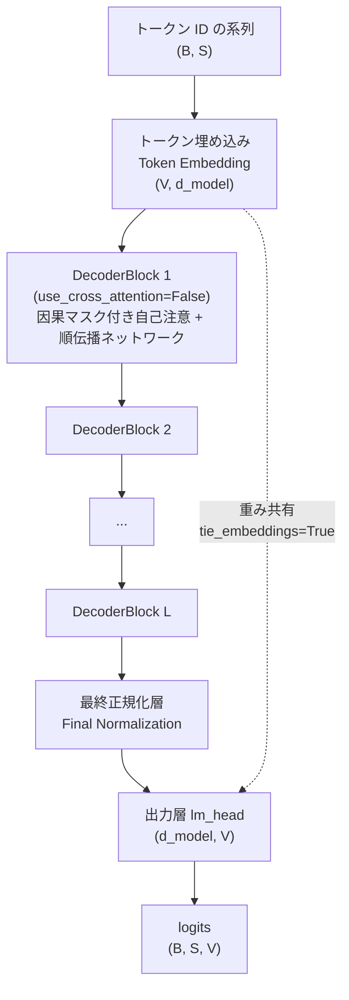
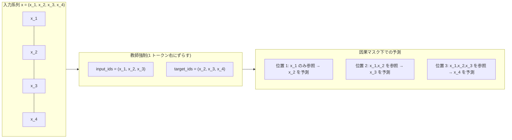
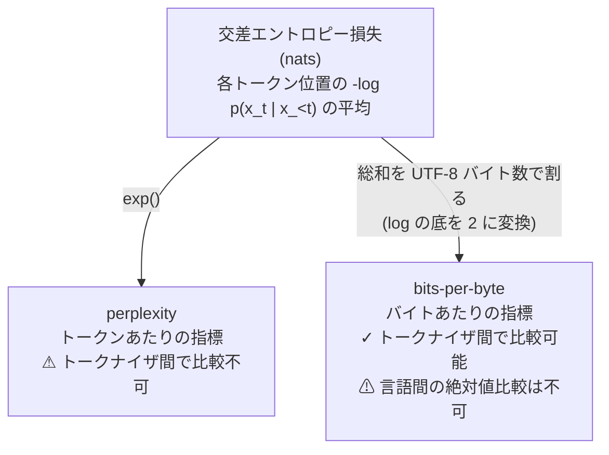

# 006. 小型 GPT の事前学習(Pretraining a Small GPT)

## 1. 概要 / Overview

001〜005 で個別に検証してきた部品(多頭注意機構、Transformer Block、RoPE、RMSNorm、SwiGLU、トークナイザ)を統合し、**decoder-only な自己回帰言語モデル(Autoregressive Language Model)を実際に事前学習(pretraining)させる** 初めてのトピックである。あわせて、005 で比較したトークナイザ(方式・語彙サイズ)を下流の言語モデリング性能(bits-per-byte)で選定する。日本語版・英語版 Wikipedia のコーパスを用い、トークナイザ条件間・語彙サイズ間の比較を、測定ノイズ床(noise floor)を基準にした判定基準のもとで行う。

## 2. 参考論文 / References

| # | 著者 / Authors | タイトル / Title | 会議・媒体 / Venue | URL |
|---|---|---|---|---|
| [1] | Radford, A., Narasimhan, K., Salimans, T., Sutskever, I. | Improving Language Understanding by Generative Pre-Training | OpenAI, 2018 | https://cdn.openai.com/research-covers/language-unsupervised/language_understanding_paper.pdf |
| [2] | Radford, A., Wu, J., Child, R., Luan, D., Amodei, D., Sutskever, I. | Language Models are Unsupervised Multitask Learners | OpenAI, 2019 | https://d4mucfpksyws.cloudfront.net/better-language-models/language-models.pdf |
| [3] | Brown, T. B., et al. | Language Models are Few-Shot Learners | NeurIPS 2020 | https://arxiv.org/abs/2005.14165 |
| [4] | Press, O., Wolf, L. | Using the Output Embedding to Improve Language Models | EACL 2017 | https://arxiv.org/abs/1608.05859 |
| [5] | Inan, H., Khosravi, K., Socher, R. | Tying Word Vectors and Word Classifiers: A Loss Framework for Language Modeling | ICLR 2017 | https://arxiv.org/abs/1611.01462 |
| [6] | Kaplan, J., et al. | Scaling Laws for Neural Language Models | 2020 | https://arxiv.org/abs/2001.08361 |
| [7] | Touvron, H., et al. | LLaMA: Open and Efficient Foundation Language Models | 2023 | https://arxiv.org/abs/2302.13971 |

本文中で各理論に言及する際は、対応する番号(例:「decoder-only 構成 [1, 2]」)を付す。

## 3. 理論 / Theory

### 3.1 自己回帰言語モデリング(Autoregressive Language Modeling)

**記号 / Notation**:

- $x = (x_1, \dots, x_n)$: トークン ID の系列(系列長 $n$)
- $V$: 語彙サイズ(vocabulary size)
- $\theta$: モデルのパラメータ
- $p_\theta(x_t \mid x_{<t})$: パラメータ $\theta$ のもとで、位置 $t$ より前のトークン $x_{<t} = (x_1, \dots, x_{t-1})$ を条件とした位置 $t$ のトークンの予測分布

系列全体の同時分布 $p_\theta(x)$ は、確率の連鎖律(chain rule)によって、各位置の条件付き分布の積に分解できる。

$$
p_\theta(x) = \prod_{t=1}^{n} p_\theta(x_t \mid x_{<t})
$$

**自己回帰言語モデル(Autoregressive Language Model)** は、この各項 $p_\theta(x_t \mid x_{<t})$ をニューラルネットワークで直接モデル化する [1, 2]。学習は、この同時分布の負の対数尤度(negative log-likelihood)を最小化することで行う。

$$
\mathcal{L}(\theta) = -\frac{1}{n}\sum_{t=1}^{n} \log p_\theta(x_t \mid x_{<t})
$$

この式は、各位置 $t$ で「正解トークン $x_t$」を $V$ クラス分類問題の正解ラベルとみなした **交差エントロピー損失(cross entropy loss)** の系列全体の平均に他ならない。

**教師強制(teacher forcing)**: 学習時、モデルへの入力系列 $x_{<t}$ には(モデル自身が生成したトークンではなく)**正解の系列** をそのまま与える。実装上は、入力系列を`input_ids = x[:-1]`、目標系列を`target_ids = x[1:]`のように **1 トークンだけ右にずらす** ことで、位置 $t$ の入力(`input_ids[t]` = $x_t$)から位置 $t$ の目標(`target_ids[t]` = $x_{t+1}$)を予測する形に揃える(図 2 参照)。これにより、系列長 $n$ の 1 つの forward 計算で $n-1$ 個すべての位置の予測を並列に計算できる(位置 $t$ の予測に使ってよい情報を $x_{\le t}$ のみに制限する **因果マスク(causal mask)** と組み合わせて初めて、この並列計算が「未来の情報を見ない」という自己回帰の制約を満たす)。学習時とは異なり、**生成時(推論時)は自分自身が直前に生成したトークンを次の入力にする**(教師強制なしの自己回帰生成、後述の生成例を参照)。

### 3.2 decoder-only 構成

002 で実装した`DecoderBlock`は、自己注意(self-attention)に加えて、Encoder の出力(memory)を参照する **交差注意(cross-attention)** を持つ、Encoder-Decoder 構成のためのブロックだった。系列変換(機械翻訳など、002 の実験 4)では、Decoder が Encoder 側の入力系列(source)を参照しながら出力系列(target)を生成する必要があるため、この交差注意が本質的だった。

しかし、自己回帰言語モデリングでは「参照すべき別の系列(source)」は存在しない。モデルが予測すべきなのは、**同じ 1 つの系列の中で、これまでに出現したトークンから次のトークンを予測する** ことだけである。したがって、交差注意で参照する Encoder 出力(memory)がそもそも存在せず、Decoder Block は自己注意と順伝播ネットワークの 2 つの副層だけで構成できる。これが **decoder-only 構成** である [1, 2]。

004 までは、decoder-only 構成を作るために`EncoderBlock`(自己注意のみの 2 副層構成)に因果マスクを渡すという方式を使っていた(`EncoderBlock`という名前ではあるが、交差注意を持たない点で構造的には decoder-only に一致するため)。006 では`DecoderBlock`自体に`use_cross_attention: bool = False`引数を追加し、交差注意の副層(`cross_attn`・対応する正規化層)を **生成しない** モードを設けた。これにより、`DecoderBlock`という名前のクラスをそのまま decoder-only 構成に使えるようになった(`src/layers/transformer_block.py`)。

`GPTLanguageModel`(`src/models/gpt.py`)は、この`DecoderBlock(use_cross_attention=False)`を $L$ 層積み、トークン埋め込み・最終正規化層・出力層(語彙への射影)を組み合わせた構成である(図 1)。**正規化前置(Pre-Layer Normalization、`norm_first=True`)** を採用する(002 の知見の通り、深い層でも学習が安定するため)。

**図 1: decoder-only Transformer(`GPTLanguageModel`)の全体構成。** 破線はトークン埋め込み行列と出力層`lm_head`の重み共有(3.3 節)を表す。RoPE・RMSNorm・SwiGLU の配置は 3.4 節で述べる。

**図 2: 教師強制における入力・目標の 1 トークンずらしと、因果マスク下での予測対応。** 位置 $t$ の logits(`input_ids[t]`までを見た予測)が`target_ids[t]`(= $x_{t+1}$)の予測に対応する。

### 3.3 重み共有(Weight Tying)

トークン埋め込み行列 $E \in \mathbb{R}^{V \times d_{\text{model}}}$(トークン ID → ベクトル)と、出力層(語彙への射影)の重み行列 $W_{\text{out}} \in \mathbb{R}^{V \times d_{\text{model}}}$(ベクトル → 各トークンのスコア)は、形状が一致する。**重み共有(weight tying)** は、この 2 つの行列に **同一のパラメータ** $E = W_{\text{out}}$ を使う手法である [4, 5]。

**動機**: 入力側の埋め込みは「トークン ID を意味空間のベクトルに変換する」写像、出力側の射影は「意味空間のベクトルを各トークンへの選好スコアに変換する」写像であり、直感的には互いに逆向きの、しかし同じ意味空間を共有する変換である。実際、意味的に近いトークン(類義語など)は、入力側の埋め込みでも出力側の射影でも近いベクトルを持つことが期待される。Press & Wolf [4] と Inan et al. [5] は、この 2 つの行列を独立に学習するより共有した方が、言語モデルの性能(perplexity)が同等かそれ以上になることを示した。

**パラメータ削減効果**: 埋め込み行列・出力層はいずれも $V \times d_{\text{model}}$ 個のパラメータを持つ。重み共有により、この $2 \times V \times d_{\text{model}}$ 個から $V \times d_{\text{model}}$ 個へと、**語彙サイズに比例する分だけ** パラメータ数を削減できる。語彙サイズ $V$ が大きい(例えばバイトレベル BPE で $V=8192$)条件ほど、この削減効果は大きい。`GPTLanguageModel`は`tie_embeddings: bool = True`引数でこれを切り替えられる(既定で共有する)。

**非埋め込みパラメータ数(non-embedding parameters)との関係**: 3.5 節・実験で条件間のパラメータ数を揃える際、埋め込み行列・出力層(重み共有時は同一のパラメータ)を除いた **非埋め込みパラメータ数** を基準にする(`count_non_embedding_parameters`、`src/utils/statistics.py`)。語彙サイズが条件ごとに異なる(文字レベル・$V{=}1024$・$V{=}2048$・$V{=}4096$・$V{=}8192$)ため、総パラメータ数をそのまま比較すると語彙サイズの効果と「実質的な計算能力」の効果が交絡してしまう。重み共有によって埋め込み関連パラメータが 1 セットに統一されていることは、この切り分けをより明確にする(Kaplan et al. [6] が総パラメータ数ではなく非埋め込みパラメータ数でスケーリング則を定式化した理由と同じ発想であり、009 で改めて扱う)。

### 3.4 003・004 の成果の統合

`GPTLanguageModel`は、003・004 で個別に検証した部品を **注入点(injection point)を通じて** 組み込む。新しいクラスを作るのではなく、既存の`DecoderBlock`の注入点(`normalization_factory`・`feed_forward_factory`)と、`MultiHeadAttention`の注入点(`positional_transform`)にそのまま差し込む設計であり、001〜005 を通じて一貫している「ラッパークラスを増やすのではなく optional 引数・注入点で拡張する」方針を踏襲する。

- **RoPE(Rotary Position Embedding、003)**: `positional_transform`として各層の`self_attn`に注入する。学習パラメータを持たないため、全層で同一インスタンスを共有できる(`GPTLanguageModel._build_block`が 003 と同じ手法、すなわち構築済みの`DecoderBlock`の`self_attn`属性を位置変換を注入した`MultiHeadAttention`に差し替える手法で組み込む)。002 の正弦波(sinusoidal)方式・学習可能な絶対位置埋め込みのようにトークン埋め込みへ加算する方式は使わない(3.2 節・図 1 の通り、`GPTLanguageModel`はモジュール内部に位置エンコーディングを持たず、注入方式のみに一本化している)。
- **RMSNorm(004)**: `normalization_factory=RMSNorm`として`DecoderBlock`・最終正規化層に渡す。
- **SwiGLU(004)**: `feed_forward_factory`として`DecoderBlock`に渡す。中間次元は 004 の理論セクションで導出した通り、標準の順伝播ネットワークとパラメータ数を揃えるため $d_{ff}' = \text{round}(\frac{2}{3} d_{ff})$ に丸める。

これら 3 つを採用する理由は、LLaMA [7] が実際にこの組み合わせ(RoPE・RMSNorm・SwiGLU)を採用しており、現代の decoder-only 言語モデルの標準的な構成の一例になっているためである。ただし本トピックの主眼は「トークナイザの選定」(実験 D〜F)であり、アーキテクチャ選択そのものの比較実験(RoPE 対 学習可能絶対位置埋め込み、RMSNorm 対 層正規化など)は 003・004 で既に行っているため、006 では固定の構成として採用し、繰り返さない。

### 3.5 評価指標: perplexity と bits-per-byte

**perplexity(困惑度)**: トークンあたりの平均負の対数尤度 $\bar{\mathcal{L}}$(3.1 節の $\mathcal{L}(\theta)$)を使って

$$
\text{PPL} = \exp(\bar{\mathcal{L}})
$$

と定義される(`compute_perplexity`、`src/utils/statistics.py`)。直感的には「モデルが各ステップで平均的に何個のトークンから 1 つを選ぶのに相当する不確実性を持っているか」を表す。

**perplexity の限界**: perplexity は **1 トークンあたり** の指標であり、**トークナイザが異なる条件間では比較できない**。同じテキストでも、語彙サイズを上げればトークン数(系列長)が減る(005 の fertility の議論)。1 トークンに、より多くの情報(文字数)が詰め込まれるようになるため、モデルの予測能力そのものが変わらなくても、1 トークンあたりの負の対数尤度は変化しうる。したがって、「トークナイザ A(perplexity 20)はトークナイザ B(perplexity 15)より劣る」という比較は、語彙サイズが異なる限り成立しない。

**bits-per-byte**: この問題を避けるため、条件間比較(実験 D〜G)には **bits-per-byte** を使う。

$$
\text{bits\_per\_byte} = \frac{\sum_{t} -\log_2 p_\theta(x_t \mid x_{<t})}{\text{total\_bytes}}
$$

分母を「評価対象のトークン数」ではなく「評価対象の **UTF-8 バイト数**」にすることで、トークナイザの語彙サイズ・分割方式によらず、常に同じ「元のテキストの物理的な量」を基準にできる(`compute_bits_per_byte`、`src/utils/statistics.py`)。**分母を文字数ではなくバイト数にする理由** は 005 の fertility の議論と同じで、日本語(1 文字が UTF-8 で 3 バイト)と英語(1 文字が 1 バイト)を文字数で揃えると、そもそも情報量が揃わないためである。バイトレベル BPE では 1 トークンが UTF-8 の複数バイト文字の途中で切れうる(005 の byte-level BPE の議論)ため、バイト数を分母にすることで、この「トークンの境界がバイト境界と必ずしも一致しない」という事情に関係なく、全条件で厳密に同じ量(バイト)を分母にできる。**実装上は、この分母をトークン化後の窓から逆算するのではなく、トークン化前の検証テキストから直接** `len(text.encode("utf-8"))` **として求める**(`make_evaluation_windows`、`src/data/text.py`)。これにより、末尾の不完全な窓をパディングして損失計算から除外する実装(5.7 節)と組み合わせても、分母が全トークナイザ条件で厳密に同一の定数になることを保証できる(本番実行前の修正 2)。

**bits-per-byte を言語間で直接比較しない**: bits-per-byte はトークナイザ条件をまたいだ比較を可能にするが、**言語をまたいだ絶対値の比較には使えない**。日本語は 1 文字が平均して英語よりずっと多くの情報(エントロピー)を持ち、同じ文字数のテキストを表すのに必要なバイト数も約 3 倍になる(005 で述べた通り)。そのため、「日本語の bits-per-byte が英語より高い」という結果が出ても、それは日本語の方がモデルにとって「難しい」ことを意味するとは限らず、言語そのものの情報量の違いを反映しているだけの可能性がある。本トピックで日英を比較する際は、**各言語内での相対改善率**(例えば「$V{=}1024$ から $V{=}8192$ への改善率」)のみを比較し、絶対値そのものを日英間で比較しない(実験 F)。

**図 3: 損失から perplexity / bits-per-byte への変換と、トークナイザ依存性がどこで入るか。** perplexity はトークン単位で計算するため、分母(トークン数)自体がトークナイザに依存する。bits-per-byte は分母を UTF-8 バイト数に固定することで、この依存性を除去する。ただし言語が変われば同じバイト数が表す情報量も変わるため、言語間の絶対値比較はできない(いずれも`compute_bits_per_byte`・`compute_perplexity`、`src/utils/statistics.py`)。

### 3.6 事前分割チャンクの最大長

005 で確認したとおり、空白による事前分割は日本語では機能せず、チャンクが 1 行や 1 段落まるごとの長さになる。自作の`learn_bpe`はマージのたびに全チャンクの対の頻度を数え直すので、チャンクが長いと計算量が急増する。そこで`pretokenize()`に`max_chunk_bytes`引数を追加し、事前分割の後になお`max_chunk_bytes`バイトを超えるチャンクを、UTF-8 の文字境界を壊さない位置でさらに分割する。語彙学習と符号化で必ず同一の値を使う。この考え方は、GPT-2 [2] 以降の byte-level BPE が正規表現でマージの対象範囲を制限するのと同じである。

代償として、チャンク境界をまたぐマージは候補から外れるので、学習される語彙は制限なしの場合と厳密には異なる。しかし`max_chunk_bytes`を全 BPE 条件・両言語に共通の値で適用する限り、条件間の差(実験 D〜F)の妥当性は損なわれない。ただし、制限なしの場合との絶対値の比較はできない。採用する値と選定の理由は付録 B.1、元の記述は付録 A.1。

## 4. 実装方針 / Implementation Policy

001〜005 でスクラッチ実装した部品(`MultiHeadAttention`・`DecoderBlock`・`RoPE`・`RMSNorm`・`SwiGLU`・トークナイザ)を **そのまま再利用** し、006 で新規に追加するのは「これらを 1 つの学習ループに統合する部分」のみである(段階 1 で`src/`に追加済み)。

| 機能 | 配置場所 | 実装/委譲 |
|---|---|---|
| decoder-only 言語モデル(`GPTLanguageModel`、トークン埋め込み・重み共有・`generate()`) | `src/models/gpt.py` | スクラッチ実装(新規、段階 1) |
| `DecoderBlock`の`use_cross_attention`引数(交差注意を持たない decoder-only 構成) | `src/layers/transformer_block.py` | スクラッチ実装(段階 1、002・003・004 との後方互換性を検証済み) |
| 学習ループ(`train_language_model`、Adam・固定学習率・fp32)・評価(`evaluate_bits_per_byte`、非重複窓での逐次評価) | `src/training/trainer.py` | スクラッチ実装(新規、段階 1) |
| Wikipedia コーパス取得の一般化(`load_wikipedia_corpus`)、文字列段階での訓練・検証分割(`split_train_val_text`)、トークン化(`encode_corpus`)、評価窓の作成(`make_evaluation_windows`) | `src/data/text.py` | スクラッチ実装(段階 1) |
| bits-per-byte・perplexity・非埋め込みパラメータ数(`compute_bits_per_byte`・`compute_perplexity`・`count_non_embedding_parameters`) | `src/utils/statistics.py` | スクラッチ実装(段階 1) |
| ノイズ床の帯を表示するグループ棒グラフ(`plot_grouped_bar`の`noise_band`引数) | `src/utils/visualization.py` | スクラッチ実装(段階 1) |
| BPE・Unigram トークナイザを整数 ID 方式のインターフェース(`encode(text) -> list[int]`・`decode(ids) -> str`)に適合させるラッパー | 本ノートブック(5.3 節) | ノートブック内に直接記述(下記の理由による) |

**ID 方式ラッパーを`src/`ではなく本ノートブックに置く理由**: `encode_corpus`(`src/data/text.py`)は`CharacterLevelTokenizer`と同じ「`encode(text) -> list[int]`で整数 ID を直接返す」インターフェースを想定している。しかし 005 の`BPETokenizer`・`UnigramTokenizer`の`encode()`は部分語シンボルの **文字列**(`list[str]`)を返し、シンボル → 整数 ID の対応を持たない(005 の関心が「どう分割するか」であり「ID をどう割り当てるか」ではなかったため)。この対応付けは実装上ごく薄い作業(語彙をソートして通し番号を振るだけ)であり、`src/`に切り出すほどの再利用価値のある抽象化を要さないため、本ノートブックに直接書く(`encode_corpus`の docstring で「整数 ID を割り当てる語彙ラッパーの追加は 006 のノートブック段階で扱う」と予告した通り)。なお`UnigramTokenizer`は内部で保持する`sentencepiece.SentencePieceProcessor`(`processor`属性)が`encode(text) -> list[int]` / `decode(ids) -> str`を既に提供しているため、これはラップせずそのまま使う。

実行環境についての注記は付録 B.6。

## 5. 実装 / Implementation

### 5.1 スケールの設定(スモークテスト)

`SMOKE_TEST = True`の分岐が、コーパスサイズ・語彙サイズ・学習ステップ数を縮小し、`SMOKE_TEST = False`側に本番(Google Colab T4 GPU)の値を置く。判定基準・実験設計は本番のスケールを前提に記述する。縮小した理由の内訳、`TOKENIZER_TRAIN_BYTES`を本番でも制限する理由、`MAX_CHUNK_BYTES = 64`の選定、`TOKENIZER_TRAIN_BYTES = 8{,}000{,}000`(8 MB)への見直しの経緯は付録 B.1。

語彙サイズは公比 2 の等比数列($1024 \to 2048 \to 4096 \to 8192$)とする。刻みが不揃いだと、収穫逓減の仮説(実験 E)が刻みの違いだけで支持されてしまうためである(理由は付録 A.2)。

エポックの上限は、実験 C〜F は高々 1/2 エポック、実験 G は高々 1 エポックとする(理由は付録 A.2)。

### model サイズについて: 計算最適ではないことの明記

本番の model サイズ($d_{\text{model}}{=}256$、4 層、8 ヘッド、非埋め込みパラメータ数は 6 節で実測して報告する)は、Kaplan et al. [6] や Chinchilla(Hoffmann et al., "Training Compute-Optimal Large Language Models", 2022)が示す計算最適(compute-optimal)の目安(非埋め込みパラメータ 1 個あたり約 20 トークン)には遠く及ばない。本番のコーパス規模・エポック上限(1/2 エポック、修正 9)から逆算すると、消化トークン数は非埋め込みパラメータ数 1 個あたり **約 2 トークン程度** にとどまる見込みである(6 節で実測値を報告する)。

**これは意図的な選択である。** 006 が主張するのは条件 **間** の比較(トークナイザ方式・語彙サイズによる bits-per-byte の違い)であり、その公平性は 3.3 節・6 節で述べた通り非埋め込みパラメータ数を全条件で揃えることによって担保されている。全条件が等しく学習不足(under-trained)であっても、条件間の順位や差の解釈そのものは損なわれない。model サイズ・データ量・計算量の最適な配分そのものは 009 の主題であり、006 では扱わない。

### 実行時間の較正

本番実行の前に、ダミーのランダムトークン列で 1 ステップあたりの学習時間を見積もる(最初の 20 ステップ(warmup)を捨て、その後 30 ステップの中央値)。5.6 節で、この較正結果から総実行時間を見積もる。詳細は付録 B.2。

### 5.2 コーパスの取得

日本語版・英語版 Wikipedia のコーパス(段階 1 で`load_wikipedia_corpus`により取得済み、日本語 24.58 MB・英語 24.33 MB、いずれも 20 MB 以上の目標を達成している)を読み込み、`LM_CORPUS_BYTES`バイトに切り詰める。バイト数を基準に切り詰めることで、日英で同じ「物理的な量」のコーパスを使う(3.5 節で述べた通り、文字数で揃えると日本語の方が少ない情報量になってしまう)。

### 5.3 トークナイザを整数 ID 方式に適合させるラッパー

4 節で述べた通り、`BPETokenizer.encode()`は部分語シンボルの文字列を返す。`encode_corpus`・`make_evaluation_windows`・`GPTLanguageModel`が要求する「整数 ID を返す`encode()` / ID から文字列に戻す`decode()`」のインターフェースに適合させるため、学習済み語彙をソートして通し番号を振る薄いラッパーが必要になる。この`BPEIDTokenizer`は 006・008・009 で共通に使うため`src/data/tokenizer.py`にモジュール化してあり、ここでは import して使う。

### 5.4 トークナイザ条件の学習

各言語について、5 条件(文字レベル・バイトレベル BPE × 4 語彙サイズ・Unigram 言語モデル)のトークナイザを学習する。**BPE・Unigram の語彙学習は訓練テキストの先頭`TOKENIZER_TRAIN_BYTES`バイトのみを使う**(5.1 節で述べた通り、自作 BPE の学習コストの都合による制限。本番実行前の修正 14 により、この制限はスモークテストに限らず本番でも行う。ただし言語モデルの学習データ量(`LM_CORPUS_BYTES`)は制限しない)。文字レベルの語彙は **コーパス全体(訓練 + 検証)** から構築する(文字レベルは語彙構築が軽量なため縮小の必要がなく、`CharacterLevelTokenizer`は未知文字への対応を持たないため、検証テキストのみに出現する文字で符号化が失敗しないよう訓練テキストだけでなくコーパス全体を使う。004 と同じ理由)。

**Unigram の`byte_fallback=True`・`character_coverage=1.0`について**: sentencepiece の既定(`character_coverage=0.9995`、`byte_fallback=False`)では、訓練コーパスの低頻度文字(改行を含む制御文字や、`character_coverage`の外側に落ちる希少文字)が語彙に入らず、符号化時にすべて単一の未知語トークン`<unk>`へ潰れてしまう。これは Unigram 条件だけが他の条件(バイトレベル BPE は 256 バイト初期語彙を持つため未知語が原理的に発生しない、文字レベルはコーパス全体から語彙を構築するため未知語が発生しない)と異なる問題を解くことを意味し、失われた文字の分だけ負の対数尤度が不当に下がってしまう。`byte_fallback=True`(語彙にない文字を UTF-8 バイト列へ退避させる)と`character_coverage=1.0`(全文字を被覆対象にする)を組み合わせることで、この情報損失を解消する(`train_unigram_model`、`src/data/tokenizer.py`。005 は`byte_fallback`・`character_coverage`を指定せず、変更後も既定値のままのため影響を受けない。005 を再実行し、結果が変わらないことを確認済み)。

#### BPE 学習時間のスケーリング計測

`TOKENIZER_TRAIN_BYTES`での BPE 学習が 1 セッションの時間内に収まるかを、訓練テキストの先頭の 3 点のデータ量で学習時間を実測し、べき乗則 $t = a n^{b}$ をあてはめて外挿して見積もる。語彙サイズ 4 つ分の補正を含む。詳細は付録 B.3。

#### 語彙品質の診断量

**これは判定基準ではなく、実験 E(語彙サイズ増加の収穫逓減)の結果を解釈するための補助情報(診断量)である**。

トークナイザの学習データ量(`TOKENIZER_TRAIN_BYTES`)は、計算量の都合(5.1 節)により言語モデルの学習データ量(`LM_CORPUS_BYTES`、コーパス全体)より小さい。学習データを絞ると、**語彙サイズが大きい条件ほど不利になりうる**。例えば`TOKENIZER_TRAIN_BYTES=2{,}000{,}000`のとき、そこから 8192 回マージすると末尾のマージは低頻度のペアに基づくものになり、学習後の語彙のうち実際に使われる部分が少なくなる可能性がある。これは実験 E が測ろうとしている「語彙サイズ増加に伴う収穫逓減」と **同じ向き** に働くため、観測される収穫逓減の一部が、真の収穫逓減ではなく **トークナイザ学習データの不足で説明できてしまう可能性がある**。

以下の 3 つを BPE の 4 条件それぞれについて報告する。

1. **語彙使用率**: 訓練テキスト全体(`LM_CORPUS_BYTES`規模)を符号化したときに、実際に 1 回以上出現した語彙の割合。語彙サイズを増やしても使われない語彙が増えるだけなら、この値が下がる。
2. **低頻度語彙の割合**: 訓練テキスト全体の符号化で出現回数が 10 回未満だった語彙(一度も出現しない語彙を含む)の割合。
3. **1 マージあたりの学習バイト数**: `TOKENIZER_TRAIN_BYTES / vocab_size`。

**語彙使用率が大きい語彙サイズで顕著に下がっている場合、実験 E の「収穫逓減」の一部はトークナイザ学習データの不足で説明されうる** ことに注意して 7.3 節の考察を読むこと。

#### ラウンドトリップの完全一致の検証

各条件について、訓練テキスト・検証テキストの両方で`decode(encode(text)) == text`を確認する。一致しない条件があればその場で例外を送出する(未知語による情報損失が実際に解消されているかどうかの直接的な検証)。

#### 未知トークン率の報告

バイトレベル BPE・文字レベル(コーパス全体から語彙を構築)は未知語の仕組みを持たないため未知トークン率は構造的に常に 0 である。Unigram は`byte_fallback=True`により未知語が発生しないことを実測で確認する(`compute_unknown_rate`、`src/utils/statistics.py`)。

### 5.5 符号化時間のスケーリング計測

学習時間に加えて、学習済みトークナイザで`LM_CORPUS_BYTES`の訓練分割全体を符号化する時間もべき乗則で外挿し、学習と符号化の合計が 30 分を超える場合に警告を出す。詳細は付録 B.4。

### 5.6 ステップ数の決定

日英でバイトあたりのトークン数(fertility)が異なるため、同じ「1 エポック」に相当するステップ数も条件によって異なる。実験 F は日英の相対改善率を比較するため、**言語ごとにステップ数を変えると新たな交絡が入ってしまう**。そこで`NUM_STEPS`・`G_NUM_STEPS`はハードコードせず、**全言語・全トークナイザ条件の訓練トークン数を実測してから、最も条件の厳しい(訓練トークン数が最小の)条件を基準に計算式で決める**。

$$
\text{tokens\_per\_step} = \text{BATCH\_SIZE} \times \text{SEQUENCE\_LENGTH}
$$
$$
\text{min\_train\_tokens} = \min_{\text{lang, tokenizer}} \lvert \text{train\_ids}_{\text{lang, tokenizer}} \rvert
$$
$$
\text{NUM\_STEPS} = \left\lfloor \text{EPOCH\_CAP\_CF} \times \frac{\text{min\_train\_tokens}}{\text{tokens\_per\_step}} \right\rfloor, \qquad
\text{G\_NUM\_STEPS} = \left\lfloor \text{EPOCH\_CAP\_G} \times \frac{\text{min\_train\_tokens}}{\text{tokens\_per\_step}} \right\rfloor
$$

全条件で共通の`NUM_STEPS`(実験 C〜F)・`G_NUM_STEPS`(実験 G)を、最小トークン数の条件を基準に決めることで、**すべての条件が該当するエポック上限以内に収まることが構成上保証される**(訓練トークン数が最小条件以上の条件では、消化トークン数(分子は共通)に対するエポック比率が最小条件以下になるため)。`EVAL_INTERVAL`・`G_EVAL_INTERVAL`は、それぞれ 4 回・5 回程度の検証点が得られるように`NUM_STEPS`・`G_NUM_STEPS`から比例して決める。

条件データ(符号化した訓練データ・検証窓)は、`(lang, tokenizer_name)`をキーにキャッシュして使い回す(`get_condition_data()`)。詳細は付録 A.4。

### 5.7 データ準備・model 構築・学習実行のヘルパー関数

`encode_corpus`・`make_evaluation_windows`(トークナイザ条件ごとに訓練データ・検証窓を作る)、`GPTLanguageModel`の構築(3.4 節の通り RoPE・RMSNorm・SwiGLU を注入する)、`train_language_model`の呼び出しを、条件(言語・トークナイザ名)を受け取って一括で行うヘルパーにまとめる。実験 C・D・E・F・G はいずれもこのヘルパーを条件を変えて呼ぶだけで実行できる。`prepare_condition_data`は 5.6 節で定義した`get_condition_data`(キャッシュ付き、修正 19)の薄いラッパーであり、同じ条件を再度要求してもキャッシュヒットにより符号化をやり直さない。

### 5.8 実験結果の永続化

学習ランの結果(`model`を除く JSON 化可能な部分)を JSON として`CACHE_DIR`に保存し、設定が完全に一致する場合のみ読み込む。学習済みの重みは保存しない。詳細は付録 B.5。

## 6. 実験 / Experiments

実験 D・E・F の結論は **支持 / 反証 / 判定不能** の 3 値で報告し、差がノイズ床(実験 C)の 2 倍以内に収まった場合は「判定不能」とする。**宣言した判定基準は結果を見た後に変更しない。** 全実験が 1 シード(実験 C・G を除く)であるため、単一の観測差から条件の効果を断定できない。実行環境についての注記は付録 B.6。

### 実験 A: ランダム初期化時の損失が $\ln V$ に一致するか

**検証すること**: 学習を一切行っていないランダム初期化直後の model は、各トークンについて語彙 $V$ 個からの一様分布に近い予測をするはずである。このとき交差エントロピー損失の期待値は $-\log(1/V) = \ln V$ になる。5 条件(文字レベル・BPE × 4 語彙サイズ・Unigram)× 2 言語のすべてでこれが成り立つかを検証する。

**判定基準(事前登録)**: 全条件で $\lvert \text{loss} - \ln V \rvert < 0.05$。

検証窓は、一部ではなく全体を使って平均損失を計算する(窓の一部だけでは、統計的なばらつきだけで判定基準 0.05 を超える偽陽性のリスクがあるため。詳細は付録 A.3)。

#### 診断: 実験 A の判定基準未達の原因切り分け

本番実行の結果、実験 A は 12 条件中複数の条件で判定基準($\lvert \text{loss} - \ln V \rvert < 0.05$)を満たさなかった。**これは判定基準を満たさなかった原因を切り分けるための診断であり、判定基準の変更ではない。実験 A の判定は「満たさなかった」ままである**。

**有力な仮説**: 重み共有(weight tying、3.3 節)により出力層`lm_head`が入力側のトークン埋め込み行列そのものであるため、正規化前置(Pre-Layer Normalization)の残差接続を通じて入力トークンの埋め込みが最終層の出力までほぼそのまま伝わり、初期状態でも「現在の入力トークンを繰り返す」方向に logits が系統的に偏りうる。ずれの大きさは検証テキストのトークン反復率(同じトークンが隣接して出現する頻度)と語彙サイズに依存するため、条件ごとに異なりうる。これは実装の誤りではなく、重み共有という設計そのものの性質である可能性が高い。

以下を測定する(**学習は行わない**、初期化直後の測定のみ)。

1. 全 12 条件について、`tie_embeddings=False`で構築した model の初期損失と $\ln V$ の差を測り、`tie_embeddings=True`(実験 A、上記)の diff と並べる
2. 検証テキストにおける隣接トークンの反復率(位置 $t$ と $t+1$ のトークンが一致する割合)を測り、`tie_embeddings=True`での diff との対応を見る
3. `tie_embeddings=True`の場合の初期 logits について、目標トークンの logit の平均値と、全語彙にわたる logit の標準偏差の平均値を測り、logits が一様分布からどれだけ離れているかを定量化する

### 実験 B: 因果マスクが未来のトークンを遮断するか

**検証すること**: 位置 $t$ の logits は、位置 $t$ 以前(`input_ids[0..t]`)のみに依存し、位置 $t+1$ 以降を変更しても変化しないはずである。因果マスクが正しく機能しているかを、入力の一部を変更する前後で位置 $t$ の logits を比較して検証する。

**判定基準(事前登録)**: 位置 $t+1$ 以降の入力を変更したときの位置 $t$ の logits の変化(絶対値の最大)が $10^{-5}$ 未満。

### 本番実行前の判定基準の改訂

判定基準は、本番(Google Colab T4 GPU)実行の前に、観測結果の方向に依存しない一般論(対数軸上で等比刻みでなければ収穫逓減を検証できないこと、独立測定の差・和の誤差伝播、2 つの交絡要因の分離)に基づいて改訂した。本番の判定は改訂後の基準(新基準)でのみ行っている。実験 D・E・F・G の旧基準・新基準・改訂理由の表は付録 C。

### 実験 C: シード間ノイズ床の測定(日英それぞれ)

**検証すること**: バイトレベル BPE $V{=}2048$(スモークテストでの Unigram 一致条件、本番では $V{=}4096$)を、**日本語・英語それぞれ** で乱数シード(seed)を変えて学習し、最終検証 bits-per-byte のばらつきを言語ごとに測定する。日本語は文字あたりの情報量・系列長が英語と異なるため、シード間分散が言語間で同じである保証がない(修正 6)。このばらつきを、実験 D・E の判定基準で使う言語ごとの「ノイズ床(noise floor)」 $\sigma_{\text{ja}}$・$\sigma_{\text{en}}$ とする。

**判定基準を設けない**。本実験は後続実験(D・E・F)の閾値を得るための測定であり、真偽を判定する対象ではない。

5 シードを使う(標本標準偏差の過小バイアスを縮めるため。導出は付録 A.3)。

### 実験 D・E・F: 同一の学習ランを共有した 3 つの検証

実験 D(部分語分割は文字レベルより優れるか)・E(語彙サイズ増加は収穫逓減するか)・F(語彙サイズ増加の効きかたは日本語の方が大きいか)は、**同一の学習ラン(日英各 5 条件)を共有し、判定する指標だけを分ける**。各言語のバイトレベル BPE $V{=}2048$(Unigram と一致させた条件)は実験 C の seed=0 のランをそのまま再利用する(二重学習しない)。

- **実験 D の検証すること**: 部分語分割(BPE・Unigram)は文字レベルより bits-per-byte が低いか。
  **判定基準(事前登録、本番実行前に改訂)**: 日英とも、最良の部分語条件が文字レベルを $2\sqrt{2}\,\sigma_{\text{lang}}$ を超えて下回る。
  **選択バイアスについての注記**: 「最良の部分語条件」は 4 つの BPE 条件と Unigram、計 5 条件中の最小値(`min`)を取っている。複数条件から最小値を選ぶ操作自体が、単一条件どうしの比較よりも偶然小さい値を選びやすくする(選択バイアス)。ノイズ床 $\sigma_{\text{lang}}$ は単一条件の 3 シード標準偏差であり、この選択バイアスを補正していない点に注意する。
- **実験 E の検証すること**: 語彙サイズ増加の改善は収穫逓減するか。BPE の語彙サイズ 4 点 $V_1{<}V_2{<}V_3{<}V_4$(公比 2 の等比数列、修正 3)について、隣接改善幅 $g_1 = b_1 - b_2$、$g_2 = b_2 - b_3$、$g_3 = b_3 - b_4$($b_i$ は $V_i$ での bits-per-byte)が単調減少するか($g_1 > g_2 > g_3$)を検証する。
  **誤差伝播の式**: 各 $b_i$ は独立な 1 回の測定であり、標準偏差を $\sigma_{\text{lang}}$ とする。隣接する 2 つの改善幅の差 $d_{i} = g_i - g_{i+1} = b_i - 2b_{i+1} + b_{i+2}$ は 3 つの独立測定の線形結合であり、分散は $\text{Var}(d_i) = \sigma^2 + 4\sigma^2 + \sigma^2 = 6\sigma^2$、標準偏差は $\sqrt{6}\,\sigma_{\text{lang}}$ になる。
  **判定基準(事前登録、本番実行前に改訂)**: $d_1 = b_1 - 2b_2 + b_3$ と $d_2 = b_2 - 2b_3 + b_4$ の **両方** が $2\sqrt{6}\,\sigma_{\text{lang}}$ を超えて正であれば「支持」(単調減少)、両方が $2\sqrt{6}\,\sigma_{\text{lang}}$ を超えて負であれば「反証」(収穫逓増)、それ以外は「判定不能」とする。
- **実験 F の検証すること**: 語彙サイズ増加の効きかたは日本語の方が大きいか。$V_1{\to}V_4$(4 点の両端)の **相対** 改善率 $r_{\text{lang}} = (b_1 - b_4) / b_1$ を日英で比較する。
  **誤差伝播の式**: $r_{\text{lang}}$ は $b_1$・$b_4$ の 2 測定から作られ、日英で計 4 測定になる。ノイズ床由来の相対誤差を $\sigma_{\text{rel,lang}} = \sigma_{\text{lang}} / b_{\text{center,lang}}$(各言語の中心条件の bpb で正規化)と近似すると、対比量 $r_{\text{ja}} - r_{\text{en}}$ の標準偏差は $\approx 2\,\sigma_{\text{rel}}$($\sigma_{\text{rel}} = \max(\sigma_{\text{rel,ja}}, \sigma_{\text{rel,en}})$、事前にどちらの言語のノイズ床が大きいか分からないため保守的な側を採用する、修正 6)。
  **判定基準(事前登録、本番実行前に改訂)**: $r_{\text{ja}} - r_{\text{en}} > 4\,\sigma_{\text{rel}}$ であれば「支持」。

**同一計算予算についての注記(実験 D の交絡)**: 全条件を同じステップ数`NUM_STEPS`で学習するため、語彙サイズが大きく fertility が低い(1 トークンあたりの情報量が多い)条件ほど、同じステップ数で **より多くの原文バイト数を消化する**。これは「同一計算予算(同一 FLOPs 相当)での比較」であり「同一データ量での比較」ではない。条件ごとの消化バイト数・(コーパスが小さい場合の)エポック数は 7 節で表にして報告する。

#### 実験 D・E・F の判定(新基準)

判定関数は 3 値(支持・反証・判定不能)を返す。以前の版の`judge_d`・`judge_f`には反証の分岐の欠落があり、本番の結果の一部が誤って「判定不能」と報告されていたため修正した(経緯は付録 B.7)。

#### 可視化: 条件ごとの bits-per-byte(言語ごとのノイズ床の帯つき)

    

    

#### 実験 D の交絡: 条件ごとの消化バイト数・エポック数

    lang condition     train_bytes train_tokens  digested_bytes   epochs
    ja   character      23,309,728    8,507,563       7,137,549     0.31
    ja   bpe_v1024      23,309,728    8,799,191       6,900,992     0.30
    ja   bpe_v2048      23,309,728    7,172,792       8,465,762     0.36
    ja   bpe_v4096      23,309,728    6,061,518      10,017,812     0.43
    ja   bpe_v8192      23,309,728    5,217,974      11,637,303     0.50
    ja   unigram        23,309,728    7,586,435       8,004,174     0.34
    en   character      23,117,476   23,003,819       2,617,927     0.11
    en   bpe_v1024      23,117,476    9,971,837       6,039,240     0.26
    en   bpe_v2048      23,117,476    8,194,972       7,348,691     0.32
    en   bpe_v4096      23,117,476    6,926,577       8,694,384     0.38
    en   bpe_v8192      23,117,476    5,956,436      10,110,462     0.44
    en   unigram        23,117,476    7,801,569       7,719,257     0.33

### 実験 G: 選定条件での本学習

**検証すること**: 実験 D〜F で選定したトークナイザ条件で、より多いステップ数(`G_NUM_STEPS`、5.6 節)で日英各 1 ラン学習し、学習が実際に進行するかを確認する。**model サイズは実験 C〜F と完全に同一のまま変えない**(本番実行前の修正 7)。model サイズを同時に変えると、性能向上が model サイズの増加によるものかステップ数の増加によるものか分離できなくなるためである。model サイズと性能の関係は 009(スケーリング則)の主題であり、006 では変数として扱わない。

**選定方法**: 実験 D〜F の判定が「判定不能」に終わった場合(スモークテストでは高い確率でそうなる、6 節冒頭の注記)、統計的な支持が得られた条件がないため、暫定的に **最終検証 bits-per-byte が最小だった条件** を選定する(参考程度の選定であることを明記する。本番で D〜F が支持を示せば、その結果に基づいて選定し直す)。

**判定基準(事前登録、本番実行前に改訂)**:
- 検証 bits-per-byte が学習を通じて **単調に改善する**(各評価点が直前の評価点以下)
- 最終値が同条件の短時間学習(実験 D〜F、`NUM_STEPS`ステップ)の値を下回る

**セル 66(実験 G の学習ラン)の実行状態についての注記(修正 37)**: 本セルは、経過時間の計測箇所の修正(修正 35、`t0`をループ内で言語ごとにリセットする変更)の後、**Google Colab の無料枠を使い切ったため再実行していない**。そのため出力・実行番号を含まない状態のままコミットされている。**修正内容は表示上の計測方法のみであり、実験 G の結果(検証 bits-per-byte の推移、判定)には一切影響しない。** それらは後続のセル(実験 G の学習曲線・判定)の出力として残っている。実行時間の実測値は 7.7 節に記録してある。

    

    

### 実験 H: 素朴な学習設定の限界の観測

**検証すること**: 実験 G の学習中に記録した勾配ノルム(`train_language_model`が gradient clipping なしで測定した値)と訓練損失の推移を観察し、素朴な学習設定(Adam・固定学習率・gradient clipping なし)の限界の兆候(勾配ノルムのスパイク、損失の発散など)が見られるかを定性的に観察する。追加の学習は不要(実験 G の履歴をそのまま使う)。

**判定基準を設けない**。定性的な観察であることを明記する。

    

    

### 生成例(greedy と temperature)

実験 G で学習した model(選定条件・`G_NUM_STEPS`ステップ)を使い、`generate()`(貪欲法と temperature sampling のみ、3.1 節)で生成した例を示す。デコーディング手法どうしの比較(top-k・top-p・beam search を含む)は 008 で扱うため、ここでは動作確認としての 2 例のみを示す。学習量がスモークテスト規模(`G_NUM_STEPS`ステップのみ)であるため、生成テキストは流暢さに欠けることが予想される(本番では Colab T4 での大規模な学習後に再生成する)。

    === ja(character) ===
    prompt: 'に建設されたばかりの、「おっぱいドラゴン'
    greedy (temperature=0.0): 'に建設されたばかりの、「おっぱいドラゴンド」を「この日、これまでのことを発表した。\n\n1988年には'
    sampled (temperature=0.8): 'に建設されたばかりの、「おっぱいドラゴンシー」であるが、元島無殺を持うほか、敦坂の立ちということをと'
    
    === en(bpe_v8192) ===
    prompt: 'e sponsorship of men'
    greedy (temperature=0.0): 'e sponsorship of men in the first time in the first time in the first time in the first time in the first time in the first time in the first time in the'
    sampled (temperature=0.8): "e sponsorship of men at the  Dopt' finred the single victory was elected to the first raceers. Durier had in the was hold of the win to"
    

## 7. 結果・考察 / Results and Discussion

**実行環境についての注記**: 以下は Google Colab T4 GPU での本番実行(`SMOKE_TEST=False`、本番スケールのコーパス・語彙サイズ・ステップ数)の実際のセル出力に基づく。5.1 節で述べたスモークテスト(ローカル Apple Silicon MPS、縮小スケール)の結果は 7.8 節に「旧基準による結果」として保持する。

**本節の構成についての重要な注記**: **スモークテストでは実験 D・E・F がすべて「支持」だったが、本番実行では判定が大きく変わった。** 実験 D は日本語で反証・英語で支持に分かれ、実験 E は日英とも判定不能、実験 F は反証(スモークテストとは逆方向の結論)になった。**縮小スケールでの結果が本番スケールの結果を予測しないことの実例である。** この逆転の詳細は 7.4 節で述べる。

**判定基準は本番実行後に変更していない。** 6 節で改訂された新基準(改訂は本番実行前に完了している、6 節「本番実行前の判定基準の改訂」参照)をそのまま適用し、満たさなかった実験(A・D(日本語)・F)は結論を曲げずにそのまま報告する。

### 7.1 各実験の判定結果

| 実験 | 判定 |
|---|---|
| A | **満たさない**(12 条件中 7 条件が基準未達、`en/character`は diff = 0.1895) |
| B | 満たす |
| C | 判定基準なし(測定のみ)。$\sigma_{\text{ja}} = 0.0071$、$\sigma_{\text{en}} = 0.0064$ |
| D(日本語) | **反証** |
| D(英語) | 支持 |
| E(日本語) | 判定不能 |
| E(英語) | 判定不能 |
| F | **反証** |
| G(日本語) | 満たす |
| G(英語) | 満たす |
| H | 判定基準なし(定性的観察) |

実験 A の判定関数の出力(セル 47)は「判定基準(全条件で diff < 0.05)を満たすか: False」であり、12 条件中`ja/bpe_v1024`・`ja/bpe_v2048`・`ja/bpe_v4096`・`en/character`・`en/bpe_v1024`・`en/bpe_v4096`・`en/bpe_v8192`の 7 条件が diff ≥ 0.05 で未達だった。実験 B は因果マスク未来遮断の検証であり、位置 $t$ の logits が位置 $t+1$ 以降の変更の影響を受けないことを確認し満たした(セル 51 の出力)。実験 C はノイズ床の測定のみで判定基準を設けていない(セル 54)。実験 D・E・F の判定はセル 59 の出力、実験 G の判定はセル 67 の出力による。

### 7.2 数値の詳細(本番実行の bits-per-byte)

セル 57 の出力による。

**注記(後日の調査による)**: 実験 C〜F の「最終検証 bits-per-byte」は、学習ステップ数`NUM_STEPS = 318`が評価の間隔`EVAL_INTERVAL = 79`で割り切れないため、最終ステップではなく 316 ステップ時点の評価値である。実験 C のノイズ床を含め、全条件で同じ時点の値を比較しているため、判定には影響しない。

| 条件 | 日本語 | 英語 |
|---|---:|---:|
| 文字レベル(陰性対照) | **2.3375** | 2.9068 |
| BPE $V{=}1024$ | 2.5356 | 2.7596 |
| BPE $V{=}2048$ | 2.5183 | 2.7214 |
| BPE $V{=}4096$ | 2.4469 | 2.5838 |
| BPE $V{=}8192$ | 2.4132 | **2.4236** |
| Unigram $V{=}4096$ | 2.3695 | 2.4419 |

**日本語は文字レベルが全条件中で最良の bits-per-byte(2.3375)を示し、英語は文字レベルが全条件中で最悪(2.9068)である。** 部分語分割(subword segmentation)が有利かどうかの順序が言語間で反転している。

### 7.3 実験 A: 判定基準未達についての節

**実験 A は判定基準($\lvert \text{loss} - \ln V \rvert < 0.05$、全条件)を満たさなかった。** 12 条件中 7 条件で未達であり、特に`en/character`は diff = 0.1895 と他条件から大きく外れている(セル 47 の出力)。これは事前登録した判定基準による結論であり、曲げずにそのまま報告する。

以下は、修正 26 の診断セル(セル 49)の出力に基づく原因の分析であり、**結果を見た後に立てた事後的な解釈である。**

診断量の記号の定義: $s$ はランダム初期化直後の出力層 logits の標本標準偏差(セル 49 の`vocab_std`列)、$V$ は語彙サイズ、$\mathbb{E}[\text{target logit}]$ は正解トークンに対応する logit の検証窓全体での平均値(`target_logit`列)である。標準偏差 $s$ の logits に対する交差エントロピー損失は、ソフトマックス正規化項をおおむね $\ln V$ とみなせる領域で

$$
\mathbb{E}[\text{loss}] \approx \ln V + \frac{s^2}{2} - \mathbb{E}[\text{target logit}]
$$

で近似できる。

- $s$ は全 12 条件で 0.3186〜0.3214 とほぼ一定である(セル 49 の`vocab_std`列)。
- $s^2/2 \approx 0.3202^2/2 = 0.0513$ であり、**この項だけで判定基準 0.05 を超える**。目標トークンの logit がほぼ 0 の条件(たとえば`ja/bpe_v8192`の 0.0009、`ja/character`の 0.0015)では diff が 0.0400〜0.0639 に収まっており、この近似とおおむね一致する。
- `en/character`は目標トークンの logit が $-0.1369$ と大きく負であり、$0.0513 + 0.1369 = 0.188$ が実測の diff = 0.1895 とよく一致する。
- **重み共有(weight tying)が原因という仮説は、診断(セル 49 の`diff(untied)`列)によって否定された。** `tie_embeddings=False`では diff がむしろ 0.1053〜0.1836 と全条件で大きく、重み共有は初期 logits のスケールをむしろ小さく保つ方向に働いている。
- `en/character`のみ目標トークンの logit が偏る理由として、英語の文字レベルは語彙サイズが 2394 でも実効的な語彙(高頻度で現れる文字)が小さく、ランダムな埋め込みどうしの内積が **平均化されずに偏りとして残る** ことが考えられる。**ただし、その偏りの符号は初期化のシードに依存する偶然であり**、本実行ではたまたま負(-0.1369)に出た。別のシードでは正に出て diff が小さくなる可能性がある。隣接トークン反復率`repeat_rate`(英語の文字レベルは 0.0197、日本語の文字レベルは 0.0049、セル 49)は実効的な語彙の集中度を示す補助的な観察であり、logit の符号そのものの説明にはならない。この解釈を確かめるには、複数のシードで目標トークンの logit の平均を測り、符号が安定するかを見る必要がある(本トピックでは実施していない)。

**結論として、判定基準 $\lvert \text{loss} - \ln V \rvert < 0.05$ は、この初期化スケール($s \approx 0.32$)の下では原理的に満たせない値だった。** $s^2/2$ の項だけで基準の大半を占めており、実装の誤りではなく判定基準の設定側の問題である。本トピックでは基準を変更せず「満たさなかった」ままとする。**同種の検証を行う将来のトピックでは、初期化スケールから決まる $s^2/2$ の項を織り込んだ基準(例えば $\lvert \text{loss} - \ln V - s^2/2 \rvert < \epsilon$)を事前に宣言すべきである。**

### 7.4 実験 D・E・F の考察

#### 事前登録した基準による結論

セル 59 の出力による。

- **実験 D は日本語で反証、英語で支持。** 日本語は文字レベル 2.3375 に対し最良の部分語(Unigram)は 2.3695 で、文字レベルの方が低い(差 $-0.0320$、閾値 $-2\sqrt{2}\sigma_{\text{ja}} = -0.0201$ を下回る)。英語は文字レベル 2.9068 に対し最良の部分語(BPE $V{=}8192$)が 2.4236 で、閾値($2\sqrt{2}\sigma_{\text{en}} = 0.0181$)を大きく超えて改善している(差 0.4833)。**部分語分割の優位性は言語に依存する。**
- **実験 E は日英とも判定不能。** 日本語は隣接する改善幅の差が単調でなく($d_1 = -0.0541 < 0 < d_2 = 0.0377$、閾値 $2\sqrt{6}\sigma_{\text{ja}} = 0.0349$ 未満)、英語も改善幅が $d_1 = -0.0995$、$d_2 = -0.0226$ と単調減少ではない(改善幅そのものは $V{:}1024{\to}2048$ で 0.038、$2048{\to}4096$ で 0.138、$4096{\to}8192$ で 0.160 と **むしろ増加** しており、$V{=}8192$ でも飽和に達していない)。**英語は $d_1$ が閾値 $-2\sqrt{6}\sigma_{\text{en}} = -0.0314$ を大きく下回る一方、$d_2$ だけが閾値に届かなかった非対称な結果であり、収穫逓増の方向に片側だけ有意という結果になっている**(判定不能という結論そのものは変わらない)。
- **実験 F は反証。** 語彙サイズ増加($V{:}1024{\to}8192$)の相対改善率は日本語 4.83%、英語 12.18% で、差($-7.35$%)は閾値($-4\sigma_{\text{rel}} = -0.0116$)を下回り、**英語の方が語彙サイズ効果が大きい**(事前登録した仮説「日本語の方が大きい」を反証する結果)。

#### 事後的な解釈(結果を見た後に立てたものである)

- bits-per-byte はバイト(byte)で正規化した指標である。UTF-8 では日本語の 1 文字がおよそ 3 バイトを占めるため、日本語では文字レベルのトークン化がすでにバイトあたりの符号として効率的である可能性がある。
- 英語は 1 文字がおおむね 1 バイトで冗長性が高く、部分語分割による圧縮の余地が大きい。実験 D で英語のみ部分語が大きく優位だったこと、実験 F で英語の語彙サイズ効果が日本語より大きかったことは、この見方と整合する。
- スモークテストで観測された収穫逓減(実験 E の「支持」、7.8 節)は、コーパスが小さくトークナイザ学習データも不足していたことによる人工物(artifact)だった可能性がある。本番では語彙品質の診断量(6 節、セル 32)で語彙使用率が高く保たれている。

  | 言語 | 語彙サイズ | 語彙使用率 | 低頻度語彙率 | バイト/マージ |
  |---|---:|---:|---:|---:|
  | ja | 1024 | 0.9336 | 0.0820 | 7812.5 |
  | ja | 2048 | 0.9668 | 0.0420 | 3906.2 |
  | ja | 4096 | 0.9827 | 0.0225 | 1953.1 |
  | ja | 8192 | 0.9902 | 0.0175 | 976.6 |
  | en | 1024 | 0.9395 | 0.0713 | 7812.5 |
  | en | 2048 | 0.9663 | 0.0439 | 3906.2 |
  | en | 4096 | 0.9736 | 0.0396 | 1953.1 |
  | en | 8192 | 0.9822 | 0.0334 | 976.6 |

  日本語 $V{=}1024$ で語彙使用率 0.9336、1 マージあたり 7812.5 バイトであり、スモークテストで懸念された語彙品質の低下(トークナイザ学習データ不足による語彙使用率の低下)は本番では起きていない。実験 E が判定不能になったのは語彙品質の劣化ではなく、対比量の分散(誤差伝播)に対して改善幅の変化が小さいことによると考えられる。
- 文字レベルの語彙をコーパス全体(訓練 + 検証)から構築している(5.4 節)ことは、今回の結果では文字レベルに有利に働く方向(未知語が発生しないため)である。これは本実験の **限界** として明記する。

### 7.5 実験 G・H と生成例

**実験 G**(セル 67)は日英とも判定基準(単調改善 かつ 最終値 $<$ 短時間学習の値)を満たした。

**注記(後日の調査による)**: 実験 G の「最終値」は、学習ステップ数`G_NUM_STEPS = 636`が評価の間隔`G_EVAL_INTERVAL = 127`で割り切れないため、最終ステップではなく 635 ステップ時点の評価値である。日本語・英語の両ランとも同じ時点の値であり、判定には影響しない。

- 日本語: 選定条件は文字レベル(7.4 節の実験 D で文字レベルが最良だったため)。検証 bits-per-byte 推移 $[2.7621, 2.4231, 2.2846, 2.2021, 2.1458]$、単調改善、最終値 $2.1458 < 2.3375$(短時間学習の値)。
- 英語: 選定条件は BPE $V{=}8192$(実験 D・F で最良の部分語条件)。検証 bits-per-byte 推移 $[2.7555, 2.4989, 2.3596, 2.267, 2.1936]$、単調改善、最終値 $2.1936 < 2.4236$。

選定条件が言語で異なる(日本語は文字レベル、英語は BPE $V{=}8192$)のは、7.4 節で述べた部分語分割の優位性が言語に依存する結果を反映している。

**実験 H**(セル 70)は、本番のステップ数(`G_NUM_STEPS`、636 ステップ)での勾配ノルムの推移を記録した。日本語は最小 0.281・最大 1.320・平均 0.691・標準偏差 0.165、英語は最小 0.250・最大 1.018・平均 0.550・標準偏差 0.130 であり、明確な発散は観測されなかったが、最大値は平均の 1.8〜1.9 倍程度まで達しており(日本語 $1.320/0.691 = 1.91$、英語 $1.018/0.550 = 1.85$)、gradient clipping なしの素朴な学習設定ではこの種のばらつきが抑えられていない。学習の安定化技術(AdamW・学習率スケジュール・gradient clipping・mixed precision)は 007 で扱う。

**生成例**(セル 72)は実験 G で学習した model(選定条件・636 ステップ)による。日本語は貪欲法(greedy)・temperature sampling(0.8)のいずれも、プロンプトに続く一部は文として自然な断片(「を「この日、これまでのことを発表した。」など)を含むが、全体としては文法的な一貫性を欠く。英語は貪欲法が"in the first time"の反復に収束し、頻出フレーズへの退化が見られる一方、temperature sampling ではこの反復は回避されるが、意味的な一貫性はない。デコーディング手法(greedy・temperature・top-k・top-p・beam search)の体系的な比較は 008 で扱う。

### 7.6 非埋め込みパラメータ数について

3.3 節で述べた通り、条件間の公平な比較のために非埋め込みパラメータ数を揃えている。本番実行では全 12 条件で **3,149,056** で一致することを確認した(セル 57)。総パラメータ数は埋め込み層(重み共有により 1 セット)の分だけ語彙サイズに応じて変動するが、Transformer Block 自体の「計算能力」を表す非埋め込みパラメータ数は不変である。この考え方は Kaplan et al. [6] のスケーリング則の定式化と同じであり、009(スケーリング則)でモデルサイズと性能の関係を扱う際の土台になる。

### 7.7 実行時間の記録

本番の実行時間の記録(1 ステップあたりの学習時間の較正、トークナイザ学習・符号化のスケーリング計測と外挿、実験 C・D〜F・G の所要時間)は付録 B.8。実験 G の学習ラン(セル 66)は、計測箇所の修正の後に再実行していないので、次の Google Colab での再実行時に出力を差し替える(判定には影響しない)。

### 7.8 旧基準による結果(スモークテスト、参考として保持)

ローカル(Apple Silicon MPS)での縮小スケールのスモークテストでは、旧基準のもとで実験 D・E・F がすべて「支持」だった。本番実行(7.1〜7.7 節)では、実験 D が日本語で反証、実験 E が日英とも判定不能、実験 F が反証になり、判定は逆転した。縮小スケールの結果は本番スケールの結果を予測しなかった。旧基準の判定・数値・解釈(未知語による測定上の人工物を含む)は削除せず、付録 D に保持する。

付録(実行の手順・パイロット・設計の改訂の記録など)は、GitHub のノートブックを参照。

https://github.com/kojikojiprg/ai-theories/blob/main/theories/02_pretraining/006_pretraining_small_gpt.ipynb

## 元ノートブック(実装の全文はこちら)

https://github.com/kojikojiprg/ai-theories/blob/main/theories/02_pretraining/006_pretraining_small_gpt.ipynb
