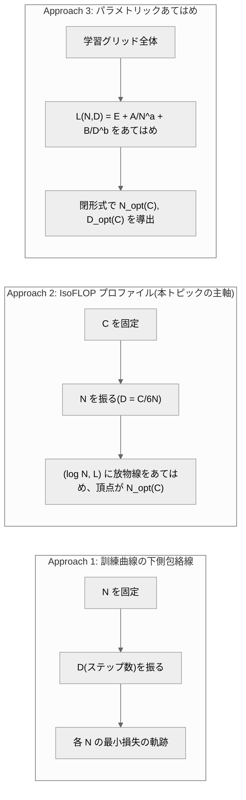
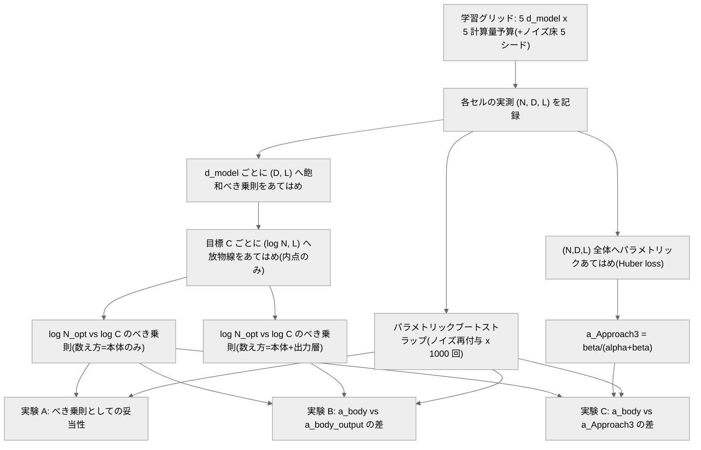

# 009. スケーリング則(Scaling Laws)

## 1. 概要 / Overview

計算量予算(compute budget)$C$ が与えられたとき、それをモデルサイズ $N$ と訓練トークン数 $D$ にどう配分すれば損失を最小化できるかという問題を扱う。Kaplan et al. (2020) と Hoffmann et al. (2022, Chinchilla)はこの **計算量最適(compute-optimal)** な配分則を導いたが、両者は大きく異なる指数($a \approx 0.73$ と $a \approx 0.5$、$N_{opt}(C) \propto C^{a}$)を報告した。Porian et al. (2024) はこの食い違いを、計算量の数え方・warmup の長さ・スケール依存の最適化ハイパーパラメータ調整という 3 つの交絡要因により説明した。

**本トピックの規模上の制約**: Google Colab 無料枠の T4 GPU で振れる計算量の範囲はせいぜい 1.5 桁(コンピュートバジェットを 5 水準・公比 2 で振っても $2^4 = 16$ 倍、$\log_{10} 16 \approx 1.2$)であり、べき指数 $a$ の絶対値を原論文の値(0.73 や 0.5)と一致させることは原理的に不可能である。したがって本トピックが検証するのは **指数の値そのものではなく、小スケールでも成立する構造的な主張** に限る。具体的には、計算量最適なモデルサイズ $N_{opt}(C)$ のべき指数 $a$ を、3 つの異なる角度から攻める。

- **実験 A**: そもそも $N_{opt}(C)$ がべき乗則(対数空間で直線)として記述できるか(IsoFLOP プロファイル、Hoffmann et al., 2022 の Approach 2)。
- **実験 B**: 計算量の数え方(出力層を含めるかどうか)が指数 $a$ の推定値に与える影響。Porian et al. (2024) が特定した 3 要因のうち要因 1(最終層の計算量)のみを、既存の学習結果の再解析だけで検証する。
- **実験 C**: IsoFLOP プロファイル(Approach 2)による指数推定と、パラメトリックあてはめ(Approach 3)から導出した指数推定が内的に整合するか。

$a$ の推定値が Chinchilla の 0.5 や Kaplan らの 0.73 に近いかどうかは判定基準にせず、参考値として事後的に報告するに留める。

## 2. 参考論文 / References

1. Kaplan, J., McCandlish, S., Henighan, T., Brown, T. B., Chess, B., Child, R., Gray, S., Radford, A., Wu, J., Amodei, D. "Scaling Laws for Neural Language Models." arXiv:2001.08361, 2020. https://arxiv.org/abs/2001.08361
2. Hoffmann, J., Borgeaud, S., Mensch, A., et al. "Training Compute-Optimal Large Language Models." NeurIPS 2022. arXiv:2203.15556. https://arxiv.org/abs/2203.15556
3. Porian, T., Wortsman, M., Jitsev, J., Schmidt, L., Carmon, Y. "Resolving Discrepancies in Compute-Optimal Scaling of Language Models." NeurIPS 2024. arXiv:2406.19146. https://arxiv.org/abs/2406.19146

本トピックのモデル学習は、006・007・008 の以下の論文にも依拠する(理論の再掲はしない)。

- Radford, A. et al., "Language Models are Unsupervised Multitask Learners", 2019(GPT-2、バイトレベル BPE)
- Su, J. et al., "RoFormer: Enhanced Transformer with Rotary Position Embedding", Neurocomputing 2024(RoPE)
- Loshchilov, I., Hutter, F., "Decoupled Weight Decay Regularization", ICLR 2019(AdamW)
- Besiroglu, T., Erdil, E., Barnett, M., You, J. "Chinchilla Scaling: A replication attempt." arXiv:2404.10102, 2024(Chinchilla のパラメトリックあてはめが初期値に敏感であることの指摘。本文中で言及する)

## 3. 理論 / Theory

### 3.1 動機・課題

計算量予算 $C$(浮動小数点演算回数)が与えられたとき、それをモデルサイズ $N$(非埋め込みパラメータ数、non-embedding parameter count)と訓練トークン数 $D$ にどう配分すべきか。この問いに Kaplan et al. (2020) と Hoffmann et al. (2022) は大きく異なる答えを出した。Kaplan らは $N_{opt}(C) \propto C^{a}$ の指数を $a \approx 0.73$(モデルサイズを積極的に増やすべき)と報告し、Hoffmann らは $a \approx 0.50$(モデルサイズとデータ量を同程度に増やすべき)と報告した。この 2 つの結果は、GPT-3(Kaplan らの指針に基づく)が同時代の他モデルに比べて過大なモデルサイズ・過小な訓練データ量になっていた、という業界的に大きな影響を持つ違いだった。Porian et al. (2024) はこの食い違いの原因を、計算量の数え方・warmup の長さ・スケール依存の最適化ハイパーパラメータ調整という 3 つの交絡要因に帰着させ、これらを補正すると Kaplan らの手法でも Chinchilla に近い指数が得られることを示した。

### 3.2 記号の定義と計算量の見積もり

以下の記号を用いる。

- $N$: 非埋め込みパラメータ数(non-embedding parameter count)。埋め込み層・出力層を除く Transformer 本体のパラメータ数(`count_non_embedding_parameters`、006 で導入)。
- $D$: 訓練トークン数。
- $C$: 計算量予算(浮動小数点演算回数、FLOPs)。
- $L$: 検証損失。009 では bits-per-byte(006 で確立した、トークナイザに依存しない指標)を用いる。009 は全条件で同一トークナイザ(3.1 節参照)を使うため perplexity でも比較可能だが、シリーズ内の一貫性のため bits-per-byte を使う。
- $V$: 語彙サイズ、$d_{model}$: モデルの隠れ次元、$n_{layer}$: 層数、$n_{ctx}$: 系列長(sequence length)。
- $E, A, B, \alpha, \beta$: Chinchilla のパラメトリックあてはめ(3.3 節 Approach 3)の係数・指数。
- $a, b$: 計算量最適配分の指数($N_{opt}(C) \propto C^{a}$、$D_{opt}(C) \propto C^{b}$)。

**トークンあたりの計算量**: 順伝播 1 パラメータあたり 2 回の演算(乗算+加算)、逆伝播を含めて 3 倍という標準的な近似(Kaplan et al., 2020)から出発する。1 トークンあたりの計算量を、以下の 3 つの項の和として見積もる(`estimate_flops_per_token`、`src/scaling/laws.py`)。

$$
C_{\text{token}} = \underbrace{6N}_{\text{body}} + \underbrace{6 V d_{model}}_{\text{output layer}} + \underbrace{12 \, n_{layer} \, n_{ctx} \, d_{model}}_{\text{attention seq term}}
$$

- **本体**(embedding 層と出力層を除く Transformer 本体): $6N$。
- **出力層**(重み共有(weight tying)により埋め込み行列と同一の行列、006 参照): $6 V d_{model}$。出力層は $V \times d_{model}$ の行列演算であり、1 トークンあたり $2 V d_{model}$ の順伝播演算(逆伝播を含め 3 倍で $6 V d_{model}$)。
- **Attention の系列長依存項**: 各層の Attention スコア計算($QK^\top$ と重み付き和)が系列長 $n_{ctx}$ に比例した追加コストを持つ(Kaplan et al., 2020 の $C_{\text{attn}}$)。

**本トピックの中心的な観察**: $N$ は概ね $d_{model}^2$ に比例する(Attention・Feed-Forward Network の重み行列がいずれも $d_{model}$ の 2 次関数であるため)一方、出力層の項 $6 V d_{model}$ は $d_{model}$ に対して 1 次でしか増加しない。したがって **モデルが小さいほど、出力層が全計算量に占める割合が相対的に大きくなる**。009 の規模($V = 8192$、$d_{model} \le 400$ 程度)ではこの割合が数十パーセントに達することを、次のコードセルで具体的な数値表として示す。

### 3.2.1 出力層が計算量に占める割合(数値表)

009 の学習グリッド(6.1 節)で使う`d_model`の水準(32・64・96・128、語彙サイズ $V=8192$、$n_{layer}=4$、$n_{ctx}=256$)について、本体の計算量 $6N$ に対して出力層の計算量 $6 V d_{model}$ がどの程度の割合を占めるかを示す。ここでの $N$ は 006・008 と同じ構成(RoPE・RMSNorm・SwiGLU、6.1 節で確定)のモデルを実際に構築して`count_non_embedding_parameters`で実測した値である。

     d_model  num_heads       N (実測)        body 6N     output 6Vd   output比率
          32          1       49,312        295,872      1,572,864     84.2%
          64          2      197,440      1,184,640      3,145,728     72.6%
          96          3      443,232      2,659,392      4,718,592     64.0%
         128          4      787,072      4,722,432      6,291,456     57.1%
    
    隣接 d_model 間の N の比: [4.004, 2.245, 1.776](目標 2.0)

出力層の割合は最小の`d_model=32`で最も大きく、`d_model`が増えるにつれ低下する(本体の計算量が $d_{model}^2$ で増える一方、出力層は $d_{model}$ の 1 次でしか増えないため)。この非対称性が、計算量の数え方(出力層を含めるか)がスケーリング指数の推定値に影響を与えるという実験 B の理論的根拠である。

### 3.3 Chinchilla の 3 つのアプローチ

Hoffmann et al. (2022) は、計算量最適な配分則を 3 つの独立なアプローチで推定し、結果が一致することを示した。

- **Approach 1**: モデルサイズ $N$ を固定して訓練ステップ数(= $D$)を振り、各 $N$ について損失 $L$ が最小になる訓練曲線の下側包絡線(minimum envelope)を取る。
- **Approach 2(IsoFLOP プロファイル、本トピックの主軸)**: 計算量予算 $C$ を固定して $N$(したがって $D = C/(6N)$)を振る。$(\log N, L)$ の点は下に凸な放物線状になり、その頂点が $N_{opt}(C)$ を与える。
- **Approach 3(パラメトリックあてはめ)**: $L(N, D) = E + A/N^{\alpha} + B/D^{\beta}$ という関数形を学習グリッド全体にあてはめ、閉形式で $N_{opt}(C)$・$D_{opt}(C)$ を導く。

以下、Approach 3 の閉形式解を導出する。制約 $C = 6ND$(本体のみの数え方、5.2 節)の下で $D = C/(6N)$ を $L$ に代入すると

$$
L(N) = E + A N^{-\alpha} + B (6N/C)^{\beta} = E + A N^{-\alpha} + B \, 6^{\beta} C^{\beta} N^{-\beta}
$$

$N$ について微分し 0 と置く。

$$
\frac{\partial L}{\partial N} = -\alpha A N^{-\alpha - 1} + \beta B \, 6^{\beta} C^{\beta} \, (-1) N^{-\beta - 1} \cdot (-1)
$$

やや煩雑になるので、$D = C/(6N)$ を保ったまま $N, D$ の両方を変数として、ラグランジュの未定乗数法で $C = 6ND$ の制約下の最小化を行う方が見通しがよい。$\mathcal{L} = E + A N^{-\alpha} + B D^{-\beta} - \lambda (6ND - C)$ とおき、$N, D, \lambda$ について偏微分を 0 と置く。

$$
\frac{\partial \mathcal{L}}{\partial N} = -\alpha A N^{-\alpha - 1} - 6 \lambda D = 0, \qquad
\frac{\partial \mathcal{L}}{\partial D} = -\beta B D^{-\beta - 1} - 6 \lambda N = 0
$$

2 式から $\lambda$ を消去する。第 1 式より $\lambda = -\alpha A N^{-\alpha - 1} / (6D)$、第 2 式より $\lambda = -\beta B D^{-\beta - 1} / (6N)$。両者を等置すると

$$
\frac{\alpha A N^{-\alpha - 1}}{D} = \frac{\beta B D^{-\beta - 1}}{N}
\quad \Longrightarrow \quad
\alpha A N^{-\alpha} = \beta B D^{-\beta}
$$

（両辺に $ND$ を掛けて整理した。）この関係と制約 $D = C/(6N)$ を組み合わせると、$N^{-\alpha} \propto N^{\beta}$($D^{-\beta} \propto N^{\beta}$ に $D \propto 1/N$ を代入)より $N^{\alpha + \beta} \propto C^{\beta}$、すなわち

$$
\boxed{N_{opt}(C) \propto C^{a}, \quad a = \frac{\beta}{\alpha + \beta}}
\qquad\qquad
\boxed{D_{opt}(C) \propto C^{b}, \quad b = \frac{\alpha}{\alpha + \beta}}
$$

（$a + b = 1$ は $C = 6ND$、$N_{opt} D_{opt} \propto C$ から自明に整合する。）この導出は **$C$ が $ND$ に比例することを前提としている** 点に注意する。出力層を含む数え方(実験 B)では $C$ は $ND$ に単純比例しないため、この閉形式は使えない。実験 C(6.7 節)で`compute_optimal_allocation_exponents`を使う際は、必ず本体のみの数え方で得られた $(\alpha, \beta)$ を用いる。

### 3.4 Kaplan と Chinchilla の食い違いと 3 要因

Porian et al. (2024) は、Kaplan らの指数($a \approx 0.73$)と Hoffmann らの指数($a \approx 0.5$)の食い違いを、以下の 3 要因に帰着させた。

1. **最終層の計算量**: Kaplan らは計算量の見積もりから出力層(3.2 節の $6 V d_{model}$ 項)を除外しており、小さいモデルの計算量を過小評価していた。出力層を除外すると、小さいモデルは「実際より少ない計算量で今の損失を達成した」ことになり、同じ計算量予算に対して相対的に有利に評価される。この結果、低い計算量予算での $N_{opt}$ が実際より小さく見積もられ、フロンティアの傾き($a$)が急になる(過大評価される)。
2. **warmup の長さ**: 固定ステップ数の warmup は、訓練ステップ数が少ないラン(小さい計算量予算)ほど、訓練全体に占める warmup の割合が大きくなり不利に働く。
3. **スケール依存の最適化ハイパーパラメータ調整**: モデルサイズごとに学習率などを調整しないと、最適配分の推定が歪む。

これらを補正すると、Kaplan らの手法(Approach 1 に近い手法)でも Chinchilla のスケーリング則とよく一致することを Porian らは示した。また、Hoffmann らが示唆した仮説(学習率の減衰(decay)を訓練終了時点に正確に合わせることがスケーリング則の妥当性に重要)に反して、**学習率の減衰の丁寧な扱いはスケーリング則の妥当性に必須ではない** と Porian らは結論している。

**009 で検証するのは要因 1(最終層の計算量)のみである。** 理由は、要因 1 は既存の学習結果の計算量の数え方を変えるだけの再解析で検証でき、要因 2(warmup)・要因 3(最適化ハイパーパラメータ)は追加の学習グリッド(warmup 長・学習率を独立変数として振った別グリッド)を要するという、**観測結果とは独立な** 実装コスト上の理由による(結果を見てから要因 1 だけを選んだのではない)。要因 2・要因 3 は 6.2 節の固定条件として扱う(要因 2 は比例 warmup で回避する側に、要因 3 は全条件で学習率を固定する交絡として明示的に残す)。

### 3.5 解析パイプラインのデータフロー

学習グリッド(モデルサイズ x 計算量予算)から実験 A〜C の指数推定に至るデータフローを示す(6.4 節で詳述)。Mermaid は Google Colab 上では描画されないため、本文の数式・文章だけでも理解が成立するように 6.4 節に文章での説明を併記する。

## 4. 実装方針 / Implementation Policy

- べき乗則あてはめ・飽和べき乗則あてはめ・IsoFLOP 放物線あてはめ・Chinchilla パラメトリックあてはめ・パラメトリックブートストラップは`src/scaling/laws.py`にスクラッチ実装する(Levenberg-Marquardt 法・IRLS もスクラッチ実装し、`scipy.optimize`等の外部最適化ライブラリには委譲しない。線形の最小二乗解`numpy.linalg.lstsq`のみ利用)。
- トークナイザは 008 で Hugging Face Hub(`kojikojiprg/ai-theories-small-gpt-en`)にアップロードした語彙サイズ 8192 の英語バイトレベル BPE を再利用する(5.2 節)。モデル重みはアップロードしない(009 は複数サイズのモデルを新規に学習するため)。
- モデル本体(`GPTLanguageModel`)・学習ループ(`train_language_model`)・optimizer(`AdamW`)・学習率スケジュール(`compute_warmup_cosine_learning_rate`)は 006・007・008 の実装をそのまま再利用し、本トピックでは変更しない。
- コーパスは`src/data/text.py`に追加した`load_english_wikipedia_corpus()`(006 の英語マニフェストを部分集合として含む形で拡張した`en_009_scaling.json`、5.4 節)を使う。
- IsoFLOP プロファイル・フロンティアの描画関数を`src/utils/visualization.py`に追加する(`plot_isoflop_profile`・`plot_optimal_frontier`)。
- 009 では学習済みチェックポイントを Hugging Face Hub にアップロードしない(多数の小型モデルを学習するため、008 のような「標準モデル」の位置づけを持たせない)。
- `SMOKE_TEST`フラグでスモークテスト(縮小スケール)と本番(Google Colab T4)を切り替える。model サイズの水準(`D_MODEL_LEVELS`)自体は独立変数であるため`SMOKE_TEST`で変更しない。縮小するのはコーパス量・学習ステップ数のみであり、等比刻み・条件間で一致させる値は本番設定との比率構造を保つ。

## 5. 実装 / Implementation

### 5.1 トークナイザの取得

008 で Hugging Face Hub にアップロードした`tokenizer.json`(`merges`・`vocab`・`byte_level`・`chunk_split_mode`・`max_chunk_bytes`・`symbol_to_id`を含む、008 5.12 節参照)を取得し、`BPETokenizer`を再構築する。ネットワーク越しの取得に失敗した場合は、008 と完全に同一の設定(`VOCAB_SIZE=8192`、`byte_level=True`、`max_chunk_bytes=64`)で BPE を再学習し、**語彙サイズが 008 のものと一致することをアサーションで確認する**(フォールバック時の学習コーパスは軽量化のため 008 の学習コーパス量よりは少ないが、語彙サイズ自体は一致するかを検証する。学習コーパス自体が完全一致しない場合、マージ規則そのものが 008 と一致する保証はないため、厳密なマージ規則の一致は要求しない)。

**トークナイザの現在の配布先についての注記**: このノートブックが使うトークナイザは、現在`kojikojiprg/ai-theories-tokenizer-en`で配布されている。

以下のコードセル(`HF_TOKENIZER_REPO_ID`)は、モデルリポジトリ`kojikojiprg/ai-theories-small-gpt-en`から`tokenizer.json`を取得する実装になっている。**このノートブックを再実行する場合は、取得元を上記のトークナイザリポジトリに変更する必要がある。**

- 変更対象: 下のコードセルの`HF_TOKENIZER_REPO_ID`
- 現在の値: `"kojikojiprg/ai-theories-small-gpt-en"`
- 変更後の値: `"kojikojiprg/ai-theories-tokenizer-en"`

取得に失敗した場合のフォールバックは、下のコードセルに埋め込まれた小さな埋め込みサンプルテキストから BPE を再学習するが、この再学習で得られる語彙サイズはこのノートブックが前提とする 8192 とは異なる。**フォールバックには頼らないこと。** 取得元を変更せずに取得が失敗した場合、`assert tokenizer.vocab_size == VOCAB_SIZE`により`AssertionError`で停止する。

配布されているトークナイザ(`kojikojiprg/ai-theories-tokenizer-en`)は、このノートブックの実行時に実際に使われたトークナイザと、`merges`・`vocab`・トークン ID 列まで一致することを確認済みである。

### 5.2 ラウンドトリップの検証

008・006 と同様、符号化(encode)と復号(decode)のラウンドトリップが一致することを確認する(不変条件、6 節)。

### 5.3 スケールの設定(SMOKE_TEST)

`SMOKE_TEST=True`はローカルでの動作確認・本番実行可能性の検証用の縮小スケールであり、`SMOKE_TEST=False`(Google Colab T4)が本番設定である。`D_MODEL_LEVELS`(3.2.1 節で確定済み)は独立変数であるため`SMOKE_TEST`で変更しない。縮小するのはコーパス量(取得する記事数)・学習ステップ数・ブートストラップ回数のみである。

### 5.3.1 拡張コーパスに基づく計算量予算の再設計

過去の本番実行では、前提条件 P1(IsoFLOP プロファイルの最小値が掃引範囲の内点にあること)が繰り返し不成立だった。診断の結果、根本原因は前提条件 P3(データ再利用が訓練コーパスの`EPOCH_REUSE_LIMIT`=4.0 倍以内)の天井にあった。そこで英語コーパスを拡張し(マニフェストの記事数を 999 から 9826 に)、律速要因を P3 から Colab 1 セッションの予算(120 分)に入れ替えた。判定基準・前提条件の閾値は変更しない。変更するのは計算量予算(`TARGET_TOKENS_PER_PARAM_MID`)と掃引水準の再検討のみで、その根拠は観測結果の方向に依存しない。詳細は付録 A.1。

### 5.3.2 決定: 採用した設計とその根拠

**採用**: `D_MODEL_LEVELS=[32,64,96,128]`(変更なし)・`TARGET_TOKENS_PER_PARAM_MID=14`(3.7 から引き上げ)。5 水準(`d_model=192`の復帰)は、前提条件 P1 を改善せず最小ステップ数を悪化させるため採用しなかった。`tau=14`はセッション予算の 66.7% を使う見積もりで、残り約 33% を安全余裕とする。前提条件 P3 の比率(予測)は 1.54 倍(上限 4.0 倍)で余裕がある。`MIN_STEPS_FLOOR`は **100** に引き上げる(採用設計での予測値は 107)。根拠の詳細(5 水準化を採らなかった理由、幾何学的な限界、`tau`の選定)は付録 A.2。

### 5.4 コーパスの取得

英語版 Wikipedia を 60〜100 MB 規模で取得する(`load_english_wikipedia_corpus_with_fallback`、`src/data/text.py`。Hugging Face Hub のデータセットから取得できない場合のみ`load_english_wikipedia_corpus`による直接取得にフォールバックする)。マニフェスト`en_009_scaling.json`は、006 の 356 記事(`en_006_pretraining.json`)に、Wikipedia の Special:LongPages(長大記事一覧、API `list=querypage&qppage=Longpages`)から追加で選定した記事を加えた計 9826 記事からなる(内訳・拡張経緯は`src/data/wikipedia_manifests/README.md`および 5.3.1 節を参照)。006 のマニフェストを部分集合として含む形で拡張しているため、006・008 で取得済みのキャッシュをそのまま再利用できる。

**実行時点のコーパスサイズについての注記**: 本番実行(Google Colab、`SMOKE_TEST=False`)で実際に取得したコーパスは 60,851,631 UTF-8 バイト(約 60.85 MB)であった。事前の概算(006 の 356 記事から実測した抽出比率 約 14.1% を追加記事の wikitext 合計に適用した見積もり、60 MB 弱)とよく一致しており、目標レンジ(60〜100 MB)の下限付近である。

### 5.5 コーパス取得のスケーリング計測・外挿

記事取得件数を 3 点以上振って所要時間を実測し、$\log t = \log a + b \log n$ のあてはめでべき指数 $b$ を推定して、マニフェスト全体(1000 記事)への外挿値を出す。取得はキャッシュされるため(`load_wikipedia_corpus`の記事単位キャッシュ)、計測に使った記事は以降の呼び出しで再取得されない。

### 5.6 符号化のスケーリング計測・外挿

学習データ全体の符号化(encode)は 1 回だけ行われる処理だが、超線形にコストが増加すると本番実行時間の見積もりを大きく崩すため、006・008 と同じ手法でスケーリングを計測する。

### 5.7 コーパスの符号化・評価窓の作成

全`d_model`条件で同一の訓練データ・検証データ(evaluation windows)を共有する(不変条件、6 節)。

訓練データ(`train_ids`)は`encode_text_to_memmap`(`src/data/text.py`)で`uint16`の`numpy.memmap`として符号化する。トークン ID を Python の`list[int]`として保持すると、大規模コーパス(1 億トークン超)では整数オブジェクトのオーバーヘッドにより数 GB の RAM を消費し、Google Colab の RAM 制約(12 GB)を超えるため(背景は本節のセル実行結果、および`src/data/text.py`の`encode_text_to_memmap`の docstring を参照)。検証データ(`val_ids`)は規模が小さいため、従来通り`encode_corpus`で in-memory に符号化する。

### 5.8 学習グリッドの定義(計算量予算)

6.1 節の設計に従い、計算量予算を公比 2 で 5 水準構成する。グリッドの構成には **本体のみの数え方**($C = 6ND$、Kaplan らの流儀)を用いる。各セルのステップ数は $D = C / (6N)$ から決める。中央の`d_model`における目標トークン/パラメータ比`TARGET_TOKENS_PER_PARAM_MID`を起点に、中央の計算量予算 $C_{mid} = 6 \times \tau \times N_{mid}^2$ を定め、公比 2 で前後 2 水準ずつ計 5 水準を作る。

### 5.9 較正: 学習率・gradient clipping 閾値

較正のスケールが本番より小さいと、本番でのみ現れる前提の不成立(学習の崩壊、閾値の未達など)を検出できない。そのため較正は中央の`d_model`・最大の計算量予算(そのセルの本番ステップ数)で行う。009 は Porian らの要因 3(スケール依存の最適化ハイパーパラメータ調整)を検証対象から明示的に除外し、**全`d_model`・全計算量予算で同一の学習率を使う**(6.2 節、固定条件として事前宣言済み)ため、較正するのは (1) 発散しない学習率、(2) その学習率での gradient clipping 閾値、の 2 つのみである。

**学習率の選定方針**: 固定 4 水準(x0.5, x1.0, x2.0, x4.0)による較正では、本番実行(`SMOKE_TEST=False`)で 4 水準すべてが単調に改善し続け、発散点にも改善の頭打ちにも到達しないまま探索が終わっていた(採用した学習率が真に「これ以上上げると悪化する」水準なのか確認できていなかった)。この問題に対処するため、倍率を 1 倍から倍々に増やしながら、**発散するか、直前の水準からの損失改善が`PLATEAU_RATIO`未満(頭打ち)になるまで** 探索を続ける適応的な方式に変更する。

- 発散した場合は、その 1 つ手前の(発散しなかった最後の)倍率を採用する(固定 4 水準時代と同じ設計方針を踏襲)。
- 発散せずに頭打ちになった場合は、改善が頭打ちになった時点の倍率(その時点でなお僅かに改善している最新の倍率)を採用する。
- `MAX_LR_MULTIPLIER`(32.0)に達しても発散も頭打ちも起きない場合は、その旨を出力し、`MAX_LR_MULTIPLIER`の水準を採用したうえで、**この探索範囲では真の最適値を捉えられていない可能性がある** ことを明記する。

**gradient clipping 閾値**: 採用した学習率での較正実行における勾配ノルムの`CLIP_QUANTILE`分位点(007・008 と同じ方式)。

### 5.10 1 ステップあたりの学習時間のスケーリング計測・外挿

まず代表として中央の`d_model`について、ステップ数を 3 点以上振って学習時間を実測し、$\log t = \log a + b \log(\text{steps})$ のあてはめでべき指数 $b$ を推定する(線形なら $b \approx 1$。JIT ウォームアップなどにより短いステップ数で相対的に遅くなる場合、$b$ が 1 から乖離する)。そのうえで、全`D_MODEL_LEVELS`(5.9 節の較正と同じ学習率・gradient clipping 閾値)について実際に一定ステップ数を実行し、`d_model`ごとの 1 ステップあたり学習時間を実測する(5 点しかないためこちらは外挿ではなく直接測定だが、`d_model`に対する依存の傾向をべき乗則としても報告する、診断用)。

### 5.11 学習グリッド全体の合計時間の見積もり

4 つの`d_model` x 5 つの計算量予算(20 セル)+ノイズ床の追加 4 シード(中央`d_model`・中央計算量予算を計 5 シードにするための追加分)の合計時間を、5.10 節で実測した`d_model`ごとの 1 ステップあたり時間と、5.8 節で決めた本番ステップ数から計算し、Colab のセッション時間予算(`SESSION_BUDGET_SECONDS`)と比較する。

### 5.11.1 時間見積もりが予算超過と出た理由(ローカル実行固有の注記)

ローカル(Mac、MPS)での時間見積もりは「予算内: False」(合計 11006.5 秒=183.4 分、予算の 152.9%)となったが、これは設計が過大であることを意味しない。ローカルでは 1 ステップの実行時間が Python のディスパッチ・MPS カーネル起動などの固定オーバーヘッドに支配され、小さい`d_model`ほど T4 より相対的に遅いためである。T4 の過去の実測(731.2 秒)から逆算した採用設計の推定時間は 80.1 分(予算の 66.7%)である。診断の詳細と、本番での確認事項は付録 A.3。

### 5.12 学習グリッドの実行

`SMOKE_TEST=True`(ローカル)では、この学習は主張を検証する本番実行ではなく、コードが最後まで動作することの確認が目的である。5.3 節で縮小したステップ数(本番ステップ数を一定比率で縮小する。5.8 節の等比構造(計算量予算の公比 2)自体は縮小後も保つ)で全 20 セルを実行し、実測の $N$・$D$・$L$ を記録する(実行結果は 6.2 節・後述のセルで JSON として永続化する)。

### 5.13 前提条件 P0・P3 の判定量: 学習の進行・データ再利用の上限

最終検証 bits-per-byte が、一様分布相当の値の一定割合以下であることを、実験 A・B・C 共通の前提条件 P0 として後段(7 節)で判定する。ここでは判定に使う閾値を、検証したい仮説とは独立な量として確定させる。

**前提条件 P3(データ再利用の上限)**: いずれのグリッドセルも、訓練トークン数($D$)が訓練コーパスのトークン数の`EPOCH_REUSE_LIMIT`(=4.0)倍を超えないこと。同じコーパスを 4 エポックを超えて反復させると、言語モデルの事前学習では過学習・データ重複による汎化性能の低下が報告されている(Muennighoff et al., "Scaling Data-Constrained Language Models", NeurIPS 2023、006 の実装時にも参照した基準)。P0 と同様、検証したい仮説(スケーリング指数)とは独立な、学習グリッドの設計自体が意味を持つための前提条件である。

### 5.14 ノイズ床の測定

中央の`d_model`・中央の計算量予算の 1 条件を`NOISE_FLOOR_SEEDS`シードで実行し、$L$ のシード間標本標準偏差を測定する(標本標準偏差の過小バイアスを抑えるため 5 シード。シード数自体は縮小しない)。

### 5.14.1 学習グリッドの生データの永続化

学習グリッド・ノイズ床・較正の結果を JSON としてディスクに書き出し、学習グリッド実行セル(5.12 節)では`grid_points`を先頭 5 点ではなく全件(20 セル分)印字する。ノートブックのセル出力さえ残っていれば、JSON ファイルが失われても生データを復元できる。保存先は`SMOKE_TEST`の値で分ける。経緯と本番実行後の作業は付録 A.4。

### 5.15 解析パイプライン全体のスケーリング計測・外挿

ブートストラップ回数を 3 点以上振って解析パイプライン全体(`reconstruct_optimal_frontier` x 2 数え方 + Chinchilla パラメトリックあてはめ)の実行時間を実測し、本番のブートストラップ回数(1000 回)への外挿値を出す。ここでは学習グリッド(5.12 節)で実際に得た $(N, D, L)$ を使う(`SMOKE_TEST=True`の場合、値そのものはスモークテストの判定には使わない、時間計測のみが目的)。

### 5.16 解析パイプラインの動作確認

実験 A・B・C で使う関数呼び出しが実際に動作することを確認する。**この時点の数値は動作確認用の小さい`n_bootstrap`(=30)によるものであり、支持・反証・判定不能の結論を導かない**(7 節で改めて宣言する判定基準・前提条件を`N_BOOTSTRAP`で適用する本来の判定セルとは別物である)。

## 6. 不変条件のアサーション / Invariant Assertions

実験の妥当性が依存する量をすべて実行時のアサーションで確認する(表として出力するだけでは足りない)。

### 6.1 あてはめ関数の正しさ(合成データによる検証)

`src/scaling/laws.py`にスクラッチ実装したあてはめ関数が、既知のパラメータから生成した合成データからそのパラメータを正しく復元できることを検証する。

## 7. 実験 / Experiments

実験 A(IsoFLOP プロファイルによるべき乗則の妥当性)・実験 B(計算量の数え方が指数に与える影響)・実験 C(2 つの推定法の内的整合性)の 3 実験を独立に宣言する。いずれも $N_{opt}(C)$ のべき指数 $a$ に関する実験であり、3 つの異なる角度から攻める構成である(0 節)。

### 7.1 学習グリッドの共通設定(再掲)

学習グリッド・固定条件・較正は 5 節で確定済みである。ここでは判定に関わる設計のみを再掲する。

- モデルサイズ: `n_layer=4`固定、`d_model`を 4 水準(32, 64, 96, 128)。head_dim を 32 に固定し`num_heads = d_model // 32`。実測 $N$ の目標公比は 2(32→64 の 1 区間を除き 6 節で ±15% 以内であることを確認済み。32→64 は head_dim=32 固定の制約上、この 1 区間だけ N が約 4 倍に飛ぶ構造的な例外であり、6 節で明示的に扱う)。
- 計算量予算: 公比 2 で 5 水準。グリッドの構成には本体のみの数え方($C=6ND$)を用いる。
- ノイズ床: 中央の`d_model`・中央の計算量予算の 1 条件を 5 シードで測定(5.14 節)。

### 7.2 固定条件(事前宣言)

以下を固定条件として事前に宣言する。009 では検証対象から除外し、Porian et al. (2024) の要因 2・3 に相当する既知の交絡として明示的に残す。

- **学習率は全`d_model`・全計算量予算で同一の値に固定する**(5.9 節で較正した`LEARNING_RATE`)。これは Porian らの要因 3(スケール依存の最適化ハイパーパラメータ調整)に相当する既知の交絡であり、009 では扱わない。
- **warmup は各ランの総ステップ数の 10%(比例方式)**。Porian らの要因 2(固定ステップ数 warmup が短いランを不利にする)を避ける側に固定する。
- **cosine decay の長さは各ランの総ステップ数に一致させる。**
- **バッチサイズ・系列長`n_ctx`は全条件で同一に固定する**(006・008 と揃える、`BATCH_SIZE=32`、`SEQUENCE_LENGTH=256`)。
- **アスペクト比(depth と width の比)**: `n_layer`を固定して`d_model`のみを振るため、大きいモデルほど幅広の形状になる。Kaplan et al. (2020) はモデルの形状(depth と width の比)がスケーリング則に与える影響は小さいと報告しており、この簡略化を固定条件として採用する。
- **gradient clipping の閾値**: 較正で決めた`GRADIENT_CLIP_THRESHOLD`(勾配ノルムの 90% 分位点方式、007・008 と同じ)。

### 7.3 判定関数(共通)

対比量とその標準偏差(パラメトリックブートストラップによる)から、支持 / 反証 / 判定不能(または支持 / 反証のみ)を返す判定関数を定義する。

### 7.4 実験 A: IsoFLOP プロファイルによる計算量最適配分の推定

- **検証すること**: 本体のみの数え方のもとで、$N_{opt}$ が $C$ のべき乗則として記述できるか。
- **判定基準(3 値: 支持 / 反証 / 判定不能)**
  - 対比量: $\log N_{opt}$ 対 $\log C$ のべき乗則あてはめの指数 $a_{\text{body}}$。
  - 支持: ブートストラップによる $a_{\text{body}}$ の標準偏差の 2 倍が、推定値 $a_{\text{body}}$ 自身より小さい(すなわち $a$ が 0 と区別できる)。かつ、べき乗則(対数空間の直線)のあてはめの残差平方和が、対数を取らない線形あてはめの残差平方和より小さい。
  - 反証: 上記の後半が成立しない(べき乗則が対数を取らない線形より劣る)。
  - 判定不能: $a_{\text{body}}$ が 0 と区別できない。
- **前提条件 P0**: 全ランで学習が進んでいること。最終検証 bits-per-byte が、一様分布相当の値の`PRECONDITION_BPB_RATIO`(=0.9)以下であること(5.13 節で閾値を確定済み)。
- **前提条件 P1**: 各計算量予算の IsoFLOP プロファイルの最小値が掃引範囲の内点にあること。内点となった予算が 3 つ未満の場合、実験 A 全体を前提不成立として記録する。
- **前提条件 P3**: いずれのグリッドセルも、訓練トークン数が訓練コーパスのトークン数の`EPOCH_REUSE_LIMIT`(=4.0)倍を超えないこと(5.13 節)。

$a$ の推定値が Chinchilla の 0.5 や Kaplan らの 0.73 に近いかどうかは判定基準にしない(計算量の範囲が 1.5 桁では絶対値の一致を主張できないため)。参考として値を報告するのはよいが、事前宣言した判定とは節を分け、事後的な参考であることを明示する。

### 7.5 実験 B: 最終層の計算量の扱いが指数に与える影響

- **検証すること**: 計算量の数え方に出力層を含めると、推定される指数 $a$ が小さくなるか(Porian et al., 2024 の要因 1 の再現)。
- **予測の方向と根拠**: 出力層を含めない数え方は小さいモデルの計算量を過小評価する。含めると小さいモデルが相対的に不利に評価され、低い計算量予算での $N_{opt}$ が上がる。その結果フロンティアの傾きは緩やかになるため、$a_{\text{body+output}} < a_{\text{body}}$ を予測する(3.2.1 節の数値表と整合する向き)。これは Kaplan らの 0.73 から Chinchilla の 0.5 への変化と同じ向きである。
- **判定基準(3 値: 支持 / 反証 / 判定不能)**
  - 対比量: $\Delta a = a_{\text{body+output}} - a_{\text{body}}$。**同一ブートストラップ反復内の差** として計算する(`bootstrap_scaling_analysis`の`delta_b`)。
  - 閾値: $\Delta a$ のブートストラップ標準偏差の 2 倍。
  - 支持: $\Delta a < 0$ かつ $|\Delta a|$ が閾値を超える。
  - 反証: $\Delta a > 0$ かつ $|\Delta a|$ が閾値を超える。
  - 判定不能: $|\Delta a|$ が閾値以内。
- **前提条件**: 実験 A の P0・P1・P3 に加え、本体+出力層の数え方でも内点となる予算が 3 つ以上あること。
- **追加の診断量(判定基準ではない)**: 注意機構の系列長依存項をさらに加えた 3 つめの数え方(`FLOPS_PER_TOKEN_FULL`)での $a$ も報告してよい。

この実験は **追加の学習を一切行わない**。実験 A と同一の学習結果を、計算量の数え方だけ変えて再解析する。

### 7.6 実験 C: 2 つの推定法の内的整合性

- **検証すること**: パラメトリックあてはめ(Approach 3)から導出した指数と、IsoFLOP プロファイル(Approach 2)から直接推定した指数が一致するか。
- **判定基準(3 値ではなく支持 / 反証の 2 値、理由は前提条件 P2 の項を参照)**
  - グリッド全体の $(N, D, L)$ に $L(N,D) = E + A/N^{\alpha} + B/D^{\beta}$ を対数空間の Huber 損失であてはめ、$a_{\text{Approach3}} = \beta / (\alpha + \beta)$ を求める。
  - 対比量: $\delta = a_{\text{Approach3}} - a_{\text{body}}$。同一ブートストラップ反復内の差として計算する(`bootstrap_scaling_analysis`の`delta_c`)。
  - 閾値: $\delta$ のブートストラップ標準偏差の 2 倍。
  - 支持: $|\delta|$ が閾値以内(2 つの推定法が一致する)。
  - 反証: $|\delta|$ が閾値を超える。
  - **判定不能はこの実験では設けない**: 支持の条件が「差が小さいこと」であるため、ノイズが大きいと自動的に支持になってしまう。これを防ぐため前提条件 P2 を設ける。
- **前提条件 P2(識別可能性)**: ブートストラップによる $\alpha \cdot \beta$ の変動係数(標準偏差 / 推定値)が、`P2_CV_THRESHOLD`(=0.5、本番の前に宣言)以下であること。満たさない場合、パラメトリックあてはめは識別不能であり、実験 C を前提不成立として記録する。
- **前提条件 P3**: 実験 A の P3(5.13 節)と同一。
- 比較は本体のみの数え方で行う(3.3 節: $a = \beta/(\alpha+\beta)$ の導出が $C \propto ND$ を前提とするため)。

### 7.7 可視化

IsoFLOP プロファイル・フロンティアの描画関数(`plot_isoflop_profile`・`plot_optimal_frontier`)で、現在の学習グリッド(`grid_points`)の点推定(ブートストラップなし)を描画する。`SMOKE_TEST=True`の場合はスモークスケールのデータであり、動作確認以上の意味を持たない。`SMOKE_TEST=False`の場合は本番データの点推定を示すが、7 節で事前登録した判定基準(ブートストラップに基づく支持・反証・判定不能)そのものではない点に注意する。

    

    

## 8. 結果・考察 / Results and Discussion

本番実行(Google Colab、`SMOKE_TEST=False`)の結果を報告する。

本番実行に至る過程で、学習グリッドの掃引範囲(`D_MODEL_LEVELS`)と計算量予算(`TARGET_TOKENS_PER_PARAM_MID`)の設計を複数回見直した(前提条件 P1 の不成立への対応。5.3.1 節・5.3.2 節)。以下は、`D_MODEL_LEVELS=[32,64,96,128]`・`TARGET_TOKENS_PER_PARAM_MID=14`とする採用設計での本番実行の結果である。**この修正を通じて判定基準(対比量の定義・閾値の導出式・期待する差の方向)は一切変更していない。** 修正の根拠は実験デザイン上の問題(最適点が掃引範囲の端に偏り、放物線の頂点を内点として推定できない)であり、どの仮説を支持する結果が出たかには依存しない。再設計によっても前提条件 P1 が必ず満たされる保証はなく、実際に実験 B(8.3 節)では本体+出力層の数え方で P1 が不成立となった。経緯の詳細は付録 A.5。

### 8.1 学習グリッドと較正

較正(5.9 節)は、学習率の倍率を x1.0 から倍々に上げながら、発散するか改善が頭打ちになるまで探索する適応的な方式で行った。実測結果(base learning rate = 3e-4)は次の通りである。

- x1.0: train loss 5.6721(発散なし)
- x2.0: train loss 5.0440
- x4.0: train loss 4.6653
- x8.0: train loss 4.4263
- x16.0: train loss 4.2350
- x32.0: train loss 4.1969

x16.0 から x32.0 への改善率は $(4.2350-4.1969)/4.2350 \approx 0.90\%$ であり、`PLATEAU_RATIO`(2%)を下回ったため探索は **頭打ち(plateaued)** として終了し、`x32.0`(学習率 $9.60\times10^{-3}$)を採用した。発散には一度も到達しなかった。最小・最大の`d_model`(32・128)でも同じ学習率で発散しないことを確認済みである。gradient clipping 閾値は、採用した学習率での較正実行における勾配ノルムの 90% 分位点として`0.3054`を得た。

本番グリッド(4 つの`d_model` x 5 つの計算量予算、20 セル)の実行時間の実測値は`3252.3`秒(約 54.2 分)だった。5.11 節に記載したローカル(Mac、MPS)実測に基づく見積もり(グリッドのみで`84797.4`秒 = 1413.3 分、較正を含めた合計では`120472.1`秒でセッション予算 120 分を大幅に超過)は、5.11.1 節で述べた通りローカルの固定オーバーヘッド支配的な特性に起因する過大な見積もりであり、実測はこれを大きく下回った(ローカル見積もりの約 3.8%)。5.3.1 節で算出した Colab T4 換算のクロスチェック(グリッド・ノイズ床・較正を合わせた設計全体で`80.1`分、セッション予算の 66.7%)と比較しても、グリッド単体の実測(54.2 分)はこれを下回っており、見積もりが実測から大きく外れていないことを確認できた(ノイズ床・較正それぞれの個別の実行時間は、セルの出力として個別には記録されていない)。

前提条件 P0(学習の進行)・P3(データ再利用の上限)の実測結果は次の通りである。

- 一様分布相当の bits-per-byte: `4.2947`、前提条件 P0 の閾値(90%): `3.8652`。本番グリッドでの最終 bits-per-byte の最大値は`2.8203`であり、閾値を下回るため **P0 は成立** する。
- 前提条件 P3 の上限: 訓練コーパスの`4.0`倍。本番グリッドでの最大データ再利用比率は`1.54`倍であり、**P3 は成立** する(5.3.1・5.3.2 節での予測値`1.54`倍と一致)。

本番グリッドの最小ステップ数の実測値は`107`であり、6 節のアサーション`MIN_STEPS_FLOOR=100`を満たす(5.3.2 節での予測値と一致)。

ノイズ床(5.14 節、中央の`d_model`・中央の計算量予算を`5`シードで測定)は、$L$ のシード間標本標準偏差として`NOISE_STD=0.01459`を得た。この値が、以降の全実験でパラメトリックブートストラップの観測ノイズとして使われる。

学習グリッドの生データ(`009_grid_results.json`)については、セル出力上は「学習グリッドの生データを保存した」と記録されているが、**このノートブックを整理した時点で当該ファイルはリポジトリにコミットされておらず、確認できなかった。** 5.14.1 節で想定していた「JSON 保存後にコミットされずセッション終了で失われる」という事象が、今回も再現した可能性がある。ただし、5.12 節の学習グリッド実行セルの出力に`grid_points`(20 セル分の実測 $N$・$D$・$L$)が全件印字されており、本節(8 節)で報告する数値はすべてこの印字済みの生データから独立に再計算・検証したものである。生データそのものは失われていない。

### 8.2 実験 A: IsoFLOP プロファイルによるべき乗則の妥当性

前提条件の実測結果: 内点となった計算量予算の数(本体のみの数え方)は`3`(判定に必要な`3`をちょうど満たしており、余裕はない)であり **P1 は成立** する。P0・P3 は 8.1 節の通り成立している。

判定基準による結論は **支持** である。$a_{\text{body}} = 0.41212$、ブートストラップ標準偏差は`0.09533`であり、判定基準の閾値(標準偏差の 2 倍 = `0.19067`)を$a_{\text{body}}$が上回るため($a$ は 0 と明確に区別できる、標準偏差の約 4.3 倍に相当)、判定基準の前半を満たす。べき乗則(対数空間の直線)のあてはめが、対数を取らない線形あてはめより残差平方和が小さいという後半の条件も、`judge_experiment_a`の判定として満たされている。両条件がそろったため支持と判定された。

7.7 節の図(IsoFLOP プロファイル、本体のみの数え方)を見ると、5 つの計算量予算のうち、最小($C=4.13\times10^{12}$)と最大($C=6.60\times10^{13}$)の 2 つは、掃引した`d_model`の範囲内で損失が単調に変化しており(放物線の頂点が範囲外にある)内点にならない。残る中央の 3 つの計算量予算($C=8.25\times10^{12},\ 1.65\times10^{13},\ 3.30\times10^{13}$)では、`log N`に対して損失が一度下がってから上がる形の放物線が観測でき、頂点(内点、図中の星印)がそれぞれ`log N_opt`$\approx11.46,\ 11.77,\ 12.03$($N_{opt}$でおよそ`94,800`・`129,100`・`167,800`)に得られている。右側のフロンティア図では、この 3 点(青線、`body-only`)が`log C`に対してほぼ直線上に並んでおり、べき乗則としての当てはまりが視覚的にも確認できる。

**事後的な参考(判定には使わない)**: $a_{\text{body}}=0.412$ は、Chinchilla の指数($a\approx0.5$)の約 82%、Kaplan らの指数($a\approx0.73$)の約 56% にあたる。計算量の範囲が 1.5 桁程度しかないため、この絶対値の近さ自体を検証済みの結論として扱うことはできない(7.4 節で事前宣言した通り)。

### 8.3 実験 B: 最終層の計算量の扱いが指数に与える影響

判定基準による結論は **前提不成立** である。前提条件 P1 は、本体のみの数え方では内点予算`3`(実験 A と同一の結果、成立)である一方、本体+出力層の数え方では内点予算が`2`にとどまり、判定に必要な`3`に届かなかった(不成立)。P1 は両方の数え方で内点予算`3`以上であることを要求するため、実験 B 全体として **前提不成立** と判定される。P0・P3 は成立している。

**前提不成立は、仮説(計算量の数え方が指数に与える影響)について何の情報も与えない。** これは、効果がノイズ床に埋もれて検出できなかった「判定不能」とは異なる状態であり、両者を区別して報告する。`run_experiment_b`は前提不成立の場合に早期リターンする実装になっており、$a_{\text{body+output}}$・$\Delta a$・診断量(`FLOPS_PER_TOKEN_FULL`によるべき指数)のいずれも、本番実行では計算されなかった。

参考として、7.7 節の可視化セルは実験 B の判定パイプラインとは独立に、本体+出力層の数え方でのフロンティアを描画のためだけに計算している。そこでは内点`2`点(`log C`$\approx31.13, 31.82$)を結ぶ直線の傾きとして$a_{\text{body+output}}\approx0.538$が得られている。**この値はブートストラップによる不確かさの評価を伴っておらず、また 2 点を通る直線は残差 0 で必ず一致するため統計的な当てはめとしての意味を持たない、極めて不安定な参考値である。** 実際、この値は$a_{\text{body}}=0.412$より大きく、事前に予測した向き($a_{\text{body+output}} < a_{\text{body}}$、7.5 節)とは逆符号である。しかし前提条件 P1 が不成立である以上、この符号の違いを「反証」として扱うことはできない。判定パイプライン自体が実行されていないためである。

**事後的な解釈(検証されたものではない)**: なぜ本体+出力層の数え方で内点予算が`3`から`2`に減ったのか。出力層を含めると 1 トークンあたりの計算量が増え、特に小さい`d_model`ほど出力層の占める割合が大きい(3.2.1 節の数値表: `d_model=32`で 84.2%、`d_model=128`でも 57.1%)。同じ計算量予算 $C$ に対して、出力層を含めた数え方では 1 トークンあたりの計算量が全体に底上げされるため、同じ $N$ に対する訓練トークン数 $D=C/(\text{flops\_per\_token})$ が小さくなる。この効果が`d_model`ごとに非対称(小さい`d_model`ほど強く効く)であるため、IsoFLOP プロファイルの形状が変化し、これまで内点だった予算のうち少なくとも 1 つで頂点が掃引範囲の外に押し出された可能性がある。これは本番実行後に立てた構造的な仮説であり、本ノートブックで直接検証したものではない。

Porian et al. (2024) の要因 1(最終層の計算量)の再現については、**前提不成立である以上、再現できたともできなかったとも言えない。** 上記の参考値($a_{\text{body+output}}\approx0.538$)が示す符号は要因 1 の予測と逆であるが、これは統計的な検証を経ていない値に基づく観察であり、要因 1 を反証する根拠にはならない。

### 8.4 実験 C: 2 つの推定法の内的整合性

前提条件の実測結果: P0・P1(内点予算`3`、実験 A と同一)・P3 は成立している。前提条件 P2(識別可能性)は、パラメトリックあてはめの$\alpha$・$\beta$のブートストラップ変動係数がそれぞれ`cv_alpha=0.12349`、`cv_beta=0.02341`であり、いずれも採用済みの閾値`P2_CV_THRESHOLD=0.5`を大きく下回る(閾値に対して約 4 倍・約 21 倍の余裕がある)。**P2 は十分な余裕を持って成立** する。

判定基準による結論は **支持** である。$\delta = a_{\text{Approach3}} - a_{\text{body}} = 0.48507 - 0.41212 = 0.07295$、ブートストラップ標準偏差`delta_boot_std=0.10727`、閾値(標準偏差の 2 倍)は`0.21454`。$|\delta|=0.07295$は閾値の約 34% にとどまり、閾値以内であるため支持と判定される。

パラメトリックあてはめ(Approach 3)の点推定値は$\alpha=0.6809$、$\beta=0.6414$(`fit_chinchilla_parametric`の`converged`フラグは`False`であり、境界張り付きなど何らかの数値的な不安定性が検出されたことを示す)。ここから$a_{\text{Approach3}} = \beta/(\alpha+\beta) = 0.48507$が導かれる。

**独立な 2 つの推定法が近い値に収束したことの意味**: 実験 C の判定基準は「差が小さいこと」を支持の条件とするため、もしパラメトリックあてはめの$\alpha$・$\beta$が全く定まらない(ブートストラップでの変動が非常に大きい)状態であれば、$\delta$のブートストラップ標準偏差も比例して大きくなり、閾値`2×std`が広がって、どんな$\delta$でも自動的に「支持」になってしまう。これでは 2 つの推定法が実際に一致しているのか、単に一方の推定がノイズに埋もれているだけなのかを区別できない。前提条件 P2 は、この抜け道を塞ぐために「パラメトリックあてはめが十分に安定して定まっていること」を要求するものである。今回 P2 が閾値に対して大きな余裕を持って成立したことにより、今回の支持判定は「ノイズが大きすぎて何でも支持になる」状態ではなく、**2 つの独立な推定法が実際に近い値へ収束したことを意味する。** これは、5 節で構築した学習グリッド・6 節で検証した解析パイプラインの内的な一貫性を裏付ける結果である。

### 8.5 スケーリング則の小規模実験としての限界(総合考察)

3 つの実験を通じて得られた結果を整理すると、実験 A(IsoFLOP プロファイルによるべき乗則の妥当性)と実験 C(2 つの推定法の内的整合性)はいずれも **支持** され、実験 B(最終層の計算量の扱いが指数に与える影響)は **前提不成立** に終わった。実験 A・C の支持により、この小スケールの学習グリッドにおいても$N_{opt}(C)$がべき乗則として記述でき、かつ IsoFLOP プロファイルからの直接推定とパラメトリックあてはめからの間接推定が独立に一致するという、構造的な主張は成立したと言える。一方、計算量の数え方が指数に与える影響(Porian らの要因 1)については、本体+出力層の数え方で内点予算が不足したため、支持・反証いずれの結論も出せなかった。

**計算量予算グリッドの設計に関する限界**: 5.3.1 節で述べた通り、5 つの計算量予算の中心を決めるにあたり、$N_{opt}(C)\propto\sqrt{C}$(Chinchilla の$a\approx0.5$)という値を作業仮説として用いて、較正済みモデル$N_{opt}=0.0276936\sqrt{C}$を構築した。009 が推定しようとしている対象はまさにこの指数$a$であるため、この手続きは一見循環しているように見える。グリッドをどこに配置するかを決めるには何らかの事前の見積もりが必要であり、Hoffmann らも同様に反復的な手続きを踏んでいる以上、この種の仮定を完全に避けることは難しい。しかし、掃引範囲に対して実際に内点になった予算がどれかは、この作業仮説の影響を受けている可能性があり、推定された$a_{\text{body}}=0.412$がこの仮定にどの程度引きずられているかを、本ノートブック内で切り分けることはできていない。この点は限界として正直に記録しておく。

**このスケールに固有の制約**: 計算量予算の範囲は 5 水準・公比 2 で、対数スケールにしてわずか 1.5 桁程度($2^4=16$倍、$\log_{10}16\approx1.2$)しかない。加えて`d_model`の掃引水準も 4 つに限られ、放物線あてはめに使える点数も同様に限られている。実際、実験 A の内点予算は判定に必要な最小数`3`ちょうどであり、余裕はなかった。したがって、推定されたべき指数の絶対値を Kaplan らや Chinchilla の値と直接比較することはできない(7.4 節で事前宣言した通り)。

**本番実行で判明した、このスケールに特徴的な性質(事後的な解釈)**: 実験 A のフロンティア上の 3 つの内点における計算量最適な訓練トークン数とパラメータ数の比($D_{opt}/N_{opt} = C/(6N_{opt}^2)$)は、それぞれ約`153`・`165`・`195`であり、Chinchilla が報告した比(約`20`)よりも一桁近く大きい。これは事後的な観察であり、本ノートブックで統計的に検証したものではないが、考えられる構造的な理由として、本トピックの語彙サイズ(`VOCAB_SIZE=8192`)に対してモデル本体(`d_model=32〜128`)が小さいことが挙げられる。3.2.1 節で確認した通り、出力層の計算量が総計算量に占める割合は`d_model=32`で 84.2%、`d_model=128`でも 57.1% と大きく、本体の計算量が語彙サイズ由来の固定コストに対して相対的に小さい。この構造のもとでは、同じ計算量をパラメータ数の増加に投じるより、訓練トークン数を増やす方が損失を下げやすくなっている可能性があり、計算量最適な配分が通常のスケール(語彙サイズに対して十分大きいモデル本体を持つ設定)よりもデータ側に偏ったのではないかと考えられる。

**扱わなかった要因(今後の課題)**: Porian et al. (2024) が特定した 3 要因のうち、本トピックは要因 1(最終層の計算量)のみを検証対象とし、要因 2(warmup の長さ)・要因 3(スケール依存の最適化ハイパーパラメータ調整)は 7.2 節で固定条件として明示的に除外した。これらを検証するには、warmup 比率や学習率を`d_model`・計算量予算ごとに変える追加のグリッドが必要であり、今後の課題とする。

付録(実行の手順・パイロット・設計の改訂の記録など)は、GitHub のノートブックを参照。

https://github.com/kojikojiprg/ai-theories/blob/main/theories/02_pretraining/009_scaling_laws.ipynb
