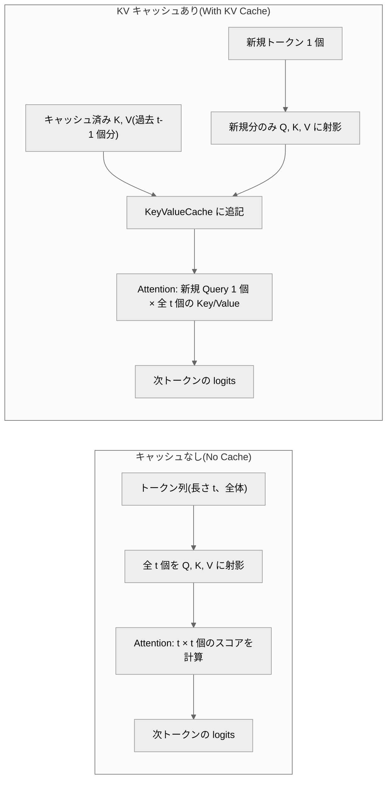
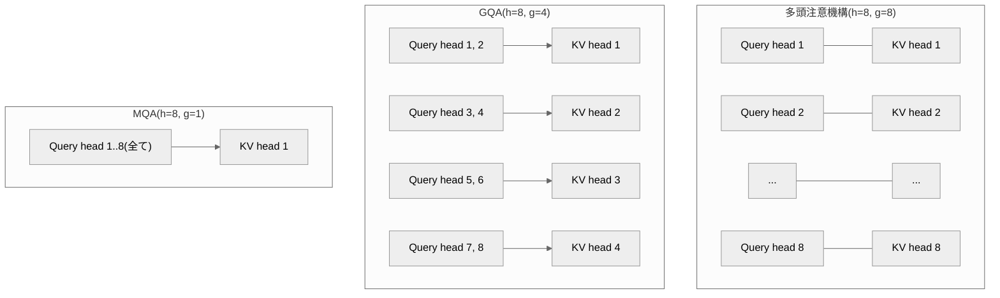

# 010. KV キャッシュと推論の計算量(KV Cache and Inference Compute)

## 1. 概要 / Overview

自己回帰生成(autoregressive generation)では、各生成ステップで同じ Key / Value を
繰り返し計算する冗長性がある。この冗長性を取り除く **KV キャッシュ(KV Cache)** の
仕組みと、それが生成の時間計算量・メモリ量に与える影響を扱う。特に、文脈全体を
一度に処理する **prefill** と 1 トークンずつ処理する **decode** という 2 つの
フェーズの非対称性(計算律速とメモリ帯域律速)に注目し、Key / Value ヘッド数を
削減してキャッシュを縮小する MQA(Multi-Query Attention)・GQA(Grouped-Query
Attention)の効果を実験で検証する。

## 2. 参考論文 / References

1. Shazeer, N. "Fast Transformer Decoding: One Write-Head is All You Need."
   arXiv:1911.02150, 2019. https://arxiv.org/abs/1911.02150
2. Ainslie, J., Lee-Thorp, J., de Jong, M., Zemlyanskiy, Y., Lebrón, F., Sanghai, S.
   "GQA: Training Generalized Multi-Query Transformer Models from Multi-Head
   Checkpoints." EMNLP 2023. https://arxiv.org/abs/2305.13245
3. Pope, R., Douglas, S., Chowdhery, A., Devlin, J., Bradbury, J., Levskaya, A.,
   Heek, J., Xiao, K., Agrawal, S., Dean, J. "Efficiently Scaling Transformer
   Inference." MLSys 2023. https://arxiv.org/abs/2211.05102
4. Kwon, W., Li, Z., Zhuang, S., Sheng, Y., Zheng, L., Yu, C. H., Gonzalez, J. E.,
   Zhang, H., Stoica, I. "Efficient Memory Management for Large Language Model
   Serving with PagedAttention." SOSP 2023. https://arxiv.org/abs/2309.06180
   (メモリ断片化への対処。本ノートブックでは理論の位置づけとして言及するのみで、
   実装・実験の対象にはしない)

## 3. 理論 / Theory

### 3.1 自己回帰生成における再計算の冗長性

記号(このセクション共通):

- $T$: 生成するトークン数
- $L$: 層数(num_layers)
- $h$: 多頭注意機構(Multi-Head Attention)のヘッド数
- $d_{\mathrm{model}}$: モデルの隠れ次元
- $d_k$: ヘッドあたりの次元($= d_{\mathrm{model}} / h$)

003([位置エンコーディング(RoPE)](https://zenn.dev/kojikojiprg/books/ai-theories-roadmap/viewer/003_positional_encoding_rope))
までの`GPTLanguageModel.generate()`(006〜008)は、生成ステップ $t$ ごとに、
その時点までの系列全体(長さ $t$)を`forward()`に丸ごと渡し直す。すなわち、
ステップ $t$ の計算には以下が含まれる。

- **Query / Key / Value の線形射影**: 系列長 $t$ の入力を $d_{\mathrm{model}}
  \times d_{\mathrm{model}}$ の行列で変換するため、1 層あたり $O(t \, d_{\mathrm{model}}^2)$。
- **Attention 本体(スコア計算 + 加重和)**: $t \times t$ のスコア行列を計算するため、
  1 層あたり $O(t^2 d_{\mathrm{model}})$(ヘッド数 $h$ に分割しても
  $h \times (t^2 d_k) = t^2 (h d_k) = t^2 d_{\mathrm{model}}$ で変わらない)。

$T$ トークンを生成するには、この計算を $t = 1, \dots, T$ について毎回すべて
やり直す。$\sum_{t=1}^{T} t = O(T^2)$、$\sum_{t=1}^{T} t^2 = O(T^3)$ であるから、
1 層あたりの総計算量は

$$
\underbrace{O(T^2 d_{\mathrm{model}}^2)}_{\text{linear projections}}
+ \underbrace{O(T^3 d_{\mathrm{model}})}_{\text{attention}}
$$

(第 1 項が線形射影の総和、第 2 項が Attention 本体の総和である)

$L$ 層分では、これに $L$ を掛けた $O(L T^2 d_{\mathrm{model}}^2 + L T^3
d_{\mathrm{model}})$ になる(層数 $L$ はアーキテクチャを固定すれば定数とみなせる
ため、以降では単に $O(T^3 d_{\mathrm{model}} + T^2 d_{\mathrm{model}}^2)$ と書く)。

**KV キャッシュ** は、ステップ $t$ で計算した Key / Value を保持しておき、
ステップ $t+1$ では新規トークン 1 個分の Key / Value だけを計算して追記する
仕組みである。これにより、ステップ $t$ の計算は次で済む。

- **新規トークン分の線形射影**: 系列長 1 の入力を変換するだけなので
  $O(d_{\mathrm{model}}^2)$(定数)。
- **Attention 本体**: 新規の Query 1 個と、キャッシュ済みの長さ $t$ の
  Key / Value との内積なので $O(t \, d_{\mathrm{model}})$。

$T$ ステップの総和は $\sum_{t=1}^{T} 1 = O(T)$、$\sum_{t=1}^{T} t = O(T^2)$ から、

$$
O(T \, d_{\mathrm{model}}^2) + O(T^2 d_{\mathrm{model}})
$$

キャッシュなしの $O(T^3 d_{\mathrm{model}} + T^2 d_{\mathrm{model}}^2)$ から、
キャッシュありの $O(T^2 d_{\mathrm{model}} + T d_{\mathrm{model}}^2)$ へ、
$T$ に対する次数がそれぞれ 1 つずつ下がる。これが実験 A で検証する内容である。

下図は、1 生成ステップにおけるデータフローの違いを示す(キャッシュなしは
系列全体を毎回計算し直すのに対し、キャッシュありは新規トークン分のみを計算し
過去の結果に追記する)。

### 3.2 キャッシュのメモリ量の閉形式

記号(前節に加えて):

- $B$: バッチサイズ
- $g$: Key / Value ヘッド数(num_key_value_heads。多頭注意機構では $g = h$)
- $\text{bytes\_per\_element}$: 要素あたりバイト数(fp32 なら 4、fp16 / bf16 なら 2)

層 $l$ の KV キャッシュは、Key・Value それぞれ形状 $(B, g, T, d_k)$ のテンソルであり、
要素数は $B \, g \, T \, d_k$。Key と Value の 2 つを保持するので、1 層あたりの
バイト数は $2 \, B \, g \, T \, d_k \times \text{bytes\_per\_element}$。これを
$L$ 層分合計すると、

$$
\text{memory}
= 2 \cdot B \cdot L \cdot T \cdot (g \cdot d_k) \cdot \text{bytes\_per\_element}
$$

多頭注意機構では $g = h$ であり $g \cdot d_k = d_{\mathrm{model}}$ なので、この式は
$2 \, B \, L \, T \, d_{\mathrm{model}} \cdot \text{bytes\_per\_element}$ になる
(`compute_key_value_cache_memory_bytes`、`src/utils/statistics.py`)。系列長
$T$ に **線形** で増えることが、prefill と異なる decode 特有の性質である
(prefill 自体はキャッシュを増やすだけで、モデル本体の計算量が $T$ に対して
線形に留まるわけではない。3.1 節参照)。

### 3.3 prefill と decode の非対称性

本トピックの中心的な洞察は、生成の 2 つのフェーズ **prefill**(起点となる文脈
全体を 1 回の順伝播でまとめて処理する)と **decode**(KV キャッシュを使い、
新規トークン 1 個ずつを逐次処理する)が、計算資源の使われ方の点で対称ではない
ことである。

**演算強度(arithmetic intensity)** は、ある演算が読み書きするメモリの
バイト数に対する浮動小数点演算回数(FLOPs)の比

$$
\text{AI} = \frac{\text{FLOPs}}{\text{bytes moved}}
$$

で定義される(`compute_arithmetic_intensity`)。roofline モデル(Williams et al.,
"Roofline: An Insightful Visual Performance Model for Multicore Architectures",
CACM 2009)では、ハードウェアごとに定まる **ridge point**

$$
\text{AI}_{\text{ridge}} = P_{\text{peak}} / BW
$$

を境に演算の律速要因が切り替わる($P_{\text{peak}}$ はハードウェアのピーク演算性能
(FLOPS)、$BW$ はメモリ帯域幅(bytes/s))。ridge point より演算強度が低い演算は、
演算器がメモリからのデータ供給を待つ **メモリ帯域律速(memory-bound)** になり、
高い演算はメモリ帯域が余っていても演算器が追いつかない **計算律速(compute-bound)**
になる。

線形層(重み $(d_{\text{in}}, d_{\text{out}})$、入力 $N$ 行、要素あたり
$\text{bytes\_per\_element}$ バイト)を例にとる。

- FLOPs: $2 N d_{\text{in}} d_{\text{out}}$(積和 1 回を 2 演算と数える標準的な近似)
- bytes moved: 重みの読み出し $d_{\text{in}} d_{\text{out}} \cdot
  \text{bytes\_per\_element}$ + 入出力活性化の読み書き
  $N (d_{\text{in}} + d_{\text{out}}) \cdot \text{bytes\_per\_element}$

**prefill**($N = B \cdot S$、$S$ は文脈全体の系列長)では、$N$ が大きいほど
FLOPs は $N$ に比例して増える一方、重みの読み出しバイト数は $N$ によらず一定
(1 回の呼び出しにつき 1 回だけ読む)ため、$N$ が大きいほど演算強度は大きくなる
(重みの読み出しコストが多くの演算で「償却」される)。

**decode**($N = B$、系列長 1 の新規トークンのみ)では、$B$ が小さい典型的な
生成では $N$ が小さく、重みバイト数が総バイト数の大部分を占め続ける。1 ステップ
ごとに同じ重みを読み直すコストを、そのステップの少ない演算量では償却できない
ため、演算強度は低いまま(概ね $O(B)$、$B=1$ では $O(1)$)に留まる。

このため decode はメモリ帯域律速になりやすく、KV キャッシュのメモリ量(3.2 節)を
減らすこと(MQA・GQA)が、decode の速度に直接効いてくる。実験 B は、この非対称性を
バッチサイズ依存性の差として検証する。

### 3.4 MQA(Multi-Query Attention)と GQA(Grouped-Query Attention)

3.2 節の閉形式が示す通り、KV キャッシュのメモリ量は Key / Value ヘッド数 $g$ に
比例する。Shazeer (2019) の **MQA** は $g = 1$(全ての Query ヘッドが単一の
Key / Value ヘッドを共有する)、Ainslie et al. (2023) の **GQA** はその中間
($1 < g < h$、Query ヘッドを $h/g$ 個ずつのグループに分け、グループ内で
Key / Value ヘッドを共有する)を提案した。いずれも、キャッシュのメモリ量を
$g/h$ 倍に縮小する(Query 側の射影 $W^Q$・出力射影 $W^O$ は変更しない)。

**uptraining**(Ainslie et al., 2023): 既存の多頭注意機構チェックポイントから
GQA / MQA へ変換する際、Key / Value の射影行列をランダムに初期化すると、
学習済みの Query・出力射影との整合が崩れ、追加学習の初期の損失が大きく跳ね上がる。
Ainslie らは、グループ内の元の Key / Value ヘッドの重みを **平均プール
(mean pooling)** して初期化する方法を提案し、ランダム初期化より少ない追加学習
ステップ数で高い性能に到達することを示した(`convert_attention_to_grouped_query`
の`init="mean_pool"`、実験 D で検証する)。

### 3.5 RoPE とキャッシュの相互作用

003([位置エンコーディング(RoPE)](https://zenn.dev/kojikojiprg/books/ai-theories-roadmap/viewer/003_positional_encoding_rope))
で導入した RoPE(Rotary Position Embedding、Su et al., Neurocomputing 2024)は、
Query・Key の各トークンをその **絶対位置** $m$ だけ回転させる
(`RotaryPositionEmbedding.apply`)。この回転は他のトークンの値に一切依存しない
(トークン $m$ の回転は $m$ だけで決まる)ため、系列全体をまとめて回転させても、
1 トークンずつ回転させて後から連結しても、結果は完全に同じになる。

これが、KV キャッシュと RoPE の相互作用の核心である。decode の各ステップで
新規トークンに RoPE を適用する際、**その系列内での相対位置(常に 0)ではなく、
キャッシュ長だけずれた絶対位置** を使う必要がある。003 の時点で
`MultiHeadAttention.forward`・`RotaryPositionEmbedding.apply`・`DecoderBlock.forward`
はいずれも`positions`引数(Query の絶対位置インデックス)を既に持っており、
docstring にも「KV キャッシュを用いた逐次推論(トピック 010)では、生成の各
ステップで Query の絶対位置がキャッシュ長だけずれるため、これを外部から指定
できるようにしている」と明記されていた。010 の実装(`GPTLanguageModel.generate`
の`use_cache=True`パス)は、この 003 の設計をそのまま使う。具体的には、prefill
ステップでは`positions = arange(S_0)`、decode の各ステップでは
`positions = [kv_cache.length]`(その時点のキャッシュ長)を渡す。

## 4. 実装方針 / Implementation Policy

**ノートブック内に直接書くもの**(`src/`に置かない): 3.1 節の導入として、
Attention 層自身が過去の Key / Value を保持する最小実装
(`MinimalCachedAttention`、20 行程度)。状態を層の外に出す設計上の理由
(条件・シードをまたぐ計測での状態漏れ、メモリ量集計の分散)を実装と対比して
示すためだけの教育的なコードであり、後続トピックから import されない。

**`src/`に置くもの**:

- `src/generation/cache.py`(新規): `KeyValueCache`。層ごとの Key / Value の
  保持・追記・メモリ量の報告を行う。014(Flash Attention)・015(長文脈拡張)・
  [016](https://zenn.dev/kojikojiprg/books/ai-theories-roadmap/viewer/016_supervised_fine_tuning) 以降の生成による評価から再利用される前提。
- `src/layers/attention.py`: `MultiHeadAttention`に`num_key_value_heads`引数
  (既定値`None`で多頭注意機構と完全に同一の挙動)と KV キャッシュの入出力
  (`kv_cache`・`layer_idx`引数)を追加。
- `src/layers/transformer_block.py`: `DecoderBlock.forward`に`kv_cache`・
  `layer_idx`引数を追加し、`self_attn`へそのまま透過する。
- `src/models/gpt.py`: `GPTLanguageModel.forward`に`kv_cache`引数、
  `generate()`に`use_cache`引数(既定値`False`で 006〜008 と完全に同一の挙動)を
  追加。多頭注意機構の重みから GQA / MQA への変換関数
  `convert_attention_to_grouped_query`(平均プール初期化・ランダム初期化の
  両方に対応)を追加。
- `src/utils/statistics.py`: `compute_key_value_cache_memory_bytes()`・
  `compute_arithmetic_intensity()`・`fit_power_law_exponent()`(回帰係数と
  その標準誤差を返す)。
- `src/utils/visualization.py`: `plot_log_log_fit()`(両対数プロット、
  べき乗則あてはめの直線を重畳できる)。

後方互換性(`num_key_value_heads=None`・`use_cache=False`のとき 006〜009 と
完全に同一の挙動になること)は、乱数消費まで含めて bit-identical であることを
既に検証済みである(`MultiHeadAttention`・`GPTLanguageModel`のパラメータ初期化・
順伝播の出力ハッシュが、本トピック追加前のコードと完全一致することを、実装の
過程で確認した。6 節の不変条件アサーションで改めて示す)。

## 5. 実装 / Implementation

### 5.1 最小実装: Attention 層自身が Key / Value を保持する

まず、状態(過去の Key / Value)を Attention 層自身に持たせる最小実装
(`MinimalCachedAttention`)を示す。次のセルで`src/generation/cache.py`の
`KeyValueCache`(状態を層の外に出した実装)と生成結果を比較し、**なぜ状態を層の
外に出すのか** を実装の対比を通じて示す。

- **条件・シードをまたぐ計測での状態漏れ**: `MinimalCachedAttention`はインスタンス
  自身が`cache_k`・`cache_v`を保持するため、同じレイヤーインスタンスを複数の
  条件・シードで使い回すと、前の生成のキャッシュが残ったまま次の計測を始めて
  しまう危険がある(`reset_cache()`の呼び忘れが静かなバグになる)。`KeyValueCache`
  は呼び出し側が明示的に生成・破棄するため、この危険が構造的に起きない。
- **メモリ量集計の分散**: 状態がレイヤーごとに分散していると、モデル全体の
  キャッシュメモリ量(3.2 節)を集計するにはモデル全体を走査する必要がある。
  `KeyValueCache`は 1 つのインスタンスが全層の Key / Value を持つため、
  `memory_bytes()`で直接合計できる。

### 5.2 `src/`の実装: 後方互換性の確認

`num_key_value_heads=None`・`use_cache=False`(既定値)のとき、006〜009 と
完全に同一の挙動になることを確認する。

**別マシンで採取したハッシュ定数とのクロスプラットフォーム比較はしない。**
浮動小数点の乱数生成アルゴリズムの実装は torch のバージョン・プラットフォーム
(CPU 命令セットなど)によって異なりうるため、別環境で採取した定数とのビット
単位の比較は「この環境が別環境の浮動小数点表現を再現するか」という、本ノート
ブックが検証したい後方互換性(num_key_value_heads・kv_cache 引数の追加が
006〜009 の挙動を変えていないこと)とは異なる命題を検証してしまう。代わりに
次の 2 つを行う。

1. **同一環境内での比較**(5.2.1 節): 本トピック(010)の実装を加える直前の
   コミット(`eb37dee`)のコードを、git worktree で取得し、
   **現在の実行環境と同じ Python・同じ torch のサブプロセスで実行** して
   参照値を計算する。同一プロセス内の実行では`src`パッケージ名が現行コードと
   衝突するため、サブプロセス分離が必要である。参照リポジトリの取得に失敗した
   場合(ネットワーク不通・git 履歴がないなど)は、比較を行わずその旨を記録する
   (ハードコードした定数へのフォールバックはしない)。
2. **環境に依存しない自己完結な等価性の検証**(5.2.2 節): `num_key_value_heads`
   を明示的に渡した場合と省略した場合とで、パラメータ・順伝播出力・乱数消費量
   (`torch.get_rng_state()`の変化)が完全に一致することを、同一セッション内で
   直接確認する。プラットフォームに一切依存しない。

#### 5.2.1 本トピック追加直前のコードとの同一環境比較

比較対象は、010 の実装の直前のコミット(`eb37dee`)である。git worktree で取得したそのコードを、現在の実行環境と同じ Python・同じ torch のサブプロセスで実行して参照値を計算し、5.2 節と同一のモデル構成・同一のシードで比べる。参照コードが worktree 側の`src`から読み込まれたことも、実行時に検証する。詳細は付録 A.1。

#### 5.2.2 環境に依存しない自己完結な等価性の検証

`num_key_value_heads`を明示的に`num_heads`と同じ値で渡した場合と、省略した場合
(既定値`None`)とで、同一シードからのパラメータ初期化・順伝播出力・乱数消費量が
完全に一致することを直接確認する。同一プロセス内の比較のみで完結するため、
プラットフォームに一切依存しない。

### 5.3 追加学習・符号化・評価のスケーリング計測と外挿

実験 D(7.5 節)で使う、008 が Hugging Face Hub にアップロードした本番チェックポイント
(`kojikojiprg/ai-theories-small-gpt-en`)・トークナイザ(`kojikojiprg/ai-theories-tokenizer-en`)・
コーパス(`en_006_pretraining.json`、006・008 と同一、356 記事)を読み込む。あわせて、
追加学習・符号化・評価それぞれについて、少なくとも 3 点のデータ量で実行時間を実測し、
べき乗則($\log t = \log a + b \log n$)のあてはめから本番データ量への外挿値を出す。

コーパスは、Hugging Face Hub の Dataset リポジトリ(006・008 用に昇格済みの`corpus.txt`)から直接取得し(`load_wikipedia_corpus_with_fallback`、`src/data/text.py`)、取得元が Hub でなかった場合はアサーションで即座に停止する(フォールバックを本番実行の経路から排除する)。取得元を変えた経緯とフォールバックの扱いは付録 A.2。

コーパスの取得は Hub からの単発ダウンロード(24.3 MB 程度)で完結し、データ量に応じて
繰り返される処理ではないため、5.3.1 節以降のスケーリング計測・外挿の対象には含めない
(外挿対象は、データ量に応じて実行時間が変化しうる符号化・追加学習・評価のみ)。

## 6. 不変条件のアサーション / Invariant Assertions

5 節で確認済みのもの(再掲): **KV キャッシュの有無で貪欲法の生成結果が完全に一致
すること **(5.2 節)、** ノートブック内の最小実装と`src/generation/cache.py`の実装で
生成結果が完全に一致すること **(5.1 節)、**`num_key_value_heads=None`・
`use_cache=False`のとき 006〜009 と完全に同一の挙動になること**(5.2 節、パラメータ
初期化のハッシュと順伝播出力の両方で確認)。

このセルでは残りの不変条件を確認する。

## 7. 実験 / Experiments

### 7.1 全実験に共通する前提条件

**前提条件 P0**: すべての時間計測が GPU の同期(デバイスが CUDA なら
`torch.cuda.synchronize()`、MPS なら`torch.mps.synchronize()`、CPU なら不要)を
含み、ウォームアップ反復の後に行われていること。

**本節の前提条件は、後述の 7.1.1 節に記録した 2 回の本番実行(いずれも前提条件が
不成立)を受けて、本番実行のやり直しの前に改訂したものである。** 旧い定義
(条件ごとの生の変動係数が 0.1 以下であること)は、担保したい状態(ウォームアップが
済み、計測が安定していること)と指標が対応していなかった。生の変動係数
(標準偏差 ÷ 平均)は絶対時間が小さいほど大きくなりやすく、閾値を満たせるかどうかが
仮説と無関係な要因(その水準の絶対時間の大小)で決まってしまっていた
(7.1.1 節に実測値を記録する)。これは、**ウォームアップの担保** と
**判定に必要な精度の担保** という目的の異なる 2 つの要求を、1 つの指標(変動係数)で
兼ねようとしたことが原因である。この 2 つを分離し、それぞれ独立の前提条件として
宣言し直す。

- **P0-a(ウォームアップの担保)**: 各条件について、先頭 3 反復の平均と末尾 3 反復の
  平均の差が、その条件の全反復の標準偏差(`ddof=1`)の 2 倍以内であること
  (`compute_p0a`、`P0A_MAX_DRIFT_SIGMA=2.0`)。ウォームアップ不足による系統的な
  ドリフト(反復を重ねるにつれて値が一方向に変化していくこと)を直接検出する指標
  であり、絶対時間の大小には依存しない。反復回数が 3 の 2 倍(6)未満だと先頭 3・
  末尾 3 が重複してしまい定義できないため、実験 A・B・C の反復回数が 6 以上である
  ことをセットアップセルでアサーションにより確認する。
- **P0-b(判定精度の担保)**: 各条件について、平均の標準誤差
  (標準偏差(`ddof=1`) ÷ $\sqrt{n}$、$n$ は反復回数)が、その条件の平均の 5% 以下で
  あること(`compute_p0b`、`P0B_MAX_RELATIVE_STDERR=0.05`)。対比量の推定に使う
  各測定の平均が十分な精度で求まっていることを担保する。

**両方が成立して初めて前提成立とする。** いずれかが成立しない条件があれば、
その実験は前提不成立として報告する。

**反復回数は事前に宣言して固定し、前提が満たされるまで反復を増やすという運用は
しない。** P0-b は反復回数の平方根に反比例して改善する(標準誤差 ∝ $1/\sqrt{n}$、
$n$ は反復回数)ため、結果を見てから事後的に反復を増やせば必ず満たせて
しまい、前提条件として機能しなくなる。実験 A・B・C の反復回数(`PRODUCTION_A_REPEATS`・
`PRODUCTION_B_REPEATS`・`PRODUCTION_C_REPEATS`)は、7.1.1 節に記録した過去の実行の
観測値から P0-b を満たす見込みかどうかを見積もったうえで、本番実行の前にこの節で
確定させる(この見積もりの根拠は反復回数と変動係数という前提条件に関する量のみであり、
検証したい仮説の方向には依存しない)。

実験 A・B・C は、いずれも条件ごとに P0-a・P0-b の計算に必要な量(先頭・末尾平均、
全反復の標準偏差、平均、標準誤差、成否)を計測セルの直後で計算し、**セル出力に
全件印字する**(判定の一次情報の永続化先はセル出力のみであり、ファイルへの書き出しは
行わない)。**P0 は本番の実行環境(GPU の種類・負荷状況)によって成立しないことが
あり得る前提条件であるため、アサーションで停止するのではなく、成否を記録したうえで
判定に進む。**

#### 7.1.1 旧実行の記録(前提条件 P0 不成立)

これまでの本番実行 2 回は、いずれも旧い前提条件 P0(条件ごとの生の変動係数が 0.1 以下であること)のもとで前提不成立となった。変動係数は絶対時間が小さい水準ほど大きくなりやすく、閾値を満たせるかどうかが仮説と無関係な要因で決まっていた。そのため、P0 を P0-a(ウォームアップの担保)と P0-b(判定精度の担保)に分けて、本番実行のやり直しの前に改訂した。この改訂の根拠は観測結果の方向に依存せず、判定基準(対比量の定義・閾値の導出式・期待する差の方向)は変更していない。実験 B の反復回数は 15 から 30 に増やした。各回の変動係数の表、修正の内容、反復回数の見積もりは付録 B.1。

### 7.2 実験 A: KV キャッシュによる生成時間の次数の低下

- **検証すること**: KV キャッシュを用いると、生成時間の生成長 $T$ に対する
  べき指数が小さくなる。
- **対比量**: $\Delta b = b_{\text{no cache}} - b_{\text{cache}}$
  ($b_{\text{no cache}}$ は KV キャッシュを使わない条件のべき指数、
  $b_{\text{cache}}$ は使う条件のべき指数)。$b$ は $\log t = \log a + b \log T$
  のあてはめ(`fit_power_law_exponent`)で推定する。
  - **介入の直接作用点**: この介入(KV キャッシュ)が直接作用するのは 1 ステップ
    あたりの計算量(3.1 節の $O(t \, d_{\mathrm{model}}^2 + t^2 d_{\mathrm{model}})$
    → $O(d_{\mathrm{model}}^2 + t \, d_{\mathrm{model}})$、キャッシュの有無で
    ステップ $t$ の計算コストそのものが変わる)である。対比量(生成時間全体の
    $T$ に対するべき指数)はこれを $T$ ステップ分積算した下流の量だが、積算は
    決定的な和であり(実測ノイズが積算過程で新たに混入しない)、直接の作用点との
    距離は小さい。
- **判定基準**: $\Delta b > 2\sigma_{\Delta b}$ なら支持、$\Delta b <
  -2\sigma_{\Delta b}$ なら反証、それ以外は判定不能。
  $\sigma_{\Delta b} = \sqrt{\sigma_{b,\text{no cache}}^2 + \sigma_{b,\text{cache}}^2}$
  とし、$\sigma_b$ は各条件のあてはめにおける回帰係数の標準誤差
  (`fit_power_law_exponent`の`exponent_stderr`)とする。
- **水準**: 生成長 $T$ を等比の刻みで 5 点、各点を反復計測する(反復回数は
  スモークテストと本番で異なり、セットアップセルの`SMOKE_A_REPEATS`・
  `PRODUCTION_A_REPEATS`で定義する)。
- **診断量**: 各 $T$ での実測時間の絶対値、および理論上のべき指数の上限(3 と 2、
  3.1 節)。**べき指数の絶対値は判定基準にしない**(本モデルの
  $d_{\mathrm{model}}=256$ 程度では $T d_{\mathrm{model}}^2$ の項が支配的になり、
  実測の指数は理論上限より小さく出る)。

    

    

### 7.3 実験 B: prefill と decode のバッチサイズ依存性の差

- **検証すること**: 総実行時間のバッチサイズに対する依存は、decode のほうが
  prefill より弱い(メモリ帯域律速の署名)。
- **対比量**: $\Delta b_B = b_{\text{decode}}(B) - b_{\text{prefill}}(B)$。
  $b(B)$ は総実行時間のバッチサイズ $B$ に対するべき指数。
  - **介入の直接作用点**: バッチサイズ $B$ が直接作用するのは 1 回の行列演算の
    形状(3.3 節の $N = B \cdot S$)であり、対比量($b(B)$)はこの演算を 1 回
    実行した総時間から求める。prefill・decode いずれも「1 回の呼び出し」を
    そのまま計測するため、作用点との距離は小さい。
- **判定基準**: $\Delta b_B < -2\sigma_{\Delta b_B}$ なら支持、$>
  +2\sigma_{\Delta b_B}$ なら反証、それ以外は判定不能。標準偏差の導出は実験 A と同じ
  (`fit_power_law_exponent`の`exponent_stderr`を誤差伝播で合成)。
- **水準**: バッチサイズを等比の刻みで 5 点、各点を反復計測する(反復回数は
  スモークテストと本番で異なり、セットアップセルの`SMOKE_B_REPEATS`・
  `PRODUCTION_B_REPEATS`で定義する)。
- **前提条件 P1_B**: 全バッチサイズで out-of-memory が発生しないこと。
- **診断量**(判定基準は設けない): 演算強度の理論値(3.3 節)、および重み
  読み出しバイト数を T4 GPU の公称メモリ帯域で割った下限時間との比。**この絶対値の
  一致は判定基準にしない**(実測の達成帯域は公称値の 7 割前後であり、真偽を
  判定できる形になりません)。

    

    

### 7.4 実験 C: Key / Value ヘッド数の削減による高速化の系列長依存性

- **検証すること**: Key / Value ヘッド数の削減による decode の高速化は、
  系列長が長いほど大きい。
- **対比量**: $r(T) = t_{g=h}(T) / t_{g=1}(T)$($t_{g=h}$ は通常の多頭注意機構
  ($g=h$)の生成時間、$t_{g=1}$ は MQA($g=1$)の生成時間)としたときの
  $\Delta r = r(T_{\max}) - r(T_{\min})$。$T_{\min}$・$T_{\max}$ は等比の刻みの
  両端とする。
  - **介入の直接作用点**: Key / Value ヘッド数の削減が直接作用するのは、
    1 decode ステップあたりの KV キャッシュの読み出しバイト数(3.2・3.4 節)
    である。対比量 $r(T)$ は「生成全体の時間比」という下流の量であり、direct な
    作用点(1 ステップの読み出しバイト数)からは 1 段階離れている(生成全体の
    時間には、Key/Value 削減の影響を受けない Query 射影・出力射影・
    Feed-Forward Network の計算も含まれるため)。
- **判定基準**: $\Delta r > 2\sigma_{\Delta r}$ なら支持、$< -2\sigma_{\Delta r}$
  なら反証、それ以外は判定不能。$\sigma_{\Delta r}$ は反復計測から誤差伝播で
  導く。$r = a/b$(比)の相対標準誤差は、$a$・$b$ それぞれの相対標準誤差の
  二乗和の平方根

  $$
  \frac{\sigma_r}{r} = \sqrt{\left(\frac{\sigma_a / \sqrt{n}}{a}\right)^2
      + \left(\frac{\sigma_b / \sqrt{n}}{b}\right)^2}
  $$

  で求め($\sigma_a$・$\sigma_b$ は反復計測の標本標準偏差、$n$ は反復回数)、
  $T_{\min}$・$T_{\max}$ それぞれで得た $\sigma_{r(T_{\min})}$・
  $\sigma_{r(T_{\max})}$ を $\sigma_{\Delta r} = \sqrt{\sigma_{r(T_{\min})}^2
  + \sigma_{r(T_{\max})}^2}$ として合成する。
- この実験は学習を伴わない。重みはランダム初期化でよく、Key / Value ヘッド数だけが
  異なる同一構成のモデルで計測する。

### 7.5 実験 D: GQA への変換における平均プール初期化の効果

- **検証すること**: 多頭注意機構から GQA へ変換する際、平均プール初期化は
  ランダム初期化より、同一の追加学習ステップ数で低い bits-per-byte に到達する。
- **条件(主判定)**: GQA・平均プール初期化 + 追加学習 / GQA・ランダム初期化 +
  追加学習。この 2 条件は非埋め込みパラメータ数が完全に一致する(6 節で確認済み)。
- **条件(診断量)**: 元の多頭注意機構チェックポイント(追加学習なし)、
  MQA・平均プール初期化 + 追加学習。多頭注意機構との比較は Key / Value 射影の
  縮小により非埋め込みパラメータ数が揃わないため、**揃えられないことをここに
  明記したうえで参考値として報告する**。
- **Key / Value ヘッド数**: 元モデルのヘッド数 $h=8$ に対し、GQA は $g=4$、MQA は
  $g=1$。
- **対比量**: $\Delta\mathrm{bpb} = \mathrm{bpb}_{\text{random}} -
  \mathrm{bpb}_{\text{mean pool}}$($\mathrm{bpb}_{\text{random}}$ はランダム初期化、
  $\mathrm{bpb}_{\text{mean pool}}$ は平均プール初期化。いずれもシード平均、
  最終ステップの値)。
  - **介入の直接作用点**: この介入(初期化方式)が直接作用するのは初期化直後の
    重み(および、そこから計算される初期化直後の bits-per-byte)である。対比量は
    そこから追加学習を経た下流の量であり、直接の作用点からは 1 段階以上離れて
    いる。この距離を埋めるため、**初期化直後(追加学習ステップ数 0)の
    bits-per-byte を診断量として併記する**。
- **判定基準**: $\Delta\mathrm{bpb} > 2\sigma_{\Delta\mathrm{bpb}}$ なら支持、
  $< -2\sigma_{\Delta\mathrm{bpb}}$ なら反証、それ以外は判定不能。
  $\sigma_{\Delta\mathrm{bpb}} = \sqrt{\sigma_{\text{random}}^2/n +
  \sigma_{\text{mean pool}}^2/n}$($\sigma_{\text{random}}$・$\sigma_{\text{mean pool}}$
  は各条件のシード間標準偏差)、$n$ はシード数(3)。
- **前提条件**:
  - P1: 読み込んだ元チェックポイントの bits-per-byte が 008 の記録値(1.6622、
    008 8.1 節)と相対誤差 1% 以内で一致すること。
  - P2: 全条件で追加学習が実際に進んでいること。単一ステップの訓練損失は
    ミニバッチの引きによる雑音が大きいため(1 ステップだけの比較では、シードに
    よる違いが学習の進行ではなく最初のバッチの引きを反映してしまう)、**最初の
    数ステップの平均訓練損失と最後の数ステップの平均訓練損失を比較する**
    (`P2_AVERAGING_WINDOW`ステップ分の平均、最後の平均が最初の平均より低ければ
    進行とみなす)。
- **モデル**: `kojikojiprg/ai-theories-small-gpt-en`を起点とする(5.3 節で
  読み込み済み)。トークナイザは`kojikojiprg/ai-theories-tokenizer-en`
  (同梱されていないため)。
- **追加学習の最適化手法**: 007 で導入した AdamW・warmup + cosine スケジュールでは
  なく、006 と同じ Adam・固定学習率(3e-4)を使う。少数ステップの追加学習
  (uptraining)であり、両条件(平均プール初期化・ランダム初期化)に同一の
  最適化設定を等しく適用するため、この選択自体は対比量の成立に影響しない。
- **評価**: 006 の`evaluate_bits_per_byte()`と非重複の評価窓を用いる。
  `d_eval_text`(5.3 節)は`train_text`の内側から切り出した held-out スライスで
  あり、`val_text_008`(008 の検証集合、P1 の検証に使う)とも
  `d_train_text`(この実験の追加学習データ)とも重複しない。全条件で評価集合
  (`_full_eval_windows`)・追加学習ステップ数が完全に同一であることをアサーションで
  確認する。
  - **主判定への影響なし、診断量は楽観的に出ることの明記**: `d_eval_text`は
    `train_text`(008 が`base_model`の学習に使ったデータ)の内側から切り出した
    スライスであり、`base_model`は既に`d_eval_text`の内容を学習時に見ている。
    主判定(平均プール初期化 対 ランダム初期化)は両条件で評価集合が同一であり
    この影響は相殺されるため結論に影響しない。一方、診断量である
    初期化直後の bits-per-byte、および`D_ORIGINAL_BPB`(元の多頭注意機構
    チェックポイントの`d_eval_text`上の bits-per-byte)は、真に未知のテキストで
    評価した場合より **楽観的(低い)値** になっている可能性が高い。これらの
    診断量の絶対値に基づく主張はしない。

#### 7.5 節の注記(後日の調査による): 前提条件 P1 の参照値の出典

**この注記は、本番実行の後に判明した事実の記録である。前提条件 P1 の宣言(参照値 1.6622、相対誤差 1% 以内)と
その判定は変更しない。**

- P1 の参照値 1.6622 は「008 8.1 節の本番実行結果」として転記したが、008 の本番モデルの値ではなかった。008 の
  8.1 節の較正の表にある、学習率 x4.0 の較正実行(学習率 1.2e-3、seed 0、gradient clipping なし)の最終
  bits-per-byte である。008 の本番モデルは、較正で決めた gradient clipping 閾値を使って seed 42 で別途学習した
  ものであり、較正実行とは別のモデルである。出典の記述が誤っていた。
- 008 が本番モデルについて印字した 1.6707 も、アップロードした重みの値ではない(学習途中の 2,000 ステップ時点の
  評価値である。008 の 5.10 節の注記を参照)。アップロードした重み(2,181 ステップ時点)の、同じ検証集合での
  値は 1.6681(1.668067、013 のセル出力)であり、これが P1 の参照値として本来使うべき値である。
- 上のセルの実測値 1.6681 は、正しい参照値 1.6681 と印字した桁で一致する。誤った参照値 1.6622 との比較(相対
  誤差 0.35%)でも、正しい参照値との比較でも、相対誤差 1% 以内であることは変わらない。したがって P1 の成否
  (成立)は変わらない。

### 7.6 外挿値の合計とセッション予算との比較

5.3 節(符号化・追加学習・評価)の小計に、実験 A・B・C 自身の時間計測の外挿値を合算し、セッション予算との比較を確定させる。この外挿値の絶対値はデバイス依存(ローカルの MPS・CPU で測った係数を本番の T4 GPU に適用している)なので、セッション予算に収まるかどうかの目安として使う。詳細は付録 B.2。

### 7.7 冗長な再計算の排除の確認

`d_train_ids`・`_full_eval_windows`・`_full_eval_mask`は 5.3 節で 1 回だけ符号化し、
実験 D の条件 x シードの全 9 回の学習・評価ループでそのまま再利用した(再符号化して
いない)。基となるメモリ領域のポインタ(`Tensor.data_ptr()`)が、5.3 節での作成時と
実験 D のループを終えた現在とで一致することを確認する。

### 7.8 実験 D のチェックポイントのアップロード

判定の一次情報(実験 A・B・C の条件 x 水準 x 反復の生の実行時間、実験 D の条件 x
シードの学習曲線・bits-per-byte)は 7.2〜7.5 節の各計測セルの直後で既にセル出力へ
全件印字済みであり、それが唯一の記録である(ファイルへの書き出しは行わない)。

一方、実験 D の代表チェックポイント(GQA・平均プール初期化・シード 0)は、014・015
など後続トピックの入力になるモデルであるため、Hugging Face Hub の
`kojikojiprg/ai-theories-small-gpt-en`の`gqa`ブランチへアップロードする。ローカルへ
ダウンロードしてからスクリプト経由でアップロードする迂回はせず、**このノートブックの
アップロードセルから、Google Colab Secrets の`HF_TOKEN`を使って直接アップロードする。**

アップロードは`UPLOAD_ARTIFACTS`フラグ(既定`False`、`SMOKE_TEST`とは独立)で守り、
Colab Secrets から`HF_TOKEN`が取得できない場合は例外を送出せずスキップし、アップロード
後は`list_repo_files`で意図したファイルが実際に存在することを確認する。

## 8. 結果・考察 / Results and Discussion

本番実行(Google Colab T4 GPU、torch 2.13.0+cu130、`SMOKE_TEST=False`)を実行した。
実験 A・B・C の前提条件(P0-a・P0-b、7.1 節)、実験 D の前提条件(P1・P2、7.5 節)は
いずれも成立した。以下は、実際のセル出力の数値と突き合わせた結果・考察である。

### 8.1 実験 A: KV キャッシュによる生成時間の次数の低下(支持)

**判定**: $b_{\text{no cache}} = 1.3253 \pm 0.1366$、$b_{\text{cache}} = 0.9983 \pm
0.0050$、$\Delta b = 0.3270$、$\sigma_{\Delta b} = 0.1367$、$\Delta b / \sigma =
2.39$。事前宣言した判定基準($\Delta b > 2\sigma_{\Delta b}$ なら支持)を閾値
2.39 > 2 で満たすため **支持** である。

$b_{\text{cache}} = 0.9983$ は理論値 1 とほぼ一致する。KV キャッシュを使う場合、
1 ステップあたりの計算量は $O(d_{\mathrm{model}}^2 + t \, d_{\mathrm{model}})$
(3.1 節)であり、$T$ ステップ分を積算しても $T$ に対して線形の項が支配的になる
ため、総生成時間のべき指数が 1 に近づくという理論的な予想と整合する。

一方、$b_{\text{no cache}} = 1.3253$ は理論上のべき指数の上限 3 よりかなり小さい。
これは、**べき乗則のあてはめが測定区間全体($T=128$〜$2048$)の平均的な傾きを
見ているため** である。キャッシュなしの 1 ステップあたりの計算量
$O(t \, d_{\mathrm{model}}^2 + t^2 d_{\mathrm{model}})$ のうち、$t \,
d_{\mathrm{model}}^2$ の項が支配的な範囲では総生成時間は $T$ に対してより緩やかに
増え、$t^2 d_{\mathrm{model}}$ の項が効いてくるのは $t$ が $d_{\mathrm{model}}$
(本ノートブックの本番モデルでは 256)に近づく大きな $T$ に限られる。実際、隣接する
水準間の局所的な傾き($\log(t_2/t_1) / \log(T_2/T_1)$)を計算すると、次のように
$T$ が大きいほど傾きが急になっている。

| 区間 | $b_{\text{local}}$(no cache) | $b_{\text{local}}$(cache) |
| --- | --- | --- |
| $T=128 \to 256$ | 1.022 | 1.031 |
| $T=256 \to 512$ | 0.998 | 0.965 |
| $T=512 \to 1024$ | 1.294 | 1.005 |
| $T=1024 \to 2048$ | 2.168 | 1.004 |

キャッシュありの局所的な傾きは全区間でほぼ 1 に留まっているのに対し、キャッシュ
なしは $T=512$ 以降で明確に増加し、$T=1024 \to 2048$ の区間では 2.168 に達して
いる。これは、$T$ が $d_{\mathrm{model}}$ を超える領域で高次の項が効き始めるという
理論的な描像と定性的に整合する。あてはめ全体の指数($b_{\text{no cache}} =
1.3253$)は、傾きが緩やかな小さい $T$ の区間に引きずられた平均値であり、局所的な
振る舞いはこれよりも $T$ に対して速く増大している。

**診断量**: 理論上のべき指数の上限(キャッシュなし 3、キャッシュあり 2)との対比
では、実測値($1.3253$・$0.9983$)はいずれも上限を大きく下回った。べき指数の
絶対値そのものは判定基準ではない(7.2 節)。

### 8.2 実験 B: prefill と decode のバッチサイズ依存性の差(支持)

**判定**: $b_{\text{prefill}}(B) = 0.9190 \pm 0.0531$、$b_{\text{decode}}(B) =
0.2238 \pm 0.0842$、$\Delta b_B = -0.6951$、$\sigma_{\Delta b_B} = 0.0995$、
$\Delta b_B / \sigma = -6.98$。判定基準($\Delta b_B < -2\sigma_{\Delta b_B}$ なら
支持)を $-6.98 < -2$ で満たすため **支持** である。

各バッチサイズでの実測時間は次のとおりである。

| $B$ | prefill(秒) | decode(秒) |
| --- | --- | --- |
| 1 | 0.00740 | 0.00540 |
| 4 | 0.01654 | 0.00582 |
| 16 | 0.06148 | 0.00614 |
| 64 | 0.26513 | 0.00764 |
| 256 | 1.07977 | 0.02223 |

$B$ を 1 から 256 へ(256 倍)増やすと、prefill の時間は 0.00740 秒から 1.07977 秒
へ約 146 倍に増えた(べき指数 0.9190 のとおり、ほぼバッチサイズに比例している)のに
対し、decode の時間は 0.00540 秒から 0.02223 秒へ約 4.1 倍にしか増えなかった。

この非対称性は roofline モデルで説明できる。prefill は行列(バッチ x 系列長)と
行列(重み)の積であり演算強度が高く計算律速である一方、decode は 1 ステップあたり
行列(重み)とベクトル(1 トークン分の活性化)の積になるため演算強度が低く
メモリ帯域律速になる(3.3 節)。decode でバッチサイズを増やしても、1 回の呼び出しで
読み出す重みの量(演算強度の分母)は変わらないため、バッチ内の各サンプルで重みの
読み出しコストが償却され、時間の増加が抑えられる。

**診断量**: 3.3 節で計算した演算強度の理論値では、decode($N=1$)が 0.496
FLOPs/byte、prefill($N=256$)が 42.667 FLOPs/byte であり、T4 GPU の公称値から
計算した ridge point(25.31 FLOPs/byte)に対して、decode はその 2.0%、prefill は
168.6% だった。decode が ridge point を大きく下回り、prefill が上回っているという
関係は、上記の速度差の方向と整合する。**これらは判定基準を設けていない診断量であり、
公称帯域の値そのものとの一致(実測の達成帯域は公称値の 7 割前後)を根拠にした主張は
しない。**

### 8.3 実験 C: Key / Value ヘッド数削減の効果の系列長依存性(判定不能)

**判定**: $r(T=64) = 0.9626$、$r(T=4096) = 0.9460$、$\Delta r = -0.0166$、
$\sigma_{\Delta r} = 0.0435$、$\Delta r / \sigma = -0.38$。判定基準
($\Delta r > 2\sigma_{\Delta r}$ なら支持、$< -2\sigma_{\Delta r}$ なら反証)の
いずれの閾値(絶対値 2)にも届かなかったため、**判定不能** である。支持とも反証とも
書かない。

#### 8.3.1 事後的な解釈(検証済みの結論ではない)

**この小節は、7.4 節で事前宣言した判定基準による結論ではなく、結果を見た後に立てた
解釈である。以下は検証済みの結論として扱わない。**

$r(T)$ は多頭注意機構の生成時間を MQA の生成時間で割った比であり、$r < 1$ は
多頭注意機構のほうが MQA より速かったことを意味する。実測では $r(T=64) = 0.9626$・
$r(T=4096) = 0.9460$ といずれも 1 を下回っており、**Key / Value ヘッド数を 8 から
1 に削減した MQA のほうが、両端の系列長で多頭注意機構より遅かった。** これは
「Key / Value ヘッド数の削減による高速化」という検証したい仮説とは逆方向の観測である。

事後的な解釈として次が考えられる。本ノートブックの本番モデル構成(4 層、
$d_{\mathrm{model}}=256$)では、decode 1 ステップで読み出す Key / Value キャッシュの
バイト数は、同じステップで読み出す重みのバイト数に比べて小さく(3.2 節の
$2 B L T (g \cdot d_k) \cdot \text{bytes\_per\_element}$ という式で、この規模の
$T$・$g$ では重みの読み出し量が支配的になりうる)、decode 時間を支配する要因に
なっていない可能性がある。一方で、Key / Value ヘッド数を 8 から 1 に減らすと、
Key / Value 射影に関わる行列積の形状が変わり、この規模ではその変化(並列度の低下、
または実装上のオーバーヘッド)のほうが、キャッシュ読み出し量の削減効果を上回った
可能性がある。

**この解釈は検証していない。** 次に検証しうる方向としては、層数や
$d_{\mathrm{model}}$ を振って Key / Value キャッシュの読み出し量と重みの読み出し量の
比率を変えた条件で同じ実験を繰り返す、またはキャッシュの読み出しバイト数と decode
時間の関係を直接測定する、といった方法が考えられる。本トピックの規模ではこの効果を
検出できなかった、という判定不能の結果として扱う。

### 8.4 実験 D: GQA への変換における平均プール初期化の効果(支持)

**前提条件**: P1(元チェックポイントの bits-per-byte が 008 の記録値と相対誤差
1% 以内で一致)は、実測 1.6681(008 記録値 1.6622、相対誤差 0.35%)で成立した。
参照値 1.6622 の出典の記述は誤っていた(後日の調査による。7.5 節の注記を参照)。正しい参照値 1.6681 と比べても
P1 の成否は変わらない。
P2(全条件で追加学習が実際に進んでいること)も、9 run すべてで末尾 3 ステップ平均
損失が先頭 3 ステップ平均損失を下回り成立した。

**判定**: $\Delta\mathrm{bpb} = 0.5474$、$\sigma_{\Delta\mathrm{bpb}} = 0.0042$、
$\Delta\mathrm{bpb} / \sigma = 129.17$。判定基準
($\Delta\mathrm{bpb} > 2\sigma_{\Delta\mathrm{bpb}}$ なら支持)を大きく上回る値で
満たすため **支持** である。

初期化直後(追加学習ステップ数 0)の bits-per-byte は、平均プール初期化が 2.3261
(3 シードとも同一値。決定的な初期化のため)、ランダム初期化が 3.3208(シード平均、
seed 毎 3.3507・3.2944・3.3171)であり、差は 0.9946 だった。300 ステップの追加学習後
は、平均プール初期化が 1.5101(seed 毎 1.5078・1.5099・1.5127)、ランダム初期化が
2.0576(seed 毎 2.0584・2.0503・2.0640)となり、差は 0.5474 まで縮んだ。すなわち
追加学習によって初期化方式の差は 0.9946 から 0.5474 へ縮小しており、比率にすると
0.5474 / 0.9946 ≈ 55.0% が残存(約 45% が解消)したことになる。

**一方、平均プール初期化 + 300 ステップの追加学習でも、元の多頭注意機構チェック
ポイント(追加学習なし)を GQA・MQA と同じ`d_eval_text`上で評価した
bits-per-byte(1.3370、診断量)には遠く及ばない(この評価集合は前提条件 P1 で
使った`val_text_008`とは異なり、P1 の 1.6681 とは直接比較できない)。** GQA
(Grouped-Query Attention)への変換は無償ではなく、Ainslie et al. (2023) は元の
事前学習計算量の数パーセントを uptraining に充てている。本トピックの 300 ステップ
という追加学習量(008 の本番学習ステップ数 2181 の約 14%)では、この程度の回復に
とどまるという位置づけになる。

**診断量**: MQA(Key / Value ヘッド数 1)・平均プール初期化 + 追加学習の最終
bits-per-byte は 1.8892(seed 平均)だった。GQA(1.5101)より高く(悪く)、
Key / Value ヘッド数をより大きく削減するほど uptraining 後の性能回復が難しくなる
という傾向と整合する。**ただし多頭注意機構・GQA と非埋め込みパラメータ数が
揃わないため、参考値として扱う**(7.5 節)。

評価に使った`d_eval_text`は、元チェックポイント(`base_model`)自身の学習データ
(`train_text`)の内側から切り出したスライスであり、`base_model`は既にその内容を
学習時に見ている(5.3 節)。そのため、**上記の bits-per-byte の絶対値(初期化直後の
値、元チェックポイントの参考値、MQA の参考値を含む)は、真に未知のテキストで
評価した場合より楽観的(低い)値になっている可能性が高い。** 主判定(平均プール
初期化 対 ランダム初期化の $\Delta\mathrm{bpb}$)は両条件で評価集合が完全に同一
であるため、この影響は相殺され結論に影響しない。

### 8.5 時間計測の前提条件の設計について

**この小節は、本トピックの実験を通じて得られた方法論上の知見をまとめるものであり、
理論トピックとしての本筋(8.1〜8.4)とは性質が異なるため、独立した小節とする。**

当初の前提条件 P0 は「各条件の生の変動係数(標準偏差 ÷ 平均)が 0.1 以下である
こと」だったが、2 度の本番実行(条件間で反復を連続実行する順序、次に交互実行する
順序に変更した後)でいずれも一部の条件が不成立となった(7.1.1 節)。設計上の誤りは、
**ウォームアップの担保** と **判定に必要な精度の担保** という目的の異なる 2 つの
要求を、1 つの指標(変動係数)で兼ねようとしたことにある。変動係数は絶対時間が
小さいほど大きくなりやすく、前提を満たせるかどうかが検証したい仮説と無関係な要因
(その水準の絶対時間)で決まってしまっていた。

この誤りは、今回(3 回目)の本番実行のデータでも確認できる。旧い変動係数の指標は
参考として引き続き計測しているが(セル出力に残る)、これを旧い閾値(0.1)に当ては
めると、次の条件は依然として超過している。

| 実験 | 条件 | 変動係数 | 平均時間 |
| --- | --- | --- | --- |
| A | nocache_T128 | 0.1030 | 0.793 秒 |
| A | nocache_T256 | 0.1169 | 1.609 秒 |
| A | cache_T128 | 0.1012 | 0.685 秒 |
| B | decode_B1 | 0.1660 | 0.0054 秒 |
| B | decode_B4 | 0.1811 | 0.0058 秒 |
| B | decode_B16 | 0.2550 | 0.0061 秒 |
| C | full_small | 0.1197 | 0.343 秒 |
| C | mqa_small | 0.1177 | 0.356 秒 |

一方、P0-a(先頭 3 反復・末尾 3 反復の平均の差でドリフトの不在を見る)・P0-b
(平均の標準誤差が平均の 5% 以下であることで判定に必要な精度を見る)に分離した
新しい前提条件では、上記の条件を含む全条件で成立した(7.2〜7.4 節)。表を見ると、
旧い指標で超過した条件はいずれも平均時間が小さい(1 秒未満、B の decode に至っては
0.01 秒未満)条件に集中しており、絶対時間が大きい条件(例: A の cache_T2048 は
変動係数 0.0278)ではむしろ余裕を持って旧い閾値を満たしている。この対比は、
「閾値を満たせるかどうかが絶対時間で決まってしまう」という旧い指標の設計上の欠陥を
直接示している。

**P0-b は反復回数の平方根に反比例して改善する
(標準誤差 $\propto 1/\sqrt{n}$、$n$ は反復回数)ため、結果を見てから反復を
増やせば必ず満たせてしまい、前提条件として機能しなくなる。** 本トピックでは、
2 回目の本番実行時点の変動係数から P0-b の成否を見積もり、実験 B のみ反復回数を
15 から 30 に増やしたうえで、本番実行の前に反復回数を確定させた(7.1.1 節)。
この見積もりの根拠は前提条件に関する量(変動係数と反復回数)のみであり、検証したい
仮説の方向には依存しない。

共有 GPU 環境(Google Colab の割り当て GPU)で時間計測を行う際、絶対時間の異なる
複数の条件を比較する実験では、ウォームアップの担保と判定精度の担保を別々の指標に
分離する設計が有効である、という一般的な指針として整理できる。

### 8.6 全体のまとめ

4 つの実験のうち、実験 A(KV キャッシュによる生成時間の次数の低下)・実験 B
(prefill と decode のバッチサイズ依存性の差)・実験 D(GQA への変換における平均
プール初期化の効果)は支持され、実験 C(Key / Value ヘッド数削減の効果の系列長
依存性)は判定不能に終わった。

支持された 3 つの実験を通じて、KV キャッシュ・prefill と decode の非対称性・GQA /
MQA が実際の計算資源にどう効くかについて、一貫した描像が得られた。KV キャッシュは
生成時間の系列長に対するべき指数を下げ(実験 A)、この非対称性の根底には prefill
(計算律速)と decode(メモリ帯域律速)という演算強度の違いがある(実験 B)。GQA
への変換は Key / Value キャッシュの読み出し量を減らす一方でモデルの表現力を落とす
ため、変換直後の性能低下を uptraining で部分的に回復させる必要があり、平均プール
初期化はランダム初期化より明確に有利である(実験 D)。実験 C は、この規模の
モデル(4 層、$d_{\mathrm{model}}=256$)では Key / Value ヘッド数削減による decode
高速化の効果を検出できなかった。8.3.1 節の事後的な解釈のとおり、この規模では
Key / Value キャッシュの読み出し量が decode 時間の支配的要因になっていない
可能性があり、より大きなモデルでの再検証が必要である。

本トピックで実装した`KeyValueCache`(4 節)は、014(Flash Attention)・015(長文脈
拡張)の基盤になる。Flash Attention は主に prefill の演算(計算律速)を最適化する
手法であり、本トピックで明らかにした decode のメモリ帯域律速という性質(実験 B)を
解消するものではないため、014 は KV キャッシュを代替するのではなく補完する関係に
なると考えられる。015 の長文脈拡張では実験 A で見た $T$ に対する時間の増大が
より大きな $T$ で問題になり、実験 C で判定不能に終わった Key / Value ヘッド数削減の
効果も、Key / Value キャッシュの読み出し量が支配的になりやすい長い系列長でこそ
明確に観測できる可能性がある。

付録(実行の手順・パイロット・設計の改訂の記録など)は、GitHub のノートブックを参照。

https://github.com/kojikojiprg/ai-theories/blob/main/theories/03_efficient_training/010_kv_cache_and_inference_compute.ipynb
