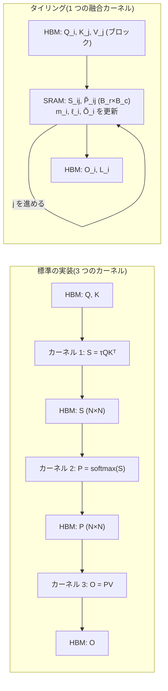
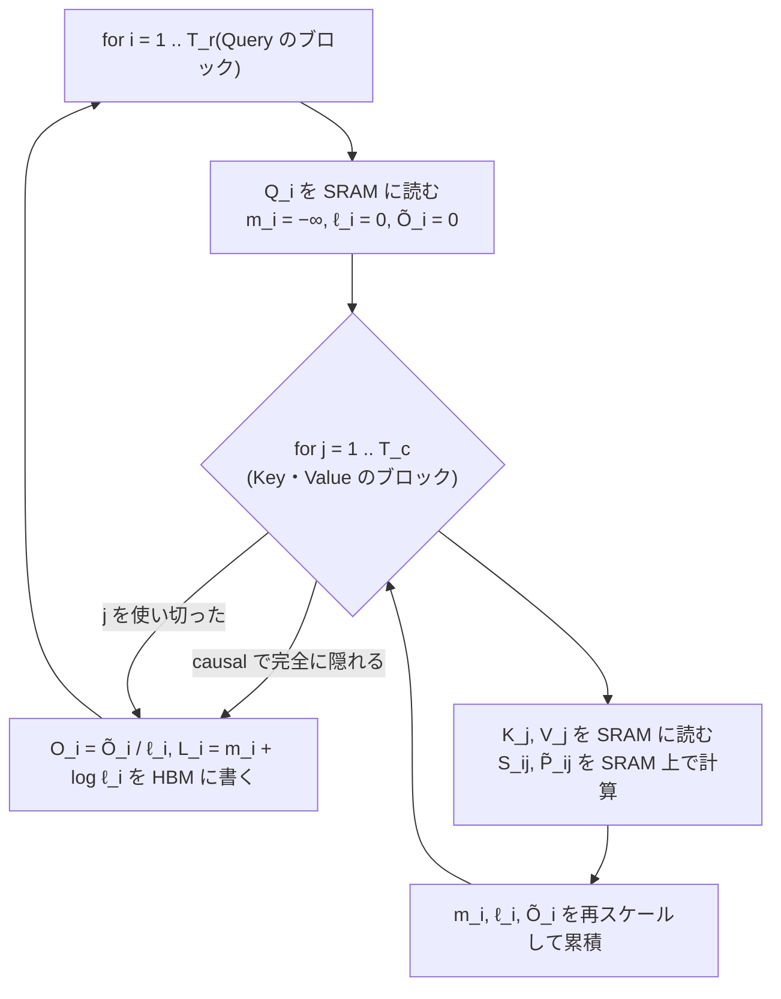

# 014. Flash Attention

## 1. 概要 / Overview

標準の Attention は、系列長 $N$ に対して $N \times N$ のスコア行列と softmax の出力を GPU の主記憶に書き出すため、
メモリ量が系列長の 2 乗で増え、softmax の周りの計算はメモリ帯域律速になる。Flash Attention(Dao et al., 2022)は、
Query・Key・Value を小さなブロックに分けてオンチップの高速なメモリの上で処理し(タイリング、Tiling)、
softmax の正規化を online softmax の統計量で逐次補正することで、近似なしに同じ出力を
$N \times N$ の中間行列を実体化せずに計算する。本トピックでは順伝播と、softmax の出力を保存せず再計算する逆伝播を
スクラッチ実装し、数値的な一致(実験 A・B)、メモリ量の系列長に対する次数(実験 C・D)、
PyTorch の memory-efficient バックエンドによる速度の系列長依存性(実験 E)を検証する。

## 2. 参考論文 / References

1. Dao, T., Fu, D. Y., Ermon, S., Rudra, A., Ré, C., "FlashAttention: Fast and Memory-Efficient Exact Attention
   with IO-Awareness", NeurIPS 2022. https://arxiv.org/abs/2205.14135
   (本トピックの原典。タイリングによる順伝播(Algorithm 1)、再計算による逆伝播(Algorithm 4、Appendix B)、
   読み書き量の計算量(定理 2)。3.2〜3.7 節)
2. Dao, T., "FlashAttention-2: Faster Attention with Better Parallelism and Work Partitioning", ICLR 2024.
   https://arxiv.org/abs/2307.08691
   (ループの順序の入れ替え、正規化の後回し、logsumexp のみの保存、系列方向の並列化。本ノートブックの実装の
   ループの順序はこれに従う。3.5 節・3.8 節)
3. Shah, J., Bikshandi, G., Zhang, Y., Thakkar, V., Ramani, P., Dao, T., "FlashAttention-3: Fast and Accurate
   Attention with Asynchrony and Low-precision", NeurIPS 2024. https://arxiv.org/abs/2407.08608
   (位置づけのみ、3.8 節)
4. Milakov, M., Gimelshein, N., "Online normalizer calculation for softmax", arXiv 2018.
   https://arxiv.org/abs/1805.02867
   (online softmax、3.4 節)
5. Rabe, M. N., Staats, C., "Self-attention Does Not Need $O(n^2)$ Memory", arXiv 2021.
   https://arxiv.org/abs/2112.05682
   (チャンクに分けた Attention の計算。PyTorch の memory-efficient バックエンドの系譜、3.8 節)
6. Vaswani, A., Shazeer, N., Parmar, N., Uszkoreit, J., Jones, L., Gomez, A. N., Kaiser, Ł., Polosukhin, I.,
   "Attention Is All You Need", NeurIPS 2017. https://arxiv.org/abs/1706.03762
   ([001](https://zenn.dev/kojikojiprg/books/ai-theories-roadmap/viewer/001_attention_mechanism) と同じ。Scaled Dot-Product Attention の定義、3.1 節)
7. Lefaudeux, B., Massa, F., Liskovich, D., Xiong, W., Caggiano, V., Naren, S., Xu, M., Hu, J., Tintore, M.,
   Zhang, S., Labatut, P., Haziza, D., Wehrstedt, L., Reizenstein, J., Sizov, G., "xFormers: A modular and
   hackable Transformer modelling library", 2022. https://github.com/facebookresearch/xformers
   (memory-efficient Attention の実装。PyTorch の memory-efficient バックエンドの由来、3.8 節)
8. Williams, S., Waterman, A., Patterson, D., "Roofline: An Insightful Visual Performance Model for Multicore
   Architectures", Communications of the ACM, 52(4), 2009. https://doi.org/10.1145/1498765.1498785
   ([010](https://zenn.dev/kojikojiprg/books/ai-theories-roadmap/viewer/010_kv_cache_and_inference_compute) と同じ。roofline モデル、3.3 節)

## 3. 理論 / Theory

### 3.0 記号

本ノートブックでは原論文 [1] の記号に従う。

- $N$: 系列長(Query と Key の系列長が等しい自己注意を考える)。[010](https://zenn.dev/kojikojiprg/books/ai-theories-roadmap/viewer/010_kv_cache_and_inference_compute)
  などの既存トピックでは系列長を $T$ と書いてきたが、本ノートブックの $N$ は同じ量である
  ([009](https://zenn.dev/kojikojiprg/books/ai-theories-roadmap/viewer/009_scaling_laws) のパラメータ数 $N$ とは別の量である)。
- $d$: 1 ヘッドあたりの次元。[001](https://zenn.dev/kojikojiprg/books/ai-theories-roadmap/viewer/001_attention_mechanism) の $d_k$($= d_v$)にあたる。
- $Q, K, V \in \mathbb{R}^{N \times d}$: 1 つのヘッドの Query・Key・Value。バッチとヘッドの次元は互いに独立に
  同じ計算を繰り返すだけなので、理論では 1 ヘッド分を考える。
- $S = \tau Q K^\top \in \mathbb{R}^{N \times N}$: スコア行列。$\tau = 1 / \sqrt{d}$ はスケーリング係数(001 と同じ)。
- $P = \mathrm{softmax}(S) \in \mathbb{R}^{N \times N}$: 行ごとの softmax。$O = P V \in \mathbb{R}^{N \times d}$: 出力。
- $M$: オンチップの高速なメモリ(3.2 節の SRAM)に置ける要素数。
- $B_r$・$B_c$: Query のブロックの行数と、Key・Value のブロックの行数。$T_r = \lceil N / B_r \rceil$・
  $T_c = \lceil N / B_c \rceil$ はそれぞれのブロックの数。
- $m$・$\ell$: online softmax の統計量(行ごとの最大値と正規化定数、3.4 節)。
- $L$: 行ごとの logsumexp。$D$: 逆伝播で使う行ごとの内積(3.6 節)。

### 3.1 標準の Attention とその問題

Scaled Dot-Product Attention [6] は

$$
S = \tau Q K^\top, \qquad P = \mathrm{softmax}(S), \qquad O = P V
$$

である。softmax は行ごとに取り、行 $i$ について $P_{ij} = e^{S_{ij}} / \sum_{k} e^{S_{ik}}$ である。

標準の実装(原論文 [1] の Algorithm 0、001 の`scaled_dot_product_attention()`も同じ手順)は、次の 3 段階で
計算し、段階ごとに中間結果を GPU の主記憶に書き出す。

1. $Q, K$ を読み、$S = \tau Q K^\top$ を計算して $S$ を書き出す。
2. $S$ を読み、$P = \mathrm{softmax}(S)$ を計算して $P$ を書き出す。
3. $P, V$ を読み、$O = P V$ を計算して $O$ を書き出す。

中間の $S$ と $P$ はいずれも $N \times N$ である。したがって

- **メモリ量**: 中間行列のために $\Theta(N^2)$ の領域が要る(入力・出力の $\Theta(Nd)$ に加えて)。
  逆伝播のために $P$ を保存する場合も $\Theta(N^2)$ である。
- **主記憶の読み書き量**: 段階 1 で $2Nd$ を読んで $N^2$ を書き、段階 2 で $N^2$ を読んで $N^2$ を書き、段階 3 で
  $N^2 + Nd$ を読んで $Nd$ を書く。合計は $4Nd + 4N^2$ 要素、すなわち $\Theta(Nd + N^2)$ である。

$d$ は 64〜128 程度で固定され、$N$ は数千以上に伸ばしたい量なので、$N \gg d$ では $N^2$ の項が支配的になる。

### 3.2 GPU のメモリの階層

GPU のメモリは、大きさと速さの異なる階層からなる [1]。

- **HBM(High Bandwidth Memory、広帯域メモリ)**: GPU チップの外にある主記憶。容量は大きい(数十 GB)が、
  演算器から見た帯域は相対的に低い。原論文は A100 の値として容量 40〜80 GB・帯域 1.5〜2.0 TB/s を挙げる。
- **SRAM(Static Random Access Memory)**: 各ストリーミングマルチプロセッサ(Streaming Multiprocessor、演算器の
  まとまり)の中にあるオンチップのメモリ(共有メモリ・L1 キャッシュ)。容量は 1 つのストリーミング
  マルチプロセッサあたり数百 KB 以下と小さいが、帯域は HBM より 1 桁ほど高い(原論文は A100 で合計 19 TB/s 程度とする)。

以降、原論文に従い、GPU の主記憶(オフチップの DRAM)を HBM、オンチップのメモリを SRAM と呼ぶ。
Google Colab の T4 の主記憶は実際には GDDR6(容量 16 GB・公称帯域 320 GB/s)であり HBM ではないが、
階層の上での位置(大容量・低帯域のオフチップのメモリ)は同じなので、本ノートブックでは同じ名前で呼ぶ。

GPU のカーネル(1 回の演算の呼び出し)は、入力を HBM から読んで SRAM やレジスタに載せて計算し、結果を HBM に
書き戻す。3.1 節の標準の実装は 3 つ(以上)の別々のカーネルからなるので、$S$ と $P$ はカーネルの境界で必ず HBM を
経由する。Flash Attention の要点は、**3 つの段階を 1 つのカーネルに融合し、$S$ と $P$ を SRAM の中だけで
ブロックごとに作っては捨てる** ことである。そのためには、softmax の正規化(行全体の和)を、行の一部しか見えていない
状態で計算する方法が要る(3.4 節)。

### 3.3 メモリ帯域律速であること(演算強度と roofline モデル)

[010](https://zenn.dev/kojikojiprg/books/ai-theories-roadmap/viewer/010_kv_cache_and_inference_compute) で導入した演算強度(arithmetic intensity、読み書きする 1 バイト
あたりの浮動小数点演算回数)と roofline モデル [8] で、標準の実装の各段階を評価する。要素あたりのバイト数を $s$
とする(FP16 で $s = 2$)。

**段階 2(softmax)**: 1 要素あたり最大値の比較・減算・指数関数・和・除算の 5 回程度の演算に対し、$S$ の読み出しと
$P$ の書き出しで $2s$ バイトを移動するので、

$$
\mathrm{AI}_{\mathrm{softmax}} \approx \frac{5 N^2}{2 s N^2} = \frac{5}{2s}
$$

であり、FP16 では約 1.25 FLOP/byte である。T4 の公称値(FP16 の Tensor Core で 65 TFLOPS、帯域 320 GB/s)から
ridge point は $\mathrm{AI}_{\mathrm{ridge}} = 65 \times 10^{12} / (320 \times 10^9) \approx 203$ FLOP/byte なので、
softmax はこれを 2 桁下回り、明確にメモリ帯域律速である。

**段階 1($S = \tau Q K^\top$)**: 演算は $2N^2 d$、移動量は $s(2Nd + N^2)$ バイトなので、$N \gg d$ では

$$
\mathrm{AI}_{QK^\top} \approx \frac{2 N^2 d}{s N^2} = \frac{2d}{s}
$$

となる。$d = 64$ の FP16 では約 64 FLOP/byte で、行列積でありながら T4 の ridge point を下回る。演算量は $d$ に
比例するのに、$S$ の書き出しは $d$ によらず $N^2$ であるためである。

どちらも、律速しているのは $N \times N$ の中間行列の HBM への書き出しと読み戻しである。演算量(FLOPs)を減らす
近似(疎な Attention や低ランク近似)ではなく、**演算量は変えずに HBM の読み書き量を減らす** のが Flash Attention の
方針であり、原論文はこれを IO を意識した(IO-aware)アルゴリズムと呼ぶ [1]。

### 3.4 online softmax

長さ $N$ のベクトル $x$ の softmax を数値的に安全に計算するには、最大値 $m = \max_k x_k$ を引いて

$$
\mathrm{softmax}(x)_i = \frac{e^{x_i - m}}{\ell}, \qquad \ell = \sum_{k=1}^{N} e^{x_k - m}
$$

とする。$x_k - m \le 0$ なので指数関数の値は $(0, 1]$ に収まり、オーバーフローしない。最大値を引かない素朴な計算
$e^{x_i} / \sum_k e^{x_k}$ は、FP32 では $x_i > 88.7$ 程度で $e^{x_i}$ が無限大になる(FP16 では $x_i > 11.1$ 程度)。
最大値を引く計算は、最大値を求めるパス・$\ell$ を求めるパス・正規化するパスの 3 回、$x$ を読む。

Milakov & Gimelshein [4] は、最大値と正規化定数を 1 パスで同時に求める **online softmax** を示した。
$x$ の先頭 $j$ 要素までの最大値を $m_j$、正規化定数を $\ell_j$ として

$$
m_j = \max(m_{j-1}, x_j), \qquad \ell_j = \ell_{j-1}\, e^{m_{j-1} - m_j} + e^{x_j - m_j}, \qquad m_0 = -\infty,\ \ell_0 = 0
$$

と更新する。

**正しさ(帰納法)**: 不変条件 $\ell_j = \sum_{k \le j} e^{x_k - m_j}$ を示す。$j = 1$ では $\ell_1 = e^{x_1 - m_1}$ で
成り立つ($e^{m_0 - m_1} = e^{-\infty} = 0$)。$j - 1$ で成り立つとすると

$$
\ell_{j-1}\, e^{m_{j-1} - m_j} = \sum_{k \le j-1} e^{x_k - m_{j-1}} e^{m_{j-1} - m_j} = \sum_{k \le j-1} e^{x_k - m_j}
$$

なので、$e^{x_j - m_j}$ を足して $\ell_j = \sum_{k \le j} e^{x_k - m_j}$ となる。$j = N$ で $m_N = m$、$\ell_N = \ell$ である。

**数値的な安定性**: 更新式に現れる指数は $m_{j-1} - m_j \le 0$ と $x_j - m_j \le 0$ だけなので、指数関数の値は常に
$(0, 1]$ に収まる。$\ell_j$ は項 $e^{x_{k^*} - m_j} = 1$($k^*$ はそれまでの最大値を取る位置)を含むので $\ell_j \ge 1$
であり、最後の除算で 0 による除算も起きない。最大値を引く標準の計算と同じ安定性が 1 パスで得られる。

**ブロック単位への一般化**: 要素を 1 つずつではなくブロックごとに処理してもよい。$x$ を 2 つの部分 $x^{(1)}, x^{(2)}$
に分け、それぞれの統計量を $(m^{(1)}, \ell^{(1)})$・$(m^{(2)}, \ell^{(2)})$ とすると、全体の統計量は

$$
m = \max(m^{(1)}, m^{(2)}), \qquad \ell = e^{m^{(1)} - m} \ell^{(1)} + e^{m^{(2)} - m} \ell^{(2)}
$$

で合成できる(上の帰納法と同じ計算)。

**出力への拡張**: Attention では softmax の値そのものではなく、それを重みとした $V$ の行の重み付き和が要る。
正規化前の出力 $\tilde{o}_j = \sum_{k \le j} e^{x_k - m_j} v_k$ も同じ係数で補正できる:
$\tilde{o}_j = e^{m_{j-1} - m_j} \tilde{o}_{j-1} + e^{x_j - m_j} v_j$。最後に $o = \tilde{o}_N / \ell_N$ とすれば、
$o = \sum_k \mathrm{softmax}(x)_k v_k$ が近似なしに得られる。これが Flash Attention の順伝播の核である。

### 3.5 タイリングによる順伝播

$Q$ を $B_r$ 行ずつの $T_r$ 個のブロック $Q_1, \dots, Q_{T_r}$ に、$K, V$ を $B_c$ 行ずつの $T_c$ 個のブロック
$K_1, \dots, K_{T_c}$・$V_1, \dots, V_{T_c}$ に分ける($N$ がブロックの行数で割り切れない場合、最後のブロックは短くなる)。
Query のブロック $i$ ごとに、行ごとの最大値 $m_i \in \mathbb{R}^{B_r}$・正規化定数 $\ell_i \in \mathbb{R}^{B_r}$・
正規化前の出力 $\tilde{O}_i \in \mathbb{R}^{B_r \times d}$ を SRAM に持ち、Key・Value のブロックを 1 つずつ読むたびに
3.4 節の更新をブロックで行う。

$$
S_{ij} = \tau Q_i K_j^\top, \qquad
m_i^{\mathrm{new}} = \max\!\left(m_i,\ \mathrm{rowmax}(S_{ij})\right), \qquad
\tilde{P}_{ij} = \exp\!\left(S_{ij} - m_i^{\mathrm{new}}\right)
$$

$$
\ell_i \leftarrow e^{m_i - m_i^{\mathrm{new}}} \ell_i + \mathrm{rowsum}(\tilde{P}_{ij}), \qquad
\tilde{O}_i \leftarrow \mathrm{diag}\!\left(e^{m_i - m_i^{\mathrm{new}}}\right) \tilde{O}_i + \tilde{P}_{ij} V_j, \qquad
m_i \leftarrow m_i^{\mathrm{new}}
$$

ここで $\mathrm{rowmax}$・$\mathrm{rowsum}$ は行ごとの最大値・和、$\exp$ は要素ごとの指数関数、$\mathrm{diag}(\cdot)$ は
ベクトルを対角成分に持つ対角行列、$m_i^{\mathrm{new}}$ を引く操作は行ごとの減算である。全ての $j$ を処理したら
$O_i = \mathrm{diag}(\ell_i)^{-1} \tilde{O}_i$ と、逆伝播で使う行ごとの logsumexp $L_i = m_i + \log \ell_i$ を HBM に書く。

擬似コード(本ノートブックの実装`flash_attention_forward()`の手順)は付録 A.1。

原論文の Algorithm 1 はループの順序が逆(Key・Value のブロックが外側)で、内側のループのたびに $O_i$・$\ell_i$・$m_i$ を
HBM に読み書きし、毎回正規化した $O_i$ を書き戻す。付録 A.1 の擬似コードは FlashAttention-2 [2] の順序で、$Q_i$ と
$\tilde{O}_i$ を SRAM に置いたまま内側のループを回し、正規化を最後に 1 回だけ行う。どちらの順序でも出力は同じで、
読み書き量の次数も同じである(3.7 節)。

**因果マスクによるブロックの省略**: 因果マスクでは Query の位置 $p$ は Key の位置 $q \le p$ のみを参照する。
Query のブロック $i$ が位置 $[i_0, i_1)$、Key のブロック $j$ が位置 $[j_0, j_1)$ を占めるとき、

- $j_0 > i_1 - 1$(ブロック内の最小の Key の位置が最大の Query の位置より後ろ)なら、ブロック全体が隠れるので
  計算を飛ばせる。付録 A.1 の擬似コードでは $j_0 \ge i_1$ になった時点で内側のループを打ち切る。
- $j_1 - 1 \le i_0$ なら、ブロック全体が参照される(マスク不要)。
- それ以外(対角をまたぐブロック)だけ、要素ごとのマスクを適用する。

$B_r = B_c$ で $N$ がブロックの行数で割り切れるとき、計算するブロックの組は $T_r (T_r + 1) / 2$ 個で、全体の
$T_r^2$ 個の約半分である。各行の最初に処理するブロック($j_0 = 0$)には必ず $q = 0 \le p$ が含まれるので、
$m_i^{\mathrm{new}}$ は最初のブロックで有限になり、$e^{-\infty - m_i^{\mathrm{new}}} = 0$ で初期値が正しく消える。

### 3.6 逆伝播での再計算(recomputation)

損失を $\phi$ とし、$dX = \partial \phi / \partial X$ と書く。$O = PV$、$P = \mathrm{softmax}(S)$、$S = \tau Q K^\top$ から

$$
dV = P^\top dO, \qquad dP = dO\, V^\top
$$

である。行ごとの softmax のヤコビアンは $\partial P_{ij} / \partial S_{ik} = P_{ij}(\delta_{jk} - P_{ik})$ なので

$$
dS_{ik} = \sum_j dP_{ij} P_{ij} (\delta_{jk} - P_{ik}) = P_{ik} \left(dP_{ik} - \sum_j P_{ij}\, dP_{ij}\right)
$$

となる。ここで $\delta_{jk}$ はクロネッカーのデルタである。括弧の中の和を $D_i = \sum_j P_{ij}\, dP_{ij}$ とおくと、
$dP_{ij} = dO_i \cdot v_j$($dO_i$ は $dO$ の第 $i$ 行、$v_j$ は $V$ の第 $j$ 行)なので

$$
D_i = \sum_j P_{ij}\, (dO_i \cdot v_j) = dO_i \cdot \sum_j P_{ij} v_j = dO_i \cdot O_i
$$

すなわち $D = \mathrm{rowsum}(dO \circ O)$ である($\circ$ は要素ごとの積)。$D$ は $N \times N$ の $P$ を使わず、
出力 $O$ と $dO$ だけから $\Theta(Nd)$ で求まる。これを使って

$$
dS = P \circ \left(dP - D \mathbf{1}^\top\right), \qquad dQ = \tau\, dS\, K, \qquad dK = \tau\, dS^\top Q
$$

である($\mathbf{1}$ は全要素が 1 の長さ $N$ のベクトル)。

**再計算**: 標準の実装は順伝播で $P$($N \times N$)を保存し、逆伝播でそれを読む。Flash Attention は $P$ を保存せず、
$Q, K, V, O$ と行ごとの logsumexp $L$ のみを保存する。逆伝播では、ブロック $(i, j)$ ごとに

$$
S_{ij} = \tau Q_i K_j^\top, \qquad P_{ij} = \exp\!\left(S_{ij} - L_i\right)
$$

で $P_{ij}$ を SRAM 上に再計算する。$L_i = m_i + \log \ell_i$ なので $\exp(S_{ij} - L_i) = \exp(S_{ij} - m_i) / \ell_i$ は
正規化済みの softmax の値そのものであり、最大値を引いた後の指数なので安定である。実装`flash_attention_backward()`は、
Key・Value のブロック $j$ を外側のループとし、$dK_j$・$dV_j$ を SRAM に置いたまま Query のブロック $i$ について

$$
dV_j \mathrel{+}= P_{ij}^\top dO_i, \quad dP_{ij} = dO_i V_j^\top, \quad dS_{ij} = P_{ij} \circ (dP_{ij} - D_i \mathbf{1}^\top), \quad
dQ_i \mathrel{+}= \tau\, dS_{ij} K_j, \quad dK_j \mathrel{+}= \tau\, dS_{ij}^\top Q_i
$$

を累積する($dQ_i$ は HBM 上で足し込む)。因果マスクでは、順伝播と同じ規則で完全に隠れるブロックを飛ばす。

**計算量とメモリ量の交換**: 行列積の演算量(積和を 2 演算と数える)は、順伝播が $QK^\top$ と $PV$ で $4N^2 d$、
標準の逆伝播が $dV$・$dP$・$dQ$・$dK$ の 4 つで $8N^2 d$ である。再計算は $S = \tau Q K^\top$ の $2N^2 d$ を逆伝播に追加するので、
逆伝播の演算量は $10 N^2 d$(標準の 1.25 倍)になる。その代わり、逆伝播のために保存する量は

- 標準: $Q, K, V$($3Nd$)と $P$($N^2$)。$\Theta(Nd + N^2)$
- Flash Attention: $Q, K, V, O$($4Nd$)と $L$($N$)。$\Theta(Nd)$、すなわち系列長に対して $\Theta(N)$

になる。原論文 [1] は、再計算で演算量が増えても HBM の読み書き量が減るため、逆伝播も標準の実装より速くなると報告している。

### 3.7 読み書き量の計算量(IO complexity)

原論文 [1] の定理 2 は、$d \le M \le Nd$ のとき、標準の Attention の HBM の読み書き量が $\Theta(Nd + N^2)$、
Flash Attention の読み書き量が $\Theta(N^2 d^2 M^{-1})$ であることを示す。本ノートブックの実装のループの順序
(Query のブロックが外側)で導出する。

**標準**: 3.1 節のとおり $4Nd + 4N^2 = \Theta(Nd + N^2)$。

**Flash Attention**:

- $Q_i$ は外側のループで 1 回ずつ読むので合計 $Nd$、$O_i$・$L_i$ は 1 回ずつ書くので合計 $Nd + N$。
- 内側のループでは、Query のブロック 1 つごとに全ての $K_j, V_j$ を読むので、1 つの $i$ あたり $2Nd$、全体で $2 N d\, T_r$。
- 合計は $\Theta(Nd + Nd\, T_r) = \Theta(N^2 d / B_r)$。

**ブロックの大きさの制約**: SRAM には $Q_i$($B_r d$)・$\tilde{O}_i$($B_r d$)・$K_j, V_j$($2 B_c d$)・
$S_{ij}, \tilde{P}_{ij}$($B_r B_c$ 程度)が同時に載らなければならないので、

$$
2 B_r d + 2 B_c d + B_r B_c = O(M)
$$

である。$B_r = \Theta(M / d)$、$B_c = \Theta(\min(d, M/d))$ と取ればこれを満たし($B_r B_c = O(M)$)、このとき

$$
T_r = \frac{N}{B_r} = \Theta\!\left(\frac{N d}{M}\right), \qquad
\text{accesses} = \Theta\!\left(N d \cdot \frac{N d}{M}\right) = \Theta\!\left(\frac{N^2 d^2}{M}\right)
$$

となる。原論文の順序(Key・Value が外側)では役割が入れ替わり、$K, V$ を 1 回ずつ読んで $Q, O$ を $T_c$ 回読み書きするので、
$B_c = \Theta(M/d)$ と取って同じ $\Theta(N^2 d^2 / M)$ を得る。

**比較**: 標準の $N^2$ の項に対して、Flash Attention の読み書き量は $d^2 / M$ 倍である。例えば $d = 64$ で SRAM に
FP16 で約 100 KB(約 5 万要素)を使えれば $d^2 / M \approx 0.08$ で、1 桁以上少ない。演算量はどちらも $\Theta(N^2 d)$ で
変わらない。因果マスクによるブロックの省略は、計算するブロックの組を約半分にするので、読み書き量も約半分になる
(次数は変わらない)。原論文は逆伝播についても同じ $\Theta(N^2 d^2 / M)$ を示している(定理 5)。

**メモリ量**: 出力以外に必要なのは $L$(または $m, \ell$)の $\Theta(N)$ と、SRAM 上のブロックの $O(M)$ だけであり、
$N \times N$ の中間行列は HBM に一度も現れない。

### 3.8 位置づけ

**FlashAttention-2 [2]**: 原論文の Flash Attention は A100 のピーク演算性能の 25〜40% 程度に留まっていた。
FlashAttention-2 は、(1) 正規化を内側のループの最後に 1 回だけ行うなど、行列積以外の演算(GPU の行列積専用の演算器
である Tensor Core で実行できず、相対的に遅い)を減らし、(2) バッチ・ヘッドに加えて **系列方向(Query のブロック)でも
並列化** して、系列が長くバッチが小さい場合にもストリーミングマルチプロセッサを埋め、(3) 1 つのブロック内の作業を
warp(同時に実行される 32 スレッドの単位)に分ける方法を、Key・Value を分ける方式から Query を分ける方式に変えて、
warp 間の共有メモリを介した同期と読み書きを減らした。逆伝播のために $m$ と $\ell$ の代わりに logsumexp $L$ だけを
保存するのも FlashAttention-2 の変更である。本ノートブックの実装はこのループの順序と $L$ の保存に従う。

**FlashAttention-3 [3]**: H100(Hopper アーキテクチャ)の非同期実行(データの転送と行列積を別々の warp に担わせる
warp の特化、softmax と行列積の重ね合わせ)と、FP8 の低精度演算(ブロック単位の量子化と、外れ値の影響を減らす
非干渉化の処理)を使う。アルゴリズムの骨格(タイリングと online softmax、再計算)は同じである。

**PyTorch の SDPA**: PyTorch の`torch.nn.functional.scaled_dot_product_attention`(SDPA: Scaled Dot-Product
Attention)は、同じ計算を複数のバックエンドから選んで実行する。バックエンドは`torch.nn.attention.sdpa_kernel`で
明示的に制限できる。

- **math**: 行列積・softmax などの個別の演算の組み合わせ。3.1 節の標準の実装と同じく $N \times N$ の中間行列を実体化する。
- **flash**: FlashAttention-2 のカーネル。CUDA では compute capability 8.0(Ampere アーキテクチャ)以降を要求するため、
  **T4(Turing アーキテクチャ、compute capability 7.5)では使えない** (このことは 5.5 節で実際に確かめる)。
- **memory-efficient**: xFormers [7] の`memory_efficient_attention`に由来するカーネル。Rabe & Staats [5] が示した、
  Key・Value をチャンクに分けて部分的な和と最大値を持ち回る計算(3.4 節と同じ考え方)に基づく。T4 でも使える。
- (**cuDNN**: NVIDIA の cuDNN ライブラリの Attention のカーネル。本ノートブックでは扱わない。)

Rabe & Staats [5] は、Attention のメモリ量が $O(n^2)$ である必要はなく、チャンクごとの計算とチェックポイント(逆伝播での
再計算)で $O(\sqrt{n})$ 程度に抑えられることを示した(彼らの $n$ は本ノートブックの $N$)。Flash Attention [1] は、同じ
考え方を HBM と SRAM の読み書き量の観点から設計し直し、1 つの融合カーネルとして実装したものと位置づけられる。

本ノートブックのスクラッチ実装は Python のループで書くため、1 つのブロックの計算ごとに複数のカーネルを呼び出し、
ブロックの中間結果も HBM を経由する。**したがってメモリ量の次数(実験 C・D)は Flash Attention と同じ性質を持つが、
速度は本来の性能を反映しない。** 速度の系列長依存性は、実際に融合カーネルである SDPA の memory-efficient
バックエンドで検証する(実験 E)。

## 4. 実装方針 / Implementation Policy

**`src/`に切り出す(スクラッチ実装、本トピックで新規作成)**: `src/layers/flash_attention.py`

- `flash_attention_forward(query, key, value, block_size_query, block_size_key, causal=False, scale=None)`:
  付録 A.1 の擬似コードどおりのタイリングと online softmax による順伝播。出力 $O$ と行ごとの logsumexp $L$ を返す。
  入力が FP16 でも、統計量 $m, \ell, L$ と $\tilde{O}_i$ の累積は FP32 で行う(入力が FP64 の場合は FP64)。
  系列長がブロックの行数で割り切れない場合は最後のブロックを短くし、ブロックの行数が系列長以上の場合は
  ブロックが 1 つになる。
- `flash_attention_backward(...)`: 3.6 節の再計算による逆伝播($P_{ij}$ をブロックごとに再計算する)。
- `FlashAttentionFunction(torch.autograd.Function)`: 上の 2 つを順伝播・逆伝播とする。`ctx`に保存するのは
  $Q, K, V, O, L$ のみである。
- `count_block_pairs()`: 計算するブロックの組の数と全体の数(因果マスクで飛ばしたブロックの割合の計算に使う)。
  順伝播と同じ規則(`key_block_end()`)で数える。
- 入力の形状は`(batch, heads, sequence, head_dim)`で、001 の`scaled_dot_product_attention()`と揃える。バッチと
  ヘッドの次元はまとめてベクトル化し、系列方向のみをブロックに分ける。
- 既存の`src/layers/attention.py`・`MultiHeadAttention`は変更しない(小型 GPT には組み込まない)。

**ノートブック内に直接書く(014 固有)**:

- online softmax の 1 次元の例(5.4 節)。
- 実験のハーネス: 入力の生成、誤差の計算、ピークメモリ・保存テンソルの計測、SDPA のバックエンドの時間計測(5.6 節)。
- 標準の Attention の参照実装には 001 の`scaled_dot_product_attention()`をそのまま使う。FP64 の参照値もこの関数に
  FP64 の入力を与えて計算する。

**SDPA のバックエンドの指定**: `torch.nn.attention.sdpa_kernel`(インストールされている torch 2.13 の API)で
math・memory-efficient をそれぞれ 1 つだけ許可して呼ぶ。指定したバックエンドが使えない場合に例外になることを
5.5 節で確かめ、実験 E では加えて、実際に実行された演算の名前を profiler で確認する(5.6 節)。
**バックエンドの選択を無視して黙って別の実装で実行する環境がある** (スモークテストで確認したローカルの MPS では、
memory-efficient・flash を指定しても例外にならなかった)ため、例外にならないことだけを「指定したバックエンドで
実行された」根拠にしない。

**デバイス**: CUDA が使える場合は CUDA、使えない場合は CPU を使う。MPS は FP64 に対応していないため
(実験 A・B の参照値に FP64 を使う)使わない。

**アップロード方針**: 学習もモデルもないため、Hugging Face Hub へのアップロードはない。生成物はセル出力
のみである。

## 5. 実装 / Implementation

### 5.1 環境セットアップ(Google Colab)と実行環境の記録

依存関係のインストールの後に、実行環境(GPU 名・compute capability・GPU の総メモリ・torch と CUDA・cuDNN の
バージョン・デバイス・コミット・実行日時)を印字する。結果・考察で実行環境に言及するときは、この印字を出典とする。

### 5.2 スケールの設定(`SMOKE_TEST`の配線)

水準の定義をこの 1 箇所(`LEVELS`)に集約する。`SMOKE_TEST = True`はローカルでのコード経路の確認用、
`SMOKE_TEST = False`は Google Colab T4 での本番実行用である。

縮小の規則(系列長の水準、シード数、反復回数など)は付録 B.1。

**実験 C の最大の系列長**: 標準の実装のピークメモリの増分の閉形式(6.1 節の実験 C)
$2 \cdot B H N^2 \cdot 4$ バイト(FP32 の $S$ と $P$ が同時に存在する)が、T4 の総メモリ(約 15 GiB)の 60% 以下に収まる
最大の公比 2 の水準を下のセルで求めて宣言する(60% は、CUDA のメモリアロケータのキャッシュ・断片化と行列積の作業領域の
余裕として置いた値である)。

### 5.3 入力の生成

入力は乱数で作る。**CPU 上の FP64 で生成してから目的の dtype・デバイスに変換する** ので、同じシードからはデバイスに
よらず同じ値が得られる。Query・Key には標準偏差 $\sigma$ を掛ける(スコア $\tau q \cdot k$ の標準偏差は $\sigma^2$ になる)。
Value と出力の勾配 $dO$ は標準正規分布とする。

### 5.4 online softmax の 1 次元の例

3.4 節の 3 つの計算を 1 次元のベクトルで比べる。

- 素朴な計算: $e^{x_i} / \sum_k e^{x_k}$(最大値を引かない)
- 最大値を引く 3 パスの計算
- online softmax(1 要素ずつの更新と、ブロックごとの統計量の合成)

通常のスケールの入力では 3 つとも`torch.softmax`と一致し、大きな値を含む入力では素朴な計算だけがオーバーフローして
NaN になることを確かめる(不変条件のアサーション)。大きな値の入力は標準偏差 300 とし、最大値が FP32 の境界(約 88.7)と
FP64 の境界(約 709.8)をともに超えるようにする。

### 5.5 不変条件の確認(`src/layers/flash_attention.py`)

- **順伝播の正しさ(FP64)**: 系列長がブロックの行数で割り切れない場合・割り切れる場合・ブロックの行数が系列長以上の
  場合・$B_r \ne B_c$ の場合のそれぞれで、因果マスクの有無の両方について、001 の`scaled_dot_product_attention()`
  (FP64)との差が $10^{-12}$ 以下であること。logsumexp $L$ が`torch.logsumexp`と一致すること。
- **`gradcheck`(FP64)**: 同じ形状の組で`FlashAttentionFunction`の勾配が数値微分と一致すること。
- **逆伝播の正しさ(FP64)**: `flash_attention_backward()`の $dQ, dK, dV$ が、001 の関数を autograd で微分した値と
  $10^{-12}$ 以下で一致すること。
- **保存するテンソル**: `FlashAttentionFunction`が逆伝播のために保存するのが $Q, K, V, O, L$ の 5 つのみで
  あること(`saved_tensors_hooks`で記録したテンソルの記憶領域が、入力 3 つ・出力・$L$ と一致する)。
- **ブロックの組の数**: `count_block_pairs()`が、順伝播で実際に計算したブロックの組の数と一致すること。
- **SDPA のバックエンド**: 使えないバックエンドだけを許可すると例外になること。CUDA で compute capability が
  8.0 未満(T4 など)なら flash、CPU なら memory-efficient が使えないので、それを許可して例外を確かめる。

### 5.6 実験のハーネス

- `run_sample_a()`・`run_sample_b()`: 実験 A・B の 1 標本(1 つの系列長・因果マスクの有無・スケール・シード)。
- `measure_forward_memory()`: 実験 C の順伝播(`torch.no_grad()`)のピークメモリ。CUDA では
  `torch.cuda.max_memory_allocated()`で測る。加えて、デバイスによらない診断量として、演算が作ったテンソルの記憶領域の
  バイト数の合計の最大値(生存中のテンソルのバイト数のピーク)を`LiveTensorBytesTracker`で数える。CUDA 以外
  (ローカルのスモークテスト)では後者のみが得られる。
- `measure_saved_tensor_bytes()`: 実験 D の、逆伝播のために保存されるテンソルのバイト数。`saved_tensors_hooks`で
  保存されるテンソルを記録し、**記憶領域(storage)ごとに 1 回だけ** 数える(転置などのビューや、softmax の出力と
  次の行列積の入力のように同じ記憶領域を複数回保存しても、実際に保持されるのは 1 つだけであるため)。
- `run_level_e()`: 実験 E の 1 つの系列長での SDPA の時間計測。math と memory-efficient を 1 回ずつ続けて実行する
  反復を繰り返し、反復ごとに実行の順序を入れ替える(偶数回目は math が先、奇数回目は memory-efficient が先)。
  それぞれ`torch.cuda.synchronize()`で挟んで時間を測る。時間計測とは別の 1 回の呼び出しを profiler で記録し、
  実行された演算の名前が指定したバックエンドのものであることを確かめる(前提条件 P-E2)。

## 6. 実験 / Experiments

### 6.1 実験宣言セル: 共通の設定・検証すること・判定基準・前提条件

**この節の内容は本番実行の前に確定させ、結果を見た後に変更しない。**

#### 共通の設定

- 入力は乱数で作る(5.3 節)。Query・Key の要素の標準偏差を $\sigma$ とし、「通常」は $\sigma = 1$(スコアの標準偏差 1)、
  「大」は $\sigma = 6$(スコアの標準偏差 36)とする。「大」では 1 行のスコアの最大値が FP32 の指数関数の
  オーバーフローの境界(約 88.7)を超える行が現れ、最大値を引かない素朴な softmax は非有限値を出す(実験 A の診断量で観察する)。
- $d = 64$。バッチ・ヘッド数・ブロックの行数は実験ごとに 5.2 節の値に固定し、水準によらず共通とする。
- 系列長の水準は公比 2 の等比数列とする(5.2 節)。メモリ量(実験 C・D)と速度比(実験 E)は $\log N$ に対する傾きを
  見るので、等比の刻みで各水準が回帰に等しく寄与するようにする。
- 判定は **支持 / 反証 / 判定不能** の 3 値とする。前提条件が 1 つでも成立しなかった実験は、判定関数の結果に関わらず
  **前提不成立** とし、判定不能とは区別して報告する。
- **標本の独立性**: 実験 A・B の各標本は、系列長・因果マスクの有無・スケール・シードの組ごとに異なる乱数のシード
  (`sample_seed()`)で入力を作る。同じ入力を複数の条件で共有しないので、標本は互いに独立である。
- **実験 C・D の計測は決定的である** (同じ入力・同じコードでは毎回同じバイト数になる)。したがって、べき指数の標準誤差は
  測定のばらつきではなく、べき乗則からのずれ(両対数での曲がり)を表す。

#### 実験 A: 順伝播の数値的な一致

- **検証すること**: タイリングと online softmax による順伝播`flash_attention_forward()`の出力の、FP64 の参照値に対する誤差が、
  標準の Attention(001 の`scaled_dot_product_attention()`)の FP32 の実装の誤差と同程度である(Flash Attention は近似ではなく、
  和を取る順序と正規化の時点を変えただけの厳密な計算であるため)。
- **条件**: 系列長 $N \in \{80, 160, 320, 640, 1280\}$(本番。$B_r = B_c = 64$ で割り切れない 80・160 と、割り切れる 320 以上を
  含む)× 因果マスクの有無 × スケール(通常・大)× シード $R = 5$ 個。標本数 $n_A = 5 \times 2 \times 2 \times 5 = 100$。
  入力はすべて FP32。
- **誤差**: 相対誤差 $\mathrm{err} = \lVert O - O_{\mathrm{ref}} \rVert_\infty / \lVert O_{\mathrm{ref}} \rVert_\infty$。
  $\lVert \cdot \rVert_\infty$ は要素の絶対値の最大値、$O_{\mathrm{ref}}$ は同じ FP32 の入力を FP64 に変換して 001 の関数で
  計算した参照値である。タイリングの誤差を $\mathrm{err}_{\mathrm{tiled}}$、標準の実装の誤差を $\mathrm{err}_{\mathrm{standard}}$ とする。
- **対比量**: 標本 $s$ ごとの $r_s = \log(\mathrm{err}_{\mathrm{tiled},s} / \mathrm{err}_{\mathrm{standard},s})$ の平均
  $\bar{r} = \frac{1}{n_A} \sum_s r_s$ と、その標準誤差 $\mathrm{SE} = \hat{s}_r / \sqrt{n_A}$($\hat{s}_r$ は $r_s$ の標本標準偏差、
  不偏分散による)。標本は独立なので、平均の標準誤差はこの式で与えられる。
- **判定基準**:
  - 支持: $\bar{r} + 2\,\mathrm{SE} < \log 2$(タイリングの誤差が、標準の実装の誤差の 2 倍以上には悪くない)
  - 反証: $\bar{r} - 2\,\mathrm{SE} > \log 2$
  - 判定不能: 上記以外
  - タイリングの誤差が非有限値(NaN・無限大)になった標本が 1 つでもあれば、その標本の $r_s = +\infty$ とみなし、反証とする。
- **閾値 $\log 2$ の意図**: 厳密な計算どうしの誤差は、どちらも FP32 の丸め誤差($2^{-24} \approx 6 \times 10^{-8}$ の定数倍)の
  大きさであり、和を取る順序や指数関数を呼ぶ回数の違いによって定数倍の範囲で変わりうる。2 倍はその程度の違いを許す幅である。
  一方、近似(項の打ち切りなど)や再スケールの誤りがあれば、誤差は丸め誤差より何桁も大きくなるので、$\log 2$ を大きく超える。
  この基準は「タイリングの方が精度が良い」ことは主張しない(片側の基準である)。
- **前提条件 P-A**: 全標本で $\mathrm{err}_{\mathrm{standard}}$ が有限かつ正であること(対比量の分母が定義されること。
  参照側の実装のみに関する条件で、検証する仮説とは独立である)。
- **対比量と直接の作用点**: タイリングと online softmax が直接作用するのは出力 $O$ の計算の手順であり、$O$ の誤差はその直接の
  帰結である。対比量は直接の作用点にあたる。
- **診断量**: FP16 の入力での同じ量($\bar{r}$ を FP16 について計算したもの。参照値は FP16 に丸めた入力の FP64 での計算)。
  **タイリングの実装は統計量と出力の累積を FP32 で行い、標準の実装(001)は FP16 のまま計算する。** 両者は累積の精度が
  異なるため、この診断量の差をタイリングそのものの効果とは解釈しない。
  最大値を引かない素朴な softmax(FP32)で非有限値を含む行の割合(スケールごと)。因果マスクで飛ばしたブロックの割合(系列長ごと)。
  条件(因果マスクの有無 × スケール)ごとの $\bar{r}$。

#### 実験 B: 再計算による逆伝播の数値的な一致

- **検証すること**: 再計算による逆伝播(`FlashAttentionFunction`)の勾配 $dQ, dK, dV$ の誤差が、標準の Attention を autograd で
  微分した FP32 の勾配の誤差と同程度である。
- **条件**: 実験 A と同じ(系列長・因果マスク・スケール・シードの数、標本数 $n_B = 100$)。出力の勾配 $dO$ は標準正規分布の乱数。
  参照値は、FP32 の入力を FP64 に変換して 001 の関数を autograd で微分した勾配。
- **対比量**: 3 つの勾配 $g \in \{dQ, dK, dV\}$ それぞれの相対誤差の比の対数
  $r_{s,g} = \log(\mathrm{err}_{\mathrm{tiled},s,g} / \mathrm{err}_{\mathrm{standard},s,g})$ のうち最大のものを、標本ごとの値
  $r_s = \max_g r_{s,g}$ とする。その平均と標準誤差は実験 A と同じ式。
- **判定基準・閾値の意図**: 実験 A と同じ(支持: $\bar{r} + 2\,\mathrm{SE} < \log 2$、反証: $\bar{r} - 2\,\mathrm{SE} > \log 2$、
  それ以外は判定不能。非有限値の扱いも同じ)。
- **前提条件 P-B**: 全標本・全勾配で $\mathrm{err}_{\mathrm{standard}}$ が有限かつ正であること。
- **対比量と直接の作用点**: 再計算が直接作用するのは逆伝播で使う $P_{ij}$ の求め方であり、勾配はその直接の帰結である。
  3 つの勾配の最大値は極値統計(3 つの中の最大)なので、同じ現象を平均で捉える診断量として、勾配ごとの $\bar{r}_g$ を併記する。
- `torch.autograd.gradcheck`(FP64・小さな形状)による確認は判定ではなく、5.5 節のアサーションで行った。

#### 実験 C: 順伝播のピークメモリの系列長に対する次数

- **検証すること**: 順伝播(`torch.no_grad()`)のピークメモリの増分の系列長 $N$ に対するべき指数が、標準の Attention では約 2、
  タイリングでは約 1 以下である。
- **ピークメモリの増分**: `torch.cuda.max_memory_allocated()`から、呼び出しの直前の`torch.cuda.memory_allocated()`
  (入力 $Q, K, V$ を含む)と、出力 $O$ のバイト数を差し引いたもの。ここで「出力」は Attention の出力 $O$ のみを指す。
  標準の実装が返す $P$ と、タイリングが返す $L$ は、中間の量として増分に含める。
- **水準**: $N \in \{1024, 2048, 4096, 8192, 16384\}$(本番)、バッチ 1・ヘッド 4・$d = 64$・FP32、$B_r = B_c = 128$(全水準で固定)。
  最大の系列長は、5.2 節の閉形式の見積もり(標準の実装で 8.0 GiB。$N = 32768$ では 32 GiB)から、T4 の約 15 GiB の 60% 以下に
  収まる最大の水準として決めた。
- **理論上の見込み**: 標準の実装の増分は $S$ と $P$ の $2 \cdot BHN^2 \cdot 4$ バイトが支配的なので、べき指数は 2 に近い。
  タイリングの増分は $L$ の $BHN \cdot 4$ バイト(系列長に比例)と、ブロックの一時的なテンソル($B_r B_c$ と $B_r d$ に比例し、
  系列長によらない)の和なので、べき指数は 0 と 1 の間になる(系列長によらない項が大きいほど 0 に近い)。
  したがって差は 1 以上になると見込む。判定は差に対して行う。
- **対比量**: 各実装について $\log(\text{increment}) = \log a + b \log N$ を最小二乗であてはめたべき指数 $b$ の差
  $\Delta b = b_{\mathrm{standard}} - b_{\mathrm{tiled}}$ と、その標準誤差
  $\mathrm{SE}_{\Delta b} = \sqrt{\mathrm{SE}_{\mathrm{standard}}^2 + \mathrm{SE}_{\mathrm{tiled}}^2}$。$\mathrm{SE}_{\mathrm{standard}}$・
  $\mathrm{SE}_{\mathrm{tiled}}$ は各回帰の傾きの標準誤差(`fit_power_law_exponent()`、残差の分散と $\log N$ の偏差平方和から
  求める)で、2 つの回帰は別々の計測から作られるので、差の分散は和になる(誤差伝播)。
- **判定基準**:
  - 支持: $\Delta b - 2\,\mathrm{SE}_{\Delta b} > 0.5$
  - 反証: $\Delta b + 2\,\mathrm{SE}_{\Delta b} < 0.5$
  - 判定不能: 上記以外
  - 閾値 0.5 は、帰無仮説(タイリングがメモリの次数を変えない、差 0)と理論値(差 1)の中間として置いた値である。
- **前提条件**:
  - P-C1: デバイスが CUDA であること。ローカルのスモークテスト(CPU)では、`LiveTensorBytesTracker`による生存中のテンソルの
    バイト数で経路の動作を確認するのみで、判定しない。
  - P-C2: 全水準で両方の実装が OOM(メモリ不足)にならずに完走すること。
- **対比量と直接の作用点**: タイリングが直接作用するのは、$N \times N$ の中間行列を実体化するかどうかである。ピークメモリは
  その直接の帰結であり、対比量は作用点に近い。
- **診断量**: 閉形式の見積もりと実測の比。`LiveTensorBytesTracker`による生存中のテンソルのバイト数のピーク(CUDA のアロケータの
  値との比較)。タイリングの HBM の読み書き量の理論値(ブロックの行数の関数)と標準の実装の読み書き量の比。

#### 実験 D: 逆伝播のために保存する活性化の系列長に対する次数

- **検証すること**: 逆伝播のために保存するテンソルのバイト数の系列長に対するべき指数が、標準の Attention(autograd)では約 2、
  `FlashAttentionFunction`では約 1 である。
- **計測**: `torch.autograd.graph.saved_tensors_hooks`で保存されるテンソルを記録し、記憶領域ごとに 1 回だけバイト数を数える
  (5.6 節)。**デバイスに依存しない計測なので、ローカルのスモークテストでも本番と同じ計測になる。**
- **水準**: $N \in \{512, 1024, 2048, 4096, 8192\}$(本番)、バッチ 1・ヘッド 4・$d = 64$・FP32、$B_r = B_c = 128$、因果マスクなし。
- **理論上の見込み**: 標準の実装は $Q, K, V$ と $P$ を保存するので $4 BH(3Nd + N^2)$ バイト、`FlashAttentionFunction`は
  $Q, K, V, O, L$ を保存するので $4 BH(4Nd + N)$ バイトである。後者は $N$ に厳密に比例する(べき指数 1)。前者は $3Nd$ の項のため、
  この範囲の $N$ ではべき指数が 2 をやや下回る。
- **この実験の位置づけ**: 保存するバイト数の計測は決定的であり、実測は閉形式と一致すると見込まれる。本番の水準では、
  閉形式から $\Delta b \approx 0.9$ が得られる(6.6 節で閉形式から計算して印字する)。したがってこの実験は、
  実装が閉形式どおりのテンソルのみを保存していることの確認にあたる。
- **対比量・判定基準**: 実験 C と同じ形(保存するバイト数のべき指数の差 $\Delta b = b_{\mathrm{standard}} - b_{\mathrm{flash}}$ と、
  誤差伝播による標準誤差。支持: $\Delta b - 2\,\mathrm{SE}_{\Delta b} > 0.5$、反証: $\Delta b + 2\,\mathrm{SE}_{\Delta b} < 0.5$、
  それ以外は判定不能)。
- **前提条件**: 設けない(決定的でデバイスに依存しない計測であり、成立を確かめるべき状態がない)。
- **対比量と直接の作用点**: 再計算が直接作用するのは、逆伝播のために $P$ を保存するかどうかであり、保存するバイト数はその
  直接の量である。
- **診断量**: 閉形式の保存バイト数と実測の比。逆伝播の時間の比(再計算による演算量の増加と Python のループのオーバーヘッドを
  含む。CUDA でのみ計測する)。

#### 実験 E: 読み書き量の削減による速度の系列長依存性(SDPA のバックエンドの比較)

- **検証すること**: SDPA の memory-efficient バックエンドの math バックエンドに対する速度比
  $t_{\mathrm{math}} / t_{\mathrm{mem\ efficient}}$ が、系列長とともに大きくなる。
- **注意**: 本ノートブックのスクラッチ実装は Python のループで書いており、ブロックの計算ごとに複数のカーネルを呼び出すので、
  速度は Flash Attention の本来の性能を反映しない。**速度に関する主張は、この実験の参照実装(PyTorch の融合カーネル)の比較でのみ
  検証する。** スクラッチ実装の時間は診断量として添えるにとどめる。
- **計測**: FP16 の入力、順伝播のみ(`torch.no_grad()`)、バッチ 1・ヘッド 8・$d = 64$、因果マスクなし。
  $N \in \{256, 512, 1024, 2048, 4096, 8192\}$(本番)。各水準でウォームアップ 3 回の後、math と memory-efficient を
  1 回ずつ続けて実行する反復を 20 回行い、それぞれ`torch.cuda.synchronize()`で挟んで時間を測る。直前のカーネルの影響が
  一方の条件にだけ系統的に乗らないよう、**反復ごとに実行の順序を入れ替える** (偶数回目は math が先、奇数回目は
  memory-efficient が先)。ウォームアップの順序は問わない。
- **対比量(改訂後)**: 水準 $N$ の反復 $k$ ごとの比 $\rho_{N,k} = t_{\mathrm{math},N,k} / t_{\mathrm{mem\ efficient},N,k}$ から、
  水準ごとの代表値 $m_N = \mathrm{median}_k \log \rho_{N,k}$ を求め、$m_N = c + \beta \log N$ を 6 水準(本番)で最小二乗で
  あてはめた傾き $\beta$ と、その標準誤差
  $\mathrm{SE} = \sqrt{\hat{\sigma}^2 / \sum_N (\log N - \overline{\log N})^2}$ を対比量とする。$\hat{\sigma}^2$ は残差平方和を
  自由度(水準数 $- 2$、本番では 4)で割った残差の分散、$\overline{\log N}$ は水準の $\log N$ の平均である。反復(本番 20 回)は、
  水準ごとの代表値 $m_N$ の精度を上げるためのものと位置づける。同じ反復の 2 つの時間は続けて測るので、比はその間の GPU の
  状態の変動の一部を打ち消す。
- **判定基準**:
  - 支持: $\beta - 2\,\mathrm{SE} > 0$
  - 反証: $\beta + 2\,\mathrm{SE} < 0$
  - 判定不能: 上記以外
- **判定基準の改訂の記録(スモークテストの後・本番実行の前に改訂した)**:
  - **旧基準**: 全水準・全反復の $6 \times 20 = 120$ 点の $\log \rho_{N,k}$ をまとめて $\log \rho_{N,k} = c + \beta \log N$ で
    最小二乗であてはめ、傾き $\beta$ とその標準誤差(残差の分散(自由度 118)と $\log N$ の偏差平方和から求める)で判定する。
    判定基準の形(支持: $\beta - 2\,\mathrm{SE} > 0$、反証: $\beta + 2\,\mathrm{SE} < 0$、それ以外は判定不能)は新基準と同じ。
  - **新基準**: 上の「対比量(改訂後)」のとおり、水準ごとの $\log \rho_{N,k}$ の中央値 $m_N$ の 6 点の回帰の傾きと、自由度 4 の
    残差の分散から求めた標準誤差で判定する。判定基準の形と閾値 0 は変えない。
  - **改訂の理由**: 同じ水準の反復は、同じ入力・同じカーネルの選択・ほぼ同じ GPU の状態で測った値であり、回帰のモデル
    ($\log N$ に対して線形)に対して互いに独立ではない。速度比の $\log N$ に対する関係が直線からずれる場合(短い系列長で
    カーネルの起動のオーバーヘッドが支配的になる、長い系列長で頭打ちになるなど)、そのずれは水準単位の誤差であるが、
    120 点の回帰では反復の数だけ標準誤差が過小になる(擬似反復、pseudoreplication)。独立な単位は水準であるため、水準ごとの
    代表値で回帰する。**この改訂は標本の独立性という一般論に基づくもので、スモークテストの結果の方向には依存しない**
    (スモークテストは CPU で実行され、前提条件 P-E1 が不成立であり、判定に使っていない)。
  - **スモークテストの旧基準による結果(記録)**: コミット`8df5b5e`のセル出力で、$\beta = -0.0643$、$\mathrm{SE} = 0.0338$、
    判定関数の結果は判定不能、最終判定は前提不成立(ローカルの CPU、memory-efficient の代わりに CPU の flash バックエンドを
    使った経路の確認、系列長 128・256・512、反復 5 回)。
  - 旧基準による $\beta$ と SE は、本番でも診断量として計算・印字する(判定には使わない)。
- **前提条件**:
  - P-E1: デバイスが CUDA であること(ローカルのスモークテストでは、CPU で使える flash バックエンドを memory-efficient の代わりに
    使って経路の動作を確認するのみで、判定しない)。
  - P-E2: 全水準で、両方のバックエンドが実際に選ばれて実行されたこと(profiler で記録した演算の名前が、math では
    `aten::_scaled_dot_product_attention_math`、memory-efficient では`aten::_scaled_dot_product_efficient_attention`の
    1 つだけであること。別のバックエンドへのフォールバックがないこと)。
- **対比量と直接の作用点**: 読み書き量の削減が直接作用するのは HBM の読み書き量だが、T4 ではこれを torch から直接は計測できない。
  時間はその下流の量であり、カーネルの起動のオーバーヘッドや演算器の使用率など、読み書き量以外の要因も含む。系列長が短い水準では
  両方のバックエンドとも起動のオーバーヘッドが支配的になりうる。
- **診断量**: 旧基準(120 点の回帰)による $\beta$ と SE。水準ごとの時間の中央値と比の中央値。スクラッチ実装の時間(本来の性能を反映しないことを添えて)。各バックエンドの
  ピークメモリの増分(CUDA でのみ計測)。

### 6.2 スケーリングの計測と外挿

本番のデータ量・回数がスモークテストと異なる重い処理について、3 点の系列長で実行時間を実測し、$\log t = \log a + b \log n$ をあてはめてべき指数 $b$ を推定し、本番の各水準へ外挿する。外挿値には本番での実行回数を乗じる。処理ごとの計測する系列長と本番の実行回数の表、CUDA 以外で計測した場合の注意は付録 B.2。

### 6.3 実験 A: 順伝播の数値的な一致

    

    

### 6.4 実験 B: 再計算による逆伝播の数値的な一致

### 6.5 実験 C: 順伝播のピークメモリの系列長に対する次数

    

    

### 6.6 実験 D: 逆伝播のために保存する活性化の系列長に対する次数

    

    

### 6.7 実験 E: 読み書き量の削減による速度の系列長依存性(SDPA のバックエンドの比較)

    

    

### 6.8 判定結果の一覧

前提条件が 1 つでも不成立の実験は、判定関数の結果に関わらず「前提不成立」とする(判定不能とは区別する)。判定関数の結果は
参考として別欄に残す。あわせて、`SMOKE_TEST`の水準が実際に使われた値と一致することを確かめる。

## 7. 結果・考察 / Results and Discussion

判定は 6.1 節で事前に宣言した基準のみから導く。結果を見た後に立てた解釈は **「事後的な解釈(検証していない)」** と明示し、
判定とは段落を分けて記す。数値はすべて本番実行(`SMOKE_TEST=False`)のセル出力から転記した。

### 7.1 実行環境と前提条件の成否

**実行環境** (5.1 節の`print_execution_environment()`の印字): GPU は Tesla T4(compute capability 7.5、GPU の総メモリ
14.56 GiB)、Python 3.13.15、torch 2.13.0+cu130(torch のビルド時の CUDA 13.0、cuDNN 92000)、デバイス cuda、
コミット`055f6115350d697ea47f7a6792c207017861813b`、未コミットの変更なし、実行日時 2026-09-24T22:02:07+00:00(UTC)。

**前提条件**: 宣言したすべての前提条件が成立した。7.2〜7.6 節の判定に「前提不成立」の実験はない(実験 D は前提条件を
設けていない)。

| 前提条件 | 内容 | 評価に使った量 | 成否 |
|---|---|---|---|
| P-A | 標準の実装の誤差が全標本で有限かつ正 | 実験 A の 100 標本 | 成立 |
| P-B | 標準の実装の誤差が全標本・全勾配で有限かつ正 | 実験 B の 100 標本 × 3 勾配 | 成立 |
| P-C1 | デバイスが CUDA | デバイス cuda | 成立 |
| P-C2 | 全水準で両方の実装が完走 | 5 水準 × 2 実装、OOM なし | 成立 |
| P-E1 | デバイスが CUDA | デバイス cuda | 成立 |
| P-E2 | 指定したバックエンドで実行 | 6 水準すべてで、math は`aten::_scaled_dot_product_attention_math`、memory-efficient は`aten::_scaled_dot_product_efficient_attention`の 1 つだけが実行された | 成立 |

**T4 での flash バックエンド**: 5.5 節で flash バックエンドだけを許可して SDPA を呼ぶと、
`RuntimeError: No available kernel. Aborting execution.`で例外になった。3.8 節で述べた「T4(compute capability 7.5)
では flash バックエンドが使えない」ことを、この環境で確かめた。黙って別のバックエンドにフォールバックすることもなかった。

**実験 C の最大の系列長についての事実の記録**: T4 の総メモリの実測値 14.56 GiB は、実験 C の最大の系列長を決めるときに
使った定数`T4_MEMORY_GIB = 15.0`より小さかった。実測値で計算し直しても予算(60%)は 8.74 GiB で、$N = 16384$ の
見積もり 8.00 GiB はその範囲に収まる。実際に、実験 C は全水準で完走した(P-C2)。

6.2 節の見積もり(合計 121.8 s)は、予算 120 分に対して十分に小さく、本番実行の可否の判断には影響しなかった。見積もりと実際の所要時間の比較は付録 B.3。

### 7.2 実験 A(順伝播の数値的な一致)の判定結果

**判定: 支持。**

| 標本数 | $\bar{r}$ | SE | $[\bar{r} - 2\,\mathrm{SE},\ \bar{r} + 2\,\mathrm{SE}]$ | 閾値 $\log 2$ |
|---|---|---|---|---|
| 100 | −0.0788 | 0.0194 | [−0.1175, −0.0400] | 0.6931 |

$\bar{r} + 2\,\mathrm{SE} = -0.0400 < \log 2$ なので、事前に宣言した基準により **支持** となる。タイリングと online softmax
による順伝播の誤差は、FP32 の標準の実装の誤差の 2 倍以上には悪くなかった。

**基準は片側である** (6.1 節)。区間が 0 を下回っていても、「タイリングの方が標準の実装より高精度である」ことは主張しない。
条件ごとの $\bar{r}$(下表)を見ると、全体の負の値は主に、因果マスクなし・通常のスケールの条件(−0.2790)から来ている。
他の 3 条件の $\bar{r}$ は −0.0359〜+0.0003 である。

| 因果マスク | スケール | $\bar{r}$(FP32) | $\bar{r}$(FP16 の入力、診断量) | $\mathrm{err}_{\mathrm{tiled}}$ の中央値 | $\mathrm{err}_{\mathrm{standard}}$ の中央値 |
|---|---|---|---|---|---|
| なし | 通常 | −0.2790 | −1.2651 | 6.497e-07 | 8.431e-07 |
| なし | 大 | +0.0003 | −3.8490 | 8.408e-06 | 8.382e-06 |
| あり | 通常 | −0.0005 | −0.5426 | 2.220e-07 | 2.636e-07 |
| あり | 大 | −0.0359 | −3.7153 | 8.057e-06 | 8.071e-06 |

**診断量**:

- **FP16 の入力での $\bar{r}$** は −2.3430(SE 0.1516)だった。宣言どおり、この差は累積の精度の違い(タイリングの実装は
  統計量と出力の累積を FP32 で行い、標準の実装は FP16 のまま計算する)を含むので、タイリングそのものの効果とは解釈しない。
- **最大値を引かない素朴な softmax** (FP32)で非有限値を含む行の割合は、通常のスケールで 0(全標本)、大きなスケール
  ($\sigma = 6$)で平均 0.6540・最大 0.9879 だった。大きなスケールの条件は、最大値を引かなければオーバーフローする入力に
  なっていた。その条件でも、タイリングの誤差は標準の実装と同程度だった(上表)。
- **因果マスクで飛ばしたブロックの割合** ($B_r = B_c = 64$)は、$N = 80$ で 0.250、160 で 0.333、320 で 0.400、640 で 0.450、
  1280 で 0.475 だった。系列長が長くなるにつれて、3.5 節で述べた約半分に近づく。

### 7.3 実験 B(再計算による逆伝播の数値的な一致)の判定結果

**判定: 支持。**

| 標本数 | $\bar{r}$(3 勾配の最大) | SE | $[\bar{r} - 2\,\mathrm{SE},\ \bar{r} + 2\,\mathrm{SE}]$ | 閾値 $\log 2$ |
|---|---|---|---|---|
| 100 | +0.1633 | 0.0287 | [+0.1059, +0.2208] | 0.6931 |

$\bar{r} + 2\,\mathrm{SE} = 0.2208 < \log 2$ なので、事前に宣言した基準により **支持** となる。再計算による逆伝播の勾配の誤差は、
標準の Attention を autograd で微分した FP32 の勾配の誤差の 2 倍以上には悪くなかった。

**診断量**:

| 勾配 | $\bar{r}_g$ | SE | $\mathrm{err}_{\mathrm{tiled}}$ の中央値 | $\mathrm{err}_{\mathrm{standard}}$ の中央値 |
|---|---|---|---|---|
| $dQ$ | +0.0084 | 0.0360 | 1.860e-06 | 2.366e-06 |
| $dK$ | −0.2003 | 0.0440 | 2.389e-06 | 3.218e-06 |
| $dV$ | −0.1867 | 0.0535 | 1.150e-06 | 1.631e-06 |

条件ごとの $\bar{r}$(3 勾配の最大)は、因果マスクなし・通常のスケールで −0.0050、因果マスクなし・大きなスケールで +0.1553、
因果マスクあり・通常のスケールで +0.2781、因果マスクあり・大きなスケールで +0.2250 だった。

**事後的な解釈(検証していない)**: 標本ごとの値は 3 つの勾配の比の対数の最大値(極値統計)なので、個々の勾配の値より上方に
偏る。平均で見る勾配ごとの $\bar{r}_g$ は、いずれも 0 付近か負である。$\bar{r}$ が正であることは、再計算による逆伝播の誤差が
系統的に大きいことを示すとは限らない。因果マスクありの条件で $\bar{r}$ が大きい理由は特定していない。

### 7.4 実験 C(順伝播のピークメモリの系列長に対する次数)の判定結果

**判定: 支持。**

| $b_{\mathrm{standard}}$ | $b_{\mathrm{tiled}}$ | $\Delta b$ | $\mathrm{SE}_{\Delta b}$ | $[\Delta b - 2\,\mathrm{SE},\ \Delta b + 2\,\mathrm{SE}]$ | 閾値 |
|---|---|---|---|---|---|
| 2.0000(SE 0.0000) | 0.0648(SE 0.0134) | 1.9352 | 0.0134 | [1.9084, 1.9621] | 0.5 |

$\Delta b - 2\,\mathrm{SE} = 1.9084 > 0.5$ なので、事前に宣言した基準により **支持** となる。ピークメモリの増分(CUDA の
アロケータの値)の系列長に対するべき指数は、標準の実装で 2、タイリングで 0 に近かった。

| $N$ | 標準の増分(バイト) | 閉形式 $2 \cdot BHN^2 \cdot 4$ | 比 | タイリングの増分(バイト) | 閉形式($L$ + ブロック) |
|---|---|---|---|---|---|
| 1024 | 33,554,432 | 33,554,432 | 1.000 | 1,204,224 | 1,196,032 |
| 2048 | 134,217,728 | 134,217,728 | 1.000 | 1,220,608 | 1,212,416 |
| 4096 | 536,870,912 | 536,870,912 | 1.000 | 1,253,376 | 1,245,184 |
| 8192 | 2,147,483,648 | 2,147,483,648 | 1.000 | 1,318,912 | 1,310,720 |
| 16384 | 8,589,934,592 | 8,589,934,592 | 1.000 | 1,449,984 | 1,441,792 |

**診断量**:

- 標準の実装の増分は、全水準で閉形式 $2 \cdot BHN^2 \cdot 4$ バイト($S$ と $P$ が FP32 で同時に存在する)と一致した(比 1.000)。
  タイリングの増分は、閉形式の見積もり($L$ の $BHN \cdot 4$ バイトとブロックの一時テンソル)より全水準で 8,192 バイトだけ
  大きかった。
- `LiveTensorBytesTracker`による増分とアロケータの増分の比は、両方の実装・全水準で 1.000 だった。
- 呼び出しの直前の確保量のうち入力以外の部分は、両方の実装・全水準で 129,864,704 バイトで一定だった(先行するセルの
  テンソルなど。増分の定義では呼び出しの直前の確保量を差し引くので、増分には入らない)。
- HBM の読み書き量の理論値(実測ではない)の標準の実装に対する比は、$B_r = B_c = 128$ で $N = 1024$ の 0.265 から
  $N = 16384$ の 0.251 まで、約 0.25 だった。$N = 16384$ でブロックの行数を変えると、16 で 1.994、32 で 0.998、64 で 0.500、
  128 で 0.251、256 で 0.126 で、ブロックの行数にほぼ反比例する(3.7 節の $\Theta(N^2 d / B_r)$)。

**宣言した見込みとの対応**: $b_{\mathrm{tiled}}$ が 0 に近かったことは、6.1 節で宣言した見込み(タイリングの増分は、系列長に
比例する $L$ と、系列長によらないブロックの一時テンソルの和であり、後者が大きいほどべき指数は 0 に近い)と整合する。
タイリングの増分(1,204,224〜1,449,984 バイト)のうち、$L$ は $N = 16384$ でも $BHN \cdot 4 = 262{,}144$ バイト(256 KiB)
である。

### 7.5 実験 D(逆伝播のために保存する活性化の系列長に対する次数)の判定結果

**判定: 支持。**

| $b_{\mathrm{standard}}$ | $b_{\mathrm{flash}}$ | $\Delta b$ | $\mathrm{SE}_{\Delta b}$ | $[\Delta b - 2\,\mathrm{SE},\ \Delta b + 2\,\mathrm{SE}]$ | 閾値 |
|---|---|---|---|---|---|
| 1.8966(SE 0.0205) | 1.0000(SE 0.0000) | 0.8966 | 0.0205 | [0.8557, 0.9376] | 0.5 |

$\Delta b - 2\,\mathrm{SE} = 0.8557 > 0.5$ なので、事前に宣言した基準により **支持** となる。

| $N$ | 標準(実測、バイト) | $4BH(3Nd + N^2)$ | `FlashAttentionFunction`(実測、バイト) | $4BH(4Nd + N)$ | 保存した記憶領域の数(標準 / Flash) |
|---|---|---|---|---|---|
| 512 | 5,767,168 | 5,767,168 | 2,105,344 | 2,105,344 | 4 / 5 |
| 1024 | 19,922,944 | 19,922,944 | 4,210,688 | 4,210,688 | 4 / 5 |
| 2048 | 73,400,320 | 73,400,320 | 8,421,376 | 8,421,376 | 4 / 5 |
| 4096 | 281,018,368 | 281,018,368 | 16,842,752 | 16,842,752 | 4 / 5 |
| 8192 | 1,098,907,648 | 1,098,907,648 | 33,685,504 | 33,685,504 | 4 / 5 |

実測は両方の実装・全水準で閉形式と一致し、$\Delta b$ は閉形式から見込んだ値(0.8966)と同じだった。宣言どおり、この実験は
仮説の新たな検証というより、実装が閉形式どおりのテンソル(`FlashAttentionFunction`では $Q, K, V, O, L$ の 5 つ)のみを
保存していることの確認にあたる。$b_{\mathrm{standard}}$ が 2 を下回るのは、閉形式の $3Nd$ の項による(6.1 節の見込みのとおり)。

**診断量(逆伝播の時間の比)**: `FlashAttentionFunction`の逆伝播の時間は、標準の実装の $N = 512$ で 11.58 倍、1024 で 15.90 倍、
2048 で 22.98 倍、4096 で 22.55 倍、8192 で 26.07 倍だった。スクラッチ実装はブロックごとに Python のループで複数のカーネルを
起動するので、この比はそのオーバーヘッドを含み、再計算の本来のコスト(3.6 節の演算量で 1.25 倍)を反映しない。

### 7.6 実験 E(SDPA のバックエンドの速度比の系列長依存性)の判定結果

**判定: 支持(新基準)。**

| 対比量 | $\beta$ | SE | $[\beta - 2\,\mathrm{SE},\ \beta + 2\,\mathrm{SE}]$ |
|---|---|---|---|
| 新基準: 水準ごとの中央値 $m_N$ の 6 点の回帰(自由度 4) | +0.2016 | 0.0391 | [+0.1234, +0.2799] |
| 旧基準(診断量): 全 120 点の回帰(自由度 118) | +0.2000 | 0.0092 | — |

$\beta - 2\,\mathrm{SE} = 0.1234 > 0$ なので、事前に宣言した基準(新基準)により **支持** となる。SDPA の memory-efficient
バックエンドの math バックエンドに対する速度比は、系列長とともに大きくなった。

**判定基準の改訂の経緯(再掲)**: 当初は全水準・全反復の 120 点をまとめて回帰する基準を宣言していたが、スモークテストの後・
本番実行の前に、同じ水準の反復は回帰のモデルに対して独立ではなく、標準誤差が反復の数だけ過小になる(擬似反復)という理由で、
水準ごとの中央値 $m_N$ の回帰に改訂した(6.1 節)。判定基準の形と閾値 0 は変えていない。旧基準による値(診断量)も
$\beta = +0.2000$、$\mathrm{SE} = 0.0092$ で、旧基準の判定関数の結果も支持だった。改訂は結論を変えなかった。

**診断量**:

| $N$ | $m_N$ | math の中央値 (ms) | memory-efficient の中央値 (ms) | 比の中央値 | スクラッチ実装 (ms) | math のピークメモリの増分(バイト) |
|---|---|---|---|---|---|---|
| 256 | +1.2921 | 0.404 | 0.115 | 3.640 | 2.3 | 6,556,160 |
| 512 | +1.5302 | 0.873 | 0.190 | 4.619 | 7.7 | 22,548,992 |
| 1024 | +1.4574 | 2.354 | 0.547 | 4.295 | 26.9 | 82,846,208 |
| 2048 | +1.7295 | 8.013 | 1.423 | 5.638 | 106.7 | 316,686,848 |
| 4096 | +2.0123 | 26.829 | 3.563 | 7.481 | 406.8 | 1,237,352,960 |
| 8192 | +1.9267 | 114.219 | 16.631 | 6.867 | 1599.5 | 4,890,624,512 |

- 速度比の中央値は 3.64 倍(N = 256)から 7.48 倍(N = 4096)の範囲だった。
- memory-efficient バックエンドのピークメモリの増分は全水準で 0 バイトだった(出力以外に呼び出しの間だけ確保される
  テンソルがない)。math バックエンドの増分は $N = 8192$ で 4,890,624,512 バイトだった。
- スクラッチ実装の時間は $N = 8192$ で 1599.5 ms で、memory-efficient バックエンドの約 96 倍だった。Python のループで
  ブロックごとにカーネルを起動するためであり、Flash Attention の本来の性能を反映しない。

**事後的な解釈(検証していない)**:

- 旧基準と新基準の標準誤差の比は、印字された値から $0.0391 / 0.0092 \approx 4.25$ で、反復の数 20 の平方根(約 4.47)に近い。
  擬似反復では標準誤差が反復の数だけ過小になるという改訂の理由と整合する観察だが、検証した結論としては扱わない。
- $m_N$ は系列長に対して単調ではない($N = 512 \to 1024$ と $N = 4096 \to 8192$ で低下する)。短い系列長でのカーネルの起動の
  オーバーヘッドや、長い系列長での頭打ちが考えられるが、特定していない。
- math の増分は、$BHN^2$ の要素あたり約 9.1 バイト($N = 8192$ で $4{,}890{,}624{,}512 / (8 \times 8192^2)$)で、FP16 の
  $N \times N$ 行列 1 つ分(要素あたり 2 バイト)を大きく超える。中間テンソルの型昇格などが考えられるが、特定していない。

### 7.7 まとめ

| 実験 | 検証すること | 対比量 | 判定 |
|---|---|---|---|
| A | 順伝播の誤差が FP32 の標準の実装と同程度 | $\bar{r} = -0.0788$、SE 0.0194 | 支持 |
| B | 再計算による逆伝播の勾配の誤差が FP32 の標準の実装と同程度 | $\bar{r} = +0.1633$、SE 0.0287 | 支持 |
| C | 順伝播のピークメモリのべき指数の差 | $\Delta b = 1.9352$、SE 0.0134 | 支持 |
| D | 逆伝播のために保存するバイト数のべき指数の差 | $\Delta b = 0.8966$、SE 0.0205 | 支持 |
| E | SDPA の memory-efficient の math に対する速度比が系列長とともに大きくなる | $\beta = +0.2016$、SE 0.0391(新基準) | 支持 |

**事前宣言した基準から言えること**:

- タイリングと online softmax による順伝播と、再計算による逆伝播は、FP32 の標準の実装と同程度の誤差で計算できる(実験 A・B)。
- タイリングは順伝播のピークメモリの系列長に対する次数を下げ(実験 C)、再計算は逆伝播のために保存する活性化の系列長に対する
  次数を下げる(実験 D)。
- PyTorch の融合カーネル(SDPA の memory-efficient バックエンド)は、math バックエンドに対する速度比が系列長とともに大きくなる
  (実験 E)。

**言えないこと**:

- スクラッチ実装の速度について(Python のループで書いており、本来の性能を反映しない)。
- HBM の読み書き量の実測値について(T4 では計測しておらず、7.4 節の値は理論値である)。
- 実験 E の速度比の増加が読み書き量の削減によるという因果(時間は読み書き量の下流の量であり、他の要因も含む)。
- タイリングが標準の実装より高精度であること(実験 A・B の基準は片側である)。

**事後的な解釈(検証していない)の一覧**: 以下は結果を見た後の解釈であり、上の結論とは区別する。

- 実験 B: 標本ごとの値は 3 勾配の最大値(極値統計)で上方に偏り、勾配ごとの $\bar{r}_g$ は 0 付近か負である。因果マスクありの
  条件で $\bar{r}$ が大きい理由は特定していない。
- 実験 E: 旧基準と新基準の標準誤差の比(約 4.25)が $\sqrt{20}$ に近いことは、改訂の理由(擬似反復)と整合する観察である。
- 実験 E: $m_N$ が単調でない理由(起動のオーバーヘッド、頭打ち)は特定していない。
- 実験 E: math の増分が要素あたり約 9.1 バイトである理由(型昇格など)は特定していない。

付録(実行の手順・パイロット・設計の改訂の記録など)は、GitHub のノートブックを参照。

https://github.com/kojikojiprg/ai-theories/blob/main/theories/03_efficient_training/014_flash_attention.ipynb
