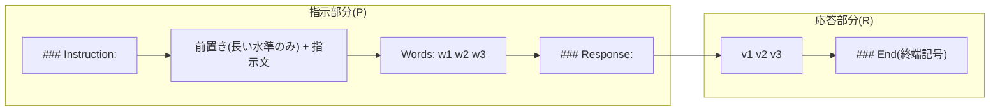
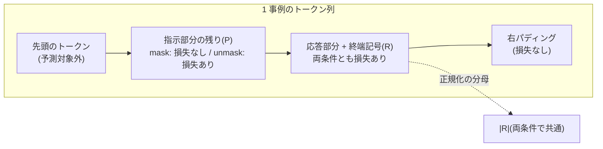

# 016. SFT(指示チューニング) / Supervised Fine-Tuning (Instruction Tuning)

## 1. 概要 / Overview

SFT(Supervised Fine-Tuning、教師あり微調整)による指示チューニング(Instruction Tuning)は、
「指示 → 応答」の組からなる指示データで事前学習済みの言語モデルを微調整し、指示に従って応答を
書き分けるようにする手法である。本トピックでは、008 の小型 GPT に Query・Value 射影への LoRA
(Low-Rank Adaptation、[012](https://zenn.dev/kojikojiprg/books/ai-theories-roadmap/viewer/012_low_rank_adaptation))を適用し、
入力と課題から応答が決定的に決まる **合成の指示データ** で SFT を行う。そのうえで、
(A)微調整後のモデルが指示を読んで出力を切り替えているか、(B)指示部分に損失をかけない
損失マスク(Loss Masking)の効果が指示の長さによってどう変わるか、(C)応答の形式と課題そのものの
どちらが少ないデータで習得されるかを検証する。

### 1.1 実行の手順

本番実行は Google Colab T4 の **1 つのセッションで完結** させる。5.1 節のセットアップセルで`SMOKE_TEST = False`にして、
「すべてのセルを実行」する。

実行時間の予算は 1 セッションあたり **T4 で 120 分** とする。本番の学習を始める前に(6.4 節)、スケーリングの計測
(6.3 節)から 1 セッション全体の実行時間を **削る段階**(6.1 節)ごとに見積もり、予算に収まる最小の段階を自動で選ぶ。
選択は見積もりのみに基づき、どの実験の結果も参照しない。段階 3 でも予算を超える場合は、学習の前に例外で停止する
(その場合は計画を見直す)。選ばれた段階は 6.4 節と判定の一覧(6.12 節)に印字される。

## 2. 参考論文 / References

1. Wei, J., Bosma, M., Zhao, V. Y., Guu, K., Yu, A. W., Lester, B., Du, N., Dai, A. M., Le, Q. V.,
   "Finetuned Language Models Are Zero-Shot Learners", ICLR 2022. https://arxiv.org/abs/2109.01652
   (FLAN(Finetuned Language Net)。既存の自然言語処理のデータセットを指示のテンプレートで包んで微調整し、未見の課題への汎化を示した)
2. Ouyang, L., Wu, J., Jiang, X., Almeida, D., Wainwright, C. L., Mishkin, P., Zhang, C., Agarwal, S.,
   Slama, K., Ray, A., et al., "Training language models to follow instructions with human feedback",
   NeurIPS 2022. https://arxiv.org/abs/2203.02155
   (InstructGPT。人手で書いた応答による SFT を、報酬モデルと RLHF の前段に置いた。RLHF は 017 で扱う)
3. Taori, R., Gulrajani, I., Zhang, T., Dubois, Y., Li, X., Guestrin, C., Liang, P., Hashimoto, T. B.,
   "Stanford Alpaca: An Instruction-following LLaMA model", GitHub repository, 2023.
   https://github.com/tatsu-lab/stanford_alpaca
   (Alpaca。言語モデルに生成させた 52K 件の指示データ。データのライセンスは CC BY-NC 4.0)
4. Zhou, C., Liu, P., Xu, P., Iyer, S., Sun, J., Mao, Y., Ma, X., Efrat, A., Yu, P., Yu, L., Zhang, S.,
   Ghosh, G., Lewis, M., Zettlemoyer, L., Levy, O., "LIMA: Less Is More for Alignment", NeurIPS 2023.
   https://arxiv.org/abs/2305.11206(表層的アライメント仮説。1,000 件の厳選した事例のみでの SFT)
5. Shi, Z., Yang, A. X., Wu, B., Aitchison, L., Yilmaz, E., Lipani, A.,
   "Instruction Tuning With Loss Over Instructions", NeurIPS 2024. https://arxiv.org/abs/2405.14394
   (指示部分にも損失をかける Instruction Modelling。指示が応答に比べて長い場合・事例が少ない場合に
   有利になると報告した。実験 B の仮説の出典)
6. Huerta-Enochian, M., Ko, S. Y., "Instruction Fine-Tuning: Does Prompt Loss Matter?", EMNLP 2024.
   https://arxiv.org/abs/2401.13586(https://aclanthology.org/2024.emnlp-main.1267/)
   (指示部分の損失の重み(prompt loss weight)の効果が、応答が短いデータで大きいことを報告した)
7. Hu, E. J., Shen, Y., Wallis, P., Allen-Zhu, Z., Li, Y., Wang, S., Wang, L., Chen, W.,
   "LoRA: Low-Rank Adaptation of Large Language Models", ICLR 2022. https://arxiv.org/abs/2106.09685
8. Krell, M. M., Kosec, M., Perez, S. P., Fitzgibbon, A., "Efficient Sequence Packing without
   Cross-contamination: Accelerating Large Language Models without Impacting Performance", arXiv 2021.
   https://arxiv.org/abs/2107.02027(packing と事例間の注意の漏れ。3.6 節)
9. Press, O., Wolf, L., "Using the Output Embedding to Improve Language Models", EACL 2017.
   https://arxiv.org/abs/1608.05859(重み共有(weight tying)。3.5 節)
10. Conover, M., Hayes, M., Mathur, A., Xie, J., Wan, J., Shah, S., Ghodsi, A., Wendell, P., Zaharia, M.,
    Xin, R., "Free Dolly: Introducing the World's First Truly Open Instruction-Tuned LLM",
    Databricks blog, 2023(databricks-dolly-15k。人手で書いた 15K 件の指示データ、CC BY-SA 3.0。3.1 節)

## 3. 理論 / Theory

### 3.1 事前学習と指示チューニングの目的の違い、指示データの系譜

事前学習の目的は、コーパスの次のトークンの負の対数尤度(negative log-likelihood)を系列のすべての位置で
最小化することである。モデルは「文書の続きとしてもっともらしいもの」を書くようになるが、指示に
答えるようにはならない(008 のモデルに指示を与えても、Wikipedia の記事の続きのような文を書く。5.5 節)。
指示チューニングは、同じ次トークン予測の損失を「指示 → 応答」の組に限って適用し、**指示に条件づけた
応答の分布** を学習させる。

指示データの系譜は次のとおりである。

- **FLAN**(Wei et al., ICLR 2022 [1]): 既存の自然言語処理のデータセット(翻訳・要約・分類など)を、課題ごとに
  複数用意した自然言語の指示のテンプレートで包んで微調整した。学習に使わなかった課題の群への
  ゼロショットの汎化が、テンプレートの多様さと課題の数とともに向上することを示した。
- **InstructGPT**(Ouyang et al., NeurIPS 2022 [2]): 人手で書いた応答による SFT を、報酬モデルの学習と
  RLHF(Reinforcement Learning from Human Feedback)の前段に置いた。
- **Alpaca**(Taori et al., 2023 [3]): 言語モデル自身に指示と応答を生成させた 52K 件のデータで SFT を行い、
  安価に指示追従モデルを作れることを示した。
- **LIMA**(Zhou et al., NeurIPS 2023 [4]): 厳選した 1,000 件だけで SFT を行い、大規模なデータを使った
  モデルに匹敵する応答が得られるとして、表層的アライメント仮説(3.7 節)を提唱した。

**本トピックで Dolly-15k・Alpaca の実データを使わない理由**:

- 008 のモデル(4 層・$d_{\mathrm{model}} = 256$、約 525 万パラメータ)に対して、これらのデータの応答は
  長い自然文である。モデルの規模では意味のある応答を書けず、また正解が一意に定まらないので、
  **完全一致による自動採点ができない**。本トピックの実験は、生成した応答を正解と照合する採点に基づく。
- Alpaca のデータのライセンスは CC BY-NC 4.0(非商用)であり、再配布・派生物の扱いに制約がある。

そこで、入力と課題から応答が決定的に決まる合成の指示データ(5.4 節)を使う。これにより、生成した応答を
正解と完全一致で照合でき、指示を読まずに達成できる完全一致率の上界 $c^*$(6.1 節)も厳密に計算できる。

### 3.2 チャットテンプレートと区切り記号

SFT では、指示と応答を 1 つの系列に並べ、どこが指示でどこが応答かをモデルに示す書式(チャットテンプレート)
を決める。推論時にも同じ書式で指示を与え、応答の開始位置からモデルに生成させる。応答の終わりを示す
終端記号を学習させておけば、生成をそこで止められる。本トピックのテンプレートは次のとおりである。

```text
### Instruction:
{前置き(長い水準のみ)} {指示文}
Words: w1 w2 w3
### Response: v1 v2 v3
### End
```

区切り記号(`### Instruction:`・`### Response:`・終端記号`### End`)はいずれも 008 のトークナイザの既存の
語彙で表せる文字列であり、トークナイザは変更しない(特殊トークンを追加しない理由は 3.5 節)。
`### Response:`までを **指示部分**、その直後の空白から終端記号までを **応答部分** とする。



**符号化の境界**: 指示部分と応答部分は **別々に符号化してから連結する**。こうすると、損失マスクの境界が
必ずトークンの境界と一致する。全文を一度に符号化すると、境界をまたぐ部分語のマージが起きたときに、
境界のトークンがどちらに属するか決められなくなる(本トピックのテンプレートでは、応答部分が空白で始まり
事前分割(pre-tokenization)の境界と一致するため、全文を一度に符号化した結果とも一致する。5.4 節で確認する)。

### 3.3 損失マスクの定式化と損失の正規化の単位

1 つのミニバッチについて、次の記号を使う。

- $R$: バッチ内の応答部分のトークン(終端記号を含む)の集合。
- $P$: バッチ内の指示部分のトークンのうち、予測対象になるものの集合(各系列の先頭のトークンは左の文脈を
  持たないので含めない)。
- $\ell_t = -\log p_\theta(y_t \mid y_{<t})$: トークン $t$ の負の対数尤度(nats)。$p_\theta$ はパラメータ
  $\theta$ のモデルが与える次トークンの分布、$y_t$ は位置 $t$ のトークン、$y_{<t}$ はそれより前の系列である。

**損失マスクあり**(指示部分に損失をかけない)の損失を

$$
\mathcal{L}_{\mathrm{mask}} = \frac{1}{|R|} \sum_{t \in R} \ell_t
$$

とし、**損失マスクなし**(指示部分にも損失をかける)の損失を、本トピックでは次のように定義する。

$$
\mathcal{L}_{\mathrm{unmask}} = \frac{1}{|R|} \left( \sum_{t \in R} \ell_t + \sum_{t \in P} \ell_t \right)
$$

どちらも **応答部分のトークン数 $|R|$ で割る** 点が要である。勾配をとると

$$
\nabla_\theta \mathcal{L}_{\mathrm{unmask}}
= \nabla_\theta \mathcal{L}_{\mathrm{mask}} + \frac{1}{|R|} \sum_{t \in P} \nabla_\theta \ell_t
$$

となり、応答部分のトークンが勾配に寄与する係数 $1/|R|$ は両者で同一である。2 つの条件の違いは、
指示部分の項 $\frac{1}{|R|} \sum_{t \in P} \nabla_\theta \ell_t$ を足すかどうかだけになる。

これに対して、一般的な実装(系列の全トークンの平均をとる実装)の損失は

$$
\mathcal{L}_{\mathrm{all}} = \frac{1}{|R| + |P|} \left( \sum_{t \in R} \ell_t + \sum_{t \in P} \ell_t \right),
\qquad
\nabla_\theta \mathcal{L}_{\mathrm{all}}
= \frac{|R|}{|R| + |P|} \nabla_\theta \mathcal{L}_{\mathrm{mask}}
+ \frac{1}{|R| + |P|} \sum_{t \in P} \nabla_\theta \ell_t
$$

であり、応答部分の勾配が係数 $\frac{|R|}{|R| + |P|}$ で薄まる。この係数は指示が長い($|P|$ が大きい)ほど
小さい。本トピックのデータでは 1 事例あたり $|R|$ が約 12、$|P|$ が短い水準で約 33・長い水準で約 133 なので、
係数は短い水準で約 $0.27$、長い水準で約 $0.08$ になる。$\mathcal{L}_{\mathrm{all}}$ で「損失マスクなし」の
条件を作ると、指示の長さを変えたときに **指示に損失をかけることの効果** と **応答の実効的な学習率が
下がることの効果** が混ざる。本トピックの定義はこの交絡を取り除き、実験 B の対比量が前者だけを反映する
ようにするためのものである。なお、損失マスクありの $\mathcal{L}_{\mathrm{mask}}$ は、応答部分のトークンの
平均をとる一般的な実装(予測対象から指示部分を除いて平均する実装)と一致する。

Shi et al.(NeurIPS 2024 [5])は、指示部分にも損失をかけることが、指示が応答に比べて長いデータや事例の
少ない設定で有利になると報告した。Huerta-Enochian & Ko(EMNLP 2024 [6])は、指示部分の損失の重みの効果が
応答の短いデータで大きいことを報告した。実験 B はこのうち「指示が長いほど、損失マスクの優位が縮む」
という向きを、上の正規化の単位のもとで検証する。



**パディング**: 長さの異なる事例をバッチにするとき、系列の右側だけにパディングを置く。因果マスクにより、
実トークンの位置はそれより右のパディングを参照しないので、パディングは実トークンの logits を変えない。
パディングの位置は $R$ にも $P$ にも含めない。

### 3.4 アルゴリズム

SFT は、LoRA を $W_q$・$W_v$ に適用し(rank $r = 8$、ほかのパラメータは凍結)、事例をエポックごとのランダムな並べ替えから $T$ 個のバッチ(大きさ $b$)に切る。各ステップで、バッチの事例を右側にパディングしたトークン列について位置ごとの負の対数尤度を求め、応答部分の損失(`include_prompt_loss`のときは指示部分の損失も)の合計を、応答部分のトークン数 $\lvert R \rvert$ で割る(3.3 節の正規化の単位)。AdamW(warmup + cosine、gradient clipping なし)で更新する。採点のための生成は、KV キャッシュを使う貪欲法で、デコードしたテキストに`### End`が含まれるか、新規に 32 トークンを生成したところで止める。擬似コードは付録 A.1。

### 3.5 特殊トークンの追加と、LoRA・重み共有との衝突(実装しない)

実務のチャットテンプレートは、`<|im_start|>`のような **特殊トークン** を語彙に追加して区切りに使うことが多い。
区切りが通常の文字列と衝突せず、1 トークンで表せるからである。しかし本トピックの設定では、次の 2 つの理由で
特殊トークンの追加が衝突を起こす。

1. **LoRA による凍結**: 新しいトークンの埋め込みベクトルは学習されていない(乱数または平均などで初期化される)。
   Query・Value 射影にだけ LoRA を掛ける設定では埋め込み行列は凍結されているので、新しいトークンの埋め込みは
   初期値のまま一度も更新されない。埋め込みも学習対象に加えると、LoRA で学習可能パラメータを絞った意味が
   薄れる(語彙 $V = 8192$、$d_{\mathrm{model}} = 256$ の埋め込みは約 210 万パラメータで、LoRA の 3.3 万を大きく
   上回る)。新しい行だけを学習する実装も可能だが、次の問題が残る。
2. **重み共有(weight tying)**: 008 のモデルは、トークン埋め込み行列と出力層の重みを共有している
   (Press & Wolf, EACL 2017 [9])。新しいトークンの行は、入力側の埋め込みであると同時に出力層で
   そのトークンの logit を計算するベクトルでもある。終端記号を新しいトークンにすると、その logit は
   学習されていないベクトルと隠れ状態の内積になり、「応答の終わりで終端記号を出す」ことを学ぶには、
   この行を入力側と出力側の両方の役割に同時に合わせて学習する必要がある。

本トピックでは、既存の語彙で表せる文字列(`### End`は 5 トークン)を区切りに使い、この問題を避ける。
代わりに、区切り記号は複数のトークンからなり、通常の文字列と区別できる保証はない(本トピックの入力の単語は
`#`を含まないので衝突しない)。

### 3.6 packing と事例間の注意の漏れ(理論のみ)

事例の長さがばらつくと、パディングで揃えたバッチには計算の無駄が生じる。**packing** は、複数の事例を
1 つの長い系列に詰めてパディングを減らす手法である。ただし、通常の因果マスクのまま詰めると、後ろの事例の
トークンが前の事例のトークンを注意で参照できてしまう(事例間の注意の漏れ、cross-contamination)。
Krell et al.(2021 [8])は、事例ごとのブロック対角な因果マスクと、事例ごとに 0 から数え直す位置の番号
(RoPE(Rotary Position Embedding)なら`positions`)を使えば、packing しても 1 事例ずつ処理した場合と同じ計算になることを示した。
本トピックの系列は短く(最長 150 トークン程度)、パディングによる無駄は小さいので、右パディング方式を使う。

### 3.7 表層的アライメント仮説と、本トピックの位置づけ

Zhou et al.(LIMA、NeurIPS 2023 [4])は、**表層的アライメント仮説(Superficial Alignment Hypothesis)** を
提唱した。モデルの知識と能力はほぼすべて事前学習で獲得されており、アライメント(SFT)が教えるのは
「利用者と対話するときにどの形式・文体を使うか」という表層の部分である、という仮説である。この仮説が正しければ、
SFT に必要なデータは少なくて済む(同論文は 1,000 件で十分な応答が得られるとした)。

**本トピックのモデルの事情(パイロットの観察、6.2 節)**: 008 のモデルは、事前学習でコピーの能力
(文脈に現れた単語の並びを後で再現する能力。Transformer では induction head と呼ばれる注意の回路が担うことが
多い)を獲得していない。無関係な単語の列を 2 回繰り返しても、2 回目の単語の負の対数尤度は 1 回目から
ほとんど下がらない(6.2 節・6.8 節)。本トピックの課題(単語の並べ替え)はコピーを必要とするので、
SFT は **形式** に加えて、**事前学習で獲得していない能力** も新たに教えることになる。

したがって、実験 C(形式と課題の習得の速さの比較)は LIMA の仮説の追試ではない。仮説は「能力は事前学習で
獲得済み」を前提とするが、本トピックではその前提が成り立たない。実験 C が比べるのは、形式の習得と、
事前学習にない能力を SFT で新たに学ぶことの習得の速さである(6.1 節)。

## 4. 実装方針 / Implementation Policy

**`src/`に切り出す(スクラッチ実装、本トピックで新規作成)**:

- `src/data/instruction.py`: 合成の指示データ。課題(`TASK_NAMES`・`apply_task()`)、単語の語彙
  (`WORD_VOCABULARY`、単一トークンの確認は`check_single_token_words()`)、指示文(学習用の`SEEN_INSTRUCTIONS`、
  未見の`UNSEEN_INSTRUCTIONS`)と長い水準の前置き(`PREAMBLES`)、テンプレートの適用(`format_prompt()`・
  `format_response()`)、入力の生成(`sample_word_sequences()`)、学習用・評価用の事例の作成
  (`build_training_examples()`・`build_evaluation_examples()`、評価用は入力と課題の直積)、区切りごとの
  符号化(`encode_instruction_example()`)、右パディングと損失マスクの作成(`collate_instruction_batch()`)、
  $c^*$ の計算(`compute_instruction_agnostic_upper_bound()`)、採点(`score_generated_response()`)。
- `src/training/instruction_tuning.py`: 3.3 節の正規化の単位による損失(`compute_instruction_tuning_loss()`)、
  エポックごとの並べ替えによるミニバッチの添字(`make_epoch_batches()`)、SFT の学習ループ
  (`train_instruction_tuning()`)、教師強制(teacher forcing)による事例ごとの負の対数尤度の評価
  (`evaluate_instruction_negative_log_likelihood()`)。既存の`train_language_model()`は連続したトークン列から
  ランダムな区間を切り出す事前学習用のループで、事例の境界も損失マスクも扱わないため、拡張せずに新規に置いた
  (既存の関数・既存のファイルの挙動は変わらない)。
- `src/generation/stopping.py`: 終端記号の文字列で停止する貪欲法の生成(`greedy_generate_until_stop()`)。
  `GPTLanguageModel.generate()`は指定したトークン数だけ生成し、途中で止まらないため、新規に置いた。
  指示部分の長さごとにバッチにする(パディングを使わない)ので、1 事例ずつ生成する場合と位置・因果マスクが
  同じになる。既存の`generate()`は変更していない(5.5 節で、停止しない場合の出力が`generate()`と一致することを
  確認する)。

既存のモジュール(`train_language_model()`・`generate()`など)は変更していないため、後方互換性の検証
(変更前のコミットとの数値比較)は要らない。LoRA は 012 の`apply_lora()`、optimizer は 007 の`AdamW`、
学習率スケジュールは 007 の warmup + cosine をそのまま使う。

**ノートブック内に直接書く(016 固有)**: 条件の定義と学習・評価の呼び出し、
実験 A〜C の判定、コピー能力の診断、スケーリングの計測。

**アップロード方針**: 本トピックで学習する LoRA のアダプタは、すべて条件間の比較のためのものであり、後続トピックの
入力にも、読者が単体で取得する対象にもならない。保存もアップロードもしない(アップロードのセルも置かない)。

**生成物の置き場所**: `.cache/`には何も置かない(合成データは乱数シードから決定的に生成でき、
全体でも数秒で作れるため)。判定の記録は、各判定セル(6.6・6.7・6.10・6.12 節)の出力(対比量・標準偏差・判定の閾値・前提条件の値と成否・判定結果)である。外部から取得するのは、
Hugging Face Hub のモデル(`kojikojiprg/ai-theories-small-gpt-en`の`main`)・トークナイザ
(`kojikojiprg/ai-theories-tokenizer-en`)と、前提条件 P0 のための英語版 Wikipedia のコーパス
(`kojikojiprg/ai-theories-corpus-en-pretraining`、取得できない場合のみ Wikipedia から直接取得)である。

## 5. 実装 / Implementation

### 5.1 環境セットアップ(Google Colab)

`SMOKE_TEST`(スモークテストか本番か)はこのセルでのみ切り替える。実行環境はこのセルで 1 回だけ印字する。
再現性のため(6.1 節)、CUDA の cuBLAS が決定的な演算を使うための環境変数`CUBLAS_WORKSPACE_CONFIG`を
torch の読み込み前に設定し、`torch.use_deterministic_algorithms(True)`を有効にする(決定的な実装を持たない演算を
使うと例外になるので、5.6 節で学習・評価・生成の経路を一通り実行して確かめる)。

### 5.2 スケールの設定(`SMOKE_TEST`の配線)

水準の定義をこの 1 箇所(`LEVELS`)に集約する。モデルは事前学習済みのものを使うので縮小しない。

学習ステップ数 $T$(本番 2048・スモークテスト 32)を縮小し、バッチサイズ $b = 32$、課題・テンプレート・単語の語彙・学習率・LoRA の設定・warmup の割合は縮小しない。縮小の規則(実験 C の水準、削る段階の表のシード数、評価用の入力の数、テスト専用の上書き)は付録 B.3。

### 5.3 ベースモデル・トークナイザの取得(008 がアップロードしたもの)

ベースモデルは`kojikojiprg/ai-theories-small-gpt-en`の`main`、トークナイザは`kojikojiprg/ai-theories-tokenizer-en`
から取得する。モデルの構成は取得した`config.json`から読む。各条件は、Hub から読み込み直す代わりに`base_model`の
複製から始める。

### 5.4 合成の指示データ

**課題**($K = 4$、いずれも単語を単位とする並べ替え・複製・選択。文字単位の操作は BPE(Byte Pair Encoding)の部分語分割と相性が
悪いので避ける):

| 課題 | 応答(入力 $w_1 \dots w_n$ に対して) |
|---|---|
| 逆順(`reverse`) | $w_n \dots w_1$ |
| 各単語を 2 回ずつ(`repeat_twice`) | $w_1 w_1 w_2 w_2 \dots w_n w_n$ |
| 奇数番目のみ(`odd_positions`) | $w_1 w_3 w_5 \dots$ |
| 先頭を末尾へ移す回転(`rotate_left`) | $w_2 \dots w_n w_1$ |

候補にあった「先頭と末尾の単語を入れ替える」課題は、3 語の入力で逆順と応答が一致する($w_3 w_2 w_1$)。
これを採用すると、3 語の入力では 2 つの課題を区別できず、指示を読まなくても 2 課題に正解できるので
$c^*$(6.1 節)が上がる。回転は、互いに異なる 3 語以上の入力に対して、4 課題の応答がすべて異なる
(逆順と回転は長さが同じだが、先頭の単語が $w_n$ と $w_2$ で異なる。ほかの 2 課題とは長さが異なる)。
このため $c^* = 1/K$ になり、評価集合のすべての事例が「指示を読まなければ解けない」事例になる。

**入力**: 3〜8 語。単語は、先頭に空白を付けた形で 008 のトークナイザの **単一トークン** になる英単語 454 語
(`WORD_VOCABULARY`)から、1 つの入力の中で重複しないように選ぶ。単一トークンであること、テンプレートに
現れる単語と重ならないことをアサーションで確かめる。

**指示文**: 課題ごとに学習用の 4 個と、学習に使わない「未見テンプレート」2 個(実験 A の診断量)を用意する。
**短い水準** は指示文そのもの、**長い水準** は課題によらない冗長な前置き(4 種類)を指示文の前に加えたもので、
課題の意味を変えない。応答部分は両水準で同一である。

**データの構成**: 合成データの乱数シード(`DATA_SEED`)は学習のシードとは独立に固定し、全条件・全シードで
同じデータを使う。

- 学習データ: $N_{\max} = Tb$ 個の事例。先頭から $K$ 個ずつの区切りごとに 4 課題を 1 回ずつ割り当てるので、
  実験 C の入れ子の部分集合(先頭 $N$ 個)でも課題の数が均等になる。
- 評価集合: $|X|$ 個の入力と 4 課題の直積(事例 $M = K|X|$ 個)。評価用の入力は学習データの入力と重複しない。
- 未見テンプレートの評価集合: 同じ入力 $X$ と 4 課題の直積に、未見の指示文を割り当てたもの。
- **パイロットの評価入力との非重複**: 学習率の選択(6.2 節)にはパイロットの評価集合の完全一致率を使った。
  本番の評価集合がそれと重なると、学習率を選んだデータで評価することになるので、本番の評価集合はパイロットとは
  別の乱数シードで生成し、パイロットの評価入力(同じ関数と乱数シードで再生成する)と重複しないことを確かめる。

### 5.5 生成・採点・損失のハーネスの確認

- **生成**: `greedy_generate_until_stop()`で停止しない場合(停止文字列が現れない文字列を指定)の出力が、
  1 事例ずつ`GPTLanguageModel.generate(temperature=0.0, use_cache=True)`で生成した結果と一致すること。
  指示部分の長さごとにまとめたバッチでの生成は、行列積の形が変わるため浮動小数点の丸めが変わりうるので、
  1 事例ずつの生成との一致率を印字する(評価集合の先頭 256 事例。アサーションは一致率 0.98 以上)。
- **採点**: 形式の遵守・完全一致の判定を、手で作った文字列で確かめる(空白の正規化、区切り記号の混入、
  終端記号の欠落)。
- **損失**: `compute_instruction_tuning_loss()`の値を、トークンごとの負の対数尤度から直接計算した
  $\mathcal{L}_{\mathrm{mask}}$・$\mathcal{L}_{\mathrm{unmask}}$ と照合する。損失マスクなしの勾配が、損失マスクありの
  勾配と指示部分の項の和に分解されること(3.3 節)も確かめる。
- **008 のモデルの出力**: 微調整前のモデルに指示を与えた生成例を印字する(3.1 節)。

### 5.6 決定的な実行の確認

`torch.use_deterministic_algorithms(True)`のもとで、学習(順伝播・逆伝播・AdamW の更新)・
教師強制の評価・生成の経路を一通り実行し、決定的な実装を持たない演算で例外にならないこと、同じ設定で 2 回
実行した結果が bit 単位で一致することを確かめる(数ステップの短い学習で確かめる)。

### 5.7 1 条件の学習・評価を行うヘルパー

- `train_condition()`: 条件(1〜4)・シード・データ数 $N$ を受け取り、複製した
  ベースモデルに LoRA を掛けて $T$ ステップ学習する。シードは LoRA の $A$ の初期化(`torch.manual_seed`)と
  データの順序(`make_epoch_batches`)を決める。条件間でシードを対応させる(同じシード・同じ $N$ なら、
  条件 1〜4 でミニバッチに入る事例の添字は同一)。学習後に、凍結したパラメータがベースモデルと bit 単位で
  一致することを確かめる。
- `evaluate_model()`: 評価集合(条件の長さの水準)で、教師強制による事例ごとの負の対数尤度と、貪欲法の生成に
  よる事例ごとの形式の遵守・完全一致を記録する。条件 1 では未見テンプレートの評価集合でも生成する。

## 6. 実験 / Experiments

### 6.1 実験宣言セル: 共通の設定・検証すること・判定基準・前提条件

**この節の内容は本番実行の前に確定させ、結果を見た後に変更しない。** パイロット(6.2 節)を受けた改訂は、
本番実行の前に行ったものであり、6.2 節に旧設定・新設定・理由を記録した。

#### 共通の設定

- **起点**: `kojikojiprg/ai-theories-small-gpt-en`の`main`(008)、トークナイザは`kojikojiprg/ai-theories-tokenizer-en`。
- **微調整**: 全層の Query・Value 射影に LoRA($r = 8$、$\alpha = 8$、$\alpha / r = 1$)を掛け、ほかのパラメータは
  凍結する(012 と同じ)。全パラメータ微調整は行わない。AdamW(重み減衰 0)、warmup(ステップ数の 10%)+ cosine
  (最小学習率はピークの 1%)、fp32。**学習率は $10^{-2}$ に固定する**(012 の $10^{-1.5}$ からの改訂、6.2 節)。
- **gradient clipping は使わない**(全条件)。012 の学習の部品のうち、gradient clipping のみ踏襲しない。
  理由は 6.2 節の改訂 5 に記した(損失マスクの有無で勾配ノルムの尺度が異なり、どの閾値の決め方でも条件間に
  非対称な処理が混ざるため)。
- **学習ステップ数 $T = 2048$、バッチサイズ $b = 32$**(全実験で共通)。$T$ の決め方は 6.2 節。
- **データ数**: 条件 1〜4 は $N_{\max} = Tb = 65536$ 事例(1 エポックちょうど。各事例を 1 回ずつ使う)。
  実験 C の水準 $N$ では、先頭 $N$ 個の事例(入れ子の部分集合)を $T$ ステップ使う($Tb/N$ エポック。$N = 16$ では
  1 つのミニバッチに同じ事例が 2 回ずつ入る)。
- **シード**: 実験 A・B は $S_{\mathrm{AB}}$ 個、実験 C は $S_{\mathrm{C}}$ 個で、いずれも削る段階(下記)で決まる
  (段階 0 では両方 5)。シードは先頭から $0, 1, \dots$ を使う。シードは LoRA の $A$ の初期化とデータの順序を決める。
  条件間でシードを対応させる(同じシード・同じ $N$ なら、条件 1〜4 のミニバッチに入る事例の添字は同一)。
- **C-$N_{\max}$ と条件 1 の共有**: 実験 C の $N_{\max}$ の水準(C-$N_{\max}$)は条件 1 と同じ設定(損失マスクあり・
  短い水準・$N_{\max}$ 事例・同じシード)なので、同じ学習を重複して実行せず、条件 1 の学習の記録をそのまま使う
  (両者に共通するシード、すなわち実験 C の全シードについて。$S_{\mathrm{C}} \le S_{\mathrm{AB}}$ なので実験 C の
  シードは条件 1 のシードの先頭部分である)。共有していることをアサーションで確かめる。
- **決定的な実行**: 再現性のため、`torch.use_deterministic_algorithms(True)`と`CUBLAS_WORKSPACE_CONFIG`を設定する(5.1 節)。
- **採点**: 貪欲法で、終端記号`### End`の文字列が現れるまで、または上限 32 トークンまで生成する(KV キャッシュ(Key-Value Cache、010)を
  使う)。
  - **形式の遵守**: 上限トークン数以内に終端記号が現れ、それより前に他の区切り記号が現れないこと(区切り記号は
    すべて`###`で始まるので、「最初に現れる`###`が終端記号の先頭であること」と同値)。
  - **完全一致**: 形式を遵守し、かつ終端記号の前の文字列を空白で区切った単語の列が正解と一致すること。
    空白の正規化: 先頭・末尾の空白を除き、連続する空白・改行を 1 つの区切りとみなす。
  - **応答部分の負の対数尤度**: 教師強制で、評価集合の応答部分のトークン(終端記号を含む)の負の対数尤度の
    合計を、応答部分のトークン数の合計で割った値(nats / トークン)。**応答部分のトークン列は全条件で同一**
    (5.4 節で確認)なので、条件間でトークンあたりの値を比べてよい。
  - **指示部分の負の対数尤度**: 同様に、指示部分の予測対象のトークンについて求めた値。長さの水準ごとに
    指示部分が異なるので、同じ長さの水準の中でのみ比べる。
- **評価の長さの水準**: 各条件は、学習と同じ長さの水準の評価集合で評価する(条件 1・2 は短い水準、条件 3・4 は
  長い水準)。評価集合の入力・課題・指示文の選択は両水準で共通で、違いは前置きの有無のみである。

#### 条件の対応表(実験 A・B・C で共有)

| 番号 | 損失マスク | 指示の長さ | データ数 |
|---|---|---|---|
| 1 | あり | 短い | $N_{\max}$ |
| 2 | なし | 短い | $N_{\max}$ |
| 3 | あり | 長い | $N_{\max}$ |
| 4 | なし | 長い | $N_{\max}$ |
| C-$N$ | あり | 短い | $N \in \mathcal{N}$(公比 4 の等比、$\mathcal{N}$ は段階で決まる。段階 0 で $\{16, 64, \dots, 65536\}$) |

C-$N_{\max}$ は条件 1 と同一の学習である(共有する)。

#### 記号

- $x$: 入力(単語の列)、$X$: 評価用の入力の集合($|X| = 250$)、$K = 4$: 課題の数、$M = K|X| = 1000$: 評価集合の
  事例数。
- $s \in \{0, \dots, S-1\}$: シード。$S$ はシード数で、実験 A・B の式では $S = S_{\mathrm{AB}}$、実験 C の式では
  $S = S_{\mathrm{C}}$ である(いずれも選ばれた段階で決まる)。
- $\mathcal{N}$: 実験 C の水準の集合、$N_{\min}$: その最小値(選ばれた段階で決まる)。
- $L_{i,s}$: 条件 $i$・シード $s$ の、評価集合の応答部分の負の対数尤度(nats / トークン)。
- $L^{P}_{i,s}$: 条件 $i$・シード $s$ の、評価集合の指示部分の負の対数尤度(nats / トークン)。
- $p_{i,s}$: 条件 $i$・シード $s$ の、評価集合での完全一致率。$f_{i,s}$: 形式の遵守率。
- $L_{0}^{\mathrm{short}}$・$L_{0}^{\mathrm{long}}$: 微調整前のモデルの、短い水準・長い水準の評価集合での応答部分の
  負の対数尤度。

#### 共通の前提条件

- **P0**: 読み込んだ 008 の重みの検証 bits-per-byte が 1.6681(アップロードした重みの評価値 1.668067)と相対誤差
  1% 以内であること。008 と同じ分割(英語版 Wikipedia のコーパスの末尾 5%)・同じ評価(長さ 256 の重ならない窓)で
  測る。全実験に適用する。
- **P-L(学習の成立)**: 対象の全シードで、評価集合の応答部分の負の対数尤度が微調整前の値の 1/2 以下であること
  ($L_{i,s} \le 0.5 \, L_0^{\mathrm{short}}$(条件 1・2・C-$N_{\max}$)、$L_{i,s} \le 0.5 \, L_0^{\mathrm{long}}$(条件 3・4))。
  実験 A・B には条件 1〜4 の全シードに、実験 C には **C-$N_{\max}$ の全シードにのみ** 適用する。$N < N_{\max}$ の水準の
  同じ量(応答部分の負の対数尤度が微調整前の 1/2 以下か)は、診断量として水準・シードごとに印字する(判定には使わない。
  6.2 節の改訂 7)。検証する仮説(指示への依存・損失マスクと長さの交互作用・習得の速さの比較)のいずれとも独立に、
  学習が起きたことだけを確かめる量である。

#### 削る段階(実行時間の予算に応じた自動選択)

本番は Google Colab T4 の 1 セッション(予算 120 分)で完結させる。削る段階を次のとおり宣言する。

| 段階 | 実験 C の水準 $\mathcal{N}$ | 実験 C のシード数 $S_{\mathrm{C}}$ | 実験 A・B のシード数 $S_{\mathrm{AB}}$ |
|---|---|---|---|
| 0 | $\{16, 64, \dots, 65536\}$(7 水準) | 5 | 5 |
| 1 | $\{64, 256, \dots, 65536\}$(6 水準) | 5 | 5 |
| 2 | $\{64, 256, \dots, 65536\}$(6 水準) | 3 | 5 |
| 3 | $\{64, 256, \dots, 65536\}$(6 水準) | 3 | 3 |

段階は、本番の学習を始める前に、スケーリングの計測から見積もった 1 セッション全体の実行時間が予算(T4 で 120 分)以内に収まる最小の段階を、見積もりのみから自動で選ぶ(どの実験の結果も参照しない)。段階 3 でも予算を超える場合は、学習の前に例外で停止する。選択の規則の詳細と、段階の順序の理由・代償は付録 B.2。

#### 実験 A: 指示への依存

**検証すること**: SFT 後のモデルは、指示を読んで出力を切り替えている。

**基準値 $c^*$**: 指示を無視して入力だけから出力を決める任意の決定的な戦略が、評価集合で達成できる完全一致率の
上界。入力 $x$ に対して指示を見ない戦略が出せる応答は 1 つだけなので、$x$ の $K$ 事例のうち正解にできるのは
$\max_y n_x(y)$ 個が最大である($n_x(y)$ は、入力 $x$ に対して応答 $y$ を正解とする課題の数)。評価集合が $X$ と
課題の直積であることを用いて

$$
c^* = \frac{1}{|X|} \sum_{x \in X} \max_y \frac{n_x(y)}{K}
$$

と厳密に計算する。本トピックの 4 課題は、互いに異なる 3 語以上の入力で応答がすべて異なるので $c^* = 1/K = 0.25$
である(5.4 節で計算して確かめる)。

**対比量**: $\bar{p} - c^*$。$\bar{p} = \frac{1}{S} \sum_s p_{1,s}$ は条件 1 の完全一致率のシード平均。

**標準偏差の導出**: $\bar{p}$ のばらつきには 2 つの独立な源がある。

1. 学習の乱数(シード): 評価集合を固定したとき、$p_{1,s}$ はシードごとにばらつく。シード間の標本標準偏差
   $s_p$(不偏)から、シード平均の分散は $s_p^2 / S$。
2. 評価集合の標本誤差: 評価集合は全シードで共有しているので、評価集合を引き直したときの変動は $S$ シードで
   平均しても減らない。**独立な標本の単位は入力 $x$ である**。評価集合は入力と課題の直積であり、同じ入力の
   $K$ 事例は同じ単語の並びを共有するので、正誤が独立でない(4 課題すべてで難しい入力・易しい入力がありうる)。
   課題は固定の 4 種類で、無作為に引いているのは入力である。そこで、入力 $x$ の完全一致率を 4 課題とシードで
   平均した

   $$
   a_x = \frac{1}{SK} \sum_s \sum_k c_{x,k,s}
   $$

   を入力ごとに求める($c_{x,k,s} \in \{0, 1\}$ は入力 $x$・課題 $k$・シード $s$ の条件 1 の正誤)。
   $\bar{p} = \frac{1}{|X|} \sum_x a_x$ であり、入力が独立に引かれているので、その分散は
   $\mathrm{Var}_x(a_x) / |X|$ で見積もれる($\mathrm{Var}_x$ は入力間の不偏分散)。$a_x$ にはシードによる変動も
   平均されて含まれるので、第 1 項と一部が重複し、$\sigma_A$ は保守的(大きめ)になる。

両者は独立なので

$$
\sigma_A^2 = \frac{s_p^2}{S} + \frac{\mathrm{Var}_x(a_x)}{|X|}
$$

とする。旧基準の第 2 項(事例を独立なベルヌーイ変数とみなす $\bar{p}(1 - \bar{p}) / M$)は診断量として併記する
(判定には使わない。改訂の経緯は 6.2 節の改訂 6)。

**判定**: $\bar{p} - c^* > 2\sigma_A$ なら支持、$\bar{p} - c^* < -2\sigma_A$ なら反証、それ以外は判定不能。

**前提条件 P-A**: 微調整前のモデルの完全一致率が $c^*$ 未満であること(微調整前から指示を読まずに解けている
わけではないことの確認)。ほかに P0・P-L(条件 1)を適用する。

**判定の偏りについての注記**: $T$ は、学習がほぼ完了する点(条件 1 の完全一致率が立ち上がった後)に選んだ
(6.2 節)。そのため、本実験の判定は支持に強く偏る。本実験の役割は、SFT の効果の提示と、$c^*$ に基づいて
「指示を読んでいる」ことを厳密に判定することにある。「SFT の後、指示を読まずに出せる完全一致率の上界を
超えている」ことは、完全一致率が高いというだけの主張より強く、指示を無視する戦略では説明できないことを意味する。

**作用点の記述**: SFT が直接作用するのは、指示に条件づけた応答トークンの予測分布である。完全一致率は生成を経た
下流の量だが、「指示に従う」という主張そのものを表す量なので対比量に選んだ。直接の作用点に近い診断量として、
条件 1 の応答部分の負の対数尤度を併記する。

**診断量**: 未見テンプレートでの完全一致率(学習に使わなかった指示文への汎化)、課題別の完全一致率、
旧基準の第 2 項 $\bar{p}(1 - \bar{p}) / M$。

#### 実験 B: 損失マスクの効果と指示の長さの交互作用

**検証すること**: 指示が長いほど、損失マスクの優位(マスクなしに対する、応答部分の負の対数尤度の差)が縮む
(Shi et al., NeurIPS 2024 [5])。

**対比量**: シードごとに

$$
D_s = (L_{4,s} - L_{3,s}) - (L_{2,s} - L_{1,s}), \qquad D = \frac{1}{S} \sum_s D_s
$$

$L_{2,s} - L_{1,s}$ は短い水準での「マスクなし − マスクあり」、$L_{4,s} - L_{3,s}$ は長い水準での同じ差である。
損失マスクが優位(マスクありのほうが応答部分の負の対数尤度が低い)なら差は正で、長い水準で優位が縮めば
$L_{4,s} - L_{3,s} < L_{2,s} - L_{1,s}$。**期待する方向は $D < 0$**。

**標準偏差の導出**: 実験 A と同じく、シードと評価集合の 2 つの独立な源を考える。

1. シード: 4 条件はシードで対応しているので、差の差 $D_s$ をシードごとに作ってからシード間の標本標準偏差 $s_D$ を
   とる。$D_s$ は 4 つの測定値の線形結合(係数 $+1, -1, -1, +1$)なので、独立な 4 条件から作るなら分散は各条件の
   分散の和(単一の測定の約 4 倍)になるが、対応があるとシードに共通の変動(同じ初期化・同じデータ順序による
   変動)が相殺されうる。$s_D$ を $D_s$ から直接求めることで、この相関を含めた誤差伝播が自動的に反映される。
   シード平均の分散は $s_D^2 / S$。
2. 評価集合: 実験 A と同じ理由で、独立な標本の単位は入力 $x$ である。評価集合の **入力** を 4 条件・全シードで
   **共通に** 復元抽出するブートストラップ(013 実験 D の対応付きの方式を、015 と同じく独立な単位のまとまりで
   行うもの)で $D$ を計算し直し、その分散 $\mathrm{Var}_{\mathrm{boot}}(D)$ を用いる。入力が選ばれると、その入力の
   $K$ 事例がまとめて選ばれる。応答部分のトークン列は全条件で同一なので、入力 $x$ の $K$ 事例の応答部分の
   トークン数の和 $n_x$ は条件によらない。入力 $x$ の $K$ 事例・条件 $i$・シード $s$ の応答部分の負の対数尤度の
   合計を $N_{x,i,s}$、入力 $x$ が選ばれた回数を $w_x$ とすると、$D$ は

   $$
   D^{*} = \frac{\sum_x w_x Q_x}{\sum_x w_x n_x}, \qquad
   Q_x = \frac{1}{S} \sum_s \left[ (N_{x,4,s} - N_{x,3,s}) - (N_{x,2,s} - N_{x,1,s}) \right]
   $$

   と、入力ごとの $Q_x$ と $n_x$ だけで書ける(分母が全条件で共通なので、比の差が分子の差の比になる)。
   事例を単位とするブートストラップ(旧基準)による分散は診断量として併記する(6.2 節の改訂 6)。

$$
\sigma_D^2 = \frac{s_D^2}{S} + \mathrm{Var}_{\mathrm{boot}}(D)
$$

**判定**: $D < -2\sigma_D$ なら支持、$D > 2\sigma_D$ なら反証、それ以外は判定不能。

**前提条件 P-B**: 損失マスクが実際に効いていること。長さの水準 $\lambda \in \{\mathrm{short}, \mathrm{long}\}$ ごとに、
マスクあり・なしの条件の組を $(a, u) = (1, 2)$(短い)・$(3, 4)$(長い)として、指示部分の負の対数尤度の差

$$
\Delta^{P}_{\lambda} = \frac{1}{S} \sum_s \left( L^{P}_{a,s} - L^{P}_{u,s} \right)
$$

が、両方の水準で $\Delta^{P}_{\lambda} > 2\sigma^{P}_{\lambda}$ であること(マスクなしのほうが指示部分の負の対数尤度が
低く、その差が標準偏差の 2 倍を超える)。$\sigma^{P}_{\lambda}$ は $\sigma_D$ と同じ方法(シード間の標本標準偏差 +
入力を共通に復元抽出するブートストラップ、分母は入力ごとの指示部分の予測対象のトークン数の和)で求める。この量は
介入(損失マスク)の直接の帰結であり、検証する仮説(応答部分での交互作用)とは独立である。ほかに P0・P-L(条件 1〜4)
を適用する。

**作用点の記述**: 介入(損失マスク)が直接作用するのは、指示部分のトークンが勾配に寄与するか否かである。
その直接の帰結は指示部分の負の対数尤度(前提条件 P-B に使う)。対比量の応答部分の負の対数尤度はそこから 1 段
下流で、介入が応答の予測に波及した結果を見る量である。完全一致率はさらに下流なので診断量とする。

**診断量**: 4 条件の完全一致率、指示部分の負の対数尤度、事例を単位とするブートストラップ(旧基準)による
$\mathrm{Var}_{\mathrm{boot}}(D)$。

#### 実験 C: 形式の習得と課題の習得の速さ

**検証すること**: 形式の遵守率は、課題の完全一致率より少ないデータ数で飽和する。008 のモデルは事前学習で
コピーの能力を獲得していない(3.7 節・6.2 節)。そのため本実験は、**形式の習得** と、**事前学習で獲得していない
能力(単語の並べ替えに必要なコピー)を SFT で新たに学ぶこと** の、習得の速さを比較する。LIMA の表層的アライメント
仮説は「能力は事前学習で獲得済み」を前提とするので、本実験はその追試ではない。支持された場合の結論は
「形式は、事前学習にない能力より少ないデータで習得される」に限る。

**学習予算**: 全水準で $T$ ステップ固定。小さい $N$ ではエポックを重ねる($N = 16$ で 4096 エポック、段階 1 以降の最小水準 $N = 64$ で 1024 エポック)。
データ数の部分集合は入れ子にする(先頭 $N$ 個)。

**量**: シードごと・指標(形式の遵守率 $f$、完全一致率 $p$)ごとに、飽和値を $N_{\max}$ での値とし、その 90% に
初めて達するデータ数 $N_{90}$ を、隣接する水準の間の $\log_2 N$ に対する線形補間で求める。水準 $N_j$ で初めて
閾値 $\tau = 0.9 \, v(N_{\max})$ 以上になったとき($v$ は指標の値)、

$$
\log_2 N_{90} = \log_2 N_{j-1} + \frac{\tau - v(N_{j-1})}{v(N_j) - v(N_{j-1})} \left( \log_2 N_j - \log_2 N_{j-1} \right)
$$

最小の水準で既に閾値以上なら $N_{90} = N_{\min}$ とし、打ち切り(censoring)として記録する。

**公比 4 による分解能の限界**: 水準は $\log_2 N$ で 2 ずつ離れている。$N_{90}$ は隣接する 2 水準の間を線形補間
するので、その間の曲線の形(例えば 2 水準の間の途中で急に立ち上がる)は分からず、$\log_2 N_{90}$ には最大で
約 2 の補間の誤差がありうる。この誤差はシードによらない系統的なもの(曲線の形が同じなら同じ向きにずれる)なので、
$s_\Delta$ に反映されない。したがって、$\Delta$ が 2 未満(水準 1 つぶん未満)の差であるときは、判定が支持でも
「水準の刻みより細かい差」であることに注意する。

**対比量**:

$$
\Delta = \frac{1}{S} \sum_s \left( \log_2 N_{90,s}^{\mathrm{task}} - \log_2 N_{90,s}^{\mathrm{format}} \right)
$$

task は完全一致率、format は形式の遵守率の $N_{90}$。**期待する方向は $\Delta > 0$**。

**標準偏差の導出**: 実験 A・B と同じく、シードと評価集合の 2 つの独立な源を考える。

1. シード: シードごとの差 $\log_2 N_{90,s}^{\mathrm{task}} - \log_2 N_{90,s}^{\mathrm{format}}$ の標本標準偏差 $s_\Delta$ から、
   シード平均の分散は $s_\Delta^2 / S$。
2. 評価集合: 評価集合は全シード・全水準で共有しているので、評価集合を引き直したときの変動は $S$ シードで平均しても
   減らない。独立な標本の単位は入力 $x$ である(実験 A と同じ理由)。そこで、評価集合の入力を復元抽出する
   ブートストラップの各反復で、**同じ再標本** から全水準・両指標・全シードの形式の遵守率と完全一致率を計算し直し、
   シードごとの $N_{90}$ と $\Delta$ を求める。こうすると、水準間・指標間・シード間で評価集合を共有していることによる
   相関が保たれる。その分散を $\mathrm{Var}_{\mathrm{boot}}(\Delta)$ とする。

$$
\sigma_\Delta^2 = \frac{s_\Delta^2}{S} + \mathrm{Var}_{\mathrm{boot}}(\Delta)
$$

(旧基準は第 1 項のみの $\sigma_\Delta = s_\Delta / \sqrt{S}$。6.2 節の改訂 6。旧基準の値は診断量として併記する。)
公比 4 による補間の誤差(上記)は、どちらの項にも反映されない。
**打ち切りがある場合**: 形式の遵守率が最小水準で既に飽和している(打ち切り)とき、真の $\log_2 N_{90}^{\mathrm{format}}$ は
記録値 $\log_2 N_{\min}$(段階 0 で $\log_2 16 = 4$、段階 1 以降で $\log_2 64 = 6$)以下なので、記録した $\Delta$ は
真の値以下(支持の向きに対して **保守的**)である。一方、打ち切られたシードは全て同じ値 $\log_2 N_{\min}$ を持つので、$s_\Delta$ はばらつきを過小に見積もり、$\sigma_\Delta$ は
**楽観的**(小さすぎる)になりうる。完全一致率の側が打ち切られた場合は、$\Delta$ は真の値以上(支持の向きに楽観的)に
なる。打ち切りの有無をシードごと・指標ごとに印字する。下端が 64 になる段階 1 以降では、形式の遵守率が $N = 64$ で
既に飽和して打ち切られる可能性が段階 0 より高く、この保守的・楽観的の両方の偏りが大きくなりうる。

**判定**: $\Delta > 2\sigma_\Delta$ なら支持、$\Delta < -2\sigma_\Delta$ なら反証、それ以外は判定不能。

**前提条件 P-C**: 両指標とも、飽和値が「90% 到達」を意味のあるものにする水準にあること。$N_{\max}$ での
完全一致率のシード平均 $\ge 2c^*$、かつ形式の遵守率のシード平均 $\ge 0.5$。ほかに P0・P-L(C-$N_{\max}$ の全シード)
を適用する。すなわち、実験 C の前提条件は P0・P-L(C-$N_{\max}$ の全シード)・P-C である。

**作用点の記述**: データ数は学習信号の量(見る事例の種類)に直接作用する。2 つの指標はいずれも生成を経た下流の量で
ある。両者を同じ尺度($\log_2 N_{90}$)で比べることで、生成による下流の減衰が両指標に共通にかかるという前提のもとで
相対比較する。各水準の応答部分の負の対数尤度も診断量として併記する。$N_{90}$ は閾値への到達という極値に近い統計
なので、全水準の両指標の曲線(シード平均と範囲)を診断量として図示する。

#### コピー能力の診断(判定基準を設けない観察)

学習データに含まれない 8 語の単語列(テンプレートなし)を 2 回繰り返した系列について、1 回目と 2 回目の単語の
負の対数尤度の平均を測る。コピーの能力があれば、2 回目の単語は 1 回目から予測でき、負の対数尤度が大きく下がる。
対象は、微調整前のモデルと、条件 1 のシード 0(C-$N_{\max}$ のシード 0 と同一の学習)。定性的な
観察であり、判定基準を設けない。

### 6.2 スモークテスト(パイロット)による設定の改訂

本番実行の前に、ノートブックの外(ローカルの MPS、スクリプトで実行)で、本番と同じスケール(同じモデル・同じ LoRA の設定・$b = 32$、$T$ は 32〜2048)のパイロットを行い、次の 8 点を改訂した。いずれも本番実行の前の改訂であり、実験 A〜C の対比量・閾値の倍率(2 倍)・期待する方向は変更していない。パイロットの評価集合は本番とは別の乱数シードで生成した入力であり、本番の評価集合とは重複しない(5.4 節でアサーションにより確認)。

1. **改訂 1**: 学習率を $10^{-1.5}$ から $10^{-2}$ に改めた。旧設定では $T$ を増やしても完全一致率が 0 のままで、学習が立ち上がらなかったため(課題が学習されるかだけに基づく)。
2. **改訂 2**: 学習ステップ数 $T$ を、相対 2% の較正規則から $T = 2048$ の固定に改めた。学習が立ち上がる前の停滞で旧規則が満たされ、また負の対数尤度が 0 に近づくと相対改善が大きいまま残るため。$T = 2048$ は学習がほぼ完了する点で、1 セッションの予算に収まる。あわせて前提条件 P-L を追加した。
3. **改訂 3**: 実行を 2 セッションに分け、実験 C の水準を公比 2 から公比 4 にした。実行の分割は改訂 8 で取りやめ、公比 4 は維持した。
4. **改訂 4**: 008 のモデルがコピーの能力を持たないというパイロットの観察を受けて、実験 C の「検証すること」の本文を、「形式」と「事前学習にない能力」の習得の速さの比較と明記した(解釈の範囲の明確化)。
5. **改訂 5**: gradient clipping を全条件で使わないことにした。損失マスクの有無で勾配ノルムの尺度が 2〜4 倍異なり、どの閾値の決め方でも条件間に非対称な処理が混ざるため。clipping なしでも全条件が P-L を満たすことを確かめた。
6. **改訂 6**: 判定の分散の項の標本の単位を、事例から入力に改めた。同じ入力の事例は同じ単語の並びを共有し、独立でないため。
7. **改訂 7**: 実験 C への前提条件 P-L の適用範囲を、C-$N$ の全水準から C-$N_{\max}$ のみに改めた。小さい $N$ で学習が成立しないことは実験 C が測ろうとしている現象そのものであり、前提条件は操作する変数から独立でなければならないため。
8. **改訂 8**: 実行の構成を、2 セッションから、1 セッションと削る段階の自動選択に改めた。実行の手間と予算の方針のみに基づく。

各改訂の旧設定・観察(学習率の比較表、$T$ の走査、シード間のばらつき、スモークテストの旧基準による判定)・理由と、本番前の確認は付録 B.1。

### 6.3 スケーリングの計測と外挿(1 セッションの見積もり)

本番でデータ量がスモークテストの何倍にもなる重い処理について、3 点のデータ量で実行時間を実測し、
$\log t = \log a + b \log n$ をあてはめてべき指数 $b$ を推定し、本番のデータ量へ外挿する。本番では、この計測を
**本番の実行の冒頭に T4 上で** 行い、その値のみから削る段階を選ぶ(6.4 節)。

学習・教師強制の評価・生成・データの生成と符号化のそれぞれについて計測点を取り、外挿値に本番での実行回数を乗じて、削る段階ごとに 1 セッション全体の見積もりを合計する(6.4 節)。計測の対象と計測点の詳細は付録 B.4。

### 6.4 共通の前提条件 P0 と、微調整前のモデルの評価

**P0**: 008 と同じ分割(英語版 Wikipedia のコーパスの末尾 5% が検証)・同じ評価(長さ 256 の重ならない窓の
bits-per-byte)で、読み込んだ重みを評価し、モデルカードの値 1.668067 と相対誤差 1% 以内であることを確かめる。

あわせて、微調整前のモデルを評価集合(短い水準・長い水準)で評価する。短い水準の完全一致率は前提条件 P-A に、
両水準の応答部分の負の対数尤度は前提条件 P-L の基準値($L_0^{\mathrm{short}}$・$L_0^{\mathrm{long}}$)に使う。

最後に、6.3 節の外挿値と本節の実測値から、削る段階ごとに 1 セッション全体の見積もりを出し、予算(T4 で 120 分)に
収まる最小の段階を選ぶ(6.1 節)。**選択は見積もりのみに基づき、どの実験の結果も参照しない。** 段階 3 でも予算を
超える場合は、ここで例外で停止する(本番の学習は始まっていない)。

### 6.5 本番の学習: 条件 1〜4 × シード

各条件を $N_{\max}$ 事例・$T$ ステップで学習し(gradient clipping なし)、評価集合で評価する。シードは選ばれた段階の
実験 A・B のシード(6.4 節)。条件 1 の学習の記録は、実験 C の $N_{\max}$ の水準(C-$N_{\max}$)としても使う
(6.9 節)。コピー能力の診断(6.8 節)のため、条件 1 のシード 0 のモデルのみメモリ上に残す(保存はしない)。
前提条件 P-L(実験 A・B)をここで記録する。

### 6.6 実験 A: 指示への依存


    

    


### 6.7 実験 B: 損失マスクの効果と指示の長さの交互作用

評価集合の標本誤差の項は、入力を 4 条件・全シードで共通に復元抽出するブートストラップで求める(6.1 節)。
入力ごとに $K$ 事例の和をとった分子・分母を単位として復元抽出する。これは、事例を入力ごとのクラスタとして復元抽出する
ブートストラップ(015 の方式)と同じ再標本を与えることを、アサーションで確かめる。


    

    


### 6.8 コピー能力の診断(判定基準を設けない観察)

学習データに含まれない 8 語の単語列(テンプレートなし)を 2 回繰り返した系列で、1 回目と 2 回目の単語の負の対数尤度の
平均を測る(6.1 節)。対象は微調整前のモデルと条件 1 のシード 0(C-$N_{\max}$ のシード 0 と同一の学習)。
**定性的な観察であり、判定基準を設けない。**

### 6.9 実験 C の学習(C-$N_{\max}$ は条件 1 と共有)

選ばれた段階の実験 C の水準・シード(6.4 節)で学習する(gradient clipping なし)。C-$N_{\max}$ は条件 1 と同一の設定
なので学習を重複して実行せず、条件 1 の同じシードの記録をそのまま使う(共有していることをアサーションで確かめる)。
前提条件 P-L は C-$N_{\max}$ の全シードについて記録し、$N < N_{\max}$ の水準の同じ量は診断量として印字する(6.1 節)。

### 6.10 実験 C: 形式の習得と課題の習得の速さ

評価集合の標本誤差の項 $\mathrm{Var}_{\mathrm{boot}}(\Delta)$ は、入力を復元抽出するブートストラップで求める。各反復で、
入力ごとの正解数(形式の遵守・完全一致、水準 × シード × 入力)に同じ重みを掛けて全水準・両指標・全シードの率を
計算し直し、シードごとの $N_{90}$ と $\Delta$ を求める(6.1 節)。


    

    


### 6.11 不変条件のアサーションと`SMOKE_TEST`の配線

- 全ての実行で、ステップ数・学習履歴の長さが $T$、学習可能パラメータ数が閉形式 $4 L r d_{\mathrm{model}}$ と一致し、
  gradient clipping が一度も発動していない(無効)。
- 条件 1〜4: データ数が $N_{\max}$(1 エポックちょうど)。同じシードでは条件 1〜4 のミニバッチの添字が同一、
  異なるシードでは異なる。評価の配列の長さが $M$。
- 実験 C: データの部分集合が入れ子であり(各水準は学習データの先頭 $N$ 個)、エポック数が $Tb/N$、ミニバッチの添字の
  ハッシュが同じ引数で作り直した値と一致する。C-$N_{\max}$ は条件 1 の記録と同一(6.9 節)。
- 評価集合の事例ごとの応答部分のトークン数が全実行で同一。
- ベースモデルの重みが、全ての学習の後も Hub から読み込んだ重みと完全に一致する。
- `SMOKE_TEST`の配線と削る段階: 実際に使ったシード・水準・ステップ数・データ数・評価集合の大きさ・ブートストラップの
  反復回数が、5.2 節の水準と 6.4 節で選ばれた段階と一致する。

### 6.12 判定結果の一覧

前提条件が 1 つでも不成立の実験は、判定関数の結果に関わらず「前提不成立」とする(判定不能とは区別する)。
判定関数の結果は参考として別欄に残す。標準偏差は入力を単位とする新基準による。旧基準(事例を単位とする)の
標準偏差も、判定に使わない参考値として並べる。選ばれた段階と、判定に実際に使ったシード数・水準を印字する。

## 7. 結果・考察 / Results and Discussion

本番実行のセル出力に基づいて記す。判定は 6.1 節で事前に宣言した基準のみから導く。結果を見た後に立てた解釈は
「事後的な解釈」として節を分けて記し、検証済みの結論としては扱わない。

### 7.1 実行の概要

- **実行環境**(5.1 節の印字): Google Colab の Tesla T4(compute capability 7.5、総メモリ 14.56 GiB)、Python 3.13.15、
  torch 2.13.0+cu130、コミット`4c13e5d`(未コミットの変更なし)。決定的な実行の確認(5.6 節)は CUDA でも通った。
- **削る段階**(6.4 節): T4 での見積もりは段階 0 で 79.1 分(予算 120 分の 65.9%)、段階 1〜3 で 73.8・63.2・45.8 分
  だった。予算に収まる最小の段階として **段階 0** が選ばれた。したがって、実験 A・B・C はいずれも 5 シード(0〜4)、
  実験 C は $N \in \{16, 64, \dots, 65536\}$ の 7 水準で実行した(6.12 節の印字)。実際の実行時間は、実験 A・B の学習と
  評価が 2,463.6 秒(見積もり 2,613.6 秒)、実験 C の追加の学習と評価が 2,088.0 秒(見積もり 1,904.6 秒)だった。
- **前提条件はすべて成立した。**

| 前提条件 | 値 | 基準 | 成否 |
|---|---|---|---|
| P0 | 検証 bits-per-byte 1.668067(相対誤差 $1.57 \times 10^{-7}$) | 相対誤差 0.01 以内 | 成立 |
| P-A | 微調整前の完全一致率 0.0000 | $c^* = 0.25$ 未満 | 成立 |
| P-L(実験 A・B) | 条件 1〜4 の全 20 実行で満たした(応答部分の負の対数尤度の最大は、短い水準で 2.206、長い水準で 3.450) | 微調整前の 1/2 以下($L_0^{\mathrm{short}} = 8.2724$、$L_0^{\mathrm{long}} = 8.5841$) | 成立 |
| P-B | 指示部分の負の対数尤度の差: 短い水準 +6.8455($\sigma$ 0.1346)、長い水準 +8.4725($\sigma$ 0.0830) | 両水準で $2\sigma$ を超える | 成立 |
| P-L(実験 C) | C-$N_{\max}$ の全 5 シードで満たした(条件 1 と共有、0.580〜0.647) | 微調整前の 1/2 以下 | 成立 |
| P-C | $N_{\max}$ での完全一致率 0.8040、形式の遵守率 1.0000 | それぞれ $2c^* = 0.50$ 以上、0.5 以上 | 成立 |

### 7.2 実験 A(指示への依存)の判定結果

**判定: 支持。**

条件 1 の完全一致率はシード順に 0.8180・0.7600・0.8070・0.8380・0.7970 で、$\bar{p} = 0.8040$ だった。

$$
\bar{p} - c^* = 0.8040 - 0.25 = +0.5540, \qquad \sigma_A = 0.0186, \qquad 2\sigma_A = 0.0371
$$

$\sigma_A^2$ の 2 つの項は、シード間の項が $1.67 \times 10^{-4}$、入力単位の評価集合の項が $1.77 \times 10^{-4}$ で同程度だった。
$\bar{p} - c^* > 2\sigma_A$ なので、事前に宣言した基準により **支持** となる。SFT 後のモデルは、指示を無視して入力だけから
出力を決める任意の戦略の上界 $c^* = 0.25$ を大きく超えており、指示を読んで出力を切り替えている。6.1 節で注記したとおり、
$T$ はパイロットで学習がほぼ完了した点(完全一致率 0.927〜0.960)として選んだため、本実験は支持に偏りやすい設計であり、
本実験の役割は SFT の効果の提示と、$c^*$ に基づく厳密な判定にある。ただし本番では、条件 1 の完全一致率は 0.804 に留まり、
パイロットほど学習は完了していなかった(7.2.1 節)。

**課題別の完全一致率**(シード平均): 逆順 0.698、各単語を 2 回ずつ 0.807、奇数番目のみ 0.903、先頭を末尾へ移す回転 0.807
(図「Condition 1: exact match by task」)。逆順が最も低かった。形式の遵守率は全シードで 1.0000、
応答部分の負の対数尤度は 0.580〜0.647(微調整前は 8.2724)だった。

**宣言済みの診断量: 未見テンプレートでの完全一致率。** 学習に使わなかった指示文での完全一致率は、シード順に
0.0230・0.0220・0.0490・0.0780・0.0440 で、すべて $c^* = 0.25$ を下回った(図の右端の棒)。したがって、本実験で
「指示を読んで出力を切り替える」ことが示されたのは、**学習で見た指示文の言い回しの範囲に限られる**。学習で見ていない
言い回しで同じ課題を指示されたときに課題を識別できることは示されていない。

**生成例の観察(定性的)**: 条件 1・シード 0 の逆順の生成例では、正解`community novel member genus software billion green agreement`に
対して`community novel member genus global green green agreement`を出力した。前半の 4 語は正しいが、入力にない単語
(`global`)を出し、`green`を重複させている。形式(終端記号まで)は守られていた。1 例の観察であり、誤りの傾向を
測ったものではない。

#### 7.2.1 事後的な観察: パイロットと本番の完全一致率の差(検証済みの結論ではない)

**この小節は、結果を見た後の事後的な観察であり、検証済みの結論ではない。** 6.2 節に記録したパイロット(ローカルの MPS、
学習率 $10^{-2}$、$T = 2048$、評価入力 100 個、3 シード)では、条件 1 と同じ設定の完全一致率は 0.927〜0.960 だった。
本番の条件 1(CUDA の T4、同じ設定、評価入力 250 個、5 シード)では 0.760〜0.838 で、パイロットの範囲から外れている。

原因の候補として、(1)デバイスの違い(MPS と CUDA で浮動小数点の演算の順序・実装が異なり、同じシードでも学習の経過が
変わりうる)、(2)データ生成と評価集合の乱数の違い(パイロットと本番で学習データ・評価入力を別の乱数シードで生成した)、
(3)評価集合の大きさの違い(100 入力と 250 入力)、(4)指示文の多様さの違い(パイロットのスクリプトでは課題ごとに
1 つの指示文を学習・評価の両方に使ったのに対し、本番では課題ごとに 4 つの指示文を学習に使い、評価集合の事例ごとに
そのうち 1 つを割り当てた)が考えられる。いずれも検証していない。gradient clipping は両者とも使っていない。

この差は、実験 A の判定(支持)には影響しない。判定は本番のセル出力のみから導いており、$\bar{p} - c^* = +0.5540$ は
$2\sigma_A = 0.0371$ を大きく上回っている。

### 7.3 実験 B(損失マスクの効果と指示の長さの交互作用)の判定結果

**判定: 反証。**

| 条件 | 応答部分の負の対数尤度(シード 0〜4) | シード平均 | 完全一致率(シード 0〜4) |
|---|---|---|---|
| 1(マスクあり・短い) | 0.60045・0.64732・0.60105・0.57972・0.60952 | 0.6076 | 0.818・0.760・0.807・0.838・0.797 |
| 2(マスクなし・短い) | 1.82754・1.52110・1.85497・1.58622・2.20648 | 1.7993 | 0.057・0.076・0.078・0.059・0.020 |
| 3(マスクあり・長い) | 1.29383・0.70892・0.81696・0.87589・1.10478 | 0.9601 | 0.273・0.667・0.569・0.534・0.346 |
| 4(マスクなし・長い) | 3.42677・3.42573・3.39077・3.41170・3.45042 | 3.4211 | 0.000(全シード) |

$$
D = \frac{1}{S} \sum_s \left[ (L_{4,s} - L_{3,s}) - (L_{2,s} - L_{1,s}) \right] = +1.26935, \qquad
\sigma_D = 0.20085, \qquad 2\sigma_D = 0.40171
$$

シードごとの $D_s$ は +0.90585・+1.84303・+1.31989・+1.52931・+0.74868 で、全シードで正だった。期待した方向は $D < 0$
(指示が長いほど損失マスクの優位が縮む)であり、$D > 2\sigma_D$ なので、事前に宣言した基準により **反証** となる。
損失マスクの優位(マスクなし − マスクあり)は、短い水準で $1.7993 - 0.6076 = 1.19$、長い水準で $3.4211 - 0.9601 = 2.46$
(nats / トークン、シード平均)であり、**指示が長いほど縮むのではなく、広がった**(図「Advantage of loss masking per seed」
で、全シードの線が右上がり)。

**診断量の読み取り**:

- **完全一致率**: 損失マスクなしの条件は、短い水準(条件 2)で 0.020〜0.078、長い水準(条件 4)で全シード 0 だった。
  マスクありの条件は、短い水準(条件 1)で 0.76〜0.84、長い水準(条件 3)で 0.27〜0.67 だった。
- **指示部分の負の対数尤度**: 条件 4 は 0.395〜0.398 で、長い指示部分はほぼ完全に予測されている(学習されている)。
  条件 2 は約 1.43、マスクありの条件 1・3 は約 7.9〜9.2 だった(P-B の値は 7.1 節)。
- **標準偏差の内訳**: $s_D = 0.44790$ から、シード間の項は $s_D^2 / S \approx 0.0401$ であり、入力単位のブートストラップの項
  $\mathrm{Var}_{\mathrm{boot}}(D) = 2.19 \times 10^{-4}$ の約 180 倍だった。$\sigma_D$ はシード間の分散に支配されている。
  旧基準(事例単位のブートストラップ)の $\sigma_D = 0.20294$ でも、判定は同じく反証である。

#### 7.3.1 事後的な解釈(検証済みの結論ではない)

**この小節は、結果を見た後に立てた事後的な解釈であり、検証済みの結論ではない。** 7.3 節の判定(反証)は、この小節の
内容によって変わらない。以下の 3 つの候補は、いずれも本トピックでは検証していない。

1. **指示の損失による容量の取り合い**: 損失マスクなしの損失(3.3 節)では、応答部分に対する指示部分の損失の相対的な重みは
   $|P| / |R|$ になる。1 事例あたりの平均は、短い水準で約 $33.06 / 12.26 \approx 2.7$、長い水準で約 $132.37 / 12.26 \approx 10.8$
   であり、長い水準では約 4 倍になる(5.4 節の印字)。Query・Value のみの LoRA($r = 8$)という限られた容量が、長い指示の
   モデル化(条件 4 の指示部分の負の対数尤度は約 0.40 まで下がった)に割かれ、事前学習にないコピーの能力の学習が、固定の
   $T$ の中で遅れた可能性がある。
2. **固定の学習予算**: $T = 2048$ は、条件 1 で学習がほぼ完了する点として選んだ(6.2 節)。損失マスクなしの条件は、この
   予算の中でコピーの能力の学習の立ち上がりに達していないだけである可能性がある(パイロットでは、条件 1 と同じ設定で
   完全一致率が $T = 256$ の 0 から $T = 1024$ で約 0.5〜0.7、$T = 2048$ で約 0.95 に立ち上がった。6.2 節)。その場合、$D$ は収束した状態での交互作用ではなく、学習の速さの違いを反映している。
   なお、本番の条件 1 自体もパイロットほど学習が進んでいなかった(完全一致率 0.804、7.2.1 節)。$T = 2048$ が本番の
   どの条件にとっても学習の完了点とは限らないことに注意して読む必要がある(候補の検証ではなく、読み方の注意である)。
3. **設定の違い**: Shi et al.(2024 [5])の主張は、大規模な事前学習済みモデルと自然言語のデータでの観察である。そこでは
   課題に必要な能力は事前学習で獲得済みであり、指示部分の損失は形式や言語の知識の補強として働きうる。本トピックでは、
   課題に必要なコピーの能力が事前学習にない(7.5 節・3.7 節)ため、指示部分の損失が応答の学習に寄与する経路がそもそも
   異なる可能性がある。

次に検証するなら、損失マスクなしの条件で学習ステップ数 $T$ を掃引して立ち上がりの有無を確かめること(候補 2)と、
指示部分の損失の重みを指示の長さと独立に振って、重みと長さの効果を分けること(候補 1)が考えられる。

### 7.4 実験 C(形式の習得と課題の習得の速さ)の判定結果

**判定: 支持。**

| $N$ | 形式の遵守率(シード 0〜4) | 完全一致率(シード 0〜4) |
|---|---|---|
| 16 | 0.901・0.842・0.862・0.945・0.943 | 0.000(全シード) |
| 64 | 0.984・0.987・0.975・0.987・0.963 | 0.000(全シード) |
| 256 | 0.992・0.983・0.982・0.974・0.991 | 0.000(全シード) |
| 1024 | 1.000(全シード) | 0.480・0.418・0.446・0.334・0.517 |
| 4096 | 1.000(全シード) | 0.607・0.740・0.681・0.564・0.795 |
| 16384 | 1.000(全シード) | 0.749・0.824・0.773・0.791・0.835 |
| 65536 | 1.000(全シード) | 0.818・0.760・0.807・0.838・0.797 |

形式の遵守率は最小の水準 $N = 16$ で既に 0.84〜0.95 に達し、$N = 1024$ 以上で全シード 1.000 になった。完全一致率は
$N = 256$ まで全シードで 0 で、$N = 1024$ で 0.33〜0.52 に立ち上がり、その後はゆるやかに上がった(図「Format vs task」)。
応答部分の負の対数尤度も $N = 256$ までは 4.3〜5.2 と高く、$N = 1024$ で 0.92〜1.19 に下がった(図「Response loss by N」)。

シードごとの $\log_2 N_{90}$ は、形式が 4.000(打ち切り)・4.800・4.673・4.000(打ち切り)・4.000(打ち切り)、課題が
13.820・11.652・12.985・13.676・11.441 だった。

$$
\Delta = +8.4202, \qquad s_\Delta = 1.3195, \qquad \mathrm{Var}_{\mathrm{boot}}(\Delta) = 0.016789, \qquad
\sigma_\Delta = 0.6042, \qquad 2\sigma_\Delta = 1.2083
$$

$\Delta > 2\sigma_\Delta$ なので、事前に宣言した基準により **支持** となる(旧基準の $\sigma_\Delta = 0.5901$ でも支持)。

**打ち切りと分解能の読み方**(6.1 節の宣言に沿って): 形式の側は 5 シード中 3 シードが最小の水準 $N = 16$ で既に閾値に達して
おり、打ち切りとして $\log_2 N_{90}^{\mathrm{format}} = 4$ を記録した。真の値は 4 以下なので、記録した値は
$N_{90}^{\mathrm{format}}$ を過大に見積もる向きに働き、$\Delta$ は真の値より小さく見積もられている(保守的)。課題の側に
打ち切りはない。一方、打ち切られた 3 シードが同じ値 4 を持つため、$s_\Delta$ はばらつきを過小に見積もりうる(6.1 節)。
公比 4 の水準による補間の誤差は $\log_2 N$ で最大 2 程度であり、$\Delta \approx 8.4$ はそれを大きく上回る。

**結論の範囲**: 宣言どおり、結論は「**形式は、事前学習にない能力より少ないデータで習得される**」に限る。008 のモデルは
コピーの能力を事前学習で獲得していないので、本実験は LIMA の表層的アライメント仮説(能力は事前学習で獲得済みで、SFT は
形式を教えるという仮説)の追試ではない。

### 7.5 コピー能力の診断(判定基準を設けない観察)

学習データに含まれない 8 語の単語列を 2 回繰り返した系列(64 系列)で、2 回目の単語の負の対数尤度は 1 回目より、微調整前の
モデルで 0.735 nats(11.426 → 10.691)、条件 1・シード 0 で 0.928 nats(9.911 → 8.984)低かった。微調整で 2 回目の低下幅は
0.19 nats 広がったが、2 回目の単語の負の対数尤度は約 9.0 nats と高いままであり、テンプレートの外での(書式に依存しない)
コピーの能力の変化は小さい。1 回目・2 回目とも微調整で約 1.5〜1.7 nats 下がっている。学習で使った単語の語彙(454 語)を覚えたことによる可能性が
あるが、検証していない。

これは、指示の言い回しが学習と異なるだけで完全一致率が $c^*$ を下回った 7.2 節の結果(学習した能力が学習したテンプレートの
中に限られている)と整合的である。ただし、この対応づけは結果を見た後の観察であり、検証したものではない。

### 7.6 まとめ

事前に宣言した基準による判定は、実験 A が支持、実験 B が反証、実験 C が支持だった(前提条件はすべて成立、段階 0・5 シード)。
合成の指示データで Query・Value に LoRA を掛けた SFT の後、008 の小型 GPT は指示を読んで 4 課題の出力を切り替え、完全一致率
0.804 で、指示を無視する戦略の上界 0.25 を大きく上回った。ただし、この切り替えは学習で見た指示文の言い回しに限られ、未見の
言い回しでは上界を下回った。指示が長いほど損失マスクの優位が縮むという先行研究の主張は本設定では反証され、優位は逆に
広がった。形式の遵守率は $N = 16$ の事例で既に 0.84〜0.95 に達した一方、事前学習にないコピーの能力を要する課題の完全一致率が
0 を超えたのは $N = 1024$ 以上であり、形式は事前学習にない能力より少ないデータで習得された。

付録(実行の手順・パイロット・設計の改訂の記録など)は、GitHub のノートブックを参照。

https://github.com/kojikojiprg/ai-theories/blob/main/theories/04_alignment/016_supervised_fine_tuning.ipynb
