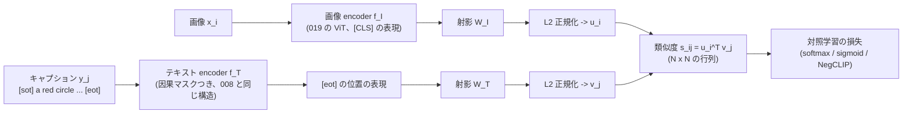

# 020. CLIP と対照学習 / CLIP and Contrastive Learning

## 1. 概要 / Overview

CLIP(Contrastive Language-Image Pre-training)は、画像とその説明文の組から、**どの文がどの画像に対応するか** を当てる対照学習
(Contrastive Learning)で、画像 encoder とテキスト encoder を同時に学習する(Radford et al. [1])。学習後は、クラス名から作った文の
埋め込みを分類器の重みとして使うことで、事前に決めたクラスの集合に依存しない zero-shot 分類ができる。本トピックでは、019 の ViT を
画像 encoder、因果マスクつきの Transformer(008 の小型 GPT と同じ構造)をテキスト encoder とする二重 encoder(dual encoder)を
スクラッチ実装し、規則で生成した合成の画像とキャプション(2 つの図形の色・形・位置関係)で学習する。学習に一度も出てこない
(色, 形) の組み合わせを含む画像での zero-shot の検索を指標として、(A)sigmoid 損失(SigLIP [4])の softmax 損失(InfoNCE [2])に
対する優位が、バッチサイズが大きいほど縮むか、(B)標準の対照学習で、語順・属性の結びつきが問われる 2 択の正解率が、ランダムな
負例との 2 択より低いか(bag-of-words 化 [5])、(C)困難な負例(hard negative)のキャプションを分母に加える NegCLIP [5] で、その
正解率が上がるか、を検証する。画像とテキストの埋め込みが別々の領域に分かれる modality gap [6] は、判定なしで観察する。

### 1.1 実行の手順

手順は付録 A。本番実行は Google Colab T4 の **1 つのセッションで完結** させる(予算は 120 分)。学習の前に、T4 上のスケーリングの計測(6.3 節)から、1 ステップの実行の方式(FP16 / FP32 / FP32 と CUDA graph)を見積もりのみで選び、12 通りの **実行計画**(6.1 節。学習で見る事例数 $E \in \{2^{19}, 2^{18}\}$ と **削る段階** 0〜3 と学習率の較正の方式の組)のそれぞれについて残りの実行時間を見積もり、予算に収まる計画のうち優先順位の最も高いものを自動で選ぶ(6.4 節)。選択は見積もりのみに基づき、どの実験の結果も参照しない。**見積もりが予算を超える場合は、学習の前に停止する。** 最初の本番の実行(コミット`81adad2`)は、この規則により学習の前に停止した。その経緯と対応は付録 C.2 に記録した(学習と評価を行っておらず、結果の情報は得ていない)。

実験 C の NegCLIP・シード 0 のモデル(両方の encoder と射影)は、[021](https://zenn.dev/kojikojiprg/books/ai-theories-roadmap/viewer/021_llava_visual_instruction_tuning) の入力になりうるので Hugging Face Hub の`kojikojiprg/ai-theories-clip-synthetic-scenes`にアップロードする(6.13 節。`UPLOAD_ARTIFACTS = True`にしたときだけ。既定は`False`)。

### 1.2 本番実行の結果の要約

本番実行(Google Colab T4、コミット`65257e0`、1 回)では、実行の方式として`fp32_eager`が選ばれ(CUDA graph は等価性の確認の閾値をわずかに
超えて候補から外れた)、最下位の **計画 11**($E = 2^{18}$・段階 3・学習率の較正の方式`"representative"`、3 シード)が選ばれた。事前に宣言した
基準による最終判定は次のとおりである(7 節)。

- **実験 A**(負例数と損失関数の交互作用): **支持**。ただし、sigmoid 損失は $N = 16$ でも $N = 256$ でも softmax 損失を下回った
  ($\Delta_{16} = -0.091$、$\Delta_{256} = -0.185$)。支持されたのは「sigmoid の相対的な劣位が $N$ とともに拡大する」向きの交互作用であり、
  「小さいバッチでは sigmoid が優位」という原論文の主張そのものは、本トピックの条件では再現されなかった。
- **実験 B**(bag-of-words 化の存在): **判定不能**(天井効果)。困難な負例との 2 択もランダムな負例との 2 択も正解率が約 0.999 で、差がほぼ 0 だった。
- **実験 C**(NegCLIP による改善): **判定不能**(天井効果)。標準のモデルの 2 択の正解率がすでに約 0.999 で、改善の余地がなかった。
  診断量の未見の組み合わせの検索の正解率 $M$ は、NegCLIP のほうが +0.0295 高かった。
- **modality gap**(判定なし): sigmoid・$N = 256$ だけが学習後も大きい gap(0.67)を残した。

NegCLIP・シード 0 のモデルは、Hugging Face Hub の`kojikojiprg/ai-theories-clip-synthetic-scenes`にアップロードした(7.8 節)。

## 2. 参考論文 / References

1. Radford, A., Kim, J. W., Hallacy, C., Ramesh, A., Goh, G., Agarwal, S., Sastry, G., Askell, A., Mishkin, P., Clark, J., Krueger, G.,
   Sutskever, I., "Learning Transferable Visual Models From Natural Language Supervision", ICML 2021.
   https://arxiv.org/abs/2103.00020(本トピックの原典。3.1〜3.3・3.6・3.9 節)
2. van den Oord, A., Li, Y., Vinyals, O., "Representation Learning with Contrastive Predictive Coding", arXiv 2018.
   https://arxiv.org/abs/1807.03748(InfoNCE 損失と相互情報量の下界。3.3・3.4 節)
3. Poole, B., Ozair, S., van den Oord, A., Alemi, A. A., Tucker, G., "On Variational Bounds of Mutual Information", ICML 2019.
   https://arxiv.org/abs/1905.06922(InfoNCE の下界の厳密な導出と $\log K$ による頭打ち。3.4 節)
4. Zhai, X., Mustafa, B., Kolesnikov, A., Beyer, L., "Sigmoid Loss for Language Image Pre-Training", ICCV 2023.
   https://arxiv.org/abs/2303.15343(SigLIP。3.5 節、実験 A)
5. Yuksekgonul, M., Bianchi, F., Kalluri, P., Jurafsky, D., Zou, J.,
   "When and Why Vision-Language Models Behave like Bags-Of-Words, and What to Do About It?", ICLR 2023.
   https://arxiv.org/abs/2210.01936(bag-of-words 化と NegCLIP。3.7 節、実験 B・C)
6. Liang, W., Zhang, Y., Kwon, Y., Yeung, S., Zou, J.,
   "Mind the Gap: Understanding the Modality Gap in Multi-modal Contrastive Representation Learning", NeurIPS 2022.
   https://arxiv.org/abs/2203.02053(modality gap。3.8 節、6.10 節の観察)
7. Zhai, X., Wang, X., Mustafa, B., Steiner, A., Keysers, D., Kolesnikov, A., Beyer, L.,
   "LiT: Zero-Shot Transfer with Locked-image text Tuning", CVPR 2022. https://arxiv.org/abs/2111.07991(3.9 節、位置づけのみ)
8. Jia, C., Yang, Y., Xia, Y., Chen, Y.-T., Parekh, Z., Pham, H., Le, Q. V., Sung, Y., Li, Z., Duerig, T.,
   "Scaling Up Visual and Vision-Language Representation Learning With Noisy Text Supervision", ICML 2021.
   https://arxiv.org/abs/2102.05918(ALIGN。3.9 節、位置づけのみ)
9. Dosovitskiy, A., Beyer, L., Kolesnikov, A., Weissenborn, D., Zhai, X., Unterthiner, T., Dehghani, M., Minderer, M.,
   Heigold, G., Gelly, S., Uszkoreit, J., Houlsby, N.,
   "An Image is Worth 16x16 Words: Transformers for Image Recognition at Scale", ICLR 2021.
   https://arxiv.org/abs/2010.11929(ViT。画像 encoder、3.2 節)

## 3. 理論 / Theory

### 3.1 動機: 自然言語を教師信号にする

019 の ViT は、CIFAR-10 の 10 クラスのように **事前に決めたクラスの集合** のラベルで学習した。この方式には 2 つの制約がある。
(1)ラベル付けに人手がかかり、データの規模を増やしにくい。(2)学習したモデルが出力できるのは学習時のクラスだけであり、
新しいクラスを認識させるには、そのクラスのラベル付きデータで追加の学習が要る。

CLIP(Contrastive Language-Image Pre-training、Radford et al. [1])は、インターネットから集めた画像とその説明文(alt テキストなど)の
組 4 億個を使い、**どの文がどの画像に付いていたかを当てる** 課題で、画像 encoder とテキスト encoder を同時に学習する。自然言語は
人手のラベル付けなしに大量に集まり、しかも「クラスの集合」に縛られない。学習後は、クラス名から作った文(例: `a photo of a dog.`)の
テキストの埋め込みを分類器の重みとして使えば、**そのクラスの画像を 1 枚も学習していなくても** 分類できる(zero-shot 分類、3.6 節)。

原論文(2.3 節)は、画像から説明文を生成する予測的な目的関数よりも、正しい組を選ぶ **対照的な(contrastive)** 目的関数のほうが、
同じ zero-shot の正解率に達するまでの学習の効率が高かったと報告している。文の正確な単語列を当てるより、「どの文が対応するか」を
区別するほうが易しい課題であるためと説明されている。

本トピックでは、この対照学習を、規則で生成した合成の画像とキャプションでスクラッチ実装する。合成データなので、
(1)学習に一度も出てこない (色, 形) の組み合わせを含む画像で zero-shot の検索を評価でき、(2)語順や属性の結びつきだけが
異なる困難な負例(hard negative)を規則で正確に作れる。

### 3.2 二重 encoder(Dual Encoder)の構造

**記号**:

- $x$: 画像、$y$: テキスト(トークン列)。$N$: バッチサイズ。$(x_i, y_i)$($i = 1, \dots, N$)がバッチ内の正例の組。
- $f_I$: 画像 encoder。019 の ViT で、最終層の [CLS] トークンの位置の表現を層正規化したもの $f_I(x) \in \mathbb{R}^{d_i}$ を返す($d_i$ は画像 encoder の出力次元)。
- $f_T$: テキスト encoder。因果マスクつきの Transformer で、終端トークン(`<eot>`)の位置の表現を層正規化したもの $f_T(y) \in \mathbb{R}^{d_t}$ を返す($d_t$ はテキスト encoder の出力次元)。
- $W_I \in \mathbb{R}^{d_i \times d_e}$・$W_T \in \mathbb{R}^{d_t \times d_e}$: 共通の埋め込み空間(次元 $d_e$)への線形射影(バイアスなし)。
  記号 $d_i$・$d_t$・$d_e$ は CLIP の原論文の図 3 の擬似コードに従う(本トピックでは $E$ を学習で見る事例数に使う)。
- 埋め込み: $u_i = \dfrac{f_I(x_i) W_I}{\lVert f_I(x_i) W_I \rVert}$、$v_j = \dfrac{f_T(y_j) W_T}{\lVert f_T(y_j) W_T \rVert}$(L2 正規化して単位球面に載せる)。
- 類似度: $s_{ij} = u_i^\top v_j \in [-1, 1]$(コサイン類似度)。

**テキスト encoder**: 原論文(2.4 節)のテキスト encoder は、GPT-2 と同じ因果マスクつき(masked self-attention)の Transformer であり、
系列の先頭と末尾に開始・終端のトークンを置き、**最終層の終端トークンの位置の活性化** を層正規化して線形射影したものを文の表現とする。
因果マスクは、事前学習済みの言語モデルで初期化したり、言語モデルの損失を補助的に加えたりする余地を残すために使われている。
これは 008 の小型 GPT(`GPTLanguageModel`)と同じ構造(002 の Decoder Block を交差注意なしで積み、因果マスクを掛ける)であり、
違いは、語彙への射影で次のトークンを予測する代わりに、終端トークンの位置の特徴を文の埋め込みにする点である。因果マスクのもとでは、
終端トークンの位置は文の全トークンを参照できる唯一の位置であり、それより後ろのパディングは終端トークンの特徴に影響しない
(5.4 節で確かめる)。位置の情報は、CLIP と同じ学習可能な絶対位置埋め込みで与える(008 は RoPE)。

### 3.3 対称な InfoNCE 損失と学習可能な温度

**記号**(3.2 節に加えて): $\tau > 0$ は温度(temperature)、$t = \log(1/\tau)$ は温度を表す学習可能なスカラー、$\ell_{ij} = e^{t} s_{ij} = s_{ij}/\tau$ は logits である。

CLIP の損失は、類似度の行列 $\ell \in \mathbb{R}^{N \times N}$ の各行(画像 → テキスト)と各列(テキスト → 画像)を、それぞれ $N$ クラスの
分類とみなした交差エントロピーの平均である(原論文の図 3 の擬似コード)。

$$
\mathcal{L}_{I \to T} = -\frac{1}{N} \sum_{i=1}^{N} \log \frac{\exp(\ell_{ii})}{\sum_{j=1}^{N} \exp(\ell_{ij})}, \qquad
\mathcal{L}_{T \to I} = -\frac{1}{N} \sum_{i=1}^{N} \log \frac{\exp(\ell_{ii})}{\sum_{j=1}^{N} \exp(\ell_{ji})}, \qquad
\mathcal{L}_{\mathrm{CLIP}} = \frac{1}{2}\left(\mathcal{L}_{I \to T} + \mathcal{L}_{T \to I}\right)
$$

各項は、van den Oord et al. [2] の InfoNCE 損失(3.4 節)と同じ形である。

**温度の扱い**: 埋め込みは単位球面上にあるので $s_{ij} \in [-1, 1]$ であり、そのままでは logits の幅が 2 しかなく、softmax の出力が
一様分布から離れられない。$1/\tau$ 倍して幅を広げる。原論文(2.5 節)は $\tau$ を手で調整する代わりに、対数でパラメータ化した
$t = \log(1/\tau)$ を学習し、初期値を $\tau = 0.07$ とし、学習が不安定にならないよう logits の倍率 $e^t$ を 100 以下に切り詰める。
本実装も同じく、各ステップの更新の後に $t \le \log 100$ に切り詰める。

**勾配と負例の役割**: 画像 → テキストの項の、類似度 $s_{ij}$ に対する勾配は

$$
\frac{\partial \mathcal{L}_{I \to T}}{\partial s_{ij}} = \frac{1}{N \tau}\left(p_{ij} - \delta_{ij}\right), \qquad
p_{ij} = \frac{\exp(\ell_{ij})}{\sum_{k=1}^{N} \exp(\ell_{ik})}
$$

である($\delta_{ij}$ はクロネッカーのデルタ)。負例 $j \ne i$ を押し下げる力は、その負例の softmax の確率 $p_{ij}$ に比例する。すでに
正例と十分に見分けられている負例は $p_{ij} \approx 0$ で、学習に寄与しない。**損失が学習を促すのは、バッチの中にある見分けにくい
負例だけである。** 見分けるのに語順や属性の結びつきが必要な負例がバッチにほとんど現れなければ、それを学ぶ誘因は弱い(3.7 節)。

### 3.4 InfoNCE は相互情報量の下界であり、下界は $\log N$ で頭打ちになる

**記号**: $(X, Y)$ は同時分布 $p(x, y)$ に従う確率変数(画像とテキスト)、$p(x)$・$p(y)$ は周辺分布、
$I(X; Y) = \mathbb{E}_{p(x, y)}\left[\log \dfrac{p(x, y)}{p(x) p(y)}\right]$ は相互情報量(mutual information)。
$g(x, y)$ は任意の実数値の関数(critic。CLIP では $g(x, y) = \ell = s/\tau$)。$K$ は 1 つの問題の候補の数(CLIP では $K = N$)。

**設定**: $x_1$ とその正例 $y_1 \sim p(y \mid x_1)$ を 1 つ引き、負例 $y_2, \dots, y_K$ を周辺分布 $p(y)$ から独立に引く。InfoNCE 損失は

$$
\mathcal{L}_{\mathrm{NCE}} = -\mathbb{E}\left[\log \frac{e^{g(x_1, y_1)}}{\sum_{j=1}^{K} e^{g(x_1, y_j)}}\right]
$$

である。van den Oord et al. [2](2.3 節と付録)は、これが $I(X; Y) \ge \log K - \mathcal{L}_{\mathrm{NCE}}$ を満たすことを示した。
Poole et al. [3] は、これを NWJ の下界(Nguyen, Wainwright, Jordan の変分下界)から厳密に導いた。その道筋を示す。

**NWJ の下界**: 任意の関数 $h$ に対して $I(A; B) \ge \mathbb{E}_{p(a, b)}[h(a, b)] - e^{-1}\, \mathbb{E}_{p(a) p(b)}[e^{h(a, b)}]$。
これは KL ダイバージェンスの変分表現(Fenchel 双対)から得られる。

**導出**:

1. $A = X_1$、$B = Y_{1:K} = (y_1, \dots, y_K)$ とする。$y_2, \dots, y_K$ は $X_1$ とも $y_1$ とも独立なので、
   $I(X_1; Y_{1:K}) = I(X_1; y_1) = I(X; Y)$ である。
2. NWJ の下界に $h = 1 + \log \dfrac{e^{g(x_1, y_1)}}{a(x_1, y_{1:K})}$、$a(x_1, y_{1:K}) = \dfrac{1}{K} \sum_{j=1}^{K} e^{g(x_1, y_j)}$ を代入する。
3. 第 2 項の期待値は周辺分布の積 $p(x_1) p(y_{1:K})$ のもとでとる。このとき $y_1, \dots, y_K$ はすべて $x_1$ と独立に同じ分布に従うので、
   添字について対称であり、$\mathbb{E}\left[e^{g(x_1, y_1)}/a\right] = \frac{1}{K} \sum_{i=1}^{K} \mathbb{E}\left[e^{g(x_1, y_i)}/a\right] = \mathbb{E}[K a / (K a)] = 1$。
   よって $e^{-1}\, \mathbb{E}[e^{h}] = e^{-1} \cdot e \cdot 1 = 1$。
4. 代入すると $I(X; Y) \ge 1 + \mathbb{E}_{p}\left[\log \dfrac{e^{g(x_1, y_1)}}{a}\right] - 1
   = \mathbb{E}_{p}\left[\log \dfrac{e^{g(x_1, y_1)}}{\sum_j e^{g(x_1, y_j)}}\right] + \log K = \log K - \mathcal{L}_{\mathrm{NCE}}$。$\square$

**頭打ち**: $\sum_{j} e^{g(x_1, y_j)} \ge e^{g(x_1, y_1)}$ なので、期待値の中の対数は常に 0 以下であり、$\mathcal{L}_{\mathrm{NCE}} \ge 0$。したがって
下界 $\log K - \mathcal{L}_{\mathrm{NCE}}$ は **どんな critic を使っても $\log K$ を超えない**。真の相互情報量が $\log K$ より大きいとき、損失を
下げきっても下界はそこで止まる。CLIP では $K = N$(バッチサイズ)なので、負例の数 $N - 1$ を増やすほど、推定できる相互情報量の
上限が上がる。対照学習で大きなバッチが有利とされる理由の 1 つである(CLIP の原論文のバッチサイズは 32,768)。

**注意**: これは損失の値が表せる範囲についての主張であり、「バッチが大きいほど下流の正解率が上がる」ことを直接には意味しない。
また、本トピックのバッチは同じキャプションを重複させないように作る(5.3 節)ので、負例は $p(y)$ からの独立な抽出ではなく、
正例と異なるキャプションからの非復元抽出になる。上の導出の独立性の仮定からのずれである。

### 3.5 sigmoid 損失(SigLIP)

**記号**: $t'$ は学習可能なスカラー(倍率 $e^{t'}$ の対数)、$b$ は学習可能なバイアス、$z_{ij} = 1$($i = j$)または $-1$($i \ne j$)は
組 $(i, j)$ が正例かどうかのラベル、$\sigma(a) = 1/(1 + e^{-a})$ はシグモイド関数。

Zhai et al. [4] の SigLIP(Sigmoid Loss for Language Image Pre-training)は、$N^2$ 個の組のそれぞれを、正例か負例かの **独立な二値分類**
として扱う(原論文の Algorithm 1)。

$$
\mathcal{L}_{\mathrm{sig}} = -\frac{1}{N} \sum_{i=1}^{N} \sum_{j=1}^{N} \log \sigma\big(z_{ij} (e^{t'} s_{ij} + b)\big)
$$

- **初期値**: 原論文は $t' = \log 10$、$b = -10$ とする。バッチの組のうち正例は $N$ 個、負例は $N^2 - N$ 個で、負例が圧倒的に多い。
  $b = -10$ から始めると、初期状態の予測が「すべて負例」に近くなり、この不均衡による大きな初期の損失と勾配を避けられる。
- **softmax との違い**: softmax の損失は、各行・各列の分母 $\sum_j \exp(\ell_{ij})$ に **バッチ全体** が入る。1 つの組の損失が、同じ
  バッチの他のすべての組に依存する(分散学習では全デバイスの埋め込みを集め、正規化のために行方向と列方向の 2 回の集計が要る)。
  sigmoid の損失は組ごとに独立で、バッチ全体の正規化を要しない。
- **原論文の主張**(本トピックの実験 A の対象): 小さいバッチでは sigmoid の損失が softmax の損失より明らかに優れ、バッチを大きく
  するにつれて差が縮む(原論文のバッチサイズの比較)。原論文の比較は本トピックよりはるかに大きいバッチ(数百以上)であり、本トピックの
  $N \in \{16, 64, 256\}$ はそれよりずっと小さい。本トピックは、同じ傾向が小さい規模でも現れるかを確かめる。
- softmax の損失は行ごとに定数を加えても変わらないので、バイアス $b$ は意味を持たない。本実装では、softmax の損失のときバイアスの
  パラメータを持つが損失に使わない(勾配が計算されず、更新されない)。

sigmoid の損失は 3.4 節の InfoNCE の形ではないので、「下界が $\log N$ で頭打ちになる」という議論はそのままは当てはまらない。
各負例の組が、正規化の分母を通さずに直接損失に入る点が、バッチサイズへの依存の違いの源になっている。

### 3.6 zero-shot 分類・prompt・線形 probe(位置づけ)

- **zero-shot 分類**: クラス $k$ の名前から文 $y_k$(例: `a photo of a {label}.`)を作り、その埋め込み $v_k$ を分類器の重みとして、
  $\hat{k} = \arg\max_k u^\top v_k$ で予測する。学習時に特定のクラスの集合を使わないので、評価のたびにクラスの集合を変えられる。
  本トピックの評価(6.1 節)は、候補のキャプションの集合を「クラス」とみなした、同じ形の検索である。
- **prompt テンプレートと prompt ensembling**(原論文 3.1.4 節): クラス名 1 語だけでは、学習データの文(説明文)と分布が違ううえ、
  多義語の区別もつかない。`a photo of a {label}.`のようなテンプレートに埋めるだけで正解率が上がり、さらに複数のテンプレート
  (ImageNet では 80 個)から作った埋め込みを平均すると上がる。原論文は、この 2 つで ImageNet の正解率がおよそ 5 ポイント上がったと
  報告している。本トピックのキャプションは規則で生成するので、学習と評価で文の形が一致しており、テンプレートは使わない。
- **線形 probe との比較**(原論文 3.1.5 節・3.2 節): 画像 encoder を固定して、その特徴にロジスティック回帰を学習する評価(線形 probe)と
  比べた。原論文は、zero-shot の CLIP が、27 のデータセットのうち 16 で、ResNet-50 の特徴に対する全データの線形 probe を上回ったと
  報告している。一方、同じ CLIP の特徴に対する線形 probe は zero-shot より高く、zero-shot は特徴の持つ情報をすべて引き出しては
  いない。本トピックでは線形 probe は扱わない。

### 3.7 bag-of-words 化と NegCLIP

**現象**: Yuksekgonul et al. [5] は、属性の結びつき(`the paved road and the white house`と`the white road and the paved house`)、
関係(`the horse is eating the grass`と`the grass is eating the horse`)、語順の入れ替えを見分ける課題(ARO ベンチマーク)で、CLIP を
含む Vision-Language モデルの正解率がチャンス水準の付近かそれ以下になることを示した。単語の集合(bag of words)としては同じ 2 つの
文を区別できないので、モデルは文を **単語の袋として** 扱っている(bag-of-words 化)、と解釈される。

**原因の説明**: 対照学習で文を正しく選ぶには、バッチ内の負例と区別できれば十分である。ランダムに集めた負例の文は、
正例の文と単語そのものが違うことがほとんどで、**単語の集合を見るだけで見分けられる**。3.3 節の勾配の式のとおり、損失は見分けにくい
負例にしか学習を促さないので、語順や属性の結びつきを表現する誘因が弱い。

**NegCLIP**: 語順や属性を入れ替えた **困難な負例のキャプション** を規則で作り、画像 → テキスト方向の分母に加える。
記号: $\tilde{v}_k$($k = 1, \dots, M$)は、バッチ内の各正例のキャプションから作った困難な負例の埋め込み($M$ はバッチ全体の困難な負例の数)。

$$
\mathcal{L}^{\mathrm{neg}}_{I \to T} = -\frac{1}{N} \sum_{i=1}^{N} \log
\frac{\exp(\ell_{ii})}{\sum_{j=1}^{N} \exp(\ell_{ij}) + \sum_{k=1}^{M} \exp(u_i^\top \tilde{v}_k / \tau)}, \qquad
\mathcal{L}_{\mathrm{NegCLIP}} = \frac{1}{2}\left(\mathcal{L}^{\mathrm{neg}}_{I \to T} + \mathcal{L}_{T \to I}\right)
$$

困難な負例は画像を持たないので、テキスト → 画像の項は変わらない。原論文は、これに加えて **困難な負例の画像**(埋め込みが近い別の画像)
もバッチに加え、COCO で CLIP を微調整した。本トピックは画像の困難な負例を加えず、テキストの困難な負例のみの効果を見る(実験 C)。

**本トピックの困難な負例**(5.3 節): 2 つの図形の **色の入れ替え**(属性の入れ替え)と、関係語を保ったままの **図形の入れ替え**(順序の
入れ替え)。どちらも元のキャプションと単語の多重集合が同じで、単語の袋としては区別できない。

**学習中の困難な負例から、除外した組を含むキャプションを除く**: 学習用のキャプションの色を入れ替えると、除外した (色, 形) の組
(5.3 節)を含むキャプションになることがある(学習用の 1,444 個のうち 700 個、約 48%)。これを困難な負例として分母に入れると、
テキスト encoder が学習中に除外した組を含むキャプションを見ることになり、「学習に一度も出てこない組み合わせ」で評価するという前提が
崩れる。そこで、NegCLIP の学習では、除外した組を含むキャプションを困難な負例に使わない(テキスト encoder に入れず、分母にも加えない)。
順序の入れ替えは同じ 2 つの図形を使うので、常に学習用のキャプションのままであり、影響を受けない。その結果、色の入れ替えの困難な負例を
持つ正例は約 52% になる。

**本トピックの設定での注意**: 実画像のキャプションの空間に比べて、合成のキャプションの空間は小さい(学習用 1,444 個)。そのため、
標準の対照学習でも、あるキャプションの順序を入れ替えたキャプションが、偶然同じバッチの別の正例として現れることがある。その確率は
バッチの他の $N - 1$ 個のキャプションが残りの 1,443 個から一様に選ばれることから $(N - 1)/1443$ であり、$N = 16$ で約 1.0%、
$N = 64$ で約 4.4%、$N = 256$ で約 17.7% になる。色の入れ替えのキャプションが学習用として存在するのは正例の約 52% だけなので、
色の入れ替えが偶然同じバッチに入る確率は、存在する場合の $(N - 1)/1443$ に存在の割合を掛けた平均で、$N = 16$ で約 0.5%、$N = 64$ で
約 2.3%、$N = 256$ で約 9.1% と低い(5.3 節の出力)。**標準の学習にも困難な負例がある程度含まれ、その量がバッチ
サイズとともに増える** ことは、実画像での状況との違いであり、実験 A・B の解釈で考慮する。色を 8 色・形を 5 種類にしてキャプションの
空間を広げたのは、この確率を下げるためである(6 色・4 種類で同じ割合の組を除くと、学習用のキャプションは 456 個になり、$N = 256$ で約 56% になる。5.3 節の出力)。

### 3.8 modality gap

Liang et al. [6] は、CLIP の画像の埋め込みとテキストの埋め込みが、単位球面上の **別々の狭い領域(円錐)** に分かれて分布することを示し、
modality gap と名付けた。2 つの重心の差の大きさで測る。

$$
\Delta_{\mathrm{gap}} = \left\lVert \frac{1}{n} \sum_{i=1}^{n} u_i - \frac{1}{n} \sum_{i=1}^{n} v_i \right\rVert
$$

($u_i$・$v_i$ は対応する画像とテキストの埋め込み、$n$ は組の数)。原論文の説明は 2 段である。(1)深いネットワークは、乱数で初期化
した時点で、入力をすべて狭い円錐に写す(cone effect)。画像とテキストの encoder は別々に初期化されるので、最初から別の円錐にある。
(2)温度の低い対照学習の損失には、この隔たりを保つ局所的な平衡があり、学習で隔たりが消えない。本トピックでは、学習前(初期化の時点)
と学習後の $\Delta_{\mathrm{gap}}$ を記録し、2 次元への射影図を示す。**判定基準を設けない観察とする**(6.10 節)。

### 3.9 位置づけのみ扱うもの

- **LiT**(Locked-image text Tuning、Zhai et al. [7]): 事前学習済みの画像 encoder を **固定し**、テキスト encoder だけを対照学習で学習する。
  画像 encoder を固定すると、画像側の表現の質(大規模な画像分類で事前学習したもの)を保ったまま、比較的少ない画像とテキストの組で
  zero-shot の能力を得られると報告している。本トピックは両方の encoder をスクラッチから同時に学習する。
- **ALIGN**(Jia et al. [8]): 18 億の、ほとんど整理していない(noisy な)alt テキストと画像の組で、EfficientNet と BERT の二重 encoder を、
  CLIP と同じ形の正規化した softmax の対照損失で学習した。データの雑音を規模で補えることを示した。
- **実画像での CLIP の結果**(Radford et al. [1]): 最大のモデル(ViT-L/14 を 336 画素で学習したもの)は、ImageNet の訓練データを一切使わない
  zero-shot で top-1 の正解率 76.2% に達し、ImageNet で教師あり学習した ResNet-50 と同程度になった。また、ImageNet の分布をずらした
  評価集合(スケッチや敵対的に集めた画像など)での正解率の低下が、ImageNet で学習したモデルより小さかった。本トピックの合成データの
  結果は、これらの実画像での結果の再現ではない。

### 3.10 アルゴリズム

学習は、規則で生成した画像とキャプションの組のバッチを二重 encoder で埋め込み、損失(3.3・3.5・3.7 節)を最小化する。評価は、未見の組み合わせの画像について、評価集合のすべてのキャプションを候補として検索する(3.6 節)。擬似コードは付録 F.1。

## 4. 実装方針 / Implementation Policy

**`src/`に切り出す(スクラッチ実装、本トピックで新規作成)**:

- `src/data/synthetic_scenes.py`: シーンの意味とキャプション(正準形と意味への逆変換)、有効な意味の全列挙、未見の組み合わせの分割、困難な負例の生成規則(色の入れ替え・順序の入れ替え)、単語単位のトークナイザ、numpy でベクトル化した描画、バッチ内のキャプションが互いに異なるサンプラ。
- `src/models/clip.py`: 因果マスクつきのテキスト encoder(002 の`DecoderBlock`を積み、終端トークンの位置の特徴を返す)、二重 encoder(019 の`VisionTransformer`の`forward_features()`を画像側に使い、共通の埋め込み次元への線形射影・L2 正規化・温度とバイアスを持つ)。
- `src/training/contrastive.py`: 対称 InfoNCE 損失、sigmoid 損失、NegCLIP の損失、バッチ内のマージン、学習ループ、評価(検索・2 択・modality gap)。

**既存モジュールの変更**(既定の挙動は変えない): `src/models/vit.py`に`forward_features()`を、`src/training/optimizer.py`の`AdamW`に`foreach`引数を追加した。変更前のコミットとの bit 単位の一致は 5.4 節で確かめる。

**ノートブック内に直接書く(020 固有)**: 描画したシーンのディスクキャッシュ(`.cache/020_synthetic_scenes/`)、条件の定義・学習率の較正・判定・可視化・スケーリングの計測、アップロードのセル。実験 C の NegCLIP・シード 0 のモデルのみを Hub にアップロードする。モジュールごとの詳しい説明、既存モジュールの変更の詳細、生成物の置き場所、アップロード方針は付録 D・F。

## 5. 実装 / Implementation

### 5.1 環境セットアップ(Google Colab)

`SMOKE_TEST`(スモークテストか本番か)と`UPLOAD_ARTIFACTS`(Hub へのアップロードをするか)はこのセルでのみ切り替える。2 つは独立である。学習の 1 ステップの **実行の方式** は、`fp16_eager`(FP16 の autocast と動的損失スケーリング)・`fp32_eager`(FP32)・`fp32_graph`(FP32 と CUDA graph)の候補から、6.4 節で時間の見積もりのみに基づいて自動で選び、全条件・全シードで同じものを使う。埋め込みの正規化・類似度・損失・評価は常に FP32 で行う(詳細は付録 A・F)。

### 5.2 スケールの設定(`SMOKE_TEST`の配線)

水準の定義をこの 1 箇所に集約した。縮小するのは、学習で見る事例数 $E$ の候補(本番 $\{2^{19}, 2^{18}\}$、スモークテスト $\{2^{13}, 2^{12}\}$。どちらも公比 2 の 2 点)、シード数、スケーリングの計測点のみで、データ・バッチサイズの水準 $N \in \{16, 64, 256\}$・損失の水準・モデルの構成・学習率の較正の格子と拡張の規則・前提条件・判定の閾値は縮小しない。縮小の規則の詳細は付録 A.2。

### 5.3 データ: 合成のシーンとキャプション

- **語彙**: 特殊トークン 3 個(`<pad>`・`<sot>`・`<eot>`)、機能語 4 個(`a`・`left`・`of`・`above`)、色 8 個、形 5 個の計 20 個の単語単位のトークナイザ。系列は`[<sot>, 単語..., <eot>, <pad>...]`で長さ 10 にそろえる。
- **キャプションの空間**: 2 つの図形の (色, 形) が色も形も異なる組を、左右(`left of`)・上下(`above`)の 2 通りに並べた全 2,240 個(3.7 節)。キャプションは意味から一意に決まる正準形で、`right of`・`below`は使わない。
- **未見の組み合わせ**: (色, 形) の 40 組のうち 8 組(20%、色 $i$ に形 $i \bmod 5$ を対応させる)を学習データの **どちらの図形にも出さず**、それを 1 つ以上含むキャプション 796 個を未見の組み合わせの評価集合に回す。残る 1,444 個が学習用のキャプションである。除外が守られていること(各色・各形は学習データに現れること)をアサーションで確かめる。
- **困難な負例**: 色の入れ替えと順序の入れ替え(3.7 節)。いずれも元のキャプションと **意味が異なり**(`right of`・`below`の言い換えも正準形に直して比べる)、単語の多重集合が元と同じで、有効なキャプションである。
- **描画**: 学習用(各キャプション 32 枚)、既知の組み合わせの検証集合(各 2 枚)、未見の組み合わせの評価集合(各 4 枚)。描画した画像は`.cache/020_synthetic_scenes/`にキャッシュし、キャッシュから読んだ画像・ディスクから読み直した画像・描き直した画像が bit 単位で一致することを確かめる。
- **学習中の困難な負例の除外**: NegCLIP の学習では、除外した組を含む困難な負例を使わない(3.7 節)。
- **ランダムな負例**(実験 B): 未見の組み合わせの評価集合の各画像に 2 個を、困難な負例と「既知 / 未見」の状態が対応するように選ぶ(6.1 節)。

詳細は付録 F.4。

    

    

### 5.4 モデルの構築と不変条件の確認

パラメータ数の印字、同じシードのモデルの初期化の一致(温度とバイアスを除いて bit 単位。実験 A・C の対応のある差の前提)、テキスト encoder の因果マスクの確認、3 つの損失の参照実装との一致(FP64)、NegCLIP の固定長の困難な負例の等価性、学習の最適化の前後の一致(変更前のコミット`81adad2`)、困難な負例の除外、バッチの切り出し、既存モジュール(`src/models/vit.py`・`src/training/optimizer.py`)の後方互換性(変更前のコミット`50820bf`と bit 単位で一致)、`AdamW(foreach=True)`の一致を、アサーションで確かめる(詳細は付録 F.5)。

### 5.5 学習と評価のヘルパー

1 つの学習を`(損失, N, s)`の鍵で表す。標準条件 S(softmax・$N = 256$)は、実験 A の $N = 256$ の softmax・実験 B のモデル・実験 C の標準のモデルで共有する。シード $s$ は初期化とバッチの順序を決める。評価は学習の最終ステップの重みで FP32 で行う(検索の正解率 $M$、2 択の正解率、modality gap など)。較正の学習は、未見の組み合わせの評価集合を一切評価しない(詳細は付録 F.6)。

## 6. 実験 / Experiments

### 6.1 実験宣言セル: 共通の設定・検証すること・判定基準・前提条件

**この節の内容は本番実行の前に確定させ、結果を見た後に変更しない。** 共通の設定の詳細、学習量の揃え方の理由、較正の規則、実行計画の理由、実験ごとの宣言の補足は付録 B・C。

#### 共通の設定

- **モデル**: 画像 encoder は 019 の ViT($P = 4$ で系列長 64、出力次元 $d_i = 128$、4 層、4 ヘッド、$d_{\mathrm{ff}} = 512$、[CLS] トークンによる読み出し)。テキスト encoder は因果マスクつきの Transformer(出力次元 $d_t = 128$、4 層、4 ヘッド、$d_{\mathrm{ff}} = 512$、系列長 10、語彙 20)。共通の埋め込みの次元 $d_e = 64$。dropout なし、正規化前置、GELU。
- **学習**: AdamW(重み減衰 0.1)、最初の 10% のステップで線形 warmup の後 cosine で最大値の 0.01 倍まで減衰、gradient clipping の閾値 1.0。1 ステップの実行の方式は 6.4 節で見積もりのみから選ぶ。温度の初期値と上限は損失ごとに原論文に従う(softmax・NegCLIP: $\tau = 0.07$、倍率 $e^t \le 100$。sigmoid: $t' = \log 10$、$b = -10$、切り詰めなし)。
- **データ**: 学習用のキャプション 1,444 個 × 各 32 枚 = 46,208 枚の固定のシーン。各バッチのキャプションは互いに異なる(5.3 節)。
- **学習量**: 学習で見る事例数 $E$(6.4 節で実行計画として自動選択される値。候補は $2^{19}, 2^{18}$)を全条件で揃え、バッチサイズ $N$ の条件のステップ数を $T_N = E / N$ とする。
- **シード**: シード $s$ は初期化とバッチの順序を決める。同じ $s$ の条件どうしは、損失によらず同じ初期値(温度とバイアスを除く)から始まり、同じ $N$ なら同じ順序で同じシーンを見る(対応のある比較)。数は削る段階で決まる。
- **評価の指標 $M$**: 未見の組み合わせの評価集合(796 個のキャプション × 各 4 枚 = 3,184 枚)の各画像について、評価集合のすべての異なるキャプション 796 個を候補として画像 → テキストの検索(zero-shot 分類と同じ形、3.6 節)を行い、コサイン類似度が最大の候補が正解である割合。チャンス水準は $1/796 \approx 0.0013$。
- **2 択の正解率**: 未見の組み合わせの評価集合の各画像について、正例のキャプションと負例のキャプション 1 つのどちらの類似度が高いかを判定する。負例は、色の入れ替え・順序の入れ替え(各 1 個、あわせて $\mathrm{acc}_{\mathrm{swap}}$)と、ランダムな負例 2 個(あわせて $\mathrm{acc}_{\mathrm{rand}}$。困難な負例と「既知 / 未見」の状態で対応させる)。どちらも各画像 2 回の 2 択で、試行の数(6,368)を揃える。
- 既知の組み合わせの検証集合(1,444 個 × 各 2 枚 = 2,888 枚、候補 1,444 個)は、学習率の較正と前提条件 P1 にのみ使う。**未見の組み合わせの評価集合は較正に使わない。**

#### 学習量の揃え方と学習率の較正

**学習量の揃え方**: 実験 A はバッチサイズ $N \in \{16, 64, 256\}$ の間で **見た事例数 $E$ を揃え**、ステップ数を $T_N = E/N$ とする($N = 16$ は $N = 256$ の 16 倍のステップを学習する)。代わりに、$N$ の小さい条件ほど更新の回数が多く、**「更新の回数」と「負例の数」の効果は分離できない(交絡)**。候補の $E$ は、学習用の 46,208 枚に対して $2^{19}$ が 11.3 エポック、$2^{18}$ が 5.7 エポックにあたり、小さい $E$ が選ばれた場合は、学習が飽和していない状態での比較になる。理由と詳細は付録 B.1。

**学習率の較正**(本番の冒頭、6.5 節): 条件 $(\ell, N)$ の格子は、中心 $\eta_c(\ell, N) = \eta_{c,\ell} (N/256)^{3/4}$ の $\{1/2, 1, 2\}$ 倍(公比 2 の 3 点)。$N = 256$ の中心 $\eta_{c,\ell}$ は、softmax が $2 \times 10^{-3}$、sigmoid が $10^{-3}$(6.2 節のパイロットで決めた)。本番と同じ $E$・全学習データで、較正専用のシード(番号 90)の 1 シードで各格子点を学習し、**既知の組み合わせの検証集合の検索の正解率** が最大の学習率を選ぶ(同点なら小さい方)。最良が格子の端に来た場合は、公比 2 で 1 点だけ格子を拡張して改めて最良を選ぶ(1 回のみ)。NegCLIP は標準条件 S で選んだ学習率をそのまま使う(実験 C の対比を損失の違いだけにするため。NegCLIP の最適な学習率が S と異なる可能性は交絡として残る)。

較正の方式`CALIBRATION_MODE`は、選ばれた実行計画から決まる。`"all"`(計画 0〜7)は実験 A で学習する全条件を較正し、`"representative"`(計画 8〜11)は $N = 256$ の softmax と sigmoid の 2 条件のみを較正して、他の $N$ の学習率をべき乗の規則 $\eta_N = \eta_{256} (N/256)^{3/4}$ で決める。`"representative"`で規則で決めた条件の P0 は検証されない(較正した $N = 256$ の P0 で代える)。規則の理由と詳細は付録 B.2。

#### 共通の前提条件

- **P0(較正)**: 較正した各条件で、選んだ学習率が格子の **内点** であること(拡張後も最良が端なら不成立)。`"representative"`で規則で決めた条件の学習率は較正していないので、その P0 は検証されない。
- **P1(学習の成立)**: 各条件で、シード平均の **既知の組み合わせの検証集合の検索の正解率** が 0.1 以上であること(チャンス水準 $1/1444 \approx 0.0007$ の約 144 倍)。検証したい仮説(損失・負例の種類による差)とは独立な、「学習が進んだか」の量である。

前提条件が 1 つでも成立しない実験は、判定関数の結果によらず **前提不成立** と記録する(判定不能とは区別する)。

#### 判定の形

各実験の対比量 $\Delta$ とその標準偏差 $\sigma$ に対し、$\Delta > 2\sigma$ なら **支持**、$\Delta < -2\sigma$ なら **反証**、それ以外は **判定不能** とする。$\sigma$ はシード間のばらつきから求める(評価集合は全条件で共通なので、評価事例の抽出によるばらつきは条件間の比較では共通に効き、対比量の標準偏差には含めない)。

#### 実行計画(学習で見る事例数 $E$ と削る段階の組)と、その自動選択

**削る段階**:

| 段階 | 内容 | 実験 A のシード数・$N$ の水準 | 実験 B・C のシード数 |
|---|---|---|---|
| 0 | 全実験 5 シード | 5、$N \in \{16, 64, 256\}$ | 5 |
| 1 | 実験 A の $N = 64$ を除く | 5、$N \in \{16, 256\}$ | 5 |
| 2 | 段階 1 に加え、実験 A のシード数を 3 にする | 3、$N \in \{16, 256\}$ | 5 |
| 3 | 段階 2 に加え、実験 B・C のシード数を 3 にする | 3、$N \in \{16, 256\}$ | 3 |

**学習で見る事例数の候補**: $E \in \{2^{19}, 2^{18}\}$(公比 2)。学習用の 46,208 枚に対するエポック数と、各条件のステップ数は次のとおり。

| $E$ | エポック数 | $T_{16}$ | $T_{64}$ | $T_{256}$ |
|---|---|---|---|---|
| $2^{19} = 524{,}288$ | 11.3 | 32,768 | 8,192 | 2,048 |
| $2^{18} = 262{,}144$ | 5.7 | 16,384 | 4,096 | 1,024 |

**実行計画**: 次の 12 通りに、優先順位の高い順に番号を付ける。計画 0〜7 は較正の方式`"all"`で、**$E$ の大きい順を第 1 キー、段階の番号の小さい順を第 2 キー** とする。計画 8〜11 は **下位の計画** で、$E = 2^{18}$・較正の方式`"representative"`・段階 0〜3 である(停止した本番の実行を受けて追加した。付録 C.2)。

| 計画 | $E$ | 段階 | 較正の方式 |
|---|---|---|---|
| 0〜3 | $2^{19}$ | 0〜3 | `"all"` |
| 4〜7 | $2^{18}$ | 0〜3 | `"all"` |
| 8〜11 | $2^{18}$ | 0〜3 | `"representative"` |

**選択の規則**: 学習を始める前に(6.4 節、較正の前)、T4 上のスケーリングの計測(6.3 節)から、各計画の残りの実行時間(較正と本番の学習・評価)を見積もる。予算は「120 分 − データの準備・確認・計測にすでに使った実測時間」とし、予算内に収まる **番号の最も小さい計画** を選ぶ。**計画 0〜7(`"all"`)で収まる計画があれば、常にそれが優先される。** 計画 11 でも超える場合は、学習の前に例外で停止する。**選択は見積もりのみに基づき、どの実験の結果も参照しない。** 較正の方式を $E$ より優先する理由、$E$ を優先する理由、段階の順序の理由、$E$ の下限 $2^{18}$ の根拠は付録 C.1。

#### 実験 A: 負例数と損失関数の交互作用

**検証すること**: sigmoid 損失の softmax 損失(InfoNCE)に対する優位が、バッチサイズ $N$ が大きいほど縮む(SigLIP [4] の主張、3.5 節)。

**条件**: 損失 $\ell \in \{\mathrm{softmax}, \mathrm{sigmoid}\}$ × $N \in \{16, 64, 256\}$(公比 4 の等比の水準。段階 1 以降は $N \in \{16, 256\}$)。見た事例数 $E$ を揃え、学習率は条件ごとに較正した値。$(\mathrm{softmax}, 256)$ は標準条件 S。

**判定基準**: $M_{\ell, N, s}$ を損失 $\ell$・バッチサイズ $N$・シード $s$ の未見の組み合わせの検索の正解率とし、

$$
\Delta_{N,s} = M_{\mathrm{sigmoid}, N, s} - M_{\mathrm{softmax}, N, s}, \qquad
d_s = \Delta_{16,s} - \Delta_{256,s}, \qquad
D = \frac{1}{n_A} \sum_{s} d_s
$$

($n_A$ は実験 A のシード数)。$D > 0$ は「$N = 16$ での sigmoid の優位が $N = 256$ より大きい」(優位が $N$ とともに縮む)ことを表す。標準偏差は、$d_s$ をシードごとに作ってその標本標準偏差をとり、$\sigma_D = \mathrm{sd}(d_s) / \sqrt{n_A}$ とする($\mathrm{sd}$ は不偏標本標準偏差。同じシードの 4 つの学習の相関を含めた分散を直接推定する。誤差伝播による導出は付録 B.3)。$D > 2\sigma_D$ なら支持、$D < -2\sigma_D$ なら反証、それ以外は判定不能。

**前提条件**: 対比量に使う 4 条件(softmax・sigmoid × $N \in \{16, 256\}$)の P0(較正した条件のみ)と P1。$N = 64$(段階 0 のみ)は判定に使わない診断の水準なので、その P0・P1 は参考として印字するのみ。

**介入の直接の作用点**: 損失関数は、バッチ内の類似度の logits(正例の組と負例の組の類似度の差)に直接作用し、$N$ は 1 つの正例に対する負例の数に直接作用する。最も近い量は **バッチ内の正例の類似度と最も類似度の高い負例の類似度の差(マージン)** である。$M$ は、そこから「学習で見た組み合わせの外への汎化」と「候補 796 個の中での順位」の 2 段を経た下流の量だが、zero-shot の性能という主張そのものなので対比量に選んだ。診断量として、学習中のバッチ内のマージンと、未見の組み合わせの評価集合での固定の候補 796 個に対するマージンを記録する。

**交絡と注意**: (1)更新の回数と負例の数(上の「学習量の揃え方」)。(2)合成のキャプションの空間が小さいので、$N$ が大きいほどバッチに困難な負例が偶然含まれる確率が上がる(3.7 節)。(3)原論文のバッチサイズ(数千以上)とは規模が大きく違う。

#### 実験 B: 標準の対照学習における bag-of-words 化の存在

**検証すること**: 標準条件 S(softmax・$N = 256$)の学習済みモデルを再利用して(追加の学習なし)、語順・属性の結びつきが問われる 2 択の正解率 $\mathrm{acc}_{\mathrm{swap}}$ が、ランダムな負例との 2 択の正解率 $\mathrm{acc}_{\mathrm{rand}}$ より低い(3.7 節)。

**判定基準**: $b_s = \mathrm{acc}_{\mathrm{rand},s} - \mathrm{acc}_{\mathrm{swap},s}$ のシード平均 $B = \frac{1}{n_{BC}} \sum_s b_s$($n_{BC}$ は実験 B・C のシード数。困難な負例は色の入れ替え・順序の入れ替えをまとめて $\mathrm{acc}_{\mathrm{swap}}$ とし、種類ごとの正解率は診断量)。標準偏差は $\sigma_B = \mathrm{sd}(b_s) / \sqrt{n_{BC}}$(同じモデルの同じ画像で評価するので、モデルの良し悪しによる共通の変動は差で打ち消される)。$B > 2\sigma_B$ なら支持、$B < -2\sigma_B$ なら反証、それ以外は判定不能。

**前提条件**: P0(softmax・256)、P1(softmax・256)。

**介入の直接の作用点**: この実験の「介入」は評価時の負例の種類であり、2 択の判定そのものに直接作用する。対比量は 2 択の正解率の差で、作用点との間に他の段を挟まない。

**解釈の注意**: $\mathrm{acc}_{\mathrm{rand}}$ が 1 に近いと(天井)、$\mathrm{acc}_{\mathrm{swap}}$ との差の上限が抑えられる。差が小さい場合に、bag-of-words 化がないのか天井のためかを区別するため、種類ごとの正解率と既知の組み合わせの検証集合での同じ量を診断量として併記する。ランダムな負例を困難な負例と「既知 / 未見」の状態で対応させたのは、未見のキャプションだけから選ぶと、モデルが学習で見たキャプションに高い類似度を出す傾向だけで $B$ が支持の方向に偏るのを避けるためである(付録 B.4)。

#### 実験 C: 困難な負例による改善(NegCLIP)

**検証すること**: 学習時に困難な負例のキャプションを画像 → テキスト方向の分母に加えると(NegCLIP、3.7 節)、$\mathrm{acc}_{\mathrm{swap}}$ が上がる。

**条件**: NegCLIP・$N = 256$・見た事例数 $E$ は S と同一・学習率は S と同一。各正例に色の入れ替えと順序の入れ替えの 2 つの困難な負例のキャプションを作り、分母に加える。**除外した (色, 形) の組を含む困難な負例は使わない**(テキスト encoder に入れず、分母にも加えない。未見の組み合わせによる評価の前提が崩れるため)。困難な負例の画像は加えない(原論文との差)。

**判定基準**: $c_s = \mathrm{acc}_{\mathrm{swap}}(\mathrm{NegCLIP}, s) - \mathrm{acc}_{\mathrm{swap}}(\mathrm{S}, s)$ のシード平均 $C = \frac{1}{n_{BC}} \sum_s c_s$(未見の組み合わせの評価集合。正を期待)。標準偏差は $\sigma_C = \mathrm{sd}(c_s) / \sqrt{n_{BC}}$。$C > 2\sigma_C$ なら支持、$C < -2\sigma_C$ なら反証、それ以外は判定不能。

**前提条件**: P0(softmax・256)、P1(softmax・256)、P1(NegCLIP)。

**介入の直接の作用点**: NegCLIP が直接作用するのは、学習中の画像と困難な負例のキャプションの類似度(分母に入った項)で、それに最も近いのは **学習で見た組み合わせでの** 困難な負例との 2 択の正解率である。対比量は、それを未見の組み合わせへ汎化させた 1 段下流の量なので、既知の組み合わせの検証集合での同じ差を診断量として併記する。

**診断量(代償)**: 困難な負例を加えることでランダムな負例に対する zero-shot の検索が悪くならないかを見るため、$M$ の差と $\mathrm{acc}_{\mathrm{rand}}$ の差を記録する(判定なし)。

**限界**: 学習と評価で困難な負例の **生成規則が同じ** である。未見の組み合わせで評価することで「学習で見たキャプションそのものを覚えた」可能性は除けるが、「この 2 つの規則で作られる負例を見分ける」ことに特化した学習の可能性は除けない。別の規則の負例への汎化は検証しない。

#### 観察: modality gap(判定基準を設けない)

実験 A・C の学習済みモデルについて、未見の組み合わせの評価集合の画像の埋め込みと、その正例のキャプションの埋め込みの重心間距離 $\Delta_{\mathrm{gap}}$(3.8 節)を、学習の前(初期化の時点)と後で記録する。シード 0 のモデルについて、画像とテキストの埋め込み(各 400 個)を主成分分析で 2 次元に射影した図を示す。

### 6.2 パイロットと、本番前の改訂・停止した本番の実行の記録

学習で見る事例数 $E$ の候補・学習率の格子・前提条件の閾値は、第 1 段階のパイロット(ローカルの Apple M4 の MPS、FP32、1 シード)で決めた。**判定に使う量(未見の組み合わせの評価集合の指標)は計算していない。** 見たのは前提条件 P1 の量(既知の組み合わせの検証集合の検索の正解率)と訓練損失のみで、softmax 以外の条件は P1 の閾値 0.1 を上回ったかの真偽のみを印字した。このパイロットから、(1)学習率の格子の中心を $N = 256$ で $2 \times 10^{-3}$ とし、他の $N$ へ $(N/256)^{3/4}$ でずらす規則、(2)$E$ の下限を $2^{18}$(sigmoid の $N = 16$ が $2^{17}$ で P1 の閾値を下回ったため候補から除いた)、(3)sigmoid の格子の中心を決めた。いずれも本番の前の改訂で、**判定基準(対比量の定義・閾値の導出式・期待する差の方向)と前提条件の定義は変えていない。** 改訂の根拠は、交絡の分離・評価の設計の整合性という一般論で、観測結果の方向には依存しない。

最初の本番の実行(コミット`81adad2`)は、6.4 節で見積もりが予算を超えたため、規則どおり **学習の前に停止した。学習と評価は一度も行われておらず、結果の情報は得ていない。** 原因は、1 ステップの時間が $N$ にほとんど依存しない(固定費が支配的な)処理に、別のトピックの速度比(019 の MPS と T4 の比)を流用して T4 の時間を見積もったことだった。対応として、1 ステップの固定費を削る変更と実行の方式の自動選択、較正の方式`"representative"`の下位の計画の追加を行い、判定基準・水準・前提条件は変えずに再実行した。パイロットの表、改訂の詳細、停止した実行の見積もりと固定費の内訳、本番で選ばれた $E = 2^{18}$ とパイロットの関係は付録 C.2。

### 6.3 スケーリングの計測と外挿(1 セッションの見積もり)

本番で規模がスモークテストの何倍にもなる重い処理(描画・学習・評価)について、3 点の規模で実行時間を実測し、$\log t = \log a + b \log n$ をあてはめてべき指数 $b$ を推定し、本番の規模へ外挿する。この計測は本番の冒頭に T4 上で行い、その値のみから実行の方式と実行計画を選ぶ(6.4 節)。CUDA のときは、CUDA graph の等価性の確認(同じ初期値・同じバッチの列で`fp32_eager`と`fp32_graph`を 6 ステップずつ学習し、重みの最大の相対差が閾値 $10^{-5}$ を超えたら候補から外す)も行う。詳細は付録 C.3。

### 6.4 実行の方式と実行計画の選択

6.3 節の外挿値から、実行の方式の候補ごとに、12 通りの実行計画の残りの実行時間(較正と本番の学習・評価)を見積もる。方式は計画 0 の見積もりが最も短いものを選び、計画は選んだ方式の見積もりで予算に収まる番号の最も小さいものを選ぶ。選択は時間の見積もりのみに基づき、どの実験の結果も参照しない(詳細は付録 C.4)。

### 6.5 学習率の較正(P0)

6.1 節の規則で、較正する条件ごとに学習率を選ぶ。6.4 節で選ばれた $E$・全学習データ・較正専用のシードで学習し、既知の組み合わせの検証集合の検索の正解率のみを見る(未見の組み合わせの評価集合は評価しない)。

### 6.6 本番の学習と評価(実験 A・B・C)

6.4 節で選んだ段階の学習をすべて行い、鍵ごとに記録する。同じ鍵の学習は 1 回だけ行う(標準条件 S を実験 A・B・C で共有する)。

### 6.7 実験 A: 負例数と損失関数の交互作用

    

    

    

    

### 6.8 実験 B: 標準の対照学習における bag-of-words 化の存在

    

    

### 6.9 実験 C: 困難な負例による改善(NegCLIP)

    

    

### 6.10 観察: modality gap(判定基準を設けない)

**判定基準を設けない観察である。** 未見の組み合わせの評価集合で、画像の埋め込みの重心とキャプションの埋め込みの重心の距離
$\Delta_{\mathrm{gap}}$(3.8 節)を、学習の前(初期化の時点)と後で比べる。シード 0 のモデルについて、画像とテキストの埋め込み(各 400 個)を
合わせて主成分分析で 2 次元に射影した図を示す。単位球面上の埋め込みの重心間の距離は、最大で 2 である。

    

    

### 6.11 不変条件のアサーションと`SMOKE_TEST`の配線

見た事例数・ステップ数・学習率のスケジュールの形・バッチ内のキャプションの重複のなさ・同じシードの初期値と同じ $N$ のバッチの順序が全学習で揃っていること、本番の学習がすべて同じ評価集合で評価されたこと、実効値が計画の表と一致することなどを、アサーションで確かめる(詳細は付録 C.5)。

### 6.12 判定結果の一覧

前提条件が 1 つでも不成立の実験は、判定関数の結果に関わらず「前提不成立」とする(判定不能とは区別する)。判定関数の結果は参考として
別欄に残す。選ばれた計画($E$・段階)と、判定に実際に使ったシード数・水準を印字する。

### 6.13 アップロード(NegCLIP・シード 0 のモデル)

実験 C の NegCLIP・$N = 256$・シード 0 のモデルを、`kojikojiprg/ai-theories-clip-synthetic-scenes`の`main`ブランチにアップロードする。対象は結果を見て選ばず、この指定で固定する。アップロードのセルは`UPLOAD_ARTIFACTS = True`のときのみ実行し(既定は`False`)、前提条件 P1(NegCLIP)が成立しない重みはアップロードしない。`HF_TOKEN`が取得できない場合はスキップし、アップロード後に`list_repo_files`で 3 つのファイルの存在と、`model_state.pt`の SHA-256 の一致を確かめる。モデルカードの指標は、読み戻した重みそのもので評価し直した値とする(設計の詳細は付録 D)。

## 7. 結果・考察 / Results and Discussion

本番実行(Google Colab T4、1 回)のセル出力に基づいて記す。判定(7.2〜7.5 節)は 6.1 節で事前に宣言した基準のみから導く。
結果を見た後に立てた解釈はすべて 7.7 節に分けて記し、検証済みの結論としては扱わない。

診断量の詳細と、本文から移した元の記述は付録 E。

### 7.1 実行の概要

- **実行環境**(5.1 節の印字): Tesla T4(compute capability 7.5、総メモリ 14.56 GiB)、Python 3.13.15、torch 2.13.0+cu130
  (ビルド時の CUDA 13.0、cuDNN 92000)、コミット`65257e0`、未コミットの変更なし、実行日時 2026-09-30T12:51:27(UTC)。
- **準備と計測**: データの準備 35.5 秒、5.4 節の確認 20.6 秒、スケーリングの計測 239.0 秒で、計画の選択の時点で 5.2 分を使い、
  残りの予算は 114.8 分だった。
- **CUDA graph の等価性の確認**(6.3 節、6 ステップ):

  | 条件 | 重みの最大の相対差 | 損失の最大の差 |
  |---|---|---|
  | softmax・$N = 16$ | 1.55e-05 | 0.00e+00 |
  | sigmoid・$N = 16$ | 2.71e-06 | 2.38e-07 |
  | NegCLIP・$N = 256$ | 7.33e-06 | 4.77e-07 |

  softmax・$N = 16$ の重みの相対差が、事前に決めた閾値 $10^{-5}$ をわずかに超えたので、規則どおり`fp32_graph`は候補から外れた。
  この条件の損失の差は 0 であり、再生したグラフ自体は正しく、eager の経路との差は演算の丸めの違いにとどまる可能性が高い(閾値の
  決め方の問題として 7.7 節の教訓に入れる)。
- **1 ステップの時間**(6.3 節、最大の計測点): 計画 0 の見積もりは`fp16_eager`が 1423.5 分、`fp32_eager`が 735.9 分で、`fp32_eager`が選ばれた。停止した本番の実行(6.2 節、当時は FP16 のみ)と比べると、softmax・$N = 16$ の 1 ステップは 45.4 ms から 38.2 ms になった。FP32 では $N = 256$ の 1 ステップが FP16 より長くなる(softmax で 67.3 ms に対し 91.6 ms)が、計画の時間の大半を占める $N = 16$ の短縮が上回った。方式ごとの時間の表は付録 E.1。
- **選ばれた計画**(6.4 節): `fp32_eager`の見積もりで、計画 0〜10 はいずれも残りの予算を超え(計画 10 は 121.6 分)、最下位の
  **計画 11**($E = 2^{18}$・段階 3・較正の方式`"representative"`、見積もり 114.4 分)が選ばれた。実験 A・B・C のシード数は 3、実験 A の
  $N$ は $\{16, 256\}$ である。
- **実際の実行時間**: 較正 10.9 分、本番の学習と評価(15 学習)81.3 分、ノートブック全体で 97.7 分(予算 120 分の内側)。計画の選択の後にかかった時間は約 97.7 − 5.2 = 92.5 分で、見積もり 114.4 分より約 22 分短かった。差の大部分は sigmoid・$N = 16$ の見積もり(計測点のべき指数 $b = 1.082$ で外挿した値が比例の値を上回った)による。詳細は付録 E.1。
- **学習率の較正**(6.5 節、既知の組み合わせの検証集合の検索の正解率、シード番号 90):

  | 学習率 | softmax・$N = 256$ | sigmoid・$N = 256$ |
  |---|---|---|
  | 0.0005 | 学習していない | 0.3840 |
  | 0.001 | 0.7538 | 0.4997 |
  | 0.002 | 0.8352 | 0.5443 |
  | 0.004 | 0.6021 | 0.3760(拡張) |

  softmax は格子の中央の 0.002 が最良(内点)。sigmoid は元の格子の上端の 0.002 が最良だったので上方向に 1 点拡張し、拡張した 0.004 が
  0.3760 に下がったため、0.002 が内点の最良となった。本番で使った学習率は、softmax・sigmoid の $N = 256$ と NegCLIP が 0.002、$N = 16$ は
  規則 $\eta_{16} = \eta_{256} (16/256)^{3/4} = \eta_{256}/8$ により softmax・sigmoid とも 0.00025 である。
- **その他**: FP32 なので損失スケーリングはなく、飛ばしたステップは全学習で 0。最終の倍率 $e^t$ のシード平均は softmax が $N = 16$ で 32.4、
  $N = 256$ で 33.6、sigmoid が $N = 16$ で 13.6、$N = 256$ で 15.9 だった(6.7 節)。NegCLIP は 34.4〜35.5(6.6 節)。
- **不変条件**(6.11 節): 全 22 学習(本番 15・較正 7)で、見た事例数・ステップ数・学習率のスケジュールの形・バッチ内のキャプションの重複の
  なさ・同じシードの初期値・同じシードと $N$ のバッチの順序が揃い、全学習でテキスト encoder に入れた系列が除外した組を含まないことを
  確かめた。NegCLIP で分母に加えた色の入れ替えは、規則が作った数の 0.514 だった。

### 7.2 前提条件

| 前提条件 | 値 | 成否 | 前提とする実験 |
|---|---|---|---|
| P0(softmax・256) | 選んだ学習率 0.002。格子 $\{0.001, 0.002, 0.004\}$ の内点 | 成立 | A・B・C |
| P0(sigmoid・256) | 選んだ学習率 0.002。拡張後の格子 $\{0.0005, 0.001, 0.002, 0.004\}$ の内点 | 成立 | A |
| P1(softmax・16) | 既知の組み合わせの検証集合の検索の正解率のシード平均 0.3487 | 成立 | A |
| P1(sigmoid・16) | 同 0.2447 | 成立 | A |
| P1(softmax・256) | 同 0.7889(実験 B・C のシードも同じ 3 シード) | 成立 | A・B・C |
| P1(sigmoid・256) | 同 0.5476 | 成立 | A |
| P1(NegCLIP・256) | 同 0.8438(6.6 節の各学習の値 0.8691・0.8064・0.8560 の平均) | 成立 | C |

閾値はいずれも 0.1 で、すべての前提条件が成立した。

- 較正の方式が`"representative"`なので、$N = 16$ の学習率は較正ではなく規則で決まり、**$N = 16$ の 2 条件は P0 の対象外である**(6.1 節の
  宣言のとおり、較正した $N = 256$ の P0 で代える)。$N = 16$ の学習率が最適かどうかは検証されていない。
- sigmoid・$N = 16$ の学習率 0.00025 は、較正で選ばれた sigmoid・$N = 256$ の 0.002(格子の上端から拡張して得た内点)から規則で決まった。
  これは、当初の sigmoid・$N = 16$ の格子 $\{6.25 \times 10^{-5}, 1.25 \times 10^{-4}, 2.5 \times 10^{-4}\}$ の **上端** にあたる。softmax・$N = 16$ の
  0.00025 は softmax の格子の中央にあたる。

### 7.3 実験 A: 負例数と損失関数の交互作用(支持)

| シード | 0 | 1 | 2 | 平均 |
|---|---|---|---|---|
| $M$(softmax・$N = 16$) | 0.4256 | 0.4256 | 0.4124 | 0.4212 |
| $M$(sigmoid・$N = 16$) | 0.3486 | 0.3379 | 0.3043 | 0.3303 |
| $\Delta_{16,s}$ | −0.0769 | −0.0876 | −0.1080 | −0.0909 |
| $M$(softmax・$N = 256$) | 0.7563 | 0.7054 | 0.7365 | 0.7327 |
| $M$(sigmoid・$N = 256$) | 0.5273 | 0.5377 | 0.5788 | 0.5479 |
| $\Delta_{256,s}$ | −0.2290 | −0.1677 | −0.1577 | −0.1848 |
| $d_s = \Delta_{16,s} - \Delta_{256,s}$ | 0.1520 | 0.0801 | 0.0496 | 0.0939 |

- 対比量 $D = +0.0939$、$\sigma_D = \mathrm{sd}(d_s)/\sqrt{3} = 0.0304$、閾値 $2\sigma_D = 0.0607$。$D > 2\sigma_D$ で、前提条件がすべて成立して
  いるので、**支持**。3 シードすべてで $d_s > 0$ だった。
- **支持されたものと、されなかったものの区別**: $\Delta_{16} = -0.091$、$\Delta_{256} = -0.185$ で、**sigmoid はどちらの $N$ でも softmax を
  下回った**。支持されたのは、事前に宣言した対比量 $D$ の向き、すなわち「sigmoid の softmax に対する差が $N = 16$ のほうが $N = 256$ より
  sigmoid に有利である」という交互作用である。本トピックの結果では、それは「sigmoid の相対的な劣位が $N$ とともに拡大する」形で現れた。
  3.5 節の原論文の主張のうち、「小さいバッチでは sigmoid が softmax より優れる」という部分は、本トピックの条件では再現されなかった。
- **限界**: $\sigma_D$ は 3 シードの $d_s$ の標本標準偏差から推定しており、推定そのもののばらつきが大きい($d_s$ は 0.050〜0.152 と広く散った)。
- **診断量**(判定なし):
  - 相関を無視した標準偏差は 0.0258 で、$d_s$ から直接推定した $\sigma_D = 0.0304$ と同程度だった。
  - 作用点に近い量(未見の組み合わせの評価集合での固定の候補 796 個に対するマージンと、学習中のバッチ内のマージン)の値は付録 E.3。
  - 学習曲線(6.7 節の 2 つ目の図、既知の組み合わせの検証集合): 両方の $N$ で、どの時点でも softmax が sigmoid を上回り、両損失とも
    最後の評価の時点($E = 2^{18}$)でまだ上がり続けていた。

### 7.4 実験 B: 標準の対照学習における bag-of-words 化の存在(判定不能)

| シード | 0 | 1 | 2 | 平均 |
|---|---|---|---|---|
| $\mathrm{acc}_{\mathrm{rand}}$(新定義) | 0.9989 | 0.9986 | 0.9997 | 0.9991 |
| $\mathrm{acc}_{\mathrm{swap}}$ | 0.9991 | 0.9983 | 0.9989 | 0.9987 |
| $b_s$ | −0.0002 | 0.0003 | 0.0008 | 0.0003 |

- 対比量 $B = +0.0003$、$\sigma_B = 0.0003$、閾値 0.0005。$\lvert B \rvert \le 2\sigma_B$ で、前提条件が成立しているので、**判定不能**。
- **判定不能の理由は、推定の精度の不足ではなく天井効果である。** $\sigma_B = 0.0003$ と精度は十分にあり、そのうえで効果の推定値がほぼ 0
  だった。$\mathrm{acc}_{\mathrm{rand}}$・$\mathrm{acc}_{\mathrm{swap}}$ はともに約 0.999 で、2 択の正解率の上限 1 に張り付いている(6.1 節の「解釈の
  注意」で想定した状況)。bag-of-words 化したモデルなら $\mathrm{acc}_{\mathrm{swap}}$ はチャンス水準の 0.5 付近になるはずなので、この値の読み取りは
  7.7 節で事後的な解釈として扱う。**判定はあくまで判定不能である。**
- **診断量**(判定なし):
  - 種類ごとの $\mathrm{acc}_{\mathrm{swap}}$ は、色の入れ替えが 0.9990、順序の入れ替えが 0.9985。既知の組み合わせの検証集合では、どれも 1.0000 だった。
  - 旧定義(ランダムな負例をすべて未見の組み合わせから選ぶ)の $\mathrm{acc}_{\mathrm{rand}}$ は 0.9992 で、新定義との差は +0.0001。
  - 既知性の偏り(学習用のキャプションとの 2 択の正解率 − 未見の組み合わせのキャプションとの 2 択の正解率)は +0.0006(sd/√n 0.0004)。
    学習用のキャプションに引き寄せられる傾向(負の値)は見られず、6.2 節の改訂 5 の交絡への対処(新定義)は、結果に実質的な影響を
    与えなかった。

### 7.5 実験 C: 困難な負例による改善(NegCLIP)(判定不能)

| シード | 0 | 1 | 2 | 平均 |
|---|---|---|---|---|
| $\mathrm{acc}_{\mathrm{swap}}$(S) | 0.9991 | 0.9983 | 0.9989 | 0.9987 |
| $\mathrm{acc}_{\mathrm{swap}}$(NegCLIP) | 0.9987 | 0.9994 | 0.9991 | 0.9991 |
| $c_s$ | −0.0003 | 0.0011 | 0.0002 | 0.0003 |

- 対比量 $C = +0.0003$、$\sigma_C = 0.0004$、閾値 0.0008。$\lvert C \rvert \le 2\sigma_C$ で、前提条件が成立しているので、**判定不能**。実験 B と同じく、
  標準のモデル S の $\mathrm{acc}_{\mathrm{swap}}$ がすでに 0.9987 で、改善の余地がほとんどない **天井効果** による判定不能である。
- **診断量**(判定なし、NegCLIP − S のシード平均と sd/√n):
  - 既知の組み合わせの $\mathrm{acc}_{\mathrm{swap}}$(作用点に近い量): NegCLIP 0.9999・S 1.0000、差 −0.0001(0.0001)。
  - 未見の $\mathrm{acc}$(色の入れ替え)+0.0002(0.0006)、未見の $\mathrm{acc}$(順序の入れ替え)+0.0004(0.0003)。
  - 未見の $\mathrm{acc}_{\mathrm{rand}}$: NegCLIP 0.9993・S 0.9991、差 +0.0003(0.0004)。
  - $M$: NegCLIP 0.7622・S 0.7327、差 **+0.0295(0.0078)**。6.1 節で「代償」として想定した向き(困難な負例を加えるとランダムな負例に対する
    検索が悪くなる)とは **逆向き** で、NegCLIP のほうが $M$ が高かった。
- **本文に明記する限界**(6.1 節の宣言のとおり): 学習と評価で困難な負例の生成規則が同じである。本トピックでは天井効果のためにこの限界が
  判定に効く以前の結果になったが、別の規則の負例への汎化は検証していない。

### 7.6 観察: modality gap(判定基準を設けない)

| 条件 | 学習前 | 学習後(未見) | 学習後(既知) |
|---|---|---|---|
| softmax・$N = 16$ | 1.369 | 0.142 | 0.129 |
| sigmoid・$N = 16$ | 1.369 | 0.233 | 0.222 |
| softmax・$N = 256$ | 1.369 | 0.148 | 0.096 |
| sigmoid・$N = 256$ | 1.369 | 0.672 | 0.674 |
| NegCLIP・$N = 256$ | 1.369 | 0.158 | 0.100 |

- 学習前(初期化の時点)の $\Delta_{\mathrm{gap}}$ は全条件で 1.369(同じシードの初期値は損失によらず同じ)で、学習後はどの条件でも小さくなった。
- **sigmoid・$N = 256$ だけ、学習後の gap が 0.67 と突出して大きい。** 他の条件は 0.10〜0.23。射影図(6.10 節、シード 0)でも、sigmoid・$N = 256$
  だけは画像の埋め込みとテキストの埋め込みが 2 次元の第 2 軸の方向に分かれて別々の領域に集まり、他の 4 条件では両者が混ざって分布した。
- 判定は置かない。この違いの解釈は 7.7 節で扱う。

### 7.7 事後的な解釈(検証済みの結論ではない)

以下はすべて結果を見た後に立てた解釈であり、検証していない。支持以外の判定になった実験 B・C(判定不能、天井効果)については、「原因の候補」「根拠」「確かめる方法」「教訓」を 7.7.2・7.7.5 に書いた。

#### 7.7.1 実験 A の交互作用の原因の候補

- **(a)ステップ数の交絡**
  - 原因の候補: 見た事例数 $E$ を揃えたので、$N = 16$ は $N = 256$ の 16 倍のステップ(16,384 と 1,024)を学習している。sigmoid の損失の収束が
    softmax より遅ければ、ステップ数の多い $N = 16$ では sigmoid の遅れが相対的に取り戻され、$D > 0$ は「負例の数 × 損失」ではなく
    「ステップ数 × 損失」の交互作用としても生じうる。
  - 根拠: 学習曲線(6.7 節)で、どちらの $N$ でも sigmoid は softmax より低いまま上がり続けており、収束の遅さと整合する。ただし収束の
    速さそのものを測った量はなく、この候補を直接支持する数値はない。
  - 確かめる方法: ステップ数を揃えた実行(同じステップ数で $N$ を変える)を加え、事例数を揃えた場合との $D$ を比べる。
- **(b)sigmoid のバイアスの初期値**
  - 原因の候補: $b = -10$ は原論文の巨大なバッチを前提とした値で、事前の対数オッズとして正例の割合がおよそ $e^{-10}$(バッチサイズで
    約 2 万)のときに見合う。本トピックの $N$ では、正例の割合 $1/N$ に見合う値は $-\log N$($N = 16$ で約 −2.8、$N = 256$ で約 −5.5)で、
    初期値はそこから大きく離れている。その結果、sigmoid の学習が初期の不均衡の解消に多くを費やした可能性がある。
  - 根拠: sigmoid の最終の倍率 $e^t$ は 13.6($N = 16$)・15.9($N = 256$)で、softmax の 32.4・33.6 の約半分にとどまった。sigmoid・$N = 256$ の
    既知の組み合わせの検証集合の正解率は 0.5476 で、softmax の 0.7889 を大きく下回った。modality gap も sigmoid・$N = 256$ だけが突出して
    大きかった(7.6 節)。いずれも sigmoid の学習が十分に進んでいないことと整合するが、バイアスが原因であることを直接示す数値はない
    (バイアスの軌跡は記録しているが、セル出力には印字していない)。
  - 確かめる方法: バイアスの軌跡を印字して調べることと、初期値を $-\log N$ にした実行を加えることで比べる。
- **(c)$N = 16$ の学習率が検証されていないこと**
  - 原因の候補: $N = 16$ の学習率は規則で決めたので、最適からずれている可能性がある。そのずれの $D$ への偏りの向きは損失によって逆になる。
    sigmoid 側がずれていれば $M_{\mathrm{sigmoid},16}$ が下がって $D$ は小さくなり、softmax 側がずれていれば $M_{\mathrm{softmax},16}$ が下がって
    $D$ は大きくなる。どちらがずれているかは分からないので、向きは断定できない。
  - 根拠: 6.2 節の改訂 3 のパイロット(MPS・1 シード・位置のみ)では、sigmoid・$N = 16$ の最良の格子点は旧定義の格子の下端の $1.25 \times 10^{-4}$
    側にあり、本番の 0.00025 はその 2 倍にあたる。これは sigmoid 側がずれていた(その場合 $D$ は過小になる)可能性と整合するが、パイロットは
    別の環境・1 シードで位置しか見ていないので、根拠としては弱い。softmax 側については、6.2 節のパイロットで $N = 16$・$E = 2^{18}$ の
    $2.5 \times 10^{-4}$ が 3 点の中で最良だった(0.334)。
  - 確かめる方法: 較正の方式`"all"`で $N = 16$ の 2 条件を較正した実行を加える。

#### 7.7.2 実験 B・C の天井効果の原因の候補

- 原因の候補: 語彙が 20 語で型の決まったキャプションでは、ランダムな負例の多くが正例と多くの単語を共有する(冠詞 a は必ず共有し、
  関係語・色・形も一部を共有しうる)。そのため、どの負例も部分的に困難な負例として働き、色と形の結びつきや順序を学ばないと損失を
  下げられない。
- 根拠: 順序の入れ替えがバッチに偶然入る確率が約 1%(5.3 節の出力 0.0104)しかない $N = 16$ のモデルでも、$\mathrm{acc}_{\mathrm{swap}}$ は約 0.999
  だった(6.6 節の各学習の出力: softmax で 0.9998・0.9992・0.9997、sigmoid で 0.9992・0.9995・1.0000)。
- Yuksekgonul et al. [5] の説明(実データでは、内容語の違いだけで負例を見分けられることが bag-of-words 化の原因だ)と整合する。本トピックの
  データは、内容語の違いだけでは見分けにくい負例がほとんどを占める、その裏返しの条件にあたる。
- 確かめる方法: 内容語の語彙を増やし、ランダムな負例と正例の単語の重なりを減らしたデータで、同じ比較を行う。

#### 7.7.3 NegCLIP が $M$ を上げた理由の候補

- 原因の候補: 796 個の候補からの検索では、候補に正例の入れ替え・1 属性だけ違うキャプション・関係語だけ違うキャプションが大量に含まれる。
  そのため、2 択よりも $M$ のほうが実質的に困難な負例の課題になっており、困難な負例を学んだ NegCLIP が有利になった可能性がある。
- 根拠: 2 択の正解率が天井に張り付く一方で、$M$ は 0.73〜0.76 にとどまり、NegCLIP と S の差 +0.0295 が $M$ にだけ現れた(7.5 節)。
  誤りの内訳を示す数値はない。
- 確かめる方法: $M$ の上位 1 位の誤りを、入れ替え・1 属性違い・関係語違いに分類し、その内訳を NegCLIP と S で比べる。

#### 7.7.4 学習が飽和していない状態での比較であることの影響

- 選ばれた $E = 2^{18}$ では、学習曲線(6.7 節)が全条件で最後まで上がり続けていた。6.2 節のパイロットでも、softmax・$N = 256$ の正解率は
  $E = 2^{18}$ の 0.768 に対し $E = 2^{19}$ で 0.917 だった。
- 実験 A の $D$ は、十分に学習した状態の差ではなく、学習の途中の差である。7.7.1 (a)のとおり、収束の速さが損失によって違えば、学習量を
  増やしたときに $\Delta_N$ も $D$ も変わりうる。

#### 7.7.5 教訓

- **(a)飽和しうる指標**: 飽和しうる指標を判定に使う場合は、仮説と独立に「改善の余地がある」ことを前提条件として事前に宣言する(例えば
  標準の条件の正解率が上限から一定以上離れていること)。評価の形式も、単語の多重集合が同じ候補の中での順位のように、天井に届きにくいものを選ぶ。
- **(b)数値の等価性の閾値**: 同じ経路どうしの実行間のばらつき(非決定的な演算による差)を実測してから決める。本トピックの $10^{-5}$ は
  実測に基づかずに決めたため、損失の差が 0 の softmax・$N = 16$ でも相対差 1.55e-05 で超え、速い経路を失った。
- **(c)学習量の揃え方**: 見た事例数を揃える設計は、損失によって収束の速さが違う比較では、ステップ数の交絡を生む。事例数とステップ数の
  両方の揃え方を事前に比べるか、交絡を分離する水準(同じ $N$ でステップ数を変える水準など)を設ける。
- **(d)見積もりの外挿**: べき指数が 1 を超えて推定された処理(sigmoid・$N = 16$ の $b = 1.082$)では、外挿値が実際より大きくなり、選ばれる
  計画が必要以上に下がりうる。本トピックでは約 22 分の余裕として残り、計画 10(見積もり 121.6 分)も実際には予算に収まった可能性がある。

### 7.8 アップロード

- 実験 C の NegCLIP・$N = 256$・シード 0 のモデルを、Hugging Face Hub の`kojikojiprg/ai-theories-clip-synthetic-scenes`(`main`ブランチ)に
  アップロードした(`model_state.pt`・`config.json`・`README.md`)。`list_repo_files`で 3 つのファイルの存在を確認し、ダウンロードし直した
  `model_state.pt`の SHA-256 が一致した。
- 読み戻した重みそのもので評価し直した値: 未見の組み合わせの zero-shot の検索の正解率 $M$ 0.7805、既知の組み合わせの検証集合の検索の
  正解率 0.8691(学習直後の評価と差 0)。
- このモデルは、合成のシーンの画像 encoder とテキスト encoder の組として、[021](https://zenn.dev/kojikojiprg/books/ai-theories-roadmap/viewer/021_llava_visual_instruction_tuning)(LLaVA 型の Vision-Language の連結)の入力になりうる。

付録(実行の手順・パイロット・設計の改訂の記録など)は、GitHub のノートブックを参照。

https://github.com/kojikojiprg/ai-theories/blob/main/theories/05_vision_language/020_clip_contrastive_learning.ipynb
