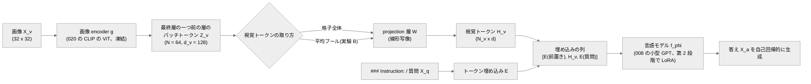

# 021. LLaVA 型 Vision-Language 連結と視覚指示チューニング / LLaVA-style Vision-Language Connection and Visual Instruction Tuning

## 1. 概要 / Overview

LLaVA(Large Language and Vision Assistant、Liu et al. [1])は、事前学習済みの画像 encoder と大規模言語モデル(Large Language Model)を、**projection 層**
という小さな写像でつなぐだけで、画像についての指示に答えるモデルを作る。画像 encoder のパッチ特徴を projection 層で言語モデルの
埋め込み空間に写し、テキストのトークン埋め込みと並べて言語モデルに入力する。学習は 2 段階で、第 1 段階(特徴の整列)では
projection 層だけを学習して視覚特徴を言語モデルの語彙の埋め込みと整列させ、第 2 段階(視覚指示チューニング)では projection 層と
言語モデルを学習して指示への応答を学ぶ。本トピックでは、020 の CLIP の画像 encoder(凍結)と 008 の小型 GPT を、この構成で
スクラッチ実装の部品からつなぎ、020 の合成のシーン(2 つの図形の色・形・位置関係)について規則で生成した質問(色・位置関係)に
答えさせる。貪欲復号による生成の完全一致を指標として、(A)第 1 段階が、第 2 段階の学習量を揃えたときの正解率を上げるか、
(B)視覚トークンをパッチトークンの格子全体から平均プールの 1 トークンに置き換えたときの正解率の低下が、色の質問より位置関係の
質問で大きいか、を検証する。

### 1.1 実行の手順

手順は付録 A。本番実行は Google Colab T4 の **1 つのセッションで完結** させる(予算は 120 分)。学習の前に、T4 上のスケーリングの計測(6.3 節)から、8 通りの **実行計画**(6.1 節。**削る段階** 0〜3 と学習率の較正の方式の組)のそれぞれについて残りの実行時間を見積もり、予算に収まる計画のうち優先順位の最も高いものを自動で選ぶ(6.4 節)。選択は見積もりのみに基づき、どの実験の結果も参照しない。**見積もりが最も下位の計画でも予算を超える場合は、学習の前に停止する。** 学習したモデルは、すべて条件間の比較のためのものであり、Hugging Face Hub にはアップロードしない。

### 1.2 本番実行の結果の要約

本番実行(Google Colab T4、コミット`7cc0ceb`、1 回、全体 45.1 分)では、8 通りの計画がすべて予算に収まり、最上位の **計画 0**(段階 0・
較正の方式`"all"`、P・R・L・M とも 5 シード)が選ばれた。事前に宣言した基準による最終判定は次のとおりである(7 節)。前提条件
(P0〜P3)は両実験ですべて成立しており、「前提不成立」ではない。

- **実験 A**(第 1 段階の効果): **判定不能**。対比量 $\Delta_A = -0.0116$ に対して閾値は $2\sigma_A = 0.0354$ で、支持の条件も反証の条件も
  満たさなかった。
- **実験 B**(視覚トークンの取り方 × 質問の種類): **判定不能**。対比量 $\Delta_B = +0.0683$ に対して閾値は $2\sigma_B = 0.1020$ で、支持の条件も
  反証の条件も満たさなかった。

以下は **事後的な解釈であり、検証済みの結論ではない**(7.6 節)。

- 第 1 段階の効果は、第 2 段階の開始時の検証集合の負の対数尤度(P 3.249・R 6.912)には大きく現れたが、第 2 段階の 25% の時点では差が
  なくなっていた(0.1443・0.1441)。総ステップ数を P に揃えた第 2 段階のみの条件 L(判定なしの診断量)の正解率が最も高かった
  (平均 0.8033。P 0.7266、R 0.7382)。
- 線形プローブ(判定なしの診断量)では、平均プールの特徴からも図形の配置が 0.80 の正解率で読み出せた。一方、平均プールの条件 M の
  位置関係の質問の正解率は 0.5205 にとどまった。ボトルネックは視覚トークンの情報ではなく、言語モデル側の学習にある可能性がある。
- 標準偏差のほとんどはシード間のばらつきであり(実験 B で 0.0506 のうちブートストラップは 0.0064)、位置関係の質問の正解率が
  シードによって大きく違った。

## 2. 参考論文 / References

1. Liu, H., Li, C., Wu, Q., Lee, Y. J., "Visual Instruction Tuning", NeurIPS 2023. https://arxiv.org/abs/2304.08485
   (LLaVA。本トピックの原典。3.1〜3.6 節、実験 A・B)
2. Liu, H., Li, C., Li, Y., Lee, Y. J., "Improved Baselines with Visual Instruction Tuning", CVPR 2024.
   https://arxiv.org/abs/2310.03744(LLaVA-1.5。2 層の多層パーセプトロンの projection 層。3.3 節)
3. Radford, A., Kim, J. W., Hallacy, C., Ramesh, A., Goh, G., Agarwal, S., Sastry, G., Askell, A., Mishkin, P., Clark, J., Krueger, G.,
   Sutskever, I., "Learning Transferable Visual Models From Natural Language Supervision", ICML 2021.
   https://arxiv.org/abs/2103.00020(CLIP。画像 encoder の由来。3.4 節)
4. Hu, E. J., Shen, Y., Wallis, P., Allen-Zhu, Z., Li, Y., Wang, S., Wang, L., Chen, W.,
   "LoRA: Low-Rank Adaptation of Large Language Models", ICLR 2022. https://arxiv.org/abs/2106.09685(第 2 段階の LoRA。3.5 節)
5. Alayrac, J.-B., Donahue, J., Luc, P., Miech, A., Barr, I., Hasson, Y., Lenc, K., Mensch, A., Millican, K., Reynolds, M., Ring, R.,
   Rutherford, E., Cabi, S., Han, T., Gong, Z., Samangooei, S., Monteiro, M., Menick, J., Borgeaud, S., Brock, A., Nematzadeh, A.,
   Sharifzadeh, S., Binkowski, M., Barreira, R., Vinyals, O., Zisserman, A., Simonyan, K.,
   "Flamingo: a Visual Language Model for Few-Shot Learning", NeurIPS 2022. https://arxiv.org/abs/2204.14198(3.7 節、位置づけのみ)
6. Li, J., Li, D., Savarese, S., Hoi, S.,
   "BLIP-2: Bootstrapping Language-Image Pre-training with Frozen Image Encoders and Large Language Models", ICML 2023.
   https://arxiv.org/abs/2301.12597(Q-Former。3.7 節、位置づけのみ)
7. Tsimpoukelli, M., Menick, J., Cabi, S., Eslami, S. M. A., Vinyals, O., Hill, F.,
   "Multimodal Few-Shot Learning with Frozen Language Models", NeurIPS 2021. https://arxiv.org/abs/2106.13884
   (凍結した言語モデルに視覚特徴を接頭の埋め込みとして与える先行例。3.7 節、位置づけのみ)
8. Alain, G., Bengio, Y., "Understanding intermediate layers using linear classifier probes", ICLR 2017 Workshop.
   https://arxiv.org/abs/1610.01644(線形プローブ。実験 B の診断量)
9. Dosovitskiy, A., Beyer, L., Kolesnikov, A., Weissenborn, D., Zhai, X., Unterthiner, T., Dehghani, M., Minderer, M.,
   Heigold, G., Gelly, S., Uszkoreit, J., Houlsby, N.,
   "An Image is Worth 16x16 Words: Transformers for Image Recognition at Scale", ICLR 2021.
   https://arxiv.org/abs/2010.11929(ViT。3.4・3.6 節)

## 3. 理論 / Theory

### 3.1 動機: 事前学習済みの部品を小さな写像でつなぐ

020 の CLIP は、画像とテキストを同じ埋め込み空間に写すが、できるのは「どの文がどの画像に対応するか」の判定(検索・zero-shot 分類)
までであり、画像について自由な形式の文を生成することはできない。一方、008 の小型 GPT のような言語モデルは文を生成できるが、
画像を入力に取れない。両者を **最初から一緒に学習し直す** のは、画像とテキストの組の大量のデータと計算を要する。

LLaVA(Liu et al. [1])は、事前学習済みの画像 encoder(CLIP の ViT-L/14)と事前学習済みの言語モデル(Vicuna)を、**どちらも
作り直さずに**、画像の特徴を言語モデルの入力の埋め込みの列に「単語のように」差し込むことでつなぐ。新しく学習するのは、画像の
特徴を言語モデルの埋め込みの次元に写す projection 層だけ(第 1 段階)と、指示に従うための言語モデルの調整(第 2 段階)である。
原論文は、指示データ(会話・詳細な説明・複雑な推論)を、画像のキャプションと物体の位置(bounding box)の記述を text-only の
GPT-4 に与えて生成した(画像そのものは GPT-4 に見せていない)。

本トピックでは、この構成を小さな規模でスクラッチ実装の部品から組み立てる。画像は 020 の合成のシーン(2 つの図形の色・形・位置関係)、
画像 encoder は 020 で学習した CLIP の画像 encoder(NegCLIP・シード 0、凍結)、言語モデルは 008 の小型 GPT である。指示データは、
原論文が GPT-4 に渡した「記号による画像の記述」に相当するシーンの意味(どの色のどの形が、どちらの側にあるか)から、規則で
質問と正解を作る(016 の合成の指示データと同じ考え方)。

### 3.2 全体の構成

**記号**(原論文の式 1〜3 の記号に従う):

- $X_v$: 画像。$X_q$: 指示(質問)、$X_a$: 答え(応答)。いずれもトークン列。
- $g$: 画像 encoder。$Z_v = g(X_v) \in \mathbb{R}^{N \times d_v}$ は画像のパッチ特徴の格子($N$ はパッチの数、$d_v$ は画像 encoder の
  隠れ次元)。どの層の特徴を使うかは 3.4 節。
- $W$: projection 層。$H_v = W \cdot Z_v \in \mathbb{R}^{N_v \times d}$ が **視覚トークン**($d$ は言語モデルの隠れ次元 $d_{\mathrm{model}}$、
  $N_v$ は視覚トークンの数。パッチトークン全体を使うなら $N_v = N$)。
- $H_q$: 指示のトークン埋め込みの列($H_q = E[X_q]$、$E$ は言語モデルのトークン埋め込み行列)。
- $f_\phi$: 言語モデル($\phi$ はそのパラメータ)。

LLaVA は、視覚トークン $H_v$ を指示の埋め込みの列 $H_q$ と **同じ系列に並べて** 言語モデルに入力し、答え $X_a$ を自己回帰的に生成する。
言語モデルから見ると、$H_v$ は「語彙にない単語」の埋め込みの列であり、言語モデル自体の構造は変わらない。

本トピックの系列は、016 のテンプレートに視覚トークンの枠を加えたものである(`<image>`の位置に $H_v$ を差し込む)。

```
### Instruction:
<image>
{質問}
### Response: {答え}
### End
```

`### Instruction:\n`(7 トークン)の直後に $N_v$ 個の視覚トークンを置くので、視覚トークンの枠の開始位置は全事例で共通である。



### 3.3 projection 層: 視覚特徴を言語モデルの埋め込み空間に写す

**線形写像(LLaVA [1])**: $H_v = Z_v W^\top + b$($W \in \mathbb{R}^{d \times d_v}$、$b \in \mathbb{R}^{d}$。$Z_v$ の各行(各パッチ)に同じ
写像を掛ける)。原論文は、これを「軽量な」接続として選び、より高度な接続(3.7 節の Flamingo の gated cross-attention や BLIP-2 の
Q-Former)は今後の課題とした。

**2 層の多層パーセプトロン(LLaVA-1.5 [2])**: $H_v = \mathrm{GELU}(Z_v W_1^\top + b_1) W_2^\top + b_2$。LLaVA-1.5 は、線形写像を
2 層の多層パーセプトロン(Multi-Layer Perceptron)に替えると、ベンチマークの性能が上がったと報告している。自己教師あり学習で
線形の射影頭を多層パーセプトロンに替えると表現が良くなるのと同様に、表現力の高い接続が有効であったと説明されている。

**写像の意味**: 言語モデルの入力の埋め込み空間では、トークン埋め込み行列 $E$ の各行が 1 つの語彙を表す。projection 層は、
視覚特徴をこの空間の中の「言語モデルが解釈できる位置」に置く役割を持つ。projection 層の出力は、$E$ のどの行とも一致する必要は
なく(連続的な「ソフトな単語」)、言語モデルの後段の層が、そこから必要な情報を読み出せればよい。第 1 段階(3.5 節)は、
キャプションの生成を通じて、この配置を学習する段階である。

**本トピックの扱い**: 実験では線形写像($d_v = 128 \to d = 256$、パラメータ数 $128 \times 256 + 256 = 33{,}024$)のみを使う。
2 層の多層パーセプトロンとの比較は **理論のみ** とし、判定を置かない(`src/models/llava.py`の`VisualProjection`は`kind="mlp"`で
2 層の版も構築できるが、実験では使わない)。

### 3.4 どの層の特徴を視覚トークンにするか

**原論文の選び方**: LLaVA は、CLIP の画像 encoder の **最終層の一つ前の層** の出力の格子特徴(パッチトークン)を使い、最終層の
特徴は使わない。原論文のアブレーション(ScienceQA)では、最終層の特徴を使うと正解率が一つ前の層より約 1 ポイント低かった。
著者らは、CLIP の最終層の特徴は画像全体の大域的・抽象的な性質に寄り、一つ前の層の特徴は細部の理解に役立つ局所的な性質を
保っているためだろうと説明している。CLIP の対照学習の損失が評価するのは画像全体の 1 つの埋め込みだけなので、最終層ほど
その目的に特化しやすい、という見方である。

**020 の画像 encoder での事情**: 020 の画像 encoder は、[CLS] トークンの最終層の表現 $y = \mathrm{LN}(z_L^0)$ だけを射影して埋め込みに
する(019 の式 4)。最終層($L = 4$ 層目)の **パッチの位置の出力** $z_L^1, \dots, z_L^N$ は、その後どこにも使われない。損失の勾配は
最終層のパッチの位置の計算を通らず、これらの出力は学習の目的から直接には制約されない。一方、最終層の一つ前の層のパッチトークン
$z_{L-1}^1, \dots, z_{L-1}^N$ は、最終層で [CLS] トークンが自己注意で参照する Key・Value になるので、「[CLS] トークンに画像の情報を
渡す」ように学習されている。[CLS] トークンで読み出すモデルでは、原論文の経験的な選び方に、この構造上の理由が加わる。本トピックは
原論文に従い、最終層の一つ前の層($L - 1 = 3$ ブロックを通した後)の残差の流れ(最終正規化の前)から、[CLS] トークンを除いた
$N = 64$ 個のパッチトークンを使う。

**位置の情報は直接の学習目標ではない**: 020 の対照学習は、画像全体の埋め込み(1 本のベクトル)とキャプションの埋め込みの一致を
学習する。キャプションには位置関係(`left of`・`above`)が含まれるので、[CLS] トークンの埋め込みは位置関係を表す必要があるが、
**各パッチトークンが自分の位置の内容を保っていること** は損失の対象ではない。パッチトークンには入力の時点で位置埋め込みが加わって
いるが、3 層の自己注意を経た後に、どのパッチトークンがどの位置の何を表しているかが線形に読み出せる形で残っているかは、学習の
目標から直接には保証されない。実験 B の診断量(パッチトークンから図形の位置を当てる線形プローブ、Alain & Bengio [8])は、この点を
確かめるためのものである。

### 3.5 2 段階の学習

**損失**(原論文の式 3): 答え $X_a = (x_1, \dots, x_L)$($L$ は答えのトークン数)について、

$$
p(X_a \mid X_v, X_q) = \prod_{i=1}^{L} p_\theta\left(x_i \mid X_v, X_q, X_{a,<i}\right), \qquad
\mathcal{L}(\theta) = -\sum_{i=1}^{L} \log p_\theta\left(x_i \mid X_v, X_q, X_{a,<i}\right)
$$

を最小化する。$\theta$ は学習するパラメータ、$X_{a,<i}$ は答えの $i$ 番目より前のトークンである。損失は **答えのトークンだけ** に掛け、
指示(と視覚トークン)の位置には掛けない(016 の損失マスク)。バッチの損失は、バッチ内の答えのトークンの数で割った平均とする
(016 の $\mathcal{L}_{\mathrm{mask}}$ と同じ正規化)。答えの終端記号(`### End`)も予測の対象に含める。

**第 1 段階: 特徴の整列のための事前学習(Pre-training for Feature Alignment)**

- 学習するもの: projection 層 $W$ のみ($\theta = W$)。画像 encoder と言語モデルは凍結する。
- データ: 画像とキャプションの組を、「画像を短く説明せよ」という指示とキャプションの答えの形に直したもの。原論文は CC3M から
  選んだ約 59.5 万組を 1 エポック学習した。
- 目的: 言語モデルを変えずに、視覚トークン $H_v$ を、言語モデルがその画像のキャプションを生成できるような埋め込みの位置に置く。
  原論文はこれを「凍結した言語モデルのための、互換性のある visual tokenizer を学習する」段階と説明している。言語モデルが凍結
  されているので、第 1 段階の後の視覚トークンは、言語モデルが元々持っている語彙の埋め込みの使い方に合わせた配置になる。

**第 2 段階: 視覚指示チューニング(Fine-tuning End-to-End)**

- 学習するもの: 原論文は projection 層と **言語モデルの全パラメータ**($\theta = \{W, \phi\}$)。画像 encoder は凍結のまま。
- データ: GPT-4 で生成した指示データ約 15.8 万件(会話・詳細な説明・複雑な推論)。原論文は 3 エポック学習した。
- 目的: 指示に従って、画像の内容に基づいて答えることを学ぶ。

**本トピックの対応と相違**:

| 項目 | 原論文(LLaVA) | 本トピック |
|---|---|---|
| 画像 encoder | CLIP ViT-L/14(凍結) | 020 の CLIP の画像 encoder(ViT、$P = 4$、凍結) |
| 言語モデル | Vicuna(13B) | 008 の小型 GPT(4 層、$d_{\mathrm{model}} = 256$、約 525 万パラメータ) |
| projection 層 | 線形写像 | 線形写像(同じ) |
| 第 1 段階のデータ | CC3M の画像とキャプション | 合成のシーンと 020 の正準形のキャプション |
| 第 2 段階のデータ | GPT-4 で生成した指示データ | シーンの意味から規則で生成した質問と答え(色・位置関係) |
| 第 2 段階で学習するもの | projection 層 + 言語モデルの全パラメータ | projection 層 + 言語モデルの Query・Value 射影への LoRA |

**第 2 段階の LoRA(相違)**: 本トピックは、言語モデルの全パラメータを更新する代わりに、012・016 と同じ LoRA(Low-Rank
Adaptation、Hu et al. [4])を、各層の自己注意の Query 射影 $W_q$ と Value 射影 $W_v$ に掛ける(rank $r = 8$、$\alpha = 8$、学習可能な
パラメータは $2 \cdot 4 \cdot 8 \cdot (256 + 256) = 32{,}768$)。理由は次のとおり。

- 同じ言語モデルでの既存の結果がある。016 では、この小型 GPT の Query・Value への $r = 8$ の LoRA による指示チューニングで、
  モデルが指示を読んで出力を切り替えるようになった(016 の実験 A、支持)。012 では、同じ設定の LoRA の改善幅は全パラメータの
  微調整の約 0.68 倍にとどまり(012 の実験 A、反証)、rank の効果は $r = 8$ 付近から逓減した(012 の実験 C、支持)。つまり、この
  設定は指示への応答を学ぶには足りたが、全パラメータの更新と同等ではない。
- 視覚トークンを使うには、言語モデルが答えの位置から視覚トークンの位置を参照する必要がある。Query・Value 射影は、自己注意が
  **どこを見るか**(Query と Key の内積)と **何を受け取るか**(Value)を直接変えるので、この適応に直接作用する。
- 全パラメータの更新は、本トピックの小さな合成データでは事前学習の言語の能力を壊しやすく、また学習可能なパラメータ数が
  約 525 万に増えて、凍結した部品を小さな写像でつなぐという LLaVA の構図からも離れる。

この相違により、第 2 段階で言語モデルが変われる範囲は原論文より狭い。実験 A の第 1 段階の効果は、この制約のもとでの効果である。

**指示データの生成(相違)**: 原論文は、画像を記号で記述したもの(キャプションと bounding box)を text-only の GPT-4 に渡して
指示データを作った。本トピックは、シーンの意味(2 つの図形の色・形と、左右・上下のどちらに並ぶか)から規則で作る。

- **色(属性)の質問**: 形で指定した図形の色を答える(例: `What color is the circle?` → `red`)。答えは 8 色のいずれか。
- **位置関係の質問**: 形で指定した図形 A が、もう一方の図形 B に対してどこにあるかを答える
  (例: `Where is the circle relative to the square?` → `left`)。答えは`left`・`right`・`above`・`below`のいずれか。

2 つの図形は色も形も異なる(020)ので、形で図形が一意に決まる。1 枚の画像から色の質問 2 個(各図形)・位置関係の質問 2 個(各図形を
A にしたもの)を作り、質問の種類ごとに 2 個のテンプレートを用意する(5.4 節)。数の質問は加えない(どの画像も図形は 2 個で、
答えが常に同じになるため)。

### 3.6 視覚トークンの数・文脈長・計算量

**視覚トークンの数**: 019 のとおり、画像 $H \times W$ をパッチサイズ $P$ で分割したパッチの数は $N = HW/P^2$ である。パッチトークンの
格子全体を視覚トークンにすると $N_v = N$ となり、言語モデルの系列長がその分だけ増える。原論文の CLIP ViT-L/14(224 画素)では
$N = 224^2 / 14^2 = 256$、LLaVA-1.5 の 336 画素では $N = 336^2 / 14^2 = 576$ である。本トピックの画像 encoder は $32 \times 32$・$P = 4$ なので
$N = 1024 / 16 = 64$ である。

**文脈長**: 系列長 $S$ は、テキストの部分(前置き・質問・答え)のトークン数 $S_t$ と $N_v$ の和 $S = S_t + N_v$ で、言語モデルの文脈長
$S_{\max}$(008 のモデルでは 256)以下でなければならない。5.4 節で、全事例の $S$ と、生成の上限トークン数を加えた長さが
$S_{\max}$ 以下であることをアサーションで確かめる。

**計算量**: 001 のとおり、自己注意のスコアの計算量は 1 層あたり $O(S^2 d)$、Query・Key・Value・出力の射影と順伝播ネットワーク
(Feed-Forward Network)は $O(S d^2)$ である。視覚トークンを $N_v$ 個加えると、前者は $(S_t + N_v)^2 / S_t^2$ 倍、後者は
$(S_t + N_v) / S_t$ 倍になる。本トピックでは $S_t$ が 30〜45 程度なので、パッチトークン全体($N_v = 64$)の系列は平均プール
($N_v = 1$)の系列の 2 倍以上の長さになる(5.4 節で実測する)。高解像度の画像ほど $N$ が増えるので、視覚トークンの数を減らす
手法(平均プール、3.7 節の Perceiver Resampler や Q-Former)は計算量の面で動機づけられる。実験 B は、その代償として何が失われるかを
調べる。

**平均プール**: $\bar{z} = \frac{1}{N} \sum_{n=1}^{N} z_n$($z_n$ は $Z_v$ の $n$ 行目)を 1 個の視覚トークンにする($N_v = 1$)。
平均は各パッチトークンの和なので、パッチトークンが **位置と内容を組にした特徴**(例: 「左側に円がある」)を持っていれば、その
情報は平均にも残りうる。一方、位置の情報が「どのトークンに載っているか」(系列の中の位置)だけで表されているなら、平均を取ると
失われる。色のように、図形の内容そのもの(形と色の結びつき)で決まる情報は、位置が失われても残りうる。実験 B の仮説
(位置関係の質問で、平均プールによる低下が大きい)は、この非対称に基づく。

### 3.7 位置づけのみ扱うもの

- **Flamingo**(Alayrac et al. [5]): 凍結した言語モデルの層の間に、新しく **gated cross-attention** の層を挿入し、言語モデルのトークンが
  視覚特徴を交差注意(cross-attention)で参照する。視覚トークンを系列に並べる LLaVA と違い、言語モデルの系列長は変わらない。挿入した
  層の出力には $\tanh$ のゲート(初期値 0)を掛け、学習の開始時に凍結した言語モデルの出力を変えないようにする。視覚特徴は
  Perceiver Resampler で、画像の大きさによらない固定の数(64 個)の視覚トークンに圧縮してから参照する。
- **BLIP-2**(Li et al. [6]): 凍結した画像 encoder と凍結した言語モデルの間に、**Q-Former**(学習可能な 32 個の Query を持つ小さな
  Transformer)を置く。Query は交差注意で画像の特徴を参照し、32 個の出力を線形写像で言語モデルの入力の埋め込みに写す。視覚トークンの
  数が画像のパッチの数によらず 32 個に圧縮される点で、パッチトークン全体を渡す LLaVA と対照的である。Q-Former は、画像とテキストの
  表現学習(対照学習などを含む)の段階と、凍結した言語モデルを使った生成の段階の 2 段階で学習する。
- **Frozen**(Tsimpoukelli et al. [7]): 凍結した言語モデルに、学習した画像 encoder の出力を **接頭の埋め込み**(visual prefix)として
  与える。視覚特徴を埋め込みの列として言語モデルに入れる点で LLaVA の先行例である(ただし Frozen は画像 encoder 側を学習する)。

本トピックの実験 B の「平均プール」は、Perceiver Resampler や Q-Former のような学習する圧縮ではなく、最も単純な固定の圧縮である。

### 3.8 アルゴリズム

画像のパッチ特徴を、凍結した画像 encoder の最終層の一つ前の層から 1 回だけ計算し、projection 層で言語モデルの埋め込み空間に写して視覚トークンとし、指示の接頭部分と質問のトークン埋め込みの列の間に差し込んで、凍結した言語モデルに通す。第 1 段階は projection 層のみ、第 2 段階は projection 層と Query・Value への LoRA を、答えのトークンだけの負の対数尤度で学習する。評価は、指示部分(視覚トークンを含む)から貪欲法で終端記号まで生成し、答えが正解と完全一致すれば正答とする。擬似コードは付録 F.1。

## 4. 実装方針 / Implementation Policy

**`src/`に切り出す(スクラッチ実装、本トピックで新規作成)**:

- `src/data/visual_instruction.py`: 視覚指示データの生成と符号化(シーンの意味から色・位置関係の質問と答えを作る、第 1 段階のキャプションの事例、画像を見ない戦略の正解率の上界、接頭部分・視覚トークンの枠・接尾部分・応答部分を別々に符号化して固定長のテンソルにする、ステップごとのミニバッチの添字)。区切り記号と終端記号は 016 の`src/data/instruction.py`のものを使う。
- `src/models/llava.py`: 凍結した画像 encoder の指定した層のパッチトークンの取り出し、projection 層`VisualProjection`、埋め込みの列から言語モデルを順伝播する`language_model_hidden_states()`、視覚トークンを枠に差し込んで言語モデルに通す`LlavaStyleModel`(パッチトークン全体 / 平均プールの切り替え)、視覚トークンを含む指示部分から終端記号まで貪欲法で生成する関数。既存の`forward()`は変更しない。
- `src/training/visual_instruction_tuning.py`: 応答部分のトークンだけの損失、2 つの段階で共通の学習ループ、教師強制の負の対数尤度の評価、生成による評価。

**既存モジュールの変更**: なし。画像 encoder は 019 の`VisionTransformer`(020 の`CLIPDualEncoder`の`vision`)、言語モデルは 008 の`GPTLanguageModel`、LoRA は 012 の`apply_lora()`をそのまま使う。

**ノートブック内に直接書く(021 固有)**: 条件の定義・学習率の較正・判定・可視化・スケーリングの計測、線形プローブ(実験 B の診断量)。本トピックで学習するモデルは、すべて条件間の比較のためのものなので、保存もアップロードもしない。モジュールごとの詳しい説明、生成物の置き場所、外部からの取得(画像 encoder は 020 の Hub のモデル、言語モデルは 008)は付録 D・F。

## 5. 実装 / Implementation

### 5.1 環境セットアップ(Google Colab)

`SMOKE_TEST`(スモークテストか本番か)はこのセルでのみ切り替え、実行環境をこのセルで 1 回だけ印字する。学習・評価はすべて FP32 で行い、`torch.use_deterministic_algorithms(True)`は使わない。同じシードの学習を繰り返しても結果が bit 単位では一致しないことがあるが、条件間の対応付けは乱数の生成器によって決まり、演算の決定性には依存しない(6.10 節で確かめる。詳細は付録 F.3)。

### 5.2 スケールの設定(`SMOKE_TEST`の配線)

スモークテストは、本番と同じステップ数・同じデータ・同じモデルで行い、縮小するのはシード数(本番は 5、削った段階で 3 / スモークテストは 3、削った段階で 2)とブートストラップの反復回数(本番 10,000 回 / スモークテスト 1,000 回)だけである。縮小の規則の詳細は付録 A.2。

### 5.3 画像 encoder・言語モデル・トークナイザの取得

- 画像 encoder: `kojikojiprg/ai-theories-clip-synthetic-scenes`の`main`(020 の NegCLIP・シード 0)。`config.json`から`CLIPDualEncoder`を
  構築して重みを読み込み、`vision`(019 の`VisionTransformer`)だけを使う。`model_state.pt`の SHA-256 が 020 のモデルカードの値と
  一致することを確かめる。画像 encoder のパラメータはすべて`requires_grad=False`にする。
- 言語モデル: `kojikojiprg/ai-theories-small-gpt-en`の`main`(008)。モデルの構成は取得した`config.json`から読む。各条件は
  Hub から読み込み直す代わりに、読み込んだ重みの複製から始める。
- トークナイザ: `kojikojiprg/ai-theories-tokenizer-en`。

### 5.4 データ: 合成のシーン・質問・符号化・パッチ特徴

- **シーン**: 020 の`src/data/synthetic_scenes.py`の生成器を使い、020 の画像 encoder の学習データに合わせて、**学習用のキャプション 1,444 個**(020 で除外した (色, 形) の組を含まないもの)の意味だけを使う。学習用(各キャプション 8 枚)・検証用(各 1 枚)・評価用(各 1 枚)は別のシードで描くので、同じ意味でも画素は異なり、020 の画像 encoder が学習中に見た画像そのものではない。
- **質問**: 各画像から、色の質問 2 個・位置関係の質問 2 個(3.5 節)。テンプレートは質問の種類ごとに 2 個で、画像の添字と図形の添字から決定的に割り当てる。
- **テンプレートの既知性の分割**: 学習用と評価用は **画像で** 分け、テンプレート・答えの語彙・意味(キャプション)の集合は共通にする。各テンプレートは学習用・評価用のどちらでも同じ割合(各 1/2)で現れ、評価用のすべての答えは学習用にも現れる(アサーション)。020 の実験 B では、比べる 2 つの負例の一方だけが学習で見たキャプションであったため、「既知かどうか」が比較に交絡した。本トピックでは、どの条件・どの質問の種類でも、評価の事例は「既知のテンプレート・既知の答えの語彙で、未知の画像に答える」ものに揃う。
- **画像を見ない戦略の上界**: 評価集合で、質問の文字列ごとに最も多い答えを返す戦略の正解率を、全体と質問の種類ごとに印字する。
- **符号化とパッチ特徴**: 接頭部分・視覚トークンの枠・接尾部分・応答部分を別々に符号化して連結し(各部分の復号が元の文字列と一致すること、系列長が言語モデルの文脈長 256 以下であることを確かめる)、画像 encoder は凍結しているので、全画像の最終層の一つ前の層のパッチトークンを一度だけ計算し、学習・評価で再利用する。
- **画像の差し替え**(前提条件 P2): 評価用の画像の固定の置換。どの画像も、自分と異なる意味(キャプション)の画像に移る。

詳細は付録 F.5。


    

    


### 5.5 モデルの構築と不変条件の確認

学習の部品(`build_llava()`・`add_lora()`・`train_stage1()`・`train_stage2()`)を定義し、埋め込みの列からの順伝播が既存の`GPTLanguageModel.forward()`と bit 単位で一致すること、視覚トークンの差し込み、パッチ特徴の層(最終層の一つ前であること)、平均プール、損失の参照実装との一致、LoRA の初期値($B = 0$)、凍結、KV キャッシュを使う生成の一致、同じシードの条件の初期値の一致を、アサーションで確かめる(詳細は付録 F.6)。

### 5.6 学習と評価のヘルパー

1 つの学習は`(条件, シード)`の組で表す。`run_condition()`が、projection 層の構築 → (第 1 段階)→ LoRA を掛ける → 第 2 段階 → 評価を行い、記録を返す。第 2 段階の開始時・途中(25%・50%・75%)・終わりに検証集合の負の対数尤度を記録する。評価(`purpose="main"`のときのみ)は、評価集合の全 5,776 事例を生成で採点し、続いて画像を差し替えた評価(前提条件 P2)を行う。較正の学習は評価集合を一切評価しない(詳細は付録 F.6)。

### 5.7 線形プローブ(実験 B の診断量)

凍結した画像 encoder の最終層の一つ前の層の特徴から、次の 2 つの量を多クラスのロジスティック回帰(線形プローブ、Alain & Bengio [8])で
当てる。言語モデル・projection 層とは独立で、学習の条件にもシードにもよらない。

| 標的 | クラス | 必要な情報 |
|---|---|---|
| 配置(`layout`) | 位置関係の種類(左右 / 上下)× 左(または上)の図形の形 = $2 \times 5 = 10$ | どの形がどちらの側にあるか(位置と形の結びつき) |
| 形の組(`shape_pair`) | 2 つの図形の形の組(順序なし)= $\binom{5}{2} = 10$ | 位置によらない内容 |

入力は、パッチトークンの格子全体を平坦化したもの($64 \times 128 = 8{,}192$ 次元)と平均プール(128 次元)の 2 通り。学習用の画像の特徴を
学習用の平均と標準偏差で標準化し、重みとバイアスを 0 で初期化して、全バッチの AdamW(学習率 $10^{-2}$、重み減衰 $10^{-4}$)で
500 ステップ学習する。評価用の画像で正解率を測る。2 つの入力の次元が違うので、プローブの容量も違う(格子全体のほうが大きい)。
「平均プールでは配置が当たらないが形の組は当たる」なら、平均プールで失われるのが位置の情報であることを示唆する。

## 6. 実験 / Experiments

### 6.1 実験宣言セル: 共通の設定・検証すること・判定基準・前提条件

**この節の内容は本番実行の前に確定させ、結果を見た後に変更しない。** パイロット(6.2 節)を受けて決めた設定は、本番実行の前に決めたものであり、6.2 節に経緯を記録した。共通の設定の詳細、較正の規則、前提条件の閾値の根拠、判定の形の導出、実行計画の理由、実験ごとの宣言の補足は付録 B・C。

#### 共通の設定

- **画像 encoder**: 020 の CLIP の画像 encoder(NegCLIP・シード 0、`kojikojiprg/ai-theories-clip-synthetic-scenes`の`main`)。凍結する。最終層の一つ前の層(3 ブロックを通した後、最終正規化の前)のパッチトークン $N = 64$ 個(各 $d_v = 128$ 次元)を使う(3.4 節)。
- **言語モデル**: 008 の小型 GPT(`kojikojiprg/ai-theories-small-gpt-en`の`main`、4 層、$d = 256$、文脈長 256)とトークナイザ。**projection 層**: 線形写像 $128 \to 256$。
- **第 1 段階**: projection 層のみを学習する。データは学習用の画像とキャプション(5.4 節)。ステップ数 $T_1 = 722$(キャプションのデータの 2 エポック)。学習率は $6.4 \times 10^{-2}$ に **固定** し、較正しない(下の「学習率の較正」)。
- **第 2 段階**: projection 層と、言語モデルの Query・Value 射影への LoRA($r = 8$、$\alpha = 8$)を学習する。データは学習用の画像の質問と答え(色・位置関係)。ステップ数 $T_2 = 1{,}444$(質問のデータの 1 エポック)。学習率は条件ごとに較正する。
- **学習の部品**: AdamW(重み減衰 0)、バッチ 32 事例、最初の 10% のステップで線形 warmup の後 cosine で最大値の 0.01 倍まで減衰、gradient clipping の閾値 1.0、FP32。損失は答えのトークンだけの負の対数尤度の平均(3.5 節)。
- **シード**: シード $s$ が決めるのは、projection 層・LoRA の初期化と、第 1 段階・第 2 段階のミニバッチの順序である。同じシードの条件どうしはこれらを共有する(対応のある比較。6.10 節で確かめる)。数は削る段階で決まる。
- **評価集合**: 学習用・検証用と別の乱数シードで描いた評価用の画像 1,444 枚の質問 5,776 個(色 2,888 個・位置関係 2,888 個)。テンプレートと答えの語彙は学習用と同じで、画像だけが学習で見ていないものである(5.4 節)。**正解率** は、指示部分(視覚トークンを含む)から貪欲法で生成し(上限 12 トークン)、終端記号`### End`の前の単語の列が正解と完全一致した割合(016 の完全一致)。$\mathrm{acc}_{c,s}$ は条件 $c$・シード $s$ の評価集合全体、$\mathrm{acc}^{\mathrm{color}}_{c,s}$・$\mathrm{acc}^{\mathrm{spatial}}_{c,s}$ は色・位置関係の質問だけの正解率である。
- **検証集合**: 評価集合と別の乱数シードで描いた画像 1,444 枚の質問(第 2 段階)とキャプション(第 1 段階)。学習率の較正と前提条件 P1 にのみ使う。**評価集合は較正に使わない。**

#### 条件の対応表

| 記号 | 視覚トークン | 第 1 段階 | 第 2 段階のステップ数 | 使う実験 |
|---|---|---|---|---|
| P | パッチトークン全体($N_v = 64$) | あり($T_1$) | $T_2$ | 実験 A の条件 1・実験 B の条件 1 |
| R | パッチトークン全体($N_v = 64$) | なし(projection 層は乱数の初期値) | $T_2$ | 実験 A の条件 2 |
| L | パッチトークン全体($N_v = 64$) | なし(projection 層は乱数の初期値) | $T_1 + T_2$ | 実験 A の診断量(判定なし) |
| M | 平均プール($N_v = 1$) | あり($T_1$) | $T_2$ | 実験 B の条件 2 |

数式の添字の $c \in \{P, R, L, M\}$ はこの表の記号である。

#### 学習率の較正(本番の冒頭、6.5 節)

- **第 1 段階の学習率は較正しない**($6.4 \times 10^{-2}$ に固定、全条件・全シードで共通)。6.2 節のパイロットで、第 1 段階の検証集合のキャプションの負の対数尤度は、学習率を 32 倍変えても条件内の相対差が 5% 以内(平均プールでは 0.3% 以内)で、内点の最良値が定まらなかったためである。規則で決めた値なので、第 1 段階の学習率は P0 の対象外である。この値が最適からずれたときの対比量への偏りは、実験 A では P のみが第 1 段階を持つので **負の向き**(第 1 段階の効果を過小に見る側)、実験 B では P・M の両方に効き、向きは事前には定まらない。
- **第 2 段階の格子**: 条件 $c$ の中心 $\eta_{2,c}$(P・R・M とも $8 \times 10^{-3}$、6.2 節のパイロットで決めた)の $\{1/2, 1, 2\}$ 倍(公比 2 の 3 点)。本番と同じステップ数・全学習データで、**較正専用のシード**(シード番号 90)の 1 シードで各格子点を学習し、**検証集合の答えのトークンあたりの負の対数尤度**(教師強制)が最小の学習率を選ぶ(同点なら小さい方。生成の正解率は較正に使わない)。最良が格子の端に来た場合は、公比 2 で 1 点だけ拡張する(1 回のみ)。
- **較正の方式**`CALIBRATION_MODE`(選ばれた実行計画から決まる): `"all"`は第 2 段階の P・R・M の 3 つをそれぞれ較正し(L は R の値を使う)、`"representative"`は第 2 段階の P だけを較正し、R・L・M には P の値を使う(規則で決める)。詳細は付録 B.2。

#### 共通の前提条件

- **P0(較正)**: 較正した各条件で、選んだ学習率が格子の **内点** であること(拡張後も最良が端なら不成立)。対象は、その実験の条件の第 2 段階の学習率を決めた較正(実験 A: P・R、実験 B: P・M)。`"representative"`で規則で決めた条件は **対象外** になる。
- **P1(学習の成立)**: その実験の全条件・全シードの学習で、(a)損失がすべてのステップで有限であり、(b)第 2 段階の後の検証集合の答えの負の対数尤度(トークンあたり)が、第 2 段階の開始時の値の 0.5 倍以下であること。第 1 段階を行う条件では、加えて(c)第 1 段階の後の検証集合のキャプションの負の対数尤度が、第 1 段階の開始時の値より **小さい** こと。
- **P2(視覚への依存)**: その実験の各条件で、評価集合の各事例の画像を **別の画像に差し替えた** ときの正解率のシード平均が **0.5 以下** であること(画像を見ずに質問の文字列だけから答える戦略の正解率の上界は約 0.2)。
- **P3(改善の余地)**: 基準となる条件の値が上限 1 から十分に離れていること。差ではなく基準の条件の値で定義する。実験 A: R の評価集合の正解率のシード平均 $\overline{\mathrm{acc}}_{R} \le 0.95$。実験 B: M の位置関係の質問の正解率のシード平均 $\overline{\mathrm{acc}}^{\mathrm{spatial}}_{M} \le 0.95$。

前提条件が 1 つでも成立しない実験は、判定関数の結果によらず **前提不成立** と記録する(判定不能とは区別する)。P1 の(b)・(c)の定義の理由と P3 の閾値の根拠は付録 B.3。

#### 判定の形と標準偏差の単位

各実験の対比量 $\Delta$ とその標準偏差 $\sigma$ に対し、$\Delta > 2\sigma$ なら **支持**、$\Delta < -2\sigma$ なら **反証**、それ以外は **判定不能** とする。$\sigma$ は、**シード間の分散** と、評価の単位を復元抽出する **対応付きのブートストラップの分散** の和の平方根とする(013・018 と同じ形)。

$$
\sigma^2 = \frac{s_d^2}{S} + \mathrm{Var}_{\mathrm{boot}}(\Delta^{*})
$$

$d_s$ はシード $s$ の対比量、$s_d^2$ はその標本分散(自由度 $S - 1$)、$S$ はシード数。第 1 項は学習の乱数(初期化・ミニバッチの順序)によるばらつき、第 2 項は評価集合の抽出によるばらつきで、評価の単位は **画像**(1 枚の画像の 4 つの質問は同じ画像を共有して相関するので、画像をクラスタとして復元抽出する。全条件・全シードに同じ再標本を使い、反復は本番 10,000 回)。2 つの項は独立とみなして足す(導出と注意は付録 B.4)。

#### 実行計画(削る段階と較正の方式の組)と、その自動選択

**削る段階**:

| 段階 | 内容 | 実験 A のシード数 $S_A$(R) | 実験 B のシード数 $S_B$(M) | P のシード数 | L(診断量) |
|---|---|---|---|---|---|
| 0 | 全実験 5 シード | 5 | 5 | 5 | 5 シード |
| 1 | L を除く | 5 | 5 | 5 | なし |
| 2 | 段階 1 に加え、実験 A のシード数を 3 にする | 3 | 5 | 5 | なし |
| 3 | 段階 2 に加え、実験 B のシード数を 3 にする | 3 | 3 | 3 | なし |

P は実験 A・B で共有するので、そのシード数は $\max(S_A, S_B)$ である。**実行計画** は次の 8 通りで、優先順位の高い順に番号を付ける。計画 0〜3 は較正の方式`"all"`で段階 0〜3、計画 4〜7 は **下位の計画** で、較正の方式`"representative"`で段階 0〜3 である。

| 計画 | 0 | 1 | 2 | 3 | 4 | 5 | 6 | 7 |
|---|---|---|---|---|---|---|---|---|
| 段階 | 0 | 1 | 2 | 3 | 0 | 1 | 2 | 3 |
| 較正の方式 | all | all | all | all | representative | representative | representative | representative |

**選択の規則**: 本番の学習を始める前に(6.4 節)、スケーリングの計測(6.3 節)から、各計画の残りの実行時間を見積もり、それまでの経過時間を足して予算(T4 で 120 分)以内に収まる計画のうち **番号の最も小さい** ものを選ぶ。計画 7 でも超える場合は、学習の前に例外で停止する。**選択は見積もりのみに基づき、どの実験の結果も参照しない。** 段階の順序の理由、較正の方式を最後に変える理由、学習量を下げる段階を設けない理由は付録 C.1。

#### 実験 A: 第 1 段階(特徴の整列)の効果

**検証すること**: 第 2 段階の前に第 1 段階(projection 層のみの学習)を行うと、第 2 段階のステップ数を揃えたとき、評価集合の正解率が上がる(Liu et al. [1] のアブレーションで、第 1 段階を省くと正解率が下がったことに対応する)。

**条件**: P(第 1 段階 → 第 2 段階)と R(第 2 段階のみ。projection 層は乱数の初期値)。第 2 段階のステップ数・データ・ミニバッチの順序・LoRA と projection 層の初期値は同じシードで揃う。

**判定基準**: $d_s = \mathrm{acc}_{P,s} - \mathrm{acc}_{R,s}$、$\Delta_A = \frac{1}{S_A} \sum_{s} d_s$(仮説の向きは $\Delta_A > 0$)。$\sigma_A$ は「判定の形」のとおり(評価の単位は画像、評価集合の全 5,776 事例)。$\Delta_A > 2\sigma_A$ なら支持、$\Delta_A < -2\sigma_A$ なら反証、それ以外は判定不能。

**前提条件**: P0(第 2 段階の P・R)、P1(P・R の全シード)、P2(P・R)、P3($\overline{\mathrm{acc}}_{R} \le 0.95$)。

**介入の直接の作用点**: 介入(第 1 段階)が直接作用するのは第 2 段階の開始時の projection 層(視覚トークンの配置)で、その直接の帰結は第 2 段階の開始時の検証集合の答えの負の対数尤度である。対比量の正解率は第 2 段階の学習を経た下流の量で、開始時の差が学習で縮むと、作用点で差があっても対比量の差は小さくなる。原論文の主張は第 2 段階の後の性能についてのものなので対比量とし、作用点に近い量(第 2 段階の開始時と途中の検証集合の負の対数尤度、第 1 段階の後の視覚トークンのノルム)を診断量として併記する。

**解釈の注意**: 揃えた量は第 2 段階のステップ数・見る事例・学習するパラメータ・初期値で、**揃えなかった量** は総ステップ数(P は $T_1 + T_2$、R は $T_2$)と、P が第 1 段階で見るキャプションのデータである。P の優位は「第 1 段階の目的の効果」と「単に projection 層を長く学習した効果」の和でありうる(交絡)。これを分離する水準として、L(第 1 段階なしで第 2 段階を総ステップ数 $T_1 + T_2$ だけ学習する。診断量、判定なし)を置く。R は乱数の初期値の projection 層から始めるので P より収束が遅いと予想され、$T_2$ で学習が飽和していなければ差は到達点の差ではなく速さの差を含む。`"representative"`の計画が選ばれた場合は、R の学習率が P の値になり、$\Delta_A$ は **正の向き(支持の側)** に偏りうる。

#### 実験 B: 視覚トークンの取り方 × 質問の種類

**検証すること**: 視覚トークンを、パッチトークンの格子全体(P、$N_v = 64$)から、同じ層のパッチトークンの平均プール(M、$N_v = 1$)に置き換えたときの正解率の低下は、色の質問より位置関係の質問で大きい(3.6 節の非対称)。

**条件**: P と M。どちらも第 1 段階 → 第 2 段階で、ステップ数・データ・ミニバッチの順序・projection 層と LoRA の初期値は同じシードで揃う。違いは視覚トークンの取り方だけである。

**判定基準**: 色の質問の正解率の差を $c_s = \mathrm{acc}^{\mathrm{color}}_{P,s} - \mathrm{acc}^{\mathrm{color}}_{M,s}$、位置関係の質問の差を $p_s = \mathrm{acc}^{\mathrm{spatial}}_{P,s} - \mathrm{acc}^{\mathrm{spatial}}_{M,s}$ として、交互作用 $d_s = p_s - c_s$、$\Delta_B = \frac{1}{S_B} \sum_{s} d_s$(仮説の向きは $\Delta_B > 0$)。$\Delta_B$ は 4 つの正解率の差の差なので、シード間の分散は $d_s$ そのものから、ブートストラップの分散は再標本ごとに 4 つの正解率から $\Delta_B^{*}$ を作って求め、条件間の相関は自動的に反映される(付録 B.6)。$\Delta_B > 2\sigma_B$ なら支持、$\Delta_B < -2\sigma_B$ なら反証、それ以外は判定不能。

**前提条件**: P0(第 2 段階の P・M)、P1(P・M の全シード)、P2(P・M)、P3($\overline{\mathrm{acc}}^{\mathrm{spatial}}_{M} \le 0.95$)。

**介入の直接の作用点**: 介入(平均プール)が直接作用するのは、言語モデルに渡る視覚トークンの持つ情報(視覚トークンから図形の位置が読み出せるか)である。対比量の正解率は、その情報を言語モデルが学習を通じて使えたかを経た下流の量なので、作用点に近い量として、**線形プローブ**(6.9 節)で、パッチトークンの格子と平均プールのそれぞれから図形の配置を当てる正解率を診断量として測る。

**解釈の注意**: 揃えなかった量は系列長(P は M より 63 トークン長い)と、それに比例する 1 ステップの計算量である。`"representative"`の計画が選ばれた場合は、M の学習率が P の値になり、$c_s$ と $p_s$ はどちらも正の向きに偏る。交互作用 $\Delta_B = p - c$ が偏る向きは、学習率のずれの害が位置関係と色のどちらで大きいかによって決まり、**事前には定まらない**。

#### 診断量(判定なし)

L の正解率(実験 A、段階 0 のみ)、途中の検証集合の負の対数尤度(第 2 段階の 25%・50%・75%・100% の時点、全条件)と第 2 段階の開始時の値、視覚トークンのノルム(第 1 段階の前後と第 2 段階の後)、線形プローブ(実験 B。凍結した画像 encoder の特徴から、図形の配置と形の組を当てる。6.9 節)、質問の種類ごと・テンプレートごとの正解率。

### 6.2 パイロットの記録(本番実行の前)

本番の前に、本番と同じモデル・データ・損失・バッチで、パイロットを行った(詳細は付録 C.2)。このパイロットから、第 2 段階の学習率の格子の中心と、第 1 段階の学習率を固定する判断(検証集合のキャプションの負の対数尤度が、学習率に対してほとんど平坦だった)、前提条件の閾値を決めた。スモークテストの後に、前提条件 P1(c)の定義を改めた(旧基準・新基準・理由と、その経緯は付録 C.2)。

### 6.3 スケーリングの計測と外挿(1 セッションの見積もり)

本番と同じデバイスで、学習・評価の各処理の時間を 3 点で計測し、各計画の残りの実行時間を見積もる。学習の見積もりは定常状態の 1 ステップの時間をステップ数に比例させたものを主とし、べき乗則のあてはめのべき指数 $b$ と、べき乗則の外挿値と比例の値の差を印字する。評価はべき乗則で外挿する。データの準備は 5.4 節ですでに本番と同じ規模で実行しているので、その実測の経過時間に含まれる(詳細は付録 C.3)。

### 6.4 実行計画の選択

6.3 節の計測から、各計画の残りの実行時間(較正・本番の学習と評価・診断量・判定)を見積もり、それまでの経過時間を足して予算(120 分)と比べ、収まる計画のうち番号の最も小さいものを選ぶ。較正は、格子の拡張が起きる最悪の場合(各条件 4 点)を仮定する。計画 7 でも超える場合は、学習の前に停止する(詳細は付録 C.4)。

### 6.5 学習率の較正(第 2 段階)

6.1 節の規則のとおり。まず較正のシードで、固定の学習率の第 1 段階を視覚トークンの取り方ごとに 1 回学習し、P・M の第 2 段階の較正の起点にする。較正の学習は評価集合を評価しない。

### 6.6 本番の学習と評価(実験 A・B)

シードの順に、各条件を学習する(条件ごとのシード数は 6.4 節で選ばれた段階で決まる)。

### 6.7 実験 A: 第 1 段階(特徴の整列)の効果


    

    


### 6.8 実験 B: 視覚トークンの取り方 × 質問の種類


    

    


### 6.9 診断量: 線形プローブ(判定なし)

5.7 節の線形プローブを、2 つの標的 × 2 つの入力で学習・評価する。実験 B の結果の解釈(特に支持以外の結果が出たときの「なぜそうなったか」の考察)の材料とする。

### 6.10 不変条件のアサーションと`SMOKE_TEST`の配線

5.2 節で印字した水準(ステップ数・シード数・計画)と実際の学習の記録の一致、同じシードの条件どうしでの projection 層と LoRA の初期値・第 2 段階のミニバッチの順序の一致、学習率が 6.5 節の規則のとおりであること、較正の学習の記録が評価集合の鍵を持たないこと、評価の事例数が全条件で同じであることを、アサーションで確かめる。

### 6.11 判定結果の一覧

## 7. 結果・考察 / Results and Discussion

判定(7.3・7.4 節)は 6.1 節で事前に宣言した基準のみから導く。結果を見た後に立てた解釈は 7.6 節に分けて記し、検証済みの結論としては
扱わない。数値はすべて、このノートブックのセル出力(本番実行)のものである。

診断量の詳細と、本文から移した元の記述は付録 E。

### 7.1 実行の概要

**実行環境**(5.1 節の印字): Google Colab の Tesla T4(compute capability 7.5、総メモリ 14.56 GiB)、Python 3.13.15、torch 2.13.0+cu130
(ビルド時の CUDA 13.0、cuDNN 92000)、コミット`7cc0ceb`(未コミットの変更なし)、実行日時 2026-10-01T08:21:21 UTC、`SMOKE_TEST = False`、
FP32。

**準備と計測の時間**: モデルの取得と構築 14.7 秒、データの準備 15.2 秒、不変条件の確認 14.0 秒、スケーリングの計測 30.1 秒。計画の選択の
時点の経過時間は 1.6 分だった。

**定常状態の 1 ステップの時間**(6.3 節、バッチ 32): 第 1 段階・パッチトークン全体 35.0 ms、第 1 段階・平均プール 17.4 ms、第 2 段階・パッチトークン全体 36.8 ms、第 2 段階・平均プール 28.3 ms。第 2 段階・平均プールだけ、べき指数が 1.166 で、見積もりは比例の値を使った。第 2 段階・パッチトークン全体の 1 ステップは、バッチ 16 で 20.1 ms、バッチ 32 で 36.8 ms(比 1.83)で、時間はバッチサイズにほぼ比例した(固定費は支配的ではない)。表とべき乗則の外挿値との差は付録 E.1。

**計画の選択と実行時間**: 8 通りの計画はすべて予算に収まり、**計画 0**(段階 0・較正の方式`"all"`、P・R・L・M とも 5 シード)が選ばれた
(残りの見積もり 47.9 分、終了の見込み 49.5 分)。

| 区分 | 見積もり | 実際 |
|---|---|---|
| 学習率の較正 | 13.8 分 | 10.8 分 |
| 本番の学習と評価 | 33.0 分 | 32.5 分 |
| 線形プローブ | 10.8 秒 | 7.7 秒 |
| ノートブック全体 | 49.5 分(終了の見込み) | 45.1 分 |

較正の見積もりは、格子の拡張が起きる最悪の場合(各条件 4 点)を仮定している。実際には拡張が起きず各条件 3 点で済んだので、
実際の時間は見積もりより短かった。

**学習率の較正**(6.5 節、検証集合の答えのトークンあたりの負の対数尤度、較正専用のシード): P・R・M の 3 条件とも、格子の中心 $8 \times 10^{-3}$ が最良で(内点、拡張なし)選ばれた。L は規則により R の値を使った。第 1 段階の学習率は固定の $6.4 \times 10^{-2}$ である。各格子点の値は付録 E.1。

### 7.2 前提条件

| 前提条件 | 実験 A | 実験 B |
|---|---|---|
| P0(較正、選んだ学習率が内点) | 成立(P・R とも内点) | 成立(P・M とも内点) |
| P1(学習の成立) | 成立(P・R の全 10 回、不成立の学習なし) | 成立(P・M の全 10 回、不成立の学習なし) |
| P2(画像を差し替えた正解率 $\le 0.5$) | 成立(P 0.2014、R 0.2026) | 成立(P 0.2014、M 0.2011) |
| P3(基準の条件の正解率 $\le 0.95$) | 成立($\overline{\mathrm{acc}}_{R} = 0.7382$) | 成立($\overline{\mathrm{acc}}^{\mathrm{spatial}}_{M} = 0.5205$) |

前提条件は両実験ですべて成立した。P1 の内訳として、第 2 段階の検証集合の負の対数尤度は、どの学習でも開始時(3.2〜7.1)から終わり
(0.05〜0.10)まで 0.5 倍を大きく下回って下がった。第 1 段階のキャプションの負の対数尤度は、P で 6.3〜6.5 から約 2.57、M で約 6.15 から
4.59 に下がった。

画像を差し替えたときの正解率(約 0.20)は、画像を見ずに質問の文字列だけから答える戦略の上界(5.4 節、全体 0.2261)を下回る。
差し替えない場合の正解率(0.65〜0.86)との差は、モデルが画像を使って答えていることを示す。

### 7.3 実験 A: 第 1 段階(特徴の整列)の効果

**最終判定: 判定不能**(前提条件はすべて成立)。

| シード $s$ | $\mathrm{acc}_{P,s}$ | $\mathrm{acc}_{R,s}$ | $d_s = \mathrm{acc}_{P,s} - \mathrm{acc}_{R,s}$ |
|---|---|---|---|
| 0 | 0.7448 | 0.7940 | −0.0492 |
| 1 | 0.6776 | 0.7235 | −0.0459 |
| 2 | 0.7699 | 0.7232 | +0.0467 |
| 3 | 0.7336 | 0.7377 | −0.0042 |
| 4 | 0.7071 | 0.7126 | −0.0055 |
| 平均 | 0.7266 | 0.7382 | −0.0116 |

対比量は $\Delta_A = -0.0116$、標準偏差は $\sigma_A = 0.0177$(シード間 0.0174、ブートストラップ 0.0030、反復 10,000 回)、閾値は
$2\sigma_A = 0.0354$ である。$\lvert \Delta_A \rvert = 0.0116$ は閾値 0.0354 より小さく、$\Delta_A > 2\sigma_A$(支持)も $\Delta_A < -2\sigma_A$(反証)も
満たさない。「第 1 段階が、第 2 段階のステップ数を揃えたときの正解率を上げる」という仮説は、支持も反証もされなかった。標準偏差の
ほとんどはシード間のばらつきによる。

**診断量**(判定なし):

第 2 段階の検証集合の答えのトークンあたりの負の対数尤度(シード平均)は、開始時が P 3.2490・R 6.9123・L 6.9123・M 4.8001、25% の時点が 0.1443・0.1441・0.1351・0.1549、終わりが 0.0823・0.0786・0.0633・0.0919 だった(L は第 2 段階が 2,166 ステップなので、同じ割合の時点のステップ数は P・R・M の 1.5 倍)。視覚トークンの平均ノルムは、P が初期値 25.61(言語モデルのトークン埋め込みの平均ノルム 0.8512 の 30.1 倍)から第 1 段階の後に 251.35(295.3 倍)、第 2 段階の後に 280.05(329.0 倍)、R が第 2 段階の後に 89.06(104.6 倍)、M が第 1 段階の後に 418.99(492.2 倍)だった。各時点の表は付録 E.3。

L(第 1 段階なしで、第 2 段階を総ステップ数 $T_1 + T_2 = 2{,}166$ だけ学習)の正解率は、シード順に 0.8627・0.7741・0.7415・0.7812・0.8570、
平均 0.8033 だった。P の平均 0.7266、R の平均 0.7382 より高い。L は判定を置かない診断量である。

### 7.4 実験 B: 視覚トークンの取り方 × 質問の種類

**最終判定: 判定不能**(前提条件はすべて成立)。

| シード $s$ | $\mathrm{acc}^{\mathrm{color}}_{P,s}$ | $\mathrm{acc}^{\mathrm{color}}_{M,s}$ | $c_s$ | $\mathrm{acc}^{\mathrm{spatial}}_{P,s}$ | $\mathrm{acc}^{\mathrm{spatial}}_{M,s}$ | $p_s$ | $d_s = p_s - c_s$ |
|---|---|---|---|---|---|---|---|
| 0 | 0.8331 | 0.8092 | +0.0239 | 0.6565 | 0.5242 | +0.1323 | +0.1084 |
| 1 | 0.8348 | 0.8061 | +0.0287 | 0.5204 | 0.5280 | −0.0076 | −0.0364 |
| 2 | 0.7995 | 0.8106 | −0.0111 | 0.7403 | 0.5215 | +0.2188 | +0.2299 |
| 3 | 0.8296 | 0.7832 | +0.0464 | 0.6375 | 0.5087 | +0.1288 | +0.0824 |
| 4 | 0.8733 | 0.8096 | +0.0637 | 0.5409 | 0.5201 | +0.0208 | −0.0429 |
| 平均 | 0.8341 | 0.8037 | +0.0303 | 0.6191 | 0.5205 | +0.0986 | +0.0683 |

対比量は $\Delta_B = +0.0683$、標準偏差は $\sigma_B = 0.0510$(シード間 0.0506、ブートストラップ 0.0064、反復 10,000 回)、閾値は
$2\sigma_B = 0.1020$ である。$\Delta_B = 0.0683$ は閾値 0.1020 より小さく、支持の条件 $\Delta_B > 2\sigma_B$ を満たさない。反証の条件
$\Delta_B < -2\sigma_B$ も満たさない。「平均プールによる正解率の低下は、色の質問より位置関係の質問で大きい」という仮説は、支持も反証も
されなかった。$d_s$ は 5 シードのうち 3 つで正、2 つで負であり、標準偏差のほとんどはシード間のばらつきによる。

**診断量**(判定なし):

- 交互作用の成分: 色の差の平均 $\bar{c} = +0.0303$、位置関係の差の平均 $\bar{p} = +0.0986$。
- テンプレートごとの正解率(シード平均)は、色の質問で P 0.8320・0.8361、M 0.7960・0.8115、位置関係の質問で P 0.6100・0.6283、M 0.5227・0.5183 だった(付録 E.4)。

  同じ質問の種類の 2 つのテンプレートの差は 0.02 以内で、質問の種類の間の差(0.2〜0.3)に比べて小さい。

### 7.5 診断量: 線形プローブ

| 標的 | 入力 | 評価用の正解率 | 学習用の正解率 | 最終の訓練損失 | チャンス | 最頻のクラス |
|---|---|---|---|---|---|---|
| 配置 | 格子全体(8,192 次元) | 0.8774 | 1.0000 | 0.0056 | 0.100 | 0.107 |
| 配置 | 平均プール(128 次元) | 0.8012 | 0.8031 | 0.5302 | 0.100 | 0.107 |
| 形の組 | 格子全体(8,192 次元) | 0.6641 | 1.0000 | 0.0371 | 0.100 | 0.119 |
| 形の組 | 平均プール(128 次元) | 0.6281 | 0.6605 | 0.9191 | 0.100 | 0.119 |

**手順の制約**: 2 つの入力のプローブは、容量と最適化の到達点が違う。

- 格子全体の入力のプローブは、学習用の正解率が 1.0000 に達し、評価用(配置 0.8774、形の組 0.6641)との差が大きい(過学習)。入力の次元
  8,192 は学習用の画像の数 11,552 に近く、学習データを暗記できる。
- 平均プールの入力のプローブは、学習用の正解率が評価用とほぼ同じ(配置で 0.8031 と 0.8012)で、最終の訓練損失も 0.53・0.92 と大きい。
  500 ステップでは学習データにも当てはまりきっていない(学習不足)可能性がある。
- したがって、**2 つの入力のプローブの正解率の差(配置で 0.076、形の組で 0.036)を、特徴の持つ情報の量の差と解釈することはできない。**
- 一方、プローブの評価用の正解率は、その特徴から線形に読み出せる情報の量の **下界** とみなせる(より良く学習したプローブは、これ以上の
  正解率に達しうる)。平均プールの特徴から、配置(位置関係の種類と、左または上の図形の形)が少なくとも 0.80 の正解率で線形に読み出せる。

形の組は、位置によらない内容の対照として置いたが、どちらの入力でも配置より正解率が低かった(0.63〜0.66)。形の組が「対照として
より易しい」という想定は成り立たなかった。

### 7.6 事後的な解釈(検証済みの結論ではない)

**この節の内容はすべて、結果を見た後に立てた解釈である。事前に宣言した基準による結論(7.3・7.4 節の「判定不能」)とは別であり、
検証済みの結論として扱わない。** 診断量は判定を置いていない量であり、ここでの比較にも判定の閾値はない。

#### 実験 A が判定不能になった理由の候補

**候補 1: 第 1 段階の効果は作用点では大きいが、第 2 段階の初めのうちに消える。**

- 原因の候補: projection 層(33,024 パラメータ)の整列は、第 2 段階の中でも短いステップ数で学習でき、第 1 段階で先に済ませておく利点が
  残らない。
- 根拠: 第 2 段階の開始時の検証集合の負の対数尤度は、P 3.2490・R 6.9123 と大きく違う(介入の作用点に近い量)。しかし 25% の時点
  (361 ステップ)では 0.1443・0.1441 とほぼ同じになり、終わりでは R のほうが低い(P 0.0823・R 0.0786)。途中の評価は 25% より前には
  ないので、差がいつ消えたかはこの出力からは分からない。
- 確かめる方法: 第 2 段階の初めの数十〜数百ステップで検証集合の負の対数尤度を細かく記録し、P と R の差が消えるステップを測る。
- 教訓: 作用点に近い量を診断量として記録したことで、「作用点では差があり、下流で消えた」ことまでは読み取れた。途中の評価の位置は、
  差が消えうる初期に密に置くべきだった。

**候補 2: 規則で決めた第 1 段階の学習率が、P に不利に働いた。**

- 原因の候補: 第 1 段階の学習率は較正せず $6.4 \times 10^{-2}$ に固定した。6.1 節で、この値が最適からずれたときの偏りは実験 A では負の向き
  (第 1 段階の効果を過小に見る側)と宣言していた。
- 根拠: 第 1 段階の後の P の視覚トークンの平均ノルムは、トークン埋め込みの 295.3 倍で、初期値(30.1 倍)の約 10 倍に増えた。第 1 段階を
  行わない R の第 2 段階の後は 104.6 倍である。第 1 段階は視覚トークンを言語モデルの埋め込みの尺度に近づけず、逆に遠ざけており、P は
  その状態から第 2 段階を始めている。ただし、ノルムが大きいことが第 2 段階の学習を妨げたことを直接示す数値はない。
- 確かめる方法: 第 1 段階の学習率を掃引し、第 1 段階の指標ではなく第 2 段階の後の正解率で比べる。projection 層の出力のノルムを
  トークン埋め込みのノルムに合わせた初期化(または出力の正規化)を加えた条件と比べる。
- 教訓: 規則で決めた値による偏りの向きを事前に宣言していたので、この候補は結果を見る前から挙がっていた。較正の指標(第 1 段階の
  キャプションの負の対数尤度)が平坦だったことは、第 1 段階の学習率が下流に影響しないことを意味しない。

**候補 3: この規模では、同じステップ数を第 2 段階に回すほうが有利だった(学習不足)。**

- 原因の候補: $T_2 = 1{,}444$ では第 2 段階の学習が飽和しておらず、正解率は第 2 段階のステップ数で決まる部分が大きい。
- 根拠: L の正解率の平均 0.8033 は、R(0.7382)より 0.065、P(0.7266)より 0.077 高い。P と L は総ステップ数が同じ(2,166)で、違いは
  先頭の 722 ステップを第 1 段階に使うか第 2 段階に使うかである。検証集合の負の対数尤度も、P・R・L とも 75% から終わりまで下がり続けて
  いる(R で 0.0875 → 0.0786)。L は判定を置かない診断量であり、L と P・R の差に閾値との比較はない。
- 確かめる方法: $T_2$ を延ばした水準(例えば 2 倍・4 倍)で P・R・L を比べ、学習が飽和した後も順位が変わらないかを見る。
- 教訓: 総ステップ数を揃えた条件を診断量として置いたことで、「第 1 段階の有無」と「学習量」の交絡の向きが読み取れた。

**原論文との違い**: 原論文の言語モデルは本トピックの 2,000 倍以上のパラメータを持ち、第 2 段階では全パラメータを更新し、第 1 段階の
データも数十万組ある。本トピックでは、言語モデルが小さく、第 2 段階で動かせるのは Query・Value への LoRA と projection 層だけで、
課題も 2 種類の質問に限られる。第 1 段階が「言語モデルを壊さずに視覚トークンを配置する」ことの利点は、第 2 段階で言語モデルが大きく
動く設定で現れやすいと考えられるが、本トピックの出力からは確かめられない。

#### 実験 B が判定不能になった理由の候補

**候補 1: ボトルネックは視覚の情報ではなく、言語モデル側の学習にある。**

- 原因の候補: 視覚トークンは位置関係に答えるのに必要な情報を持っているが、言語モデル(LoRA と projection 層)がそれを使うことを
  $T_2$ の範囲で学習しきれていない。
- 根拠: 平均プールの特徴から、配置(位置関係の種類に加えて、左または上の図形の形まで)が線形プローブで 0.8012 の正解率で読み出せる
  (7.5 節)。それに対して、M の位置関係の質問の正解率は 0.5205 である。格子全体でも、プローブ 0.8774 に対して P の位置関係の正解率は
  0.6191(シード平均)にとどまる。7.5 節のとおり、プローブの正解率は線形に読み出せる情報の量の下界なので、プローブの学習不足・過学習は
  この解釈を弱める向きには働かない(より良いプローブなら、差はさらに開く)。ただし、プローブの標的(10 クラスの配置)と質問(指定された
  2 つの形の相対位置を 4 択で答える)は同じ課題ではなく、厳密には直接比べられない。
- 3.6 節の非対称の仮定との関係: 3.6 節では「位置の情報が系列の中の位置だけで表されているなら、平均を取ると失われる」と述べた。
  平均プールの特徴から配置が 0.80 で線形に読み出せたので、位置と内容の組の情報は、系列の中の位置だけでなく、パッチトークンの
  ベクトルの中身にも含まれている。ただし、各パッチトークンが自分の位置にある内容を表しているのか、3 層の自己注意を経て画像全体の
  配置の要約を持っているのか(3.4 節のとおり、最終層の一つ前の層のパッチトークンは [CLS] トークンに画像の情報を渡すように学習されて
  いる)は、この出力からは区別できない。
  平均を取っても、位置の情報は少なくとも配置を 0.80 の正解率で線形に読み出せる程度には残っており、平均で位置の情報が失われるという
  想定は、少なくともその大部分については成り立っていなかった。格子全体のプローブ(0.8774)との差は、7.5 節のとおり手順の違いを含むので、
  平均でどれだけの情報が失われたかはこの出力からは分からない。
- 確かめる方法: $T_2$ を延ばして P・M の位置関係の正解率がプローブの正解率に近づくかを見る。LoRA の対象や rank を広げた条件、
  言語モデルの全パラメータを更新する条件と比べる。パッチトークンが何を表しているかについては、パッチトークンを 1 個ずつ入力にして、
  その位置にある図形の形・色を当てる線形プローブ(位置ごとのプローブ)を学習し、各トークンが自分の位置の内容を保っているかを測る。
- 教訓: 介入の作用点に近い量(視覚トークンから読み出せる情報)を、本番の前のパイロットで測っておけば、「平均プールで位置の情報が
  失われる」という仮説の前提が成り立たないことを、実験の設計の段階で知ることができた。

**候補 2: M は位置関係の「軸」は分かるが「向き」が分からない状態にとどまっている。**

- 原因の候補: 位置関係の答えは 4 択(`left`・`right`・`above`・`below`)で、軸(左右か上下か)だけを正しく選び、向きを当て推量すると
  正解率は 0.5 になる。
- 根拠: M の位置関係の正解率は 5 シードとも 0.5087〜0.5280 の狭い範囲にある(色の質問は 0.78〜0.81)。画像を見ない戦略の上界は位置関係で
  0.2722 なので、0.52 は画像を使った結果である。ただし、今回記録したのは事例ごとの正誤のみで、生成した答えそのものは残していないので、
  誤答が同じ軸の反対の向きに集中しているかどうかは確かめられない。
- 確かめる方法: 生成した答えを記録し、正解と答えの混同行列を作る。
- 教訓: 閉じた語彙の答えを生成で採点する評価では、正誤だけでなく生成した答えそのものを記録しておく。

**候補 3: シード間のばらつきが大きく、検出力が足りなかった。**

- 原因の候補: 位置関係の向きの獲得が、シードによって $T_2$ までに起きたり起きなかったりする(二峰的な学習)。
- 根拠: P の位置関係の正解率はシードによって 0.5204〜0.7403 と大きく違い、0.52〜0.54 のシード(1・4)と 0.64〜0.74 のシード(0・2・3)に
  分かれる。R も 0.7310 のシード 0 と 0.56〜0.61 の他のシードに、L も 0.83・0.81 のシード(0・4)と 0.57〜0.66 のシード(1・2・3)に分かれる。
  第 2 段階が長い L で高いシードが多いことは、向きの獲得が学習の途中で起き、学習が長いほど起きやすいという見方と整合する。
  $\sigma_B = 0.0510$ のうちシード間が 0.0506 で、ブートストラップ(評価集合の抽出)は 0.0064 にすぎない。
- 確かめる方法: シード数を増やす。位置関係の正解率を第 2 段階の途中で記録し、シードごとに 0.5 付近から離れる時点があるかを見る。
- 教訓: **検出力の事前確認。** 本番の前のパイロットで、基準となる条件の対比量のシード間のばらつきを測り、そのシード数で検出できる
  最小の効果量を判定基準とともに宣言する。今回のパイロットは、基準の条件が上限に届くかの真偽だけを確かめており、ばらつきの大きさは
  見ていなかった。シード間の標準偏差が 0.11($d_s$ の標本標準偏差 $0.0506 \times \sqrt{5}$)のとき、5 シードで検出できる差は約 0.10 以上で
  あり、観測された $\Delta_B = 0.068$ はそれより小さい。

#### 共通: 結論の一般化の制約

本トピックの構成は、原論文と、言語モデルの規模(約 525 万パラメータ)、第 2 段階の更新の範囲(LoRA と projection 層)、画像 encoder
(合成のシーンで学習した小さな ViT、$N = 64$)、指示データ(規則で生成した 2 種類の質問)のすべてで異なる。ここでの「判定不能」は、
この構成と学習量のもとで、事前に宣言した基準では差を検出できなかったことを意味し、原論文の設定で第 1 段階やパッチトークンの格子に
効果がないことを意味しない。

付録(実行の手順・パイロット・設計の改訂の記録など)は、GitHub のノートブックを参照。

https://github.com/kojikojiprg/ai-theories/blob/main/theories/05_vision_language/021_llava_visual_instruction_tuning.ipynb
