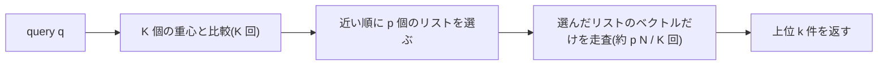
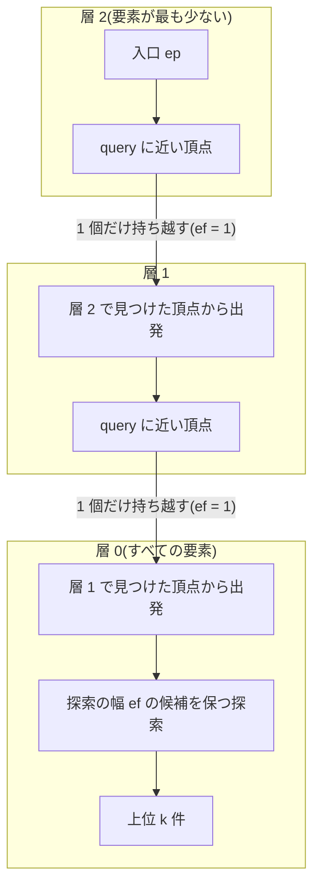
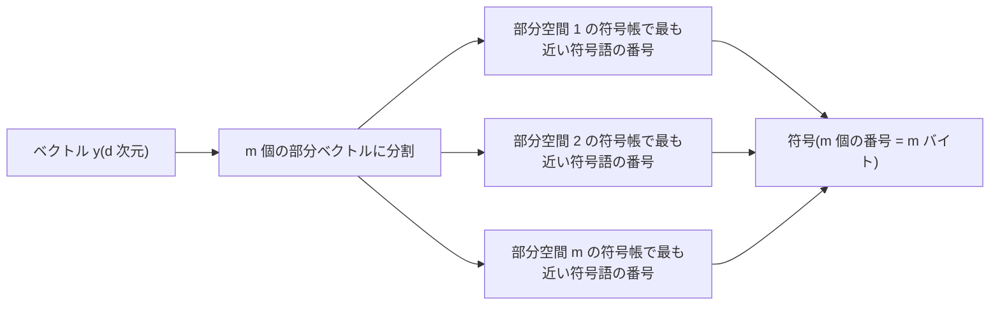
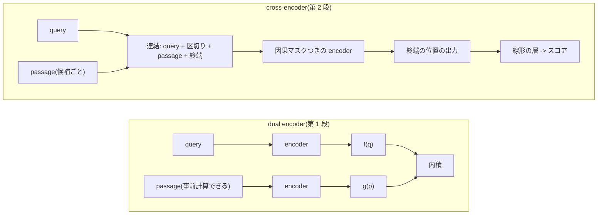

この記事は前編(理論編)です。続きは [こちら](https://zenn.dev/kojikojiprg/books/ai-theories-roadmap/viewer/025_ann_search_and_reranking-practice)。

# 025. ANN 検索とリランキング / ANN Search and Reranking

## 1. 概要 / Overview

**近似最近傍探索(ANN: Approximate Nearest Neighbor)** は、全探索のように全ベクトルとの距離を計算せず、query に近いベクトルを少ない距離計算で見つける手法である。
recall(全探索の上位との一致率)を少し手放す代わりに、**1 query あたりの距離計算の回数(費用)** を大きく減らす、という交換を扱う。
本トピックは、024 の dual encoder が埋め込んだ約 9.4 万個の passage を対象に、HNSW(Hierarchical Navigable Small World)・転置ファイル(Inverted File Index)・
Product Quantization(直積量子化)をスクラッチ実装し、費用と recall の関係を測る。さらに、第 1 段(上記の索引)が絞り込んだ上位の候補を、query と passage を連結して符号化する
**cross-encoder** で並べ替える 2 段階の検索(retrieve-then-rerank)を、008 の小型 GPT を起点に実装する。

### 1.1 実行の手順

手順は付録 A。本番実行は Google Colab T4 の 1 つのセッション(予算 120 分)で完結させた。

### 1.2 本番実行の結果の要約

検証するのは次の 5 つ(いずれも判定つき)と、判定を設けない観察 1 つである。対比量 $\Delta$ と閾値 $2\sigma$ は 6.1 節で事前に宣言した基準で、実験 D・E の対比量は、前提条件 P1(学習の成立)が成立しないため参考値であり、結論として読まない(6.15 節の出力、7.2 節)。

| 実験(検証すること) | 対比量 | 閾値 | 最終判定 | 要約 |
|---|---|---|---|---|
| A: HNSW の費用のべき指数 $b$ が 1 より小さいか | +0.6657 | 0.0204 | **支持** | 目標の recall 0.9 での費用は、$N = 4096$〜$65{,}536$ で $N^{0.334}$ に比例して増え、$N = 65{,}536$ で 399.4 回と全探索(65,536 回)の約 164 分の 1 だった。 |
| B: 最大の $N$ で HNSW の費用が転置ファイルより小さいか | +1.4339 | 0.0613 | **支持** | 転置ファイル(リスト数 512)の 1,675.4 回は、HNSW の 399.4 回の約 4.2 倍だった(構築の費用を含まない)。 |
| C: 同じ符号帳で、非対称距離計算の recall が対称距離計算より高いか | +0.1296 | 0.0067 | **支持** | 全探索の上位 10 件との一致率は、非対称距離計算 0.5143、対称距離計算 0.3847 だった。 |
| D: cross-encoder の並べ替えは dual encoder の並べ替えより Recall@10 が高いか | -0.0625(参考値) | 0.0168 | **前提不成立** | D1 の訓練損失が一様な予測の損失 $\ln 8 = 2.079$ とほぼ同じ(2.059〜2.078)で、学習が成立せず、情報を得ていない。 |
| E: 困難な負例で学習した cross-encoder は、ランダムな負例で学習したものより Recall@10 が高いか | -0.0050(参考値) | 0.0151 | **前提不成立** | D1(= E1)の成分 (a) に加えて E2 の成分 (b) も成立せず、情報を得ていない。 |
| F: 第 1 段を替えたときの 2 段階の検索(判定なし) | - | - | 判定なし | 第 1 段を HNSW(533 回の距離計算)にしても、並べ替えなしの Recall@10 は 0.1465 で、全探索(65,536 回)の 0.1481 とほぼ同じ。D1 は学習が成立していないので、D1 での並べ替えは効果を示すものではない。 |

実行は計画 1($T = 1024$)で、全体の経過時間は 98.9 分だった(7.1 節)。Hub へのアップロードは、公開の条件を満たさず行っていない(7.10 節)。実験 D・E の再実行に向けたパイロット(6.17 節)は区分 3 となり、再実行は行われなかった(7.11 節)。D1 の学習が進まなかった原因の候補は 7.12 節(事後的な解釈。検証済みの結論ではない)に記した。

## 2. 参考論文 / References

1. Malkov, Yu. A., Yashunin, D. A.,
   "Efficient and robust approximate nearest neighbor search using Hierarchical Navigable Small World graphs", IEEE TPAMI 42(4), 2020(arXiv:1603.09320, DOI 10.1109/TPAMI.2018.2889473).
   https://arxiv.org/abs/1603.09320(3.3 節、実験 A・B)
2. Malkov, Y., Ponomarenko, A., Logvinov, A., Krylov, V.,
   "Approximate nearest neighbor algorithm based on navigable small world graphs", Information Systems 45, 61–68, 2014. https://doi.org/10.1016/j.is.2013.10.006
   (3.3 節)
3. Jégou, H., Douze, M., Schmid, C.,
   "Product Quantization for Nearest Neighbor Search", IEEE TPAMI 33(1), 117–128, 2011. https://doi.org/10.1109/TPAMI.2010.57
   (3.2・3.4 節、実験 C)
4. Kleinberg, J.,
   "The small-world phenomenon: an algorithmic perspective", STOC 2000, pp. 163–170. https://www.cs.cornell.edu/home/kleinber/swn.d/swn.html
   (3.3 節)
5. Sivic, J., Zisserman, A.,
   "Video Google: A Text Retrieval Approach to Object Matching in Videos", ICCV 2003. https://doi.org/10.1109/ICCV.2003.1238663
   (3.2 節)
6. Lloyd, S. P.,
   "Least squares quantization in PCM", IEEE Transactions on Information Theory 28(2), 129–137, 1982. https://doi.org/10.1109/TIT.1982.1056489
   (3.2 節)
7. Aumüller, M., Bernhardsson, E., Faithfull, A.,
   "ANN-Benchmarks: A Benchmarking Tool for Approximate Nearest Neighbor Algorithms", Information Systems 87, 101374, 2020(オンライン公開は 2019 年。arXiv:1807.05614).
   https://arxiv.org/abs/1807.05614(3.9 節)
8. Lin, P.-C., Zhao, W.-L.,
   "Graph based Nearest Neighbor Search: Promises and Failures", arXiv:1904.02077, 2019. https://arxiv.org/abs/1904.02077
   (3.3 節、実験 A の診断量)
9. Munyampirwa, B., Lakshman, V., Coleman, B.,
   "Down with the Hierarchy: The 'H' in HNSW Stands for 'Hubs'", arXiv:2412.01940, 2024. https://arxiv.org/abs/2412.01940
   (3.3 節、実験 A の診断量)
10. Nogueira, R., Cho, K.,
    "Passage Re-ranking with BERT", arXiv:1901.04085, 2019. https://arxiv.org/abs/1901.04085
    (3.5 節、実験 D)
11. Ma, X., Wang, L., Yang, N., Wei, F., Lin, J.,
    "Fine-Tuning LLaMA for Multi-Stage Text Retrieval", SIGIR 2024(arXiv:2310.08319). https://arxiv.org/abs/2310.08319
    (3.5 節)
12. Karpukhin, V., Oğuz, B., Min, S., Lewis, P., Wu, L., Edunov, S., Chen, D., Yih, W.,
    "Dense Passage Retrieval for Open-Domain Question Answering", EMNLP 2020. https://arxiv.org/abs/2004.04906
    (3.7 節)
13. Xiong, L., Xiong, C., Li, Y., Tang, K.-F., Liu, J., Bennett, P., Ahmed, J., Overwijk, A.,
    "Approximate Nearest Neighbor Negative Contrastive Learning for Dense Text Retrieval", ICLR 2021. https://arxiv.org/abs/2007.00808
    (3.7 節、実験 E)
14. Qu, Y., Ding, Y., Liu, J., Liu, K., Ren, R., Zhao, W. X., Dong, D., Wu, H., Wang, H.,
    "RocketQA: An Optimized Training Approach to Dense Passage Retrieval for Open-Domain Question Answering", NAACL 2021. https://arxiv.org/abs/2010.08191
    (偽の負例とその除去。3.7 節。位置づけのみ)
15. Indyk, P., Motwani, R.,
    "Approximate nearest neighbors: towards removing the curse of dimensionality", STOC 1998, pp. 604–613(統合した版: Har-Peled, S., Indyk, P., Motwani, R., Theory of Computing 8(14), 2012).
    https://theoryofcomputing.org/articles/v008a014/(locality sensitive hashing。3.8 節。位置づけのみ)
16. Johnson, J., Douze, M., Jégou, H.,
    "Billion-scale similarity search with GPUs", IEEE Transactions on Big Data 7(3), 535–547(arXiv:1702.08734). https://arxiv.org/abs/1702.08734
    (Faiss。3.4・3.8 節。位置づけのみ)
17. Guo, R., Sun, P., Lindgren, E., Geng, Q., Simcha, D., Chern, F., Kumar, S.,
    "Accelerating Large-Scale Inference with Anisotropic Vector Quantization", ICML 2020(arXiv:1908.10396). https://arxiv.org/abs/1908.10396
    (ScaNN。3.8 節。位置づけのみ)
18. Subramanya, S. J., Devvrit, Kadekodi, R., Krishnaswamy, R., Simhadri, H. V.,
    "DiskANN: Fast Accurate Billion-point Nearest Neighbor Search on a Single Node", NeurIPS 2019. https://papers.nips.cc/paper/2019/hash/09853c7fb1d3f8ee67a61b6bf4a7f8e6-Abstract.html
    (DiskANN。3.8 節。位置づけのみ)
19. Ge, T., He, K., Ke, Q., Sun, J.,
    "Optimized Product Quantization", IEEE TPAMI 36(4), 744–755, 2014(CVPR 2013 の拡張)。https://www.microsoft.com/en-us/research/publication/optimized-product-quantization/
    (Optimized Product Quantization。3.8 節。位置づけのみ)
20. Khattab, O., Zaharia, M.,
    "ColBERT: Efficient and Effective Passage Search via Contextualized Late Interaction over BERT", SIGIR 2020. https://arxiv.org/abs/2004.12832
    (late interaction。3.8 節。位置づけのみ)
21. Hofstätter, S., Althammer, S., Schröder, M., Sertkan, M., Hanbury, A.,
    "Improving Efficient Neural Ranking Models with Cross-Architecture Knowledge Distillation", arXiv:2010.02666, 2020. https://arxiv.org/abs/2010.02666
    (cross-encoder から dual encoder への知識蒸留。3.8 節。位置づけのみ)

## 3. 理論 / Theory

### 3.1 動機: 全探索の計算量と、近似の考え方

**全探索(exhaustive search)** は、query $x$ と全ベクトル $y_1, \dots, y_N \in \mathbb{R}^d$ との距離(または類似度)をすべて計算して、上位 $k$ 件を返す。
1 本のベクトルとの距離計算が $O(d)$ なので、1 query あたりの計算量は

$$
O(N d)
$$

である($N$ は索引のベクトルの数、$d$ は次元)。本トピックでは **1 本のベクトルとの距離(内積)の計算を 1 回と数え**、全探索の費用を $N$ 回とする。

**単位ベクトルでは、3 つの尺度の順位が一致する。** $x$ と $y$ が単位ベクトル($\lVert x \rVert = \lVert y \rVert = 1$)のとき、

$$
\lVert x - y \rVert^2 = \lVert x \rVert^2 - 2 x^\top y + \lVert y \rVert^2 = 2 - 2 x^\top y
$$

となる。したがって、二乗ユークリッド距離は内積(= コサイン類似度)の減少関数で、**cosine 類似度・内積・二乗ユークリッド距離は、どれも同じ順位を与える**。024 の埋め込みは L2 正規化した単位ベクトルなので、
以下の索引はどの尺度を使っても同じ最近傍を探す。

**近似最近傍探索の考え方**: 次元が高いと、木構造などの厳密な探索法も全探索とほぼ同じ費用になる(次元の呪い)。Indyk & Motwani [15] は、真の最近傍でなくてよい(近似を許す)
とすると、検索時間を $N$ に対して劣線形にできることを示した。実用の索引は、**真の上位 $k$ 件のうち返せた割合(recall)を手放す代わりに、距離計算の回数を減らす**。
索引どうしの比較は、**同じ recall を達成するときの費用** で行う(3.9 節、ANN-Benchmarks [7] の考え方)。

本トピックで扱う 3 つの方式は、費用を減らす方法が異なる。

| 方式 | 減らし方 | 近似の源 |
|---|---|---|
| 転置ファイル(3.2 節) | query に近いクラスタのベクトルだけを走査する | 近いベクトルが別のクラスタに入る |
| HNSW(3.3 節) | 近傍グラフをたどって、query に近い部分だけを訪れる | 局所最適にはまり、真の近傍を訪れない |
| Product Quantization(3.4 節) | ベクトルを短い符号に圧縮し、距離を表引きで近似する | 量子化の誤差で順位が乱れる |

### 3.2 転置ファイル(Inverted File Index)

**考え方**: 全ベクトルを k-means で $K$ 個のクラスタ(Voronoi 領域)に分け、クラスタごとに、属するベクトルの一覧(転置リスト)を作る。query が来たら、$K$ 個の重心との距離を求め、近い順に $p$ 個のリスト
($p$ を探索するリストの数と呼ぶ)だけを走査して、その中の上位を返す。ベクトルを重心の番号で引く索引は、Video Google(Sivic & Zisserman [5])が導入し、Jégou ら [3] が Product Quantization と組み合わせた(IVFADC。3.4 節)。

**k-means(Lloyd のアルゴリズム [6])**: 点の集合 $\{x_i\}_{i=1}^{n}$ と重心の集合 $\{c_j\}_{j=1}^{K}$ について、各点を最も近い重心に割り当てたときの二乗誤差の和

$$
J = \sum_{i=1}^{n} \min_{j} \lVert x_i - c_j \rVert^2
$$

を小さくする。割り当て(各点を最も近い重心へ)と更新(各重心を割り当てられた点の平均へ)を交互に行うと、どちらの手順も $J$ を増やさないので、$J$ は反復ごとに単調に減少する。
ただし、収束先は局所最適で、初期値に依存する。

**費用の式**: 各リストの大きさが平均 $N / K$ のとき、1 query あたりの距離計算の回数は

$$
C(K, p) = K + p \cdot \frac{N}{K}
$$

である。第 1 項が重心との比較、第 2 項が走査するベクトルの数である($p = K$ ですべてのリストを走査すると、全探索と同じ結果になり、費用は全探索より $K$ だけ増える)。

**リスト数を $\sqrt{N}$ に比例させると費用が $O(\sqrt{N})$ になること**: $p$ を固定して $K$ で最小化する。

$$
\frac{\partial C}{\partial K} = 1 - \frac{p N}{K^2} = 0 \;\Rightarrow\; K = \sqrt{p N}, \qquad C = 2 \sqrt{p N} = O(\sqrt{N})
$$

$K = c \sqrt{N}$($c$ は定数)とおけば $C = (c + p / c) \sqrt{N}$ で、費用は $\sqrt{N}$ で増える。重心との比較(第 1 項)と走査(第 2 項)が同じ大きさになる点が最小である。
**この導出は、目標の recall に必要な $p$ が $N$ によらず一定という仮定を置いている。** 実際には、$K$ が増えると各リストが小さくなり、近いベクトルが別のリストに入る割合が増えるので、
同じ recall に必要な $p$ は $N$ とデータに依存する(必要な $p$ が $N$ とともに増えれば、費用は $\sqrt{N}$ より速く増える)。

### 3.3 HNSW(Hierarchical Navigable Small World)

#### 3.3.1 small world のグラフと貪欲な探索

**近傍グラフ(proximity graph)** は、ベクトルを頂点とし、近いベクトルどうしを辺で結んだグラフである。query に対して、適当な頂点から出発し、
**隣接する頂点のうち query に最も近いものへ移る**(貪欲な探索、greedy search)を、近づけなくなるまで繰り返せば、query に近い頂点にたどり着ける。

**small world** のグラフは、近い頂点への辺に加えて、少数の遠い頂点への辺(長距離の辺)を持ち、任意の 2 頂点の間の最短経路が短い(頂点数の対数程度)。
Kleinberg [4] は、短い経路が存在するだけでなく、**局所の情報だけで貪欲にその経路を見つけられる** のは、辺の長さの分布が特定の形のモデルに限られることを示した(navigability)。

**Navigable Small World(Malkov ら [2])** は、ベクトルを 1 つずつ挿入し、挿入のたびに、その時点のグラフから探索で見つけた近い頂点と辺を張る。
**早く挿入された頂点どうしは、その時点では少数の中で最も近い相手と結ばれる** ので、後から密になった領域では長距離の辺になる。
ただし、Navigable Small World は 1 層のグラフで、探索の費用の件数への増え方が対数よりも速い(原論文の主張)。

#### 3.3.2 階層化: 層の番号を指数分布から引く

HNSW(Malkov & Yashunin [1])は、**辺の長さの尺度ごとに層を分ける**。最下層(層 0)がすべての要素を含み、上の層ほど要素が少ない(上の層の頂点の集合は下の層の部分集合)。
要素 $q$ を挿入するとき、その要素が属する最大の層の番号 $l$ を、指数分布から引く(原論文の式)。

$$
l = \lfloor -\ln(u) \cdot m_L \rfloor, \qquad u \sim \mathrm{Uniform}(0, 1), \qquad m_L = \frac{1}{\ln M}
$$

$M$ は 1 つの要素が挿入のときに張る接続の数、$m_L$ は層の番号の分布を決める正規化の係数である。**層の番号の分布**: $l \ge j$ となる確率は

$$
P(l \ge j) = P\left(-\ln u \ge \frac{j}{m_L}\right) = P\left(u \le e^{-j \ln M}\right) = M^{-j}
$$

なので、層 $j$ 以上に属する要素は $N M^{-j}$ 個程度、最上層の番号は $\log_M N$ 程度である(スキップリストの確率 $1/M$ に対応する)。

**探索(Algorithm 5)**: 最上層の入口の要素から出発し、**上の層では貪欲な探索(探索の幅 $ef = 1$)** で query に最も近い 1 つの要素を見つけ、それを次の層の入口にして降りる。
**層 0 では、探索の幅 $ef$ の候補の集合 $W$ を保ちながら探索する**(Algorithm 2)。$W$ に入っている最も遠い要素より遠い候補を捨てるので、探索は $W$ の中を改善できなくなったときに終わる。
$W$ の中の上位 $k$ 件を返す。**$ef$ を大きくすると recall が上がり、費用も増える。**

**挿入(Algorithm 1)**: 要素の層の番号 $l$ を引く。最上層から $l + 1$ 層までは $ef = 1$ の貪欲な探索で入口を更新する。層 $l$ 以下の各層では、探索の幅 $efConstruction$ の探索で見つけた候補から、
$M$ 個の近傍を選んで双方向の辺を張る。辺を張った相手の頂点の接続の数が上限 $M_{\max}$ を超えたら、その頂点の近傍を同じ選び方で選び直す(最下層の上限は $M_{\max 0} = 2M$、それ以外の層は $M_{\max} = M$。
原論文は、$M_{\max 0} = 2M$ を良い選択として示す)。

**近傍の選択のヒューリスティック(Algorithm 4)**: 単純には、候補のうち query(基準の点)に近い順の $M$ 個を選ぶ(Algorithm 3)。ヒューリスティックは、候補を基準の点に近い順に調べ、
**すでに選んだどの要素よりも基準の点に近い候補だけ** を選ぶ(候補 $e$ について、選んだ集合 $R$ のすべての要素 $r$ で $d(e, q) < d(e, r)$ が成り立つとき)。近いが同じ方向にある候補は捨てられるので、
**方向の異なる近傍が選ばれ**、クラスタの間をつなぐ辺が残りやすい。

#### 3.3.3 計算量の主張と、高次元での注意

原論文は、**探索の計算量が $O(\log N)$、構築の計算量が $O(N \log N)$ でスケールする** と主張する。根拠は次の議論である: 各層で、厳密な Delaunay グラフ(近傍関係を表す最小の部分グラフ)があれば、
次の層の入口に着くまでの平均のステップ数は定数で抑えられ(層の間で要素の選ばれる確率が空間の位置と無関係なので、次の層に属する要素にたどり着く確率が $e^{-m_L}$ で一定になる)、
層の数の期待値が $\log N$ に比例するので、全体で $O(\log N)$ になる。この議論は **Delaunay グラフの平均次数が定数で抑えられるという仮定** に依存する。原論文自身が、
Delaunay グラフの平均次数は次元に対して指数的に増えるので、高次元のデータ(例: $d = 128$)でこの仮定の成立を実験で確かめるには極端に大きなデータが要り、高次元への一般化にはさらなる解析が必要だと述べている。

**高次元での階層の利得**: 階層(上の層)が高次元のデータで効くかは、後続の研究で疑問が示されている。Lin & Zhao [8] は、高次元のデータで階層が対数の計算量をもたらさず、階層を持たない近傍グラフ
(多様化した辺を持つもの)と同程度の性能になることを報告した。Munyampirwa ら [9] は、高次元のデータでは、階層を持たない近傍グラフが HNSW の利点を保つこと、
ハブ(多くの頂点から近傍として選ばれる頂点)が階層の代わりに「高速道路」の役割を果たしていることを報告した。

**パラメータの選び方**: 原論文は、$M$ の妥当な範囲を 5〜48 とし、**小さい $M$ は低い recall や低次元のデータに、大きい $M$ は高い recall や高次元のデータに向く** と述べている。

### 3.4 Product Quantization(直積量子化)

**符号化**: $d$ 次元のベクトル $y$ を $m$ 個の部分ベクトル $y^1, \dots, y^m$(各 $d / m$ 次元)に分け、部分空間 $j$ ごとに、独立な k-means で $k^*$ 個の符号語(centroid)の符号帳 $C^j$ を学習する。
各部分ベクトルを、最も近い符号語の番号で表す(Jégou ら [3])。

$$
q(y) = \left( q^1(y^1), \dots, q^m(y^m) \right), \qquad q^j(y^j) = \arg\min_{c \in C^j} \lVert y^j - c \rVert^2
$$

$q^j$ は部分空間 $j$ の量子化器である。符号の長さは $m \log_2 k^*$ ビットで、$k^* = 256$ なら 1 部分ベクトルを 1 バイトで表し、**1 ベクトルあたり $m$ バイト** になる。部分空間の符号語の直積で表せる再構成のベクトルの種類は $(k^*)^m$ 個で、持つ符号語は $m k^*$ 個で済む($d = 256$ を FP32 で持てば 1,024 バイトなので、$m = 32$ なら 32 分の 1)。

**非対称距離計算(Asymmetric Distance Computation)**: query $x$ は量子化せず、データベースのベクトル $y$ だけを量子化して、二乗距離を部分空間ごとの和で近似する。

$$
\hat{d}_{\mathrm{asymmetric}}(x, y)^2 = \lVert x - q(y) \rVert^2 = \sum_{j=1}^{m} \left\lVert x^j - q^j(y^j) \right\rVert^2
$$

query ごとに、すべての部分空間 $j$ と符号語 $c \in C^j$ の組について $\lVert x^j - c \rVert^2$ を求めて **参照表**($m \times k^*$ 個の値)を作る。各ベクトルの距離は、その符号の $m$ 個の番号で参照表を引いて足すだけで求まる。
1 query の費用は、参照表の作成($m k^*$ 回の部分ベクトルの距離)と、全ベクトルについての表引き($N m$ 回)である。

**対称距離計算(Symmetric Distance Computation)**: query も量子化して、符号語どうしの距離で近似する。

$$
\hat{d}_{\mathrm{symmetric}}(x, y)^2 = \lVert q(x) - q(y) \rVert^2 = \sum_{j=1}^{m} \left\lVert q^j(x^j) - q^j(y^j) \right\rVert^2
$$

符号語どうしの距離の表($m \times k^* \times k^*$)は索引の構築時に 1 回だけ作る。query の量子化(最も近い符号語を探す)に $m k^*$ 回の部分ベクトルの距離が要る。

**距離の誤差と量子化の平均二乗誤差の関係**: 符号語は k-means の重心(その領域に属するベクトルの平均)なので、$e_y = y - q(y)$(領域の中での位置のずれ。量子化の誤差)は、領域を決めると平均 0 である。
$D = \mathbb{E}\lVert e_y \rVert^2$ を量子化の平均二乗誤差とし、query $x$ は $y$ の領域の中での位置と独立とする。$x - y = (x - q(y)) - e_y$ を展開すると、

$$
\lVert x - y \rVert^2 = \lVert x - q(y) \rVert^2 - 2 \langle x - q(y), e_y \rangle + \lVert e_y \rVert^2
$$

右辺の第 2 項は、$e_y$ の平均が 0 で $x - q(y)$ と独立なので期待値が 0、第 3 項の期待値は $D$ である。したがって、非対称距離計算の推定の二乗距離 $\lVert x - q(y) \rVert^2$ は、真の値に対して **平均として $D$ だけ小さい**。対称距離計算では $x$ も量子化するので、$e_x = x - q(x)$ を使って

$$
\lVert x - y \rVert^2 = \lVert q(x) - q(y) \rVert^2 + 2 \langle q(x) - q(y), e_x - e_y \rangle + \lVert e_x - e_y \rVert^2
$$

と展開できる。第 2 項の期待値は 0、第 3 項の期待値は $\mathbb{E}\lVert e_x \rVert^2 + \mathbb{E}\lVert e_y \rVert^2$($e_x$ と $e_y$ が独立で平均 0 のとき)なので、偏りは $-(\mathbb{E}\lVert e_x \rVert^2 + \mathbb{E}\lVert e_y \rVert^2)$ で、
$x$ と $y$ が同じ分布なら $-2D$ になる。誤差の分散も、$x$ の誤差が加わるぶん大きい(Jégou ら [3] は、解析と実験で、非対称距離計算の方が検索の精度が高いことを示した)。
一様な偏りは順位を変えないが、$\lVert e_y \rVert^2$ はベクトルごとに異なるので、偏りの大きさのばらつきと第 2 項のばらつきが順位を乱す。
**query は passage と長さが違い(32 トークンと 128 トークン)、埋め込みの分布が異なりうる。** 符号帳を passage で学習すると、query の量子化の誤差 $\mathbb{E}\lVert e_x \rVert^2$ が passage の $D$ より大きくなりうるので、
対称距離計算の誤差はさらに大きくなりうる。

**スカラー量子化からベクトル量子化へ(013 との対応)**: 013 の一様量子化(1 つの値を $2^b$ 個の等間隔の水準に丸める。誤差は $\Delta^2 / 12$)を、部分ベクトル($d / m$ 次元)を単位とするベクトル量子化に拡張したものが Product Quantization で、水準が等間隔である必要がなく、データの分布に合わせて学習した符号語を使う。

**再採点(re-scoring)**: 圧縮した符号による近似の距離で上位 $R$ 件の候補に絞り、その $R$ 件だけ元のベクトルで距離を計算し直して順位をつける。近似の距離は順位を少し乱すだけで、
真の上位 $k$ 件は近似の距離の上位 $R$ 件($R > k$)に入っていることが多い。費用は $R$ 回(全次元)の距離計算が加わる。

### 3.5 dual encoder と cross-encoder

検索の類似度を計算する構造は、query と passage をどの段階で結合するかで 2 つに分かれる(024 の 3.2 節)。

- **dual encoder**: $s(q, p) = f(q)^\top g(p)$。スコアが $q$ の関数と $p$ の関数の内積に **分解できる** ので、passage の埋め込みを事前に計算して索引にでき、全件の検索に使える
  (本トピックの第 1 段)。一方、passage のすべての情報を 1 本のベクトルに詰めるので、query と passage の語どうしの細かい対応は表せない。
- **cross-encoder**: query と passage を **連結して 1 本の入力** にし、すべてのトークンの間の注意(attention)で相互作用を計算して、スカラーのスコア $g(q, p)$ を出す(Nogueira & Cho [10])。
  スコアが $q$ と $p$ に分解できないので、事前計算ができず、**組ごとに順伝播が要る**。全件には使えず、第 1 段が絞り込んだ候補の並べ替えに使う。

**因果マスクつきの decoder-only のモデルを cross-encoder にする**: 008 の小型 GPT は因果マスクを使うので、位置 $t$ の隠れ状態は位置 $t$ までのトークンにだけ依存する。入力を

$$
\left[ x_1, \dots, x_{L_q}, \langle \mathrm{sep} \rangle, y_1, \dots, y_{L_p}, \langle \mathrm{end} \rangle \right]
$$

($x_i$ は query のトークン、$y_i$ は passage のトークン、$\langle \mathrm{sep} \rangle$ は区切り、$\langle \mathrm{end} \rangle$ は終端、$L_q$・$L_p$ は query・passage の長さ)とすると、
**query 全体と passage 全体の両方を見ている位置は、最後の位置(終端のトークン)だけ** である。query のトークンの位置は passage を見ておらず、passage の途中の位置は query 全体と passage の前半だけを見ている。
そこで、最終正規化層の後の、終端の位置の隠れ状態 $h_{\mathrm{end}}$ に線形の層を付けてスコアにする。

$$
g(q, p) = w^\top h_{\mathrm{end}}(q, p) + b
$$

$w \in \mathbb{R}^{d_{\mathrm{model}}}$ は重み、$b$ はバイアスである(017 の報酬モデルと同じ形。RankLLaMA(Ma ら [11])も、終端のトークンの位置の表現からスコアを出す)。
**008 のトークナイザの語彙には特殊トークンがない**(256 個のバイトと 7,936 個のマージ)。語彙を増やさずに、コーパスに一度も現れない単一バイトのトークン(区切りは 0x1F、終端は 0x1E の制御文字)を使う。

### 3.6 2 段階の検索(retrieve-then-rerank)の費用

第 1 段が全ベクトルから上位 $K$ 件の候補を絞り込み、第 2 段がその $K$ 件をスコアの高い順に並べ替える。1 query あたりの費用は

$$
C_{\mathrm{total}} = C_{\mathrm{first}} + K \cdot F_{\mathrm{pair}}
$$

である。$C_{\mathrm{first}}$ は第 1 段の距離計算の回数(全探索なら $N$)、$K$ は並べ替える候補の数、$F_{\mathrm{pair}}$ は第 2 段の 1 組あたりの費用である。cross-encoder は組ごとに順伝播が要るので、
**第 2 段の順伝播の回数は $K$ 回** である。dual encoder で並べ替える場合は、passage の埋め込みを事前に計算してあれば、query の順伝播 1 回と $K$ 回の内積で済む。
cross-encoder の順伝播は、列の長さ $L_q + L_p + 2$ のトークンぶんの計算で、1 回の距離計算(内積)よりはるかに重い。

候補を増やす($K$ を大きくする)と、第 1 段の上位 $K$ 件に正例が入る割合(並べ替えで到達できる Recall の上限)は上がるが、第 2 段の費用が $K$ に比例して増える。
第 1 段を近似検索にすると、$C_{\mathrm{first}}$ は減るが、上位 $K$ 件に正例が入る割合が下がりうる。実験 F はこの交換を表にする。

### 3.7 困難な負例(hard negative)

並べ替えモデルは、推論時には第 1 段の上位 $K$ 件(第 1 段が query に近いと判断した候補)の中から正例を選ぶ。学習の負例がコーパスからランダムに選んだ passage だと、見分けるのが易しい区別だけを学び、紛らわしい候補を区別する力が育たない。そこで、**第 1 段の上位から採掘した、紛らわしい負例(困難な負例)** で学習する。DPR(Karpukhin ら [12])は BM25 の上位の passage を、ANCE(Xiong ら [13])は近似最近傍探索の索引で採掘した負例を使い、「学習時の負例が、検索時の無関係な文書の分布を代表していないこと」が問題だと指摘した。困難な負例には、**実際には正解である passage(偽の負例)が混ざる** 危険が大きく、RocketQA(Qu ら [14])は強いモデルで除く手法を提案した(位置づけのみ)。本トピックでは、同じ記事の passage を除くが、別の記事の関連する passage は除ききれない。

**学習時と推論時の分布を揃える**: 困難な負例は第 1 段の上位 $K$ 件(同じ記事を除く)から一様に選び、正例も、採掘した上位 $K$ 件に同じ記事の passage(元の passage を除く)がある query に限って、その上位 $K$ 件の中の同じ記事の passage から一様に選ぶ。正例を同じ記事の passage の全体から選ぶと、正例の大半は上位 $K$ 件の外にあり、「第 1 段のスコアが低い候補が正例」という、推論時には成り立たない手がかりで訓練損失を下げられる。ランダムな負例の条件(実験 E の条件 2)でも、負例の多くが上位 $K$ 件の外にあるので、第 1 段のスコアの高さが正例の手がかりになりうる。

### 3.8 位置づけのみ(実装しない)

- **Locality Sensitive Hashing**(Indyk & Motwani [15]): 近いベクトルが同じ値にハッシュされる確率が高い関数族で、同じ値のベクトルだけを調べる。理論的な保証があるが、実用では他の方式に recall と費用で劣ることが多い。
- **ScaNN**(Guo ら [17]): 量子化の損失を、内積の順位への影響(query に平行な方向の誤差を重く扱う)に合わせて設計する。
- **DiskANN**(Subramanya ら [18]): 近傍グラフをディスクに置き、メモリに載らない規模を扱う。
- **Optimized Product Quantization**(Ge ら [19]): ベクトルを回転して、部分空間の分け方を最適にしてから Product Quantization を行う。
- **IVFADC**(Jégou ら [3]): 転置ファイルの重心との残差を Product Quantization で量子化し、近い $p$ 個のリストだけを、残差に対する非対称距離計算で走査する。Faiss(Johnson ら [16])の中心的な索引である。
- **ColBERT の late interaction**(Khattab & Zaharia [20])、**cross-encoder から dual encoder への知識蒸留**(Hofstätter ら [21])、**偽の負例を除く手法**(RocketQA [14])。

### 3.9 評価の定義

#### 近似最近傍探索の recall と、目標の recall での費用

**正解**: 実験 A〜C の正解は、**全探索の上位 10 件** である(関連性のラベルは使わない)。query の元になった passage は、全探索でも近似探索でも候補から除く(024 と同じ)。
索引が返した上位 10 件のうち、全探索の上位 10 件と一致した割合を、query ごとの recall とする。

$$
\mathrm{recall}_i = \frac{\lvert \mathrm{returned}_i \cap \mathrm{truth}_i \rvert}{10}
$$

$\mathrm{returned}_i$ は query $i$ に索引が返した上位 10 件、$\mathrm{truth}_i$ は全探索の上位 10 件である。

**目標の recall での費用**: 宣言した格子(探索の幅 $ef$、または探索するリストの数 $p$ を小さい順に並べたもの)を掃引し、各格子点 $j$ で、query について平均した recall $r_j$ と費用 $c_j$
(1 query あたりの距離計算の回数)を求める。$r_j$ が初めて目標 $r^* = 0.9$ 以上になる格子点を $j$(最小の格子点では $r_0 < r^*$)として、**費用の対数を、recall について隣り合う 2 点の間で線形に補間する**。

$$
\log c^* = \log c_{j-1} + \frac{r^* - r_{j-1}}{r_j - r_{j-1}} \left( \log c_j - \log c_{j-1} \right)
$$

壁時計時間は判定に使わず、観察として印字する。

#### 並べ替えの検索指標

関連性の定義と指標は 024 と同じである(query と同じ記事の、元の passage 以外の passage が正例)。**Recall@10**(上位 10 件に正例が 1 つ以上あれば 1)を主指標とし、
平均逆順位(Mean Reciprocal Rank)と正規化割引累積利得(normalized Discounted Cumulative Gain)の上位 10 件の値を診断量として印字する。
並べ替えの対象は第 1 段の上位 $K$ 件だけなので、候補に正例が 1 つもない query の順位は候補の外($K + 1$)とし、平均逆順位ではその逆数を 0 とみなす。
**同点のスコアは、正例に不利に数える**: 正例の順位は、1 + (スコアが最も高い正例以上の、正例でない候補の数)である(同点では、正例でない候補を上位とする)。第 1 段の順位は同点の解決に使わない。
**候補に正例が入っている query の割合(coverage)** は、並べ替えで到達できる Recall@10 の上限である。

### 3.10 データの流れとアルゴリズム(擬似コード)

実験の手順(準備、実験 A〜C の索引の掃引、実験 D・E の学習と評価)の擬似コードは付録 H。
