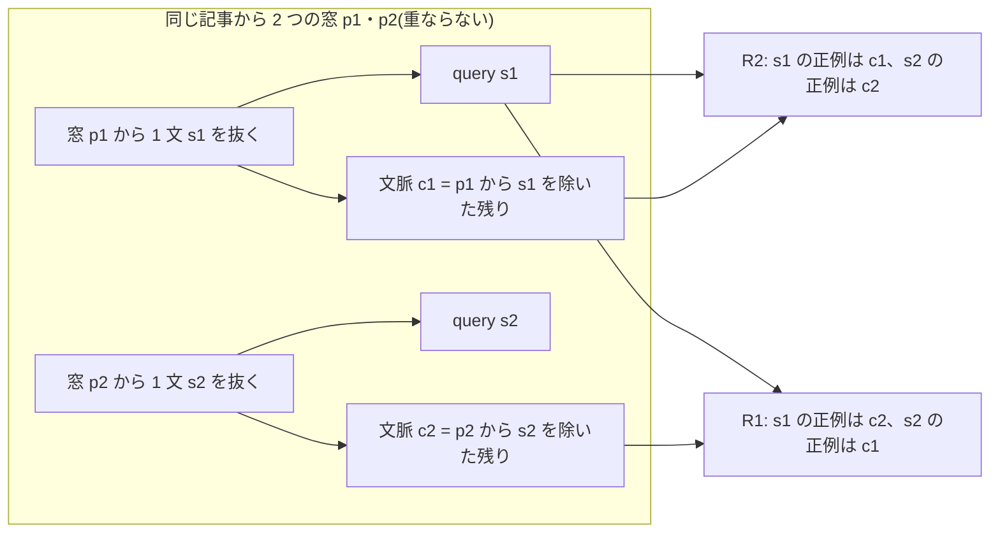
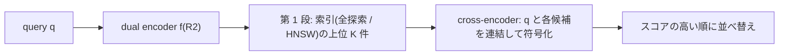

この記事は前編(理論編)です。続きは [こちら](https://zenn.dev/kojikojiprg/books/ai-theories-roadmap/viewer/026_inverse_cloze_task_and_two_stage_retrieval-practice-1)。

# 026. Inverse Cloze Task と passage 単位の 2 段階検索 / Inverse Cloze Task and Two-Stage Retrieval at Passage Level

## 1. 概要 / Overview

検索器(retriever)は、**何を関連とみなして学習するか(関連性の定義)** によって、学ぶものが変わる。[024](https://zenn.dev/kojikojiprg/books/ai-theories-roadmap/viewer/024_text_embedding_and_retriever-theory) は「同じ記事から切り出した別の区間」を正例にした
(記事単位の定義)。この定義では、話題が合っていれば解けるので、同じ記事の他の passage との区別は学習の信号に現れない。本トピックは、**passage 単位の定義** の学習として、
**Inverse Cloze Task**(Lee et al., 2019)を実装する。passage から 1 文を抜いて query にし、その文を除いた残りの文脈を正例にする自己教師ありの学習である。
同じ記事の他の passage(話題が同じ)が困難な負例になり、局所的な内容の一致が要る。

2 つの定義の比較は、**入力の形式を揃えて、関連性の定義だけを変える** 設計にする。学習では、どちらの条件も query は「passage(窓)から抜いた 1 文」で、正例の passage は文を 1 つ除いた形である。
passage 単位の定義(R2)の正例は、その文を抜いた元の窓の文脈で、記事単位の定義(R1)の正例は、同じ記事の別の窓の文を除いた形である。さらに、in-batch negatives に同じ記事の組を意図的に入れ、
**関連性の定義を、正例と in-batch の負例の両方に一貫して当てはめる**(R1 は同じ記事の組の passage を負例から除き、R2 は負例として数える)。評価では、同じ索引(すべての passage を 1 文を除いた形にしたもの)と同じ query(抜いた文)を使い、
関連のラベルだけを変える(passage 単位のラベルは正解が query の passage だけ、記事単位のラベルは正解が同じ記事の他の passage)。

そのうえで、後続のアプリ(`apps/`の RAG App)で使う **2 段階の検索**(retrieve-then-rerank)を組む。第 1 段は dual encoder(全探索と HNSW)、第 2 段は query と passage を連結して符号化する cross-encoder で、
cross-encoder は第 1 段の上位の候補だけを並べ替える。並べ替えモデルの学習の入力の分布は、推論時の候補(第 1 段の上位)に揃える。

[025](https://zenn.dev/kojikojiprg/books/ai-theories-roadmap/viewer/025_ann_search_and_reranking-theory) の実験 D・E(cross-encoder 対 dual encoder、困難な負例 対 ランダムな負例)は、cross-encoder の学習が成立せず、前提不成立だった(その結論は 025 のとおりで、本トピックはやり直さない)。
025 の事後的な解釈の候補の一つは、記事単位の関連性の定義が、query と passage の語どうしの相互作用を必要としていなかった可能性である。passage 単位の定義は、局所的な内容の一致を要求する点で、この候補と関係する。
**ただし、本トピックの実験はその解釈を検証するものではない。** 本トピックの実験 C は、「アプリで並べ替えを足す価値があるか」という実用の問いである。

検証するのは次の 3 つである(いずれも判定つき。各実験は 1 つの検証事項を扱う)。

- **実験 A**: passage 単位のラベルの評価で、passage 単位の定義(Inverse Cloze Task)で学習した検索器(R2)の Recall@10 が、記事単位の定義で学習した検索器(R1)より高いか。
- **実験 B**: 同じ索引・同じ query の、記事単位のラベルの評価で、R1 の Recall@10 が R2 より高いか。
- **実験 C**: passage 単位のラベルの評価で、R2 の上位の候補を cross-encoder で並べ替えた構成(R3)の Recall@10 が、R2 だけ(並べ替えなし)より高いか。

実験 A と B を合わせると「定義が学ぶものを決める」という交差(各定義で学習した検索器が、その定義のラベルの評価で優れる)を表すが、部分ごとに別の検証事項として判定し、組み合わせの読み方は 6.1 節で事前に宣言する。
あわせて、判定を設けない観察として、(D)R2 の埋め込みの HNSW 索引で第 1 段を近似したときの 2 段階の検索の費用(距離計算の回数・順伝播の回数)と検索指標を、並べ替える候補の数 $K$ の数点で示し、
(E)同じ query に対する R1 と R2 の検索結果の例を示す。診断量として、024 と同じ形式の記事単位の評価(024 の評価用の索引と query)も、R1・R2・024 の Hub のモデルの 3 つで測る(判定には使わない)。

### 1.1 実行の手順

本番実行は Google Colab T4 の **1 つのセッションで完結** させる。5.1 節のセットアップセルで`SMOKE_TEST = False`にして、「すべてのセルを実行」する。

実行時間の予算は 1 セッションあたり **T4 で 120 分** とする。学習を始める前に(6.2 節)、T4 上でのスケーリングの計測から、各処理の時間を見積もる。続いて、cross-encoder の学習ステップ数を決める
パイロット(6.3 節。本番と同じセッションの冒頭で行い、その時間も予算に含める)を行い、パイロットの後の残りの時間で、**実行計画**(6.1 節。削る段階の組)のそれぞれの残りの実行時間を見積もり(6.4 節)、
予算に収まる計画のうち優先順位の最も高いものを自動で選ぶ。選択は見積もりと経過時間のみに基づき、どの実験の結果も参照しない。**選ばれた計画は 6.4 節の出力に印字される。**
事前の計測のための別の実行やセッションの分割はしない。見積もりが最も下位の計画でも予算を超える場合は、本番の学習の前に停止する。

学習したモデルのうち、後続のアプリ(`apps/`)の入力にする候補の **R2 のシード 0**(`kojikojiprg/ai-theories-text-embedding-en`の新しいブランチ`inverse-cloze-task`)と
**cross-encoder のシード 0**(新しいリポジトリ`kojikojiprg/ai-theories-cross-encoder-en`)は、公開の条件(判定ではない。6.1 節)を満たし、かつ`UPLOAD_ARTIFACTS`が`True`のときだけ、
Hugging Face Hub にアップロードする(6.14 節。既定は`False`)。他のモデルは条件間の比較のためのものであり、保存もアップロードもしない。

### 1.2 本番実行の結果の要約

- **実行環境**(5.1 節の出力): Google Colab、Tesla T4、Python 3.13.15、torch 2.13.0+cu130、コミット`47f25ba`、実行日時 2026-10-14T04:11:03 UTC。
- **選ばれた計画**: 計画 0(削らない)。第 1 段のシード数 5、cross-encoder のシード数 5。$T_1 = 1024$、パイロットで選ばれた $T_2 = 2048$。学習率は R1・R2 が $4.8 \times 10^{-4}$、cross-encoder が $9.6 \times 10^{-4}$(いずれも較正で選び、内点)。全体の経過時間は 73.8 分(予算 120 分)。
- **判定の一覧**:

| 実験 | 対比量 | 標準偏差 | 閾値(標準偏差の 2 倍) | 前提条件 | 最終判定 |
|---|---|---|---|---|---|
| A: passage 単位のラベルで R2 が R1 より高いか | +0.0324 | 0.0041 | 0.0082 | P0・P1・P2 成立 | **支持** |
| B: 記事単位のラベルで R1 が R2 より高いか | −0.0168 | 0.0036 | 0.0073 | P0・P1・P2 成立 | **反証** |
| C: 並べ替えで R2 だけより高いか | +0.0903(参考値) | 0.0042 | 0.0084 | P3(第 1 段の coverage)不成立 | **前提不成立** |

- **要点**:
  - 実験 A と B の組み合わせは、事前の宣言のとおり **R2 が両方のラベルで優れる。定義の交差ではなく、passage 単位の定義の全面的な優位** と読む。passage 単位のラベルの Recall@10 は R1 0.0980・R2 0.1304、記事単位のラベルは R1 0.1518・R2 0.1686。介入が正例の対応と同じ記事の組の負例としての扱いの 2 つを含むため、どちらが効いたかは分けられない。
  - 実験 B の反証について、「なぜそうなったか」の考察を 7.11.1 節に事後的な解釈として書いた。
  - 実験 C は、第 1 段の上位 50 件に正例が入る割合(coverage)が 0.2260 で、閾値 0.35 に届かず前提不成立になった。参考値としての Recall@10 は 0.1304 から 0.2207 に上がったが、結論としては扱わない。理由の考察は 7.11.2 節。
  - 公開の条件(判定ではない)を満たしたので、R2 のシード 0 を`kojikojiprg/ai-theories-text-embedding-en`の`inverse-cloze-task`ブランチに、cross-encoder のシード 0 を`kojikojiprg/ai-theories-cross-encoder-en`にアップロードした(7.10 節)。

### 1.3 本番実行の後に更新が必要な箇所

- 1.2 節(本番実行の結果の要約)。
- 6.1 節の「検出力の事前確認」と「前提条件の閾値の下限」の、本番の値との対応(7.2 節に記す)。
- 7 章(結果・考察)のすべての節の本文。
- 6.14 節のアップロードの結果(`UPLOAD_ARTIFACTS`を`True`にして実行した場合は、7.10 節に確認の出力を記す)。

上の一覧のすべてを、本番の出力を取り込んだ後に更新した(1.2 節、7 章。6.1 節の閾値の下限と検出力の見込みの本番の値との対応は 7.2 節、アップロードの結果は 7.10 節)。

## 2. 参考論文 / References

1. Lee, K., Chang, M.-W., Toutanova, K.,
   "Latent Retrieval for Weakly Supervised Open Domain Question Answering", ACL 2019. https://arxiv.org/abs/1906.00300
   (Inverse Cloze Task。passage から 1 文を抜いて query にし、残りを正例にする。抜いた文を文脈に残す割合 10% の理由。3.2 節・実験 A・B)
2. Chang, W.-C., Yu, F. X., Chang, Y.-W., Yang, Y., Kumar, S.,
   "Pre-training Tasks for Embedding-based Large-scale Retrieval", ICLR 2020. https://arxiv.org/abs/2002.03932
   (Inverse Cloze Task・Body First Selection・Wiki Link Prediction の 3 つの事前学習の課題の比較。3.6 節、位置づけのみ)
3. Karpukhin, V., Oğuz, B., Min, S., Lewis, P., Wu, L., Edunov, S., Chen, D., Yih, W.,
   "Dense Passage Retrieval for Open-Domain Question Answering", EMNLP 2020. https://arxiv.org/abs/2004.04906
   (DPR(Dense Passage Retrieval)。質問と答えを含む passage の組による学習。in-batch negatives と困難な負例。3.3・3.6 節)
4. Izacard, G., Caron, M., Hosseini, L., Riedel, S., Bojanowski, P., Joulin, A., Grave, E.,
   "Unsupervised Dense Information Retrieval with Contrastive Learning", TMLR 2022. https://arxiv.org/abs/2112.09118
   (Contriever。同じ文書の別の区間を正例にする定義。記事単位の定義の原型。3.1 節)
5. Nogueira, R., Cho, K.,
   "Passage Re-ranking with BERT", arXiv:1901.04085, 2019. https://arxiv.org/abs/1901.04085
   (cross-encoder による再順位づけ。3.5 節)
6. Kusupati, A., Bhatt, G., Rege, A., Wallingford, M., Sinha, A., Ramanujan, V., Howard-Snyder, W., Chen, K., Kakade, S., Jain, P., Farhadi, A.,
   "Matryoshka Representation Learning", NeurIPS 2022. https://arxiv.org/abs/2205.13147
   (入れ子の次元の損失。第 1 段の学習の損失は 024 の条件 C5 と同じ)
7. Malkov, Y. A., Yashunin, D. A.,
   "Efficient and Robust Approximate Nearest Neighbor Search Using Hierarchical Navigable Small World Graphs", IEEE TPAMI 2020. https://arxiv.org/abs/1603.09320
   (HNSW。観察 D で第 1 段を近似する。025 で実装)
8. Ma, J., Korotkov, I., Yang, Y., Hall, K., McDonald, R.,
   "Zero-shot Neural Passage Retrieval via Domain-targeted Synthetic Question Generation", arXiv:2004.14503, 2020. https://arxiv.org/abs/2004.14503
   (文章から合成した質問と文章の組による学習。3.6 節、位置づけのみ)
9. Dai, Z., Zhao, V. Y., Ma, J., Luan, Y., Ni, J., Lu, J., Bakalov, A., Guu, K., Hall, K. B., Chang, M.-W.,
   "Promptagator: Few-shot Dense Retrieval From 8 Examples", arXiv:2209.11755, 2022(ICLR 2023). https://arxiv.org/abs/2209.11755
   (大規模言語モデルによる合成の質問の生成で検索器を学習する。3.6 節、位置づけのみ)

本文で用いる既存トピックの部品: 小型 GPT は [006](https://zenn.dev/kojikojiprg/books/ai-theories-roadmap/viewer/006_pretraining_small_gpt-theory)、AdamW・warmup + cosine・gradient clipping は [007](https://zenn.dev/kojikojiprg/books/ai-theories-roadmap/viewer/007_training_stabilization-theory)、
本トピックが起点にする学習済みの小型 GPT は [008](https://zenn.dev/kojikojiprg/books/ai-theories-roadmap/viewer/008_decoding_strategies-theory)、FP16 の autocast と動的損失スケーリングは [011](https://zenn.dev/kojikojiprg/books/ai-theories-roadmap/viewer/011_mixed_precision_training-theory)、
記事を単位とするクラスタブートストラップは [015](https://zenn.dev/kojikojiprg/books/ai-theories-roadmap/viewer/015_long_context_extension-theory)、dual encoder・InfoNCE・in-batch negatives・Matryoshka Representation Learning・評価の手順は
[024](https://zenn.dev/kojikojiprg/books/ai-theories-roadmap/viewer/024_text_embedding_and_retriever-theory)、HNSW・cross-encoder・2 段階の検索の費用と学習の入力の分布の揃え方は [025](https://zenn.dev/kojikojiprg/books/ai-theories-roadmap/viewer/025_ann_search_and_reranking-theory) で扱った。

## 3. 理論 / Theory

### 3.1 動機: 関連性の定義が、検索器の学ぶものを決める

検索器の学習は、query $q$ に対して「どの passage を関連とみなすか」(正解の集合 $G_q$)を決めて初めて定まる。正解の決め方が違えば、同じ構造・同じ損失でも、学ぶ表現が変わる。

| 定義 | 正解の集合 $G_q$ | 本トピックでの記号 | 学習の正例の作り方 |
|---|---|---|---|
| 記事単位 | query と同じ記事の、query の元の passage 以外の passage | R1 | query を抜いた窓とは別の、同じ記事の窓(文を 1 つ除いた形)。024 の independent cropping(Contriever [4])に相当する定義 |
| passage 単位 | query の文を抜いた元の passage ただ 1 つ | R2 | Inverse Cloze Task [1]: query を抜いた窓の、その文を除いた残り |

(表の R1・R2 は、本トピックで学習する 2 つの検索器の条件を表す記号である。)

- **記事単位** では、query の話題が合っている passage ならどれでも正解なので、話題の一致で解ける。同じ記事の他の passage は、すべて正解であり、互いを区別する信号は学習に現れない。
- **passage 単位** では、同じ記事の他の passage は話題が同じなのに正解ではない(困難な負例)。query の文の局所的な内容(固有名詞、数、文脈の語)が、元の passage の文脈と一致することが手がかりになる。

**入力の形式を揃える**: 024 の R1 に相当する学習は、固定長の窓を query と正例にするので、query が文である Inverse Cloze Task の入力と形式が違う。形式が違うと、各条件が学習で見た形式の評価で勝つだけで、関連性の定義の効果と形式の一致の効果を分けられない。
本トピックは、**R1 の query も、R2 と同じく「窓から抜いた 1 文」にし、正例の passage も、どちらの条件も文を 1 つ除いた形にする**。2 つの条件の違いは、(1)どの passage を正例にするか(query の元の窓 / 同じ記事の別の窓)と、(2)in-batch negatives の扱い(3.3 節)だけである。
評価も、同じ索引(すべての passage を 1 文を除いた形にしたもの)と同じ query(抜いた文)で、関連のラベルだけを変える(3.5 節)。

[025](https://zenn.dev/kojikojiprg/books/ai-theories-roadmap/viewer/025_ann_search_and_reranking-theory) の実験 D・E は前提不成立だった。025 の事後的な解釈の候補の一つは、記事単位の関連性の定義が、query と passage の語どうしの相互作用を必要としていなかった
(話題の一致で解けるので、相互作用のある cross-encoder の利点が出なかった)可能性である。passage 単位の定義は局所的な内容の一致を要求する点でこの候補と関係するが、**本トピックの実験はその解釈を検証するものではない**。
本トピックが確かめるのは、定義の違いが検索器の指標にどう現れるか(実験 A・B)と、2 段階の検索で並べ替えを足す価値があるか(実験 C)である。

### 3.2 Inverse Cloze Task

passage $p$ が $m$ 個の文 $s_1, \dots, s_m$ からなるとする($m \ge 2$)。Inverse Cloze Task [1] は、次の手順で学習の組を作る(cloze は、文の穴埋め問題の意味で、その「逆」: 穴(抜いた文)から、穴の周りの文脈を探す)。

1. $s_i$ を、条件を満たす文の中から一様に選ぶ($i$ は抜く文の番号)。$q = s_i$ を query とする。
2. 確率 $1 - r$ で、文脈 $c = p \setminus s_i$(passage から $s_i$ を除いたもの)を正例にする。確率 $r$ で、文を抜かず、文脈 $c = p$(query の文を含む)を正例にする。

$r$ は抜いた文を文脈に残す確率で、原論文 [1] は $r = 0.1$ とする(文を抜く割合は 90%)。**文を抜かない組を混ぜる理由**: 常に文を抜くと、検索器は「語の一致」が強い手がかりになることを学べない。
文を残した組では、query の語が文脈にそのまま現れるので、語の一致を学べる。文を抜いた組では、語の一致に頼れず、話題・固有名詞・文脈の語などの抽象的な表現が要る。
原論文は、両方を学ばせるために、文を抜く割合を 90% にしている。本トピックも $r = 0.1$ を採る。

学習の損失は、[024](https://zenn.dev/kojikojiprg/books/ai-theories-roadmap/viewer/024_text_embedding_and_retriever-theory) と同じ in-batch negatives の InfoNCE である。$N$ 組のバッチで、$u_i$ を query $q_i$ の、$v_j$ を文脈 $c_j$ の L2 正規化した埋め込み、
$\tau$ を温度として

$$
\mathcal{L}_{\mathrm{NCE}} = -\frac{1}{N} \sum_{i=1}^{N} \log \frac{\exp(u_i^\top v_i / \tau)}{\sum_{j=1}^{N} \exp(u_i^\top v_j / \tau)}
$$

である。本トピックの第 1 段の学習は、さらに Matryoshka Representation Learning [6] の入れ子の次元の和を使う(損失の形は 024 の条件 C5 と同じ。R1 と R2 で揃える量)。



(図は補助的な視覚化であり、本文の数式と文章だけでも理解が成立する。)

**本トピックの学習の組**: 1 つのバッチは、32 個の記事 × 各記事 2 組の 64 組である。各記事から、互いに重ならない 2 つの窓 $p_1, p_2$ を引き、それぞれから抜く文 $s_1, s_2$ を選ぶ。
R2 は $(s_1, c_1)$・$(s_2, c_2)$ を組にし($c_i$ は $p_i$ から $s_i$ を除いた文脈)、R1 は $(s_1, c_2)$・$(s_2, c_1)$ を組にする(同じ記事のもう一方の窓の、文を除いた形が正例)。
したがって、同じバッチに入る query と passage のトークンは R1 と R2 で同じで、**正例の対応だけが違う**。文を文脈に残す確率 $r$ も共通である(文脈の組ごとに決める。R1 の正例にも同じ文脈をそのまま使う)。

### 3.3 in-batch negatives で、同じ記事の組が同じバッチに入ったときの扱い

in-batch negatives は、同じバッチの他の組の passage を負例とみなす。同じ記事から複数の組が同じバッチに入ったとき、2 つの定義で扱いが **逆** になる。

| 定義 | 同じバッチの、同じ記事の他の組の passage | 損失での扱い |
|---|---|---|
| 記事単位(R1) | 実際には正解(関連がある) | 負例から **除く**(損失の候補から取り除く)。負例として押しのけると、意味的に近いものを遠ざける(偽の負例、false negative) |
| passage 単位(R2) | 実際には負例(話題が同じで正解ではない) | 負例として **数える**。局所的な内容の一致を要求する困難な負例になる |

本トピックは、**同じ記事の組を意図的に同じバッチに入れ**(32 記事 × 2 組)、損失での扱いだけを定義に合わせる。R1 の候補は、query 1 つあたり、正例 1 つと、別の記事の passage 62 個(同じ記事の組の passage 1 つを除く)で、
R2 の候補は、正例 1 つと、63 個の負例(同じ記事の組の passage を含む)である。**関連性の定義を、正例と in-batch の負例の両方に一貫して当てはめること** が、実験 A・B の介入である。
InfoNCE の損失は、除く組を $\mathcal{E}_i$(query $i$ と同じ記事の他の組の集合。R2 では空集合)として

$$
\mathcal{L}_{\mathrm{NCE}} = -\frac{1}{N} \sum_{i=1}^{N} \log \frac{\exp(u_i^\top v_i / \tau)}{\sum_{j \notin \mathcal{E}_i} \exp(u_i^\top v_j / \tau)}
$$

である(和は、除く組を除いたすべての $j$ にわたり、正例 $j = i$ を含む)。

### 3.4 文の分割: トークン列の上の規則

passage は 008 のトークナイザ(バイトレベルの BPE)のトークン列である。文の区切りは、テキストにデコードせず、トークンごとの表(トークン ID を引く真偽の表)で次のように決める。このトークナイザは、空白と改行を直後の語の先頭に付けるので、
「次のトークンが空白または改行で始まる位置」が語の境目になる。位置 $t$ の直後で文が終わるのは、次のいずれかである。

1. 次のトークンが **改行** で始まる(行の終わり。箇条書き・見出し・段落の区切り)。
2. 次のトークンが **空白** で始まり、かつ位置 $t$ のトークンのテキストが`.`・`!`・`?`で終わる(直後に閉じ引用符・閉じ括弧が付いていてもよい)。位置 $t$ のトークンが閉じ引用符・閉じ括弧だけで、その直前のトークンが`.`・`!`・`?`で終わる場合も含める。

passage の端は文の端として数える。したがって、passage の先頭と末尾の文は、元の文の一部(断片)であることがある。**既知の誤り**: 略語・イニシャル(`U.S.`・`Dr.`など)の後の空白で分割してしまい、`3.14`のように空白を伴わないものは分割しない。略語の辞書は使わない。

**抜く文の条件**: 長さが $L_{\min} = 4$ トークン以上 $L_{\max} = 96$ トークン以下の文(短すぎる文は query にならず、長すぎる文を抜くと文脈が短くなりすぎる)。passage に文が 2 つ以上あり、この条件を満たす文が 1 つ以上ある passage だけが、Inverse Cloze Task の対象になる。
**切り詰めを減らす選び方**: 抜く文は、query の長さの上限 $L_q = 32$ トークン以内に収まる文があれば、その中から一様に選び、収まる文がない passage だけ、より長い文から選んで先頭を切り詰める。学習と評価の索引の両方に同じ規則を適用する。
**query の長さ**: 抜いた文の先頭の $L_q = 32$ トークン(024 と同じ上限。文がそれより長ければ先頭を切る。抜く範囲は文の全体)。文脈の長さは、窓の長さ $L_p = 128$ から抜いた文の長さを引いた値で、組ごとに違う。

### 3.5 評価の索引と、関連のラベル(passage 単位と記事単位)

評価では、索引のすべての passage について、抜く文を決定的に 1 つ選び、その文を **除いた形** を索引に入れる。抜いた文がその passage の query である。
索引の passage がすべて「1 文を除いた形」になるので、除いたかどうかが手がかりにならない(対象でない passage、すなわち文を除けない passage は、除いていない形で索引に入れず、索引から除く)。
**同じ索引・同じ query に、関連のラベルだけを変えて 2 回当てる**。

- **passage 単位のラベル**(実験 A): 正解は query の passage $p_i^+$ だけ。スコアを $s(q_i, p) = f(q_i)^\top f(p)$ として、正例の順位は

$$
r_i = 1 + \bigl\lvert \{\, p \ne p_i^+ : s(q_i, p) \ge s(q_i, p_i^+) \,\} \bigr\rvert
$$

  である(同点は正例に不利に数える: 正例と同じスコアの正例でない passage は、正例より上位とみなす)。
- **記事単位のラベル**(実験 B。024 と同じ定義): 正解は、query と同じ記事の、query の passage 以外の passage の集合 $G_i$。**query の passage 自身は候補から除く**(正解でも不正解でもない)。順位は、最もスコアの高い正解の順位

$$
r_i = 1 + \bigl\lvert \{\, p \notin G_i \cup \{p_i^+\} : s(q_i, p) \ge \max_{g \in G_i} s(q_i, g) \,\} \bigr\rvert
$$

  (同点は正解に不利)。正解が複数あるので、Recall@$k$ は **上位 $k$ 件に正解が 1 つ以上ある query の割合** である。

どちらのラベルも Recall@$k$ は $\frac{1}{Q} \sum_{i=1}^{Q} \mathbb{1}[r_i \le k]$($Q$ は query の数)。主指標は Recall@10 で、平均逆順位(Mean Reciprocal Rank)を診断量にする。
**query は、記事単位のラベルの正解(同じ記事の他の passage)が索引に 1 つ以上ある query に限る**(2 つのラベルで同じ query を使うため)。評価の対象の検索は、コーパス全体の索引(使う記事すべての passage)で行う。

診断量として、024 と同じ形式の記事単位の評価(024 の評価用の索引と query。固定長の passage と query、定義は 024 の 3.9 節)を、R1・R2・024 の Hub のモデルの 3 つで測る。

### 3.6 2 段階の検索(retrieve-then-rerank)と、並べ替えモデルの学習の入力の分布

全 passage との組を cross-encoder で符号化するのは費用が大きいので、第 1 段(dual encoder による全探索または近似最近傍探索)が上位 $K$ 件の候補を絞り込み、第 2 段(cross-encoder)がその $K$ 件だけを並べ替える。
1 query あたりの費用は

$$
C_{\mathrm{total}} = C_{\mathrm{first}} + K \cdot F_{\mathrm{pair}}
$$

である($C_{\mathrm{first}}$ は第 1 段の距離計算の回数(全探索なら索引の passage の数 $P$)、$K$ は並べ替える候補の数、$F_{\mathrm{pair}}$ は 1 組あたりの順伝播の費用)。cross-encoder の順伝播の回数は $K$ 回である。
並べ替えで到達できる Recall@10 の上限は、上位 $K$ 件に正例が入っている query の割合(coverage)である。



**並べ替えモデルの学習の入力の分布を、推論時に見る入力の分布に揃える**。推論時の候補は、第 1 段の上位 $K$ 件である。学習で、正例を第 1 段の上位の外の passage から選ぶと、
「第 1 段のスコアが低い候補が正例」という、推論時には成り立たない手がかりで損失を下げられてしまう。そのため本トピックは、正例が第 1 段の上位 $K$ 件に入る query だけを使い、
負例も同じ上位 $K$ 件から(正例を除いて)選ぶ。学習の query は、索引に入れる形(文を除いた passage)と同じ作り方で、学習用の記事の passage から作る。

cross-encoder の構成([025](https://zenn.dev/kojikojiprg/books/ai-theories-roadmap/viewer/025_ann_search_and_reranking-theory) と同じ): 列`[query] [区切り] [passage] [終端]`を因果マスクのもとで符号化し、**終端の位置の隠れ状態**(query 全体と passage 全体の両方を見ている唯一の位置)に線形の層を付けてスカラーのスコアにする。
query と passage の長さが組ごとに違うので、列は左から詰めて並べ、終端の位置は列の有効な長さの最後にする。

### 3.7 位置づけのみ(実装しない)

- **Body First Selection と Wiki Link Prediction**(Chang et al. [2]): Inverse Cloze Task と並ぶ、文書の構造を使う自己教師ありの検索の課題。Body First Selection は、記事の最初の節の中の文を query にして、同じ記事の別の passage を正例にする。
  Wiki Link Prediction は、ハイパーリンクのある文を query にして、リンク先の記事の passage を正例にする。[2] は、3 つの課題を組み合わせると、単独より検索の指標が高くなることを報告した。
- **DPR**(Karpukhin et al. [3]): 質問と、答えを含む passage の組による教師あり学習。BM25 による困難な負例と in-batch negatives を使う。質問と passage の組は、人手のラベルを要する。
- **合成の質問の生成**(Ma et al. [8]、Dai et al. [9]): 文章から質問を生成する生成モデル(小規模または大規模な言語モデル)で、質問と文章の組を自動で作り、検索器を学習する。Inverse Cloze Task は、生成モデルを使わず、文章自身の文を query にする最も単純な合成の形とみなせる。

### 3.8 データの流れとアルゴリズム(擬似コード)

```
第 1 段の学習(R1 と R2 で、記事・窓・抜く文・バッチ・温度・損失・ステップ数を揃える。違いは正例の対応と、同じ記事の組の扱い):
  各ステップで 32 個の記事を非復元抽出する
  各記事から、互いに重ならない長さ 128 の窓 p1・p2 を引く(文が 2 つ以上あり、長さ 4〜96 の文がある窓になるまで引き直す)
  各窓から、長さ 32 以内に収まる文があればその中から、なければ長い文から、文 s_k を 1 つ一様に選んで抜く。query = s_k の先頭 32 トークン
  文脈 c_k = p_k から s_k を除いた残り(確率 0.1 では文を抜かず、窓全体)
  R2: 組 = (s1, c1)・(s2, c2)。同じ記事の組の passage も負例として数える(63 個の負例)
  R1: 組 = (s1, c2)・(s2, c1)。同じ記事の組の passage は関連があるので負例から除く(62 個の負例)
  z_q = pool(encoder(query))、z_p = pool(encoder(passage))             # 右側のパディングを除いた平均プール
  Matryoshka Representation Learning の InfoNCE(R1 は除く組をマスク)-> gradient clipping -> AdamW(学習率は warmup + cosine)

評価の索引の構築(コーパス全体の passage について、決定的に):
  抜く文を、(シード、記事、窓の番号)だけで決まる乱数で 1 つ選ぶ(収まる文を優先)。対象でない passage は索引に入れない
  索引に入れる形 = passage から文を除いたもの。query = 抜いた文の先頭 32 トークン
  passage 単位のラベル: 正解 = その passage だけ。記事単位のラベル: 正解 = 同じ記事の他の passage(その passage 自身は候補から除く)

2 段階の検索:
  第 1 段(R2)で query の上位 K = 50 件を求める -> cross-encoder が q と各候補を連結して符号化し、スコアを出す -> スコア順に並べ替える

cross-encoder の学習:
  学習用の記事の passage の query(索引の形で作ったもの)のうち、正例が第 1 段(R2)の上位 50 件に入る query だけを使う
  各ステップで 8 個の query を引き、正例 1 個と、上位 50 件から正例を除いて選んだ負例 7 個の 8 個の候補の上の softmax 交差エントロピーを最小にする
```


## 元ノートブック(実装の全文はこちら)

https://github.com/kojikojiprg/ai-theories/blob/main/theories/07_retrieval/026_inverse_cloze_task_and_two_stage_retrieval.ipynb
