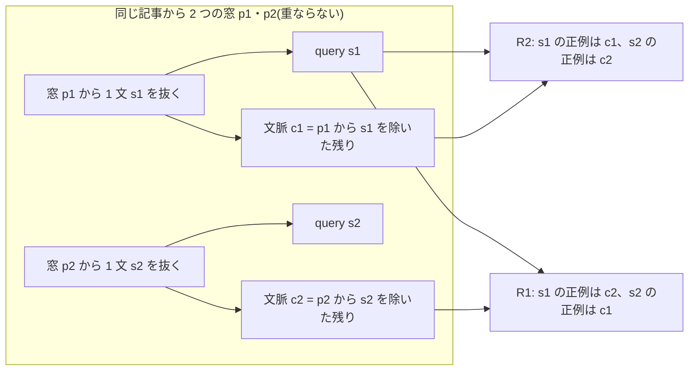
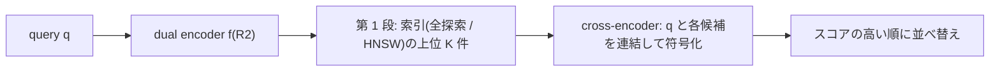

# 026. Inverse Cloze Task と passage 単位の 2 段階検索 / Inverse Cloze Task and Two-Stage Retrieval at Passage Level

## 1. 概要 / Overview

検索器(retriever)は、**何を関連とみなして学習するか(関連性の定義)** によって、学ぶものが変わる。[024](https://zenn.dev/kojikojiprg/books/ai-theories-roadmap/viewer/024_text_embedding_and_retriever-theory) は「同じ記事から切り出した別の区間」を正例にした
(記事単位の定義)。この定義では、話題が合っていれば解けるので、同じ記事の他の passage との区別は学習の信号に現れない。本トピックは、**passage 単位の定義** の学習として、
**Inverse Cloze Task**(Lee et al., 2019)を実装する。passage から 1 文を抜いて query にし、その文を除いた残りの文脈を正例にする自己教師ありの学習である。
同じ記事の他の passage(話題が同じ)が困難な負例になり、局所的な内容の一致が要る。

2 つの定義の比較は、**入力の形式を揃えて、関連性の定義だけを変える** 設計にする。学習では、どちらの条件も query は「passage(窓)から抜いた 1 文」で、正例の passage は文を 1 つ除いた形である。
passage 単位の定義(R2)の正例は、その文を抜いた元の窓の文脈で、記事単位の定義(R1)の正例は、同じ記事の別の窓の文を除いた形である。さらに、in-batch negatives に同じ記事の組を意図的に入れ、
**関連性の定義を、正例と in-batch の負例の両方に一貫して当てはめる**(R1 は同じ記事の組の passage を負例から除き、R2 は負例として数える)。評価では、同じ索引(すべての passage を 1 文を除いた形にしたもの)と同じ query(抜いた文)を使い、
関連のラベルだけを変える(passage 単位のラベルは正解が query の passage だけ、記事単位のラベルは正解が同じ記事の他の passage)。

そのうえで、後続のアプリ(`apps/`の RAG App)で使う **2 段階の検索**(retrieve-then-rerank)を組む。第 1 段は dual encoder(全探索と HNSW)、第 2 段は query と passage を連結して符号化する cross-encoder で、
cross-encoder は第 1 段の上位の候補だけを並べ替える。並べ替えモデルの学習の入力の分布は、推論時の候補(第 1 段の上位)に揃える。

[025](https://zenn.dev/kojikojiprg/books/ai-theories-roadmap/viewer/025_ann_search_and_reranking-theory) の実験 D・E は、cross-encoder の学習が成立せず前提不成立だった(その結論は 025 のとおりで、本トピックはやり直さない)。本トピックの実験 C は「アプリで並べ替えを足す価値があるか」という実用の問いで、025 の事後的な解釈を検証するものではない。

検証するのは次の 3 つである(いずれも判定つき。各実験は 1 つの検証事項を扱う)。

- **実験 A**: passage 単位のラベルの評価で、passage 単位の定義(Inverse Cloze Task)で学習した検索器(R2)の Recall@10 が、記事単位の定義で学習した検索器(R1)より高いか。
- **実験 B**: 同じ索引・同じ query の、記事単位のラベルの評価で、R1 の Recall@10 が R2 より高いか。
- **実験 C**: passage 単位のラベルの評価で、R2 の上位の候補を cross-encoder で並べ替えた構成(R3)の Recall@10 が、R2 だけ(並べ替えなし)より高いか。

実験 A と B を合わせると「定義が学ぶものを決める」という交差(各定義で学習した検索器が、その定義のラベルの評価で優れる)を表すが、部分ごとに別の検証事項として判定し、組み合わせの読み方は 6.1 節で事前に宣言する。
あわせて、判定を設けない観察として、(D)R2 の埋め込みの HNSW 索引で第 1 段を近似したときの 2 段階の検索の費用(距離計算の回数・順伝播の回数)と検索指標を、並べ替える候補の数 $K$ の数点で示し、
(E)同じ query に対する R1 と R2 の検索結果の例を示す。診断量として、024 と同じ形式の記事単位の評価(024 の評価用の索引と query)も、R1・R2・024 の Hub のモデルの 3 つで測る(判定には使わない)。

あわせて、判定を設けない観察として、(D)R2 の埋め込みの HNSW 索引で第 1 段を近似したときの 2 段階の検索の費用と検索指標、(E)同じ query に対する R1 と R2 の検索結果の例を示す。

### 1.1 実行の手順

手順は付録 A。本番実行は Google Colab T4 の 1 つのセッション(予算 120 分)で完結させた。

### 1.2 本番実行の結果の要約

| 実験(検証すること) | 対比量 | 閾値 | 最終判定 | 要約 |
|---|---|---|---|---|
| A: passage 単位のラベルで R2 が R1 より高いか | +0.0324 | 0.0082 | **支持** | passage 単位のラベルの Recall@10 は R1 0.0980、R2 0.1304 で、5 シードすべてで R2 が高かった。 |
| B: 記事単位のラベルで R1 が R2 より高いか | -0.0168 | 0.0073 | **反証** | 記事単位のラベルの Recall@10 は R1 0.1518、R2 0.1686 で、期待と逆に R2 が高かった。 |
| C: R2 の上位 50 件を並べ替えると R2 だけより高いか | +0.0903(参考値) | 0.0084 | **前提不成立** | 第 1 段の上位 50 件に正例が入る割合(coverage)が 0.2260 で、P3 の閾値 0.35 に届かなかった。参考値として Recall@10 は 0.1304 から 0.2207 に上がったが、結論として読まない。 |
| D・E: 2 段階の検索の費用と、検索結果の例(判定なし) | - | - | 判定なし | HNSW の第 1 段(距離計算 736 回。全探索は 16,384 回)でも、coverage と Recall@10 は全探索より 0.008〜0.013 低いだけだった。 |

実験 A と B の組み合わせは、事前の宣言のとおり **R2 が両方のラベルで優れる(定義の交差ではなく、passage 単位の定義の全面的な優位)** と読む。介入が正例の対応と、同じ記事の組の負例としての扱いの 2 つを含むため、どちらが効いたかは分けられない。選ばれた計画は計画 0 で、全体の経過時間は 73.8 分(予算 120 分。7.1 節)だった。R2 と cross-encoder のシード 0 は公開の条件を満たし、アップロードした(7.10 節)。実験 B の反証と実験 C の前提不成立の「なぜそうなったか」の考察は 7.11 節(事後的な解釈。検証済みの結論ではない)に記した。

## 2. 参考論文 / References

1. Lee, K., Chang, M.-W., Toutanova, K.,
   "Latent Retrieval for Weakly Supervised Open Domain Question Answering", ACL 2019. https://arxiv.org/abs/1906.00300
   (Inverse Cloze Task。3.2 節・実験 A・B)
2. Chang, W.-C., Yu, F. X., Chang, Y.-W., Yang, Y., Kumar, S.,
   "Pre-training Tasks for Embedding-based Large-scale Retrieval", ICLR 2020. https://arxiv.org/abs/2002.03932
   (3 つの事前学習の課題の比較。3.7 節。位置づけのみ)
3. Karpukhin, V., Oğuz, B., Min, S., Lewis, P., Wu, L., Edunov, S., Chen, D., Yih, W.,
   "Dense Passage Retrieval for Open-Domain Question Answering", EMNLP 2020. https://arxiv.org/abs/2004.04906
   (DPR。3.3・3.7 節)
4. Izacard, G., Caron, M., Hosseini, L., Riedel, S., Bojanowski, P., Joulin, A., Grave, E.,
   "Unsupervised Dense Information Retrieval with Contrastive Learning", TMLR 2022. https://arxiv.org/abs/2112.09118
   (Contriever。記事単位の定義の原型。3.1 節)
5. Nogueira, R., Cho, K.,
   "Passage Re-ranking with BERT", arXiv:1901.04085, 2019. https://arxiv.org/abs/1901.04085
   (cross-encoder による再順位づけ。3.6 節)
6. Kusupati, A., Bhatt, G., Rege, A., Wallingford, M., Sinha, A., Ramanujan, V., Howard-Snyder, W., Chen, K., Kakade, S., Jain, P., Farhadi, A.,
   "Matryoshka Representation Learning", NeurIPS 2022. https://arxiv.org/abs/2205.13147
   (入れ子の次元の損失。第 1 段の学習の損失は 024 の条件 C5 と同じ)
7. Malkov, Y. A., Yashunin, D. A.,
   "Efficient and Robust Approximate Nearest Neighbor Search Using Hierarchical Navigable Small World Graphs", IEEE TPAMI 2020. https://arxiv.org/abs/1603.09320
   (HNSW。観察 D で第 1 段を近似する。025 で実装)
8. Ma, J., Korotkov, I., Yang, Y., Hall, K., McDonald, R.,
   "Zero-shot Neural Passage Retrieval via Domain-targeted Synthetic Question Generation", arXiv:2004.14503, 2020. https://arxiv.org/abs/2004.14503
   (合成の質問による学習。3.7 節。位置づけのみ)
9. Dai, Z., Zhao, V. Y., Ma, J., Luan, Y., Ni, J., Lu, J., Bakalov, A., Guu, K., Hall, K. B., Chang, M.-W.,
   "Promptagator: Few-shot Dense Retrieval From 8 Examples", arXiv:2209.11755, 2022(ICLR 2023). https://arxiv.org/abs/2209.11755
   (大規模言語モデルによる合成の質問。3.7 節。位置づけのみ)

## 3. 理論 / Theory

### 3.1 動機: 関連性の定義が、検索器の学ぶものを決める

検索器の学習は、query $q$ に対して「どの passage を関連とみなすか」(正解の集合 $G_q$)を決めて初めて定まる。正解の決め方が違えば、同じ構造・同じ損失でも、学ぶ表現が変わる。

| 定義 | 正解の集合 $G_q$ | 本トピックでの記号 | 学習の正例の作り方 |
|---|---|---|---|
| 記事単位 | query と同じ記事の、query の元の passage 以外の passage | R1 | query を抜いた窓とは別の、同じ記事の窓(文を 1 つ除いた形)。024 の independent cropping(Contriever [4])に相当する定義 |
| passage 単位 | query の文を抜いた元の passage ただ 1 つ | R2 | Inverse Cloze Task [1]: query を抜いた窓の、その文を除いた残り |

(表の R1・R2 は、本トピックで学習する 2 つの検索器の条件を表す記号である。)

- **記事単位** では、query の話題が合っている passage ならどれでも正解なので、話題の一致で解ける。同じ記事の他の passage は、すべて正解であり、互いを区別する信号は学習に現れない。
- **passage 単位** では、同じ記事の他の passage は話題が同じなのに正解ではない(困難な負例)。query の文の局所的な内容(固有名詞、数、文脈の語)が、元の passage の文脈と一致することが手がかりになる。

**入力の形式を揃える**: 024 の R1 に相当する学習は、固定長の窓を query と正例にするので、query が文である Inverse Cloze Task の入力と形式が違う。形式が違うと、各条件が学習で見た形式の評価で勝つだけで、関連性の定義の効果と形式の一致の効果を分けられない。
本トピックは、**R1 の query も、R2 と同じく「窓から抜いた 1 文」にし、正例の passage も、どちらの条件も文を 1 つ除いた形にする**。2 つの条件の違いは、(1)どの passage を正例にするか(query の元の窓 / 同じ記事の別の窓)と、(2)in-batch negatives の扱い(3.3 節)だけである。
評価も、同じ索引(すべての passage を 1 文を除いた形にしたもの)と同じ query(抜いた文)で、関連のラベルだけを変える(3.5 節)。

[025](https://zenn.dev/kojikojiprg/books/ai-theories-roadmap/viewer/025_ann_search_and_reranking-theory) の実験 D・E は前提不成立だった。その事後的な解釈の候補の一つは、記事単位の関連性の定義が、query と passage の語どうしの相互作用を必要としていなかった可能性で、passage 単位の定義は局所的な内容の一致を要求する点でこの候補と関係する。**ただし、本トピックの実験はその解釈を検証するものではない**。本トピックが確かめるのは、定義の違いが検索器の指標にどう現れるか(実験 A・B)と、2 段階の検索で並べ替えを足す価値があるか(実験 C)である。

### 3.2 Inverse Cloze Task

passage $p$ が $m$ 個の文 $s_1, \dots, s_m$ からなるとする($m \ge 2$)。Inverse Cloze Task [1] は、次の手順で学習の組を作る(cloze は、文の穴埋め問題の意味で、その「逆」: 穴(抜いた文)から、穴の周りの文脈を探す)。

1. $s_i$ を、条件を満たす文の中から一様に選ぶ($i$ は抜く文の番号)。$q = s_i$ を query とする。
2. 確率 $1 - r$ で、文脈 $c = p \setminus s_i$(passage から $s_i$ を除いたもの)を正例にする。確率 $r$ で、文を抜かず、文脈 $c = p$(query の文を含む)を正例にする。

$r$ は抜いた文を文脈に残す確率で、原論文 [1] は $r = 0.1$ とする(文を抜く割合は 90%)。**文を抜かない組を混ぜる理由**: 常に文を抜くと、検索器は「語の一致」が強い手がかりになることを学べない。
文を残した組では、query の語が文脈にそのまま現れるので、語の一致を学べる。文を抜いた組では、語の一致に頼れず、話題・固有名詞・文脈の語などの抽象的な表現が要る。
原論文は、両方を学ばせるために、文を抜く割合を 90% にしている。本トピックも $r = 0.1$ を採る。

学習の損失は、[024](https://zenn.dev/kojikojiprg/books/ai-theories-roadmap/viewer/024_text_embedding_and_retriever-theory) と同じ in-batch negatives の InfoNCE である。$N$ 組のバッチで、$u_i$ を query $q_i$ の、$v_j$ を文脈 $c_j$ の L2 正規化した埋め込み、
$\tau$ を温度として

$$
\mathcal{L}_{\mathrm{NCE}} = -\frac{1}{N} \sum_{i=1}^{N} \log \frac{\exp(u_i^\top v_i / \tau)}{\sum_{j=1}^{N} \exp(u_i^\top v_j / \tau)}
$$

である。本トピックの第 1 段の学習は、さらに Matryoshka Representation Learning [6] の入れ子の次元の和を使う(損失の形は 024 の条件 C5 と同じ。R1 と R2 で揃える量)。

(図は補助的な視覚化であり、本文の数式と文章だけでも理解が成立する。)

**本トピックの学習の組**: 1 つのバッチは、32 個の記事 × 各記事 2 組の 64 組である。各記事から、互いに重ならない 2 つの窓 $p_1, p_2$ を引き、それぞれから抜く文 $s_1, s_2$ を選ぶ。
R2 は $(s_1, c_1)$・$(s_2, c_2)$ を組にし($c_i$ は $p_i$ から $s_i$ を除いた文脈)、R1 は $(s_1, c_2)$・$(s_2, c_1)$ を組にする(同じ記事のもう一方の窓の、文を除いた形が正例)。
したがって、同じバッチに入る query と passage のトークンは R1 と R2 で同じで、**正例の対応だけが違う**。文を文脈に残す確率 $r$ も共通である(文脈の組ごとに決める。R1 の正例にも同じ文脈をそのまま使う)。

### 3.3 in-batch negatives で、同じ記事の組が同じバッチに入ったときの扱い

in-batch negatives は、同じバッチの他の組の passage を負例とみなす。同じ記事から複数の組が同じバッチに入ったとき、2 つの定義で扱いが **逆** になる。

| 定義 | 同じバッチの、同じ記事の他の組の passage | 損失での扱い |
|---|---|---|
| 記事単位(R1) | 実際には正解(関連がある) | 負例から **除く**(損失の候補から取り除く)。負例として押しのけると、意味的に近いものを遠ざける(偽の負例、false negative) |
| passage 単位(R2) | 実際には負例(話題が同じで正解ではない) | 負例として **数える**。局所的な内容の一致を要求する困難な負例になる |

本トピックは、**同じ記事の組を意図的に同じバッチに入れ**(32 記事 × 2 組)、損失での扱いだけを定義に合わせる。R1 の候補は、query 1 つあたり、正例 1 つと、別の記事の passage 62 個(同じ記事の組の passage 1 つを除く)で、
R2 の候補は、正例 1 つと、63 個の負例(同じ記事の組の passage を含む)である。**関連性の定義を、正例と in-batch の負例の両方に一貫して当てはめること** が、実験 A・B の介入である。
InfoNCE の損失は、除く組を $\mathcal{E}_i$(query $i$ と同じ記事の他の組の集合。R2 では空集合)として

$$
\mathcal{L}_{\mathrm{NCE}} = -\frac{1}{N} \sum_{i=1}^{N} \log \frac{\exp(u_i^\top v_i / \tau)}{\sum_{j \notin \mathcal{E}_i} \exp(u_i^\top v_j / \tau)}
$$

である(和は、除く組を除いたすべての $j$ にわたり、正例 $j = i$ を含む)。

### 3.4 文の分割: トークン列の上の規則

passage は 008 のトークナイザ(バイトレベルの BPE)のトークン列である。文の区切りは、テキストにデコードせず、トークンごとの表(トークン ID を引く真偽の表)で次のように決める。このトークナイザは、空白と改行を直後の語の先頭に付けるので、
「次のトークンが空白または改行で始まる位置」が語の境目になる。位置 $t$ の直後で文が終わるのは、次のいずれかである。

1. 次のトークンが **改行** で始まる(行の終わり。箇条書き・見出し・段落の区切り)。
2. 次のトークンが **空白** で始まり、かつ位置 $t$ のトークンのテキストが`.`・`!`・`?`で終わる(直後に閉じ引用符・閉じ括弧が付いていてもよい)。位置 $t$ のトークンが閉じ引用符・閉じ括弧だけで、その直前のトークンが`.`・`!`・`?`で終わる場合も含める。

passage の端は文の端として数える。したがって、passage の先頭と末尾の文は、元の文の一部(断片)であることがある。**既知の誤り**: 略語・イニシャル(`U.S.`・`Dr.`など)の後の空白で分割してしまい、`3.14`のように空白を伴わないものは分割しない。略語の辞書は使わない。

**抜く文の条件**: 長さが $L_{\min} = 4$ トークン以上 $L_{\max} = 96$ トークン以下の文(短すぎる文は query にならず、長すぎる文を抜くと文脈が短くなりすぎる)。passage に文が 2 つ以上あり、この条件を満たす文が 1 つ以上ある passage だけが、Inverse Cloze Task の対象になる。
**切り詰めを減らす選び方**: 抜く文は、query の長さの上限 $L_q = 32$ トークン以内に収まる文があれば、その中から一様に選び、収まる文がない passage だけ、より長い文から選んで先頭を切り詰める。学習と評価の索引の両方に同じ規則を適用する。
**query の長さ**: 抜いた文の先頭の $L_q = 32$ トークン(024 と同じ上限。文がそれより長ければ先頭を切る。抜く範囲は文の全体)。文脈の長さは、窓の長さ $L_p = 128$ から抜いた文の長さを引いた値で、組ごとに違う。

### 3.5 評価の索引と、関連のラベル(passage 単位と記事単位)

評価では、索引のすべての passage について、抜く文を決定的に 1 つ選び、その文を **除いた形** を索引に入れる。抜いた文がその passage の query である。
索引の passage がすべて「1 文を除いた形」になるので、除いたかどうかが手がかりにならない(対象でない passage、すなわち文を除けない passage は、除いていない形で索引に入れず、索引から除く)。
**同じ索引・同じ query に、関連のラベルだけを変えて 2 回当てる**。

- **passage 単位のラベル**(実験 A): 正解は query の passage $p_i^+$ だけ。スコアを $s(q_i, p) = f(q_i)^\top f(p)$ として、正例の順位は

$$
r_i = 1 + \bigl\lvert \{\, p \ne p_i^+ : s(q_i, p) \ge s(q_i, p_i^+) \,\} \bigr\rvert
$$

  である(同点は正例に不利に数える: 正例と同じスコアの正例でない passage は、正例より上位とみなす)。
- **記事単位のラベル**(実験 B。024 と同じ定義): 正解は、query と同じ記事の、query の passage 以外の passage の集合 $G_i$。**query の passage 自身は候補から除く**(正解でも不正解でもない)。順位は、最もスコアの高い正解の順位

$$
r_i = 1 + \bigl\lvert \{\, p \notin G_i \cup \{p_i^+\} : s(q_i, p) \ge \max_{g \in G_i} s(q_i, g) \,\} \bigr\rvert
$$

  (同点は正解に不利)。正解が複数あるので、Recall@$k$ は **上位 $k$ 件に正解が 1 つ以上ある query の割合** である。

どちらのラベルも Recall@$k$ は $\frac{1}{Q} \sum_{i=1}^{Q} \mathbb{1}[r_i \le k]$($Q$ は query の数)。主指標は Recall@10 で、平均逆順位(Mean Reciprocal Rank)を診断量にする。
**query は、記事単位のラベルの正解(同じ記事の他の passage)が索引に 1 つ以上ある query に限る**(2 つのラベルで同じ query を使うため)。評価の対象の検索は、コーパス全体の索引(使う記事すべての passage)で行う。

### 3.6 2 段階の検索(retrieve-then-rerank)と、並べ替えモデルの学習の入力の分布

全 passage との組を cross-encoder で符号化するのは費用が大きいので、第 1 段(dual encoder による全探索または近似最近傍探索)が上位 $K$ 件の候補を絞り込み、第 2 段(cross-encoder)がその $K$ 件だけを並べ替える。
1 query あたりの費用は

$$
C_{\mathrm{total}} = C_{\mathrm{first}} + K \cdot F_{\mathrm{pair}}
$$

である($C_{\mathrm{first}}$ は第 1 段の距離計算の回数(全探索なら索引の passage の数 $P$)、$K$ は並べ替える候補の数、$F_{\mathrm{pair}}$ は 1 組あたりの順伝播の費用)。cross-encoder の順伝播の回数は $K$ 回である。
並べ替えで到達できる Recall@10 の上限は、上位 $K$ 件に正例が入っている query の割合(coverage)である。

**並べ替えモデルの学習の入力の分布を、推論時に見る入力の分布に揃える**。推論時の候補は、第 1 段の上位 $K$ 件である。学習で、正例を第 1 段の上位の外の passage から選ぶと、
「第 1 段のスコアが低い候補が正例」という、推論時には成り立たない手がかりで損失を下げられてしまう。そのため本トピックは、正例が第 1 段の上位 $K$ 件に入る query だけを使い、
負例も同じ上位 $K$ 件から(正例を除いて)選ぶ。学習の query は、索引に入れる形(文を除いた passage)と同じ作り方で、学習用の記事の passage から作る。

cross-encoder の構成([025](https://zenn.dev/kojikojiprg/books/ai-theories-roadmap/viewer/025_ann_search_and_reranking-theory) と同じ): 列`[query] [区切り] [passage] [終端]`を因果マスクのもとで符号化し、**終端の位置の隠れ状態**(query 全体と passage 全体の両方を見ている唯一の位置)に線形の層を付けてスカラーのスコアにする。
query と passage の長さが組ごとに違うので、列は左から詰めて並べ、終端の位置は列の有効な長さの最後にする。

### 3.7 位置づけのみ(実装しない)

- **Body First Selection と Wiki Link Prediction**(Chang et al. [2]): Inverse Cloze Task と並ぶ、文書の構造を使う自己教師ありの検索の課題。Body First Selection は、記事の最初の節の中の文を query にして、同じ記事の別の passage を正例にする。
  Wiki Link Prediction は、ハイパーリンクのある文を query にして、リンク先の記事の passage を正例にする。[2] は、3 つの課題を組み合わせると、単独より検索の指標が高くなることを報告した。
- **DPR**(Karpukhin et al. [3]): 質問と、答えを含む passage の組による教師あり学習。BM25 による困難な負例と in-batch negatives を使う。質問と passage の組は、人手のラベルを要する。
- **合成の質問の生成**(Ma et al. [8]、Dai et al. [9]): 文章から質問を生成する生成モデル(小規模または大規模な言語モデル)で、質問と文章の組を自動で作り、検索器を学習する。Inverse Cloze Task は、生成モデルを使わず、文章自身の文を query にする最も単純な合成の形とみなせる。

### 3.8 データの流れとアルゴリズム(擬似コード)

学習の組の作り方、評価の索引の構築、2 段階の検索、cross-encoder の学習の擬似コードは付録 G。

## 4. 実装方針 / Implementation Policy

**`src/`に切り出す(スクラッチ実装、本トピックで新規作成)**:

- `src/data/inverse_cloze.py`: 文の分割の表と文の境界、抜く文の選択、窓から文を抜く操作、Inverse Cloze Task の学習の組、passage 単位の評価の索引。
- `src/models/variable_length.py`: 可変長の入力の平均プールと符号化、可変長の cross-encoder(列を左から詰める)。
- `src/training/contrastive_text_variable.py`: 学習の組を受け取る第 1 段の学習ループと、同じ記事の組を負例から除くマスクつきの損失。
- `src/training/reranking_variable.py`: cross-encoder の学習の組と学習ループ。
- `src/retrieval/passage_level.py`: 単一の正例の順位(同点は正例に不利)、同じ索引・同じ query の記事単位のラベルの順位、並べ替えの順位。

`src/`は新しいファイルの追加のみで、024 と 025 のモジュールはそのまま再利用する。ノートブックの中に直接書くのは、条件の定義、単体テストと不変条件の確認、スケーリングの計測、パイロット、実行計画の選択、学習率の較正、判定、可視化、Hub へのアップロードである。モジュールごとの説明、生成物の置き場所、外部から取得するもの、アップロード方針は付録 E・G。

## 5. 実装 / Implementation

### 5.1 環境セットアップ(Google Colab)

`SMOKE_TEST`(動作確認か本番か)はこのセルでのみ切り替え、実行環境をこのセルで 1 回だけ印字する。学習は、CUDA では FP16 の`torch.autocast`と動的損失スケーリング(011)で行い、埋め込みの正規化・類似度・損失・評価は FP32 で行う(付録 A、G)。

### 5.2 スケールの設定(`SMOKE_TEST`の配線)

水準の定義をこのセルに集約した。動作確認では、本番と同じ構造(等比・順序関係)を保ったまま縮小する(付録 A.2)。

### 5.3 データ: コーパス・記事の分割・Inverse Cloze Task の索引

024 と同じ英語 Wikipedia のコーパスから、008 の事前学習に使った先頭の 356 記事を除く 9,470 記事を使い、記事を単位として学習用(9,070 記事)・検証用(100 記事)・評価用(300 記事)に分ける(024 と同じ分割)。使う記事すべてを重ならない長さ 128 の窓に分けて passage にし、評価の索引(passage ごとに抜く文を決定的に 1 つ選び、除いた形にしたもの)と、第 1 段の学習の組(3.2 節)を作る(詳細は付録 G)。

### 5.4 モデルの構築・単体テスト・不変条件の確認

008 の学習済みの重みから始める小型 GPT で、R1・R2 は平均プール・因果マスクの埋め込みモデル、cross-encoder は終端の位置の出力へのスカラーのヘッドを付けたモデルである(全パラメータを更新する)。文の分割、抜く文の選択、評価の索引、学習の組、可変長のモデル、指標(同点は正例・正解に不利)、マスクつきの in-batch negatives、学習ループ(学習率 0 で更新がないこと)の単体テストと、`src/`が追加のみであることの確認を行う(詳細は付録 G)。

### 5.5 学習と評価のヘルパー

`train_first_stage()`と`train_cross_encoder()`で第 1 段(R1・R2)と cross-encoder を学習し、`evaluate_calibration()`と`evaluate_main()`で検証用・評価用の集合を評価する(詳細は付録 G)。

## 6. 実験 / Experiments

### 6.1 実験宣言セル: 共通の設定・検証すること・判定基準・前提条件

**この節の内容は本番実行の前に確定させ、結果を見た後に変更しない。** 共通の設定の詳細、揃えた量、学習量、較正の規則、前提条件の閾値の根拠、検出力の事前確認、実験ごとの作用点などは付録 C。

#### 共通の設定

- **第 1 段(R1・R2)**: 008 と同じ小型 GPT から始め、全パラメータを更新する。query と passage で重みを共有する encoder で、最終正規化層の後の隠れ状態の平均プール(右側のパディングを除く)を L2 正規化したものを埋め込みとする($d = 256$)。損失は in-batch negatives の InfoNCE(温度 $\tau = 0.05$)と Matryoshka Representation Learning(024 の条件 C5 と同じ形)、バッチは 64 組(**32 記事 × 各記事 2 組**)、学習ステップ数は $T_1 = 1024$。**query は、どちらの条件も「窓から抜いた 1 文」で、文を文脈に残す確率 $r = 0.1$ も共通。** 正例は、R2 が query を抜いた窓の文脈、R1 が同じ記事のもう一方の窓の文脈(3.2 節)。R1 は同じ記事の組の passage を負例から除き(1 行あたりの負例 62 個)、R2 は負例として数える(63 個)。
- **cross-encoder**: 025 と同じ構成(008 の重みから始め、列`[query] [区切り] [passage] [終端]`を因果マスクのもとで符号化し、終端の位置の出力に線形のヘッドを付ける)。損失は 1 個の正例と 7 個の負例の 8 個の候補の上の softmax 交差エントロピー、1 ステップ 8 個の query。学習ステップ数 $T_2$ は、候補 $(2048, 4096, 8192)$ から 6.3 節のパイロットで自動で選ぶ。
- **データ**: 5.3 節のとおり。学習用・検証用・評価用のすべてが、008 の事前学習とトークナイザの学習の範囲の外にある。
- **評価**: Recall@10(3.5 節)。学習の最終ステップの重みで、FP32、全件の内積で順位をつける。$R_s(c)$ を条件 $c$・シード $s$ の Recall@10 とする。**実験 A・B は同じ索引・同じ query** で、関連のラベルだけを変える。索引はコーパス全体(すべての passage を、抜く文を 1 つ固定して除いた形にしたもの。約 9.4 万個)で、query は評価用の記事の passage から取り除いた文(約 3,200 個。記事単位のラベルの正解が 1 つ以上ある query に限る)。実験 A は passage 単位のラベル(正解は query の passage だけ)、実験 B は記事単位のラベル(正解は同じ記事の他の passage。query の passage 自身は候補から除く)。
- 実験 A・B の結論は、008 の 1 つのチェックポイント(`main`)から始めた場合に限る。

#### 条件の対応表

| 記号 | 正例の定義 | 学習の組 | 並べ替え | 使う実験 |
|---|---|---|---|---|
| R1 | 記事単位 | query = 窓から抜いた文。正例 = 同じ記事のもう一方の窓の、文を除いた形。同じ記事の組を負例から除く | なし | 実験 A の基準、実験 B の条件 1 |
| R2 | passage 単位 | Inverse Cloze Task: query = 窓から抜いた文。正例 = その窓の文脈(10% は文を残す)。同じ記事の組を負例として数える | なし | 実験 A の条件 2、実験 B の条件 2、実験 C の基準 |
| R3 | passage 単位 | R2 の上位 50 件を cross-encoder で並べ替える | cross-encoder | 実験 C の条件 |

数式の添字の R1・R2 はこの表の記号である。

#### 揃えた量と、学習量についての注意

R1 と R2 では、起点・モデルの構成・$T_1$・バッチ・温度・損失の形・学習率スケジュールの形と、記事の並び・窓・抜く文・文を残す組・入力の形式・評価の索引と query を揃える。**揃えないのは** 正例の対応と同じ記事の組の扱い(実験 A・B の介入)、1 行あたりの負例の数(R1 が 62 個、R2 が 63 個。介入に含まれる)、学習率(条件ごとに較正する)である。cross-encoder の追加の学習量は、実験 C では揃えない(実用の問い。付録 C.1)。

組を作れる学習用の記事は 8,639 本で、$T_1 = 1024$ は約 **0.059 エポック** にあたり、学習用の記事のトークンの大半は一度も見ない。024 の C5 は $T_1 = 1024$ でも検証用の Recall@10 が学習の最後まで伸びていたので、実験 A・B は **学習が飽和していない状態での比較** である(付録 C.2)。

#### 学習率の較正(本番の冒頭、6.5 節)

第 1 段は R1・R2 とも、中心 $4.8 \times 10^{-4}$(024 の C5 の較正で選ばれた値)の $\{1/4, 1, 4\}$ 倍、cross-encoder は中心 $2.4 \times 10^{-4}$(025 のパイロットで最後の区間の訓練損失が最も低かった学習率)の $\{1/4, 1, 4\}$ 倍(公比 4 の 3 点)を、本番と同じスケールで、較正専用のシード(番号 90)の 1 シードで学習する。評価用の集合は使わない。指標は、第 1 段が検証用の記事の passage だけを索引にした同じ索引・同じ query での、passage 単位のラベルと記事単位のラベルの Recall@10 の平均(R1 と R2 を同じ指標で較正する)、cross-encoder が検証用の query の並べ替えの Recall@10。指標が最大の点から標準偏差の 1 倍以内の候補(P1(a)を満たす点)のうち、学習の成立の余裕が最大の点を選び、格子の端に来たときは 1 点だけ拡張する。規則の詳細と、規則で学習率を決める削る段階(段階 4・5)の偏りの向きは付録 C.4。

#### 共通の前提条件

前提条件は、検証したい仮説とは独立な量で定義する。成立しなかった実験は、支持・反証・判定不能のいずれとも判定せず「前提不成立」として記録する。

- **P0(較正)**: 対比量に入る条件のうち、自分自身を較正した条件で、選んだ学習率が格子の内点であること。
- **P1(学習の成立)**: **更新なしの状態では成立しない量** で定義する。第 1 段(実験 A・B): (a)全シードで、訓練損失が有限で、最後の 5% のステップの訓練損失が、同じ組での学習前のモデルの損失の 0.9 倍以下。(b)全シードで、自分の定義のラベルの検証用の Recall@10(R1: 記事単位のラベル、R2: passage 単位のラベル)が、学習前の 008 の同じ集合での値より 0.04 以上高い。cross-encoder(実験 C): (a)全シードで、最後の 5% のステップの訓練損失が、同じ組での学習前のモデルの損失より標準誤差の 2 倍以上低く、かつ一様な予測の損失 $\ln 8$ 未満。(b)検証用の query の並べ替えの Recall@10 の、学習前の cross-encoder からの増分のシード平均が、判定と同じ式の標準偏差 $\sigma_g$ の 2 倍以上。
- **P2(天井と床、改善の余地)**: 実験 A・B は、基準の条件(R1)の Recall@10 が 0.02 以上 0.95 以下。実験 C は、$R(\mathrm{R2})$ が coverage より 0.05 以上低いこと。
- **P3(実験 C の第 1 段の候補)**: 第 1 段(R2)の上位 $K = 50$ 件に正例が入る割合(coverage)が 0.35 以上で、coverage − $R(\mathrm{R2})$(並べ替えの余地)が 0.10 以上(全シードの平均)。この閾値は、025 の記事単位のラベルの第 1 段の値(coverage 0.4094、並べ替えなしの Recall@10 0.2199)を目安に置いた(passage 単位の R2 の値は事前に分からず、測っていない範囲)。

閾値の根拠と、前提条件の閾値の下限は付録 C.5。

#### 判定の形と標準偏差の単位

対比量 $\Delta$ は、同じシードどうしで対応をとった差 $d_s$ のシード平均で、標準偏差は

$$
\sigma = \sqrt{\frac{\mathrm{Var}_s(d_s)}{n} + \sigma_{\mathrm{boot}}^2}
$$

とする($n$ はシード数、$\mathrm{Var}_s$ はシード間の不偏分散、$\sigma_{\mathrm{boot}}$ は記事を単位とする対応付きのクラスタブートストラップ(反復 10,000 回)で対比量を作り直したときの標準偏差)。評価用の query は全シードで共通で、その有限性による変動はシード間の分散に現れないので、第 2 項で補う(導出は付録 C.7)。判定は 3 値で、閾値は $2\sigma$ とする: **支持** は $\Delta > 2\sigma$、**反証** は $\Delta < -2\sigma$、**判定不能** は $\lvert \Delta \rvert \le 2\sigma$。

#### 実験 A: passage 単位のラベルの評価での、関連性の定義の効果

**検証すること**: 同じ索引・同じ query の passage 単位のラベルの評価で、passage 単位の定義(Inverse Cloze Task)で学習した R2 の Recall@10 が、記事単位の定義で学習した R1 より高いか。R1 と R2 は、008 の重み・平均プール・因果マスク・Matryoshka Representation Learning の損失・同じ記事・同じ窓・同じ抜く文・同じ入力の形式・同じ $T_1$ で、**違いは関連性の定義だけ**(正例の対応と、同じ記事の組の in-batch での扱い。3.2・3.3 節)。

**判定基準**: $\Delta_A = \frac{1}{n} \sum_s ( R_s(\mathrm{R2}) - R_s(\mathrm{R1}) )$($R_s(c)$ は passage 単位のラベルでの Recall@10。正を期待)。$\Delta_A > 2\sigma_A$ なら支持、$\Delta_A < -2\sigma_A$ なら反証、それ以外は判定不能。

**前提条件**: P0(R1・R2)、P1(R1・R2)、P2($R(\mathrm{R1})$ の passage 単位のラベルが 0.02 以上 0.95 以下)。

**解釈の注意**: R2 は in-batch negatives の同じ記事の組を負例として数え、同じ記事の困難な負例を見る。これは介入の一部で、**対比量を正の向きに大きくしうる**。R1 の負例は 1 行あたり 62 個で R2(63 個)より 1 つ少なく、この差も介入に含まれる。評価の passage 単位のラベルは R2 の学習の目標と一致するが、それは関連性の定義そのものの帰結である。削る段階 4 以降で R1 の学習率を規則で決めた場合は、R1 の値が下がり、対比量が仮説に有利な向きに偏る(付録 C.4)。

#### 実験 B: 記事単位のラベルの評価での、関連性の定義の効果

**検証すること**: 実験 A と同じ索引・同じ query の記事単位のラベルの評価(正解は同じ記事の他の passage。query の passage 自身は候補から除く)で、R1 の Recall@10 が R2 より高いか。実験 A と同じ R1 と R2(再学習しない)で、違いは評価のラベルだけ。

**判定基準**: $\Delta_B = \frac{1}{n} \sum_s ( R_s(\mathrm{R1}) - R_s(\mathrm{R2}) )$($R_s(c)$ は記事単位のラベルでの Recall@10。上位 10 件に正解が 1 つ以上ある query の割合。正を期待)。$\Delta_B > 2\sigma_B$ なら支持、$\Delta_B < -2\sigma_B$ なら反証、それ以外は判定不能。

**前提条件**: P0(R1・R2)、P1(R1・R2)、P2($R(\mathrm{R1})$ の記事単位のラベルが 0.02 以上 0.95 以下)。

**解釈の注意**: 入力の形式は両条件で同じで、形式の不一致による不利はない。実験 A と同じ介入の束ね方による解釈の制約があり、削る段階 4 以降の R1 の学習率の偏りは、実験 B では対比量を **負の向き(仮説に不利)** に偏らせる(付録 C.4)。

**実験 A と B の判定の組み合わせの読み方**(事前の宣言。部分ごとの判定は別々に記録し、どちらかが前提不成立のときは適用しない): 両方が支持なら **交差**(各定義の検索器が、その定義のラベルの評価で優れる。定義が学ぶものを決める)。A が支持で B が反証なら **R2 が両方のラベルで優れる**(定義の交差ではなく、passage 単位の定義の全面的な優位)。A が反証で B が支持なら R1 の全面的な優位、両方が反証なら逆の交差。一方が判定不能の組は、交差とは言えない。両方が判定不能なら、この学習量・この設定で定義の違いは検出されない(3 × 3 の表は付録 C.8)。

#### 実験 C: 2 段階の検索の効果(アプリの構成の判断)

**検証すること**: passage 単位の評価で、R2 の上位 $K = 50$ 件を cross-encoder で並べ替えた構成(R3)の Recall@10 が、R2 だけ(並べ替えなし)より高いか。同じシードの R2 の上位 50 件を、同じシードの cross-encoder で並べ替える。

**判定基準**: $\Delta_C = \frac{1}{n} \sum_s ( R_s(\mathrm{R3}) - R_s(\mathrm{R2}) )$(評価に使う query は評価用のすべて。正を期待)。$\Delta_C > 2\sigma_C$ なら支持、$\Delta_C < -2\sigma_C$ なら反証、それ以外は判定不能。

**前提条件**: P0(R2・cross-encoder)、P1(R2 は実験 A・B の P1、cross-encoder は P1)、P2($R(\mathrm{R2}) \le$ coverage − 0.05)、P3(coverage ≥ 0.35 かつ coverage − $R(\mathrm{R2})$ ≥ 0.10)。

**解釈の注意**: 「R2 + cross-encoder」は、R2 に加えて cross-encoder の追加の学習($T_2$ ステップ)を使う。**同じ学習量での優劣を比べる実験ではなく**、「アプリで並べ替えを足す価値があるか」という実用の問いで、費用(順伝播の回数 $K$)と合わせて読む。並べ替えで到達できる Recall@10 の上限は coverage で、$\Delta_C$ の最大は coverage − $R(\mathrm{R2})$ である。段階 5 以降の cross-encoder の学習率は中心の値で、最適からずれると対比量が負の向きに偏る(付録 C.4)。

#### 観察 D・E(判定基準を設けない)

観察 D は、R2 のシード 0 の埋め込みの部分集合(件数 $N_{\mathrm{obs}}$)で、第 1 段を全探索と HNSW(025 の実装)にして、cross-encoder のシード 0 で上位 $K = 10, 20, 50, 100$ 件を並べ替え、1 query あたりの第 1 段の距離計算の回数、第 2 段の順伝播の回数 $K$、並べ替えなしと並べ替えた後の Recall@10 と coverage を示す(部分集合の値で、実験 A・C の絶対値とは比べない)。観察 E は、R1 と R2 のシード 0 の検索結果の例を示す。選び方は付録 C.8。

### 6.2 スケーリングの計測と外挿(1 セッションの見積もり)

本番でデータ量や回数が大きくなる処理を、実行するデバイスの上で計測し、見積もり(6.4 節)に使う。計測は結果(対比量)を作らない。詳細は付録 D。

### 6.3 パイロット(第 1 段の R2 と cross-encoder の学習ステップ数)

本番と同じセッションの冒頭で、学習を伴うパイロットを行う。測るのは単一の条件の量だけで、条件間の比較や対比量の計算はしない。第 1 段の R2 を較正専用のシード(90)で学習して coverage を求め、cross-encoder の学習ステップ数 $T_2 = 2048, 4096, 8192$ の順に、学習の成立・増分・R2 だけの値を上回ることの 3 条件がすべて成立する最小のものを選ぶ(詳細は付録 D)。

### 6.4 実行計画の選択

6.2・6.3 節の計測とパイロットの後の経過時間から、8 通りの計画(削る段階の組)の残りの実行時間を見積もり、予算(120 分)に収まる計画のうち番号の最も小さいものを、見積もりと経過時間のみから自動で選ぶ(付録 D)。

#### 6.4.1 学習の組の事前生成

選んだ計画が使う学習の組の生成を、学習の前に済ませて確かめる(付録 D)。

### 6.5 学習率の較正

6.1 節の規則で、条件ごとに学習率を決める。各格子点の値は、このセルの出力にある。

### 6.6 第 1 段の本番の学習と評価

選ばれた計画のシード数の R1 と R2 をすべて学習し、評価用の集合で評価する。R2 は、cross-encoder のために第 1 段の上位 $K$ 件も求める。

### 6.7 cross-encoder の本番の学習と評価

シード $s$ の cross-encoder は、シード $s$ の R2 の上位 $K$ 件で学習し、評価する。

### 6.8 実験 A: passage 単位の評価での、関連性の定義の効果

    

    

### 6.9 実験 B: 記事単位の評価での、関連性の定義の効果

    

    

### 6.10 実験 C: 2 段階の検索の効果(アプリの構成の判断)

    

    

### 6.11 観察 D・E(判定なし)

R2 のシード 0 の埋め込みの部分集合で、第 1 段を全探索と HNSW にして、cross-encoder のシード 0 で並べ替える(観察 D)。R1 と R2 の検索結果の例を示す(観察 E)。選び方は付録 C.8。

    

    

### 6.12 不変条件のアサーションと`SMOKE_TEST`の配線

実効水準の照合、同じシードの R1 と R2 の記事の並びの一致、総パラメータ数、保持した埋め込みからの順位の再計算などを、アサーションで確かめる。

### 6.13 判定結果の一覧

判定は 1.2 節の表と、7.3〜7.6 節に示した。

### 6.14 Hugging Face Hub へのアップロード(R2 のシード 0・cross-encoder のシード 0)

後続のアプリ(`apps/`)の入力にする 2 つのモデルを、公開の条件(判定ではない)を満たし、`UPLOAD_ARTIFACTS`が`True`のときだけアップロードする。条件は、読み込み直した重みで、R2 のシード 0 の passage 単位の評価での Recall@10 が R1 のシード 0 を上回ること、cross-encoder のシード 0 の並べ替えた Recall@10 が並べ替えなしを上回ることである。結果は 7.10 節、詳細は付録 E。

## 7. 結果・考察 / Results and Discussion

この章の数値は、すべて本番のセル出力による。7.1〜7.10 は、事前に宣言した判定基準による結論と、その周辺の記録である。結果を見た後に立てた解釈は **7.11 節にまとめ、検証済みの結論として扱わない。** 診断量の詳細は付録 F。

### 7.1 実行の概要

**実行環境**(5.1 節の出力): Google Colab、Tesla T4、コミット`47f25ba`、実行日時 2026-10-14T04:11:03 UTC。**選ばれた計画**(6.4 節): 計画 0(削らない)。第 1 段のシード数 5、cross-encoder のシード数 5。経過時間 15.4 分の時点で、計画 0 の見積もりは終了の見込み 86.7 分で予算 120 分に収まり、全体の経過時間は 73.8 分だった(付録 D)。規則で学習率を決める段階(段階 4 以降)は使われず、規則で決めた学習率による偏りはない。

**学習量**: 第 1 段は $T_1 = 1024$(1 ステップ 64 組。0.059 エポック)。cross-encoder は、パイロットで 3 つの条件がすべて成立した最小の $T_2 = 2048$ が選ばれた(学習に使える query に対して約 0.78〜0.80 エポック)。**学習率**(6.5 節): R2 と R1 は $4.8 \times 10^{-4}$(内点)、cross-encoder は $9.6 \times 10^{-4}$(格子の上端を拡張した後の内点)。cross-encoder は、最良の $2.4 \times 10^{-4}$ から標準偏差以内の候補のうち、学習の成立の余裕が最大の点を、宣言した規則で選んだ。較正の P0 は実験 A・B・C のすべてで成立した。パイロットの値と、各格子点の値は付録 D・F。

### 7.2 前提条件

| 実験 | P0(較正) | P1(学習の成立) | P2(天井と床、余地) | P3(第 1 段の候補) |
|---|---|---|---|---|
| A | 成立(R1・R2 とも内点) | 成立 | 成立(R1 の passage 単位のラベル 0.0980 が 0.02〜0.95) | なし |
| B | 成立(R1・R2 とも内点) | 成立 | 成立(R1 の記事単位のラベル 0.1518 が 0.02〜0.95) | なし |
| C | 成立(R2・cross-encoder とも内点) | 成立 | 成立(R2 だけ 0.1304 が coverage 0.2260 − 0.05 以下) | **不成立** |

- **P1(実験 A・B)**: 最後の区間の訓練損失と、同じ組での学習前のモデルの損失の比の最大は 0.588(閾値 0.9 以下)。自分の定義の検証用の Recall@10 の学習前の 008 からの増分の最小は、R1・R2 とも +0.1398(閾値 0.04 以上)。
- **P1(実験 C)**: cross-encoder の全シードで、最後の区間の訓練損失が学習前のモデルの損失より標準誤差の 42.9〜69.8 倍低く、一様な予測の損失 2.0794 を下回った。検証用の query の並べ替えの Recall@10 の増分のシード平均は +0.1939、標準偏差 $\sigma_g = 0.0157$ で、増分は標準偏差の 12.3 倍(閾値 2 倍)だった。
- **P3(実験 C)**: 第 1 段の上位 50 件の coverage は 0.2260(閾値 0.35 以上)、coverage − $R(\mathrm{R2})$ は 0.0956(閾値 0.10 以上)で、**2 つの条件がどちらも成立しなかった。** 実験 C は仮説の判定に使わず、「前提不成立」として記録する(7.5 節)。

### 7.3 実験 A: passage 単位の評価での、関連性の定義の効果

**判定**(6.8 節): passage 単位のラベルの Recall@10(評価用の query 3,227 個、索引 93,995 passage)は、R1 が 0.0980、R2 が 0.1304(5 シードの平均)で、シードごとの差 $d_s = R_s(\mathrm{R2}) - R_s(\mathrm{R1})$ は 5 シードすべてで正(+0.0384・+0.0267・+0.0356・+0.0359・+0.0251)。対比量は $\Delta_A = +0.0324$、標準偏差は $\sigma_A = 0.0041$(シード間 0.0027・ブートストラップ 0.0031)、閾値 $2\sigma_A = 0.0082$。**$\Delta_A > 2\sigma_A$ なので、最終判定は支持。** 前提条件の P0・P1・P2 はすべて成立した。学習前の 008 の値は 0.0762 で、R1 は +0.0218、R2 は +0.0542 高い。

**作用点に近い診断量**(判定には使わない):

| 診断量 | R1 | R2 |
|---|---|---|
| 上位 10 件のうち、正例と同じ記事の passage の割合 | 0.0403 | 0.0477 |
| 1 位が、同じ記事の別の passage である query の割合 | 0.0474 | 0.0554 |
| 平均逆順位(passage 単位のラベル) | 0.0531 | 0.0740 |
| Recall@10 のシード間の標準偏差 | 0.0020 | 0.0056 |
| 最後の区間の訓練損失(シード平均) | 2.766 | 2.000 |

R2 は、上位 10 件に同じ記事の passage を入れる割合も、1 位を同じ記事の別の passage にする割合も R1 より高かった。同じ記事の他の passage をより多く上位に出しながら、正例を上位 10 件に入れる割合も高く、平均逆順位も高い。

**解釈の制約**: R2 は同じ記事の組を負例として数え、同じ記事の困難な負例を見る(1 行あたりの負例は R1 が 62 個、R2 が 63 個。6.6 節の出力)。実験 A の対比量には、正例の対応の違いと、この同じ記事の組の扱いの違いの両方が含まれ、**本番の設計ではこの 2 つを分けられない。** 計画 0 だったので、規則で決めた R1 の学習率による偏りはない。

### 7.4 実験 B: 記事単位の評価での、関連性の定義の効果

**判定**(6.9 節): 同じ索引・同じ query での記事単位のラベルの Recall@10 は、R1 が 0.1518、R2 が 0.1686(5 シードの平均)で、シードごとの差 $d_s = R_s(\mathrm{R1}) - R_s(\mathrm{R2})$ は 5 シードすべてで負(−0.0115・−0.0208・−0.0143・−0.0177・−0.0198)。対比量は $\Delta_B = -0.0168$、$\sigma_B = 0.0036$(シード間 0.0017・ブートストラップ 0.0032)、閾値 $2\sigma_B = 0.0073$。**$\Delta_B < -2\sigma_B$ なので、最終判定は反証。** すなわち、R1 が R2 より高いという仮説に対して、逆の向きに閾値を超える差が現れた。前提条件の P0・P1・P2 はすべて成立した。学習前の 008 の値は 0.1054 で、R1 は +0.0464、R2 は +0.0632 高い。

**024 と同じ形式の記事単位の評価**(固定長の窓、評価用の 3,244 query。判定には使わない): R1 0.6125、R2 0.6363、024 の Hub の重み(C5 のシード 0)0.6477、学習前の 008 0.4834。R1 と R2 の差(R1 − R2)のシードごとの値は −0.0133・−0.0281・−0.0373・−0.0213・−0.0191 で、5 シードすべてで R1 が低い。

**解釈の制約**: 実験 A と同じく、正例の対応の違いと同じ記事の組の負例としての扱いの違いは、分けて測っていない(7.11.1 節)。計画 0 だったので、規則で決めた学習率による偏りはない。

### 7.5 実験 C: 2 段階の検索の効果

**最終判定は前提不成立**(6.10 節)。P3(coverage が 0.35 以上、かつ coverage − $R(\mathrm{R2})$ が 0.10 以上)が成立しなかった(coverage 0.2260、coverage − $R(\mathrm{R2})$ 0.0956)。実験 C は、支持・反証・判定不能のいずれとも判定しない。前提不成立は仮説に関する情報を与えないので、以下の値は結論ではなく、参考値と診断量として記録する。

- **判定関数の参考値**(結論として読まない): 評価用の query 3,227 個での Recall@10 は、R2 だけが 0.1304、R3(R2 に cross-encoder の並べ替えを加えた構成)が 0.2207(5 シードの平均)で、シードごとの差は +0.0920・+0.0899・+0.0877・+0.0880・+0.0939。$\Delta_C = +0.0903$、$\sigma_C = 0.0042$(シード間 0.0012・ブートストラップ 0.0040)、閾値 $2\sigma_C = 0.0084$。判定関数の結果は「支持」だったが、前提不成立のため最終判定には使わない。
- **診断量**(判定には使わない): R2 だけの coverage は 0.2260(シードごとに 0.2315・0.2216・0.2250・0.2281・0.2240)。cross-encoder の最後の区間の訓練損失は 0.348(一様な予測の損失は 2.079)、候補 50 件のスコアの標準偏差の中央値は 3.6727・3.4640・3.0315・3.7827・3.3261 で、出力が定数に崩れてはいない。並べ替えによる Recall@10 の変化 +0.0903 は、cross-encoder の追加の学習量(1 シードあたり 8 query × 8 候補 × 2048 ステップ)と交絡しており、実用の問いとして読む。1 query あたりの順伝播の回数は 50 回。
- **実用の問いとしての範囲**: この構成では、追加の順伝播 50 回(1 query あたり)で Recall@10 は 0.1304 から 0.2207 に上がったが、前提不成立の実験の参考値であり、「アプリで並べ替えを足す価値がある」という結論としては扱わない。

### 7.6 実験 A と B の組み合わせ

事前に宣言した読み方の表(6.1 節)のうち、実験 A が **支持**、実験 B が **反証** の行・列にあたる。宣言した読み方は **R2 が両方のラベルで優れる。定義の交差ではなく、passage 単位の定義の全面的な優位。** 入力の形式・索引・query は両条件で同じなので、この結果は入力の形式の一致の効果ではなく、関連性の定義(正例の対応と、in-batch の負例への一貫した当てはめ)の効果として読む。ただし、介入が正例の対応と同じ記事の組の負例としての扱いの 2 つを含むため、どちらが効いたかは分けられない(7.3 節)。「各定義で学習した検索器が、その定義のラベルで優れる」という交差は、本番の結果では観察されなかった。

### 7.7 観察 D・E

**観察 D**(6.11 節。判定なし)。R2 のシード 0 の埋め込みの部分集合 16,384 passage、query 600 個、cross-encoder のシード 0 で並べ替え。HNSW の構築は 53.8 秒($M = 5$、efConstruction = 100)、探索の幅は、全探索の上位 100 件との一致率が 0.9 に初めて届いた 160(一致率 0.901)。部分集合の値であり、実験 C の絶対値(索引全体 93,995 passage)とは比べない。

| 第 1 段 | 1 query あたりの距離計算 | $K$ | 第 2 段の順伝播 | coverage | 並べ替えなしの Recall@10 | 並べ替えた Recall@10 |
|---|---|---|---|---|---|---|
| 全探索 | 16,384 | 10 | 10 | 0.2200 | 0.2200 | 0.2200 |
| 全探索 | 16,384 | 20 | 20 | 0.2817 | 0.2200 | 0.2800 |
| 全探索 | 16,384 | 50 | 50 | 0.3733 | 0.2200 | 0.3667 |
| 全探索 | 16,384 | 100 | 100 | 0.4583 | 0.2200 | 0.4333 |
| HNSW | 736 | 10 | 10 | 0.2117 | 0.2117 | 0.2117 |
| HNSW | 736 | 20 | 20 | 0.2733 | 0.2117 | 0.2717 |
| HNSW | 736 | 50 | 50 | 0.3650 | 0.2117 | 0.3567 |
| HNSW | 736 | 100 | 100 | 0.4450 | 0.2117 | 0.4217 |

- $K$ を増やすと、coverage も並べ替えた後の Recall@10 も上がった(全探索で $K = 10 \to 100$ のとき 0.2200 → 0.4333)。並べ替えた Recall@10 は coverage の 99.4%($K = 20$)から 94.5%($K = 100$)まで下がり、$K$ が大きいほど coverage との差が開いた。
- HNSW は全探索より第 1 段の距離計算が約 4.5% で済み(736 / 16,384)、coverage と Recall@10 は全探索より 0.008〜0.013 低かった。索引の件数が小さい部分集合での値で、索引が大きいときの割合は別である。
- cross-encoder は $K = 50$ の候補で学習しているので、$K = 100$ の候補は学習時の分布の外にある。これは観察であり、$K$ の選択についての結論としては扱わない。

**観察 E**(判定なし)は、評価用の query のうち R2 だけが正例を上位 10 件に入れた 2 件と、R1 だけが入れた 1 件(シード 0)の例である。日付やリリースの表現といった表層の語を含む passage が上位に入った例が見られるが、3 件だけの観察で、検証済みの結論ではない(検索結果の例は付録 F)。

### 7.8 診断量と R1 の再現の確認

024 と同じ形式の記事単位の評価(R1 0.6125、R2 0.6363、024 の Hub の重み 0.6477)と、学習時と推論時の分布の違いの検出(第 1 段 R2 の coverage の学習用・検証用・評価用のシード平均は 0.2314・0.2406・0.2260)は付録 F。

### 7.9 実行時間と見積もりの対応

全体の経過時間は 73.8 分で、選択時の見積もり(終了の見込み 86.7 分)より短かった。内訳は付録 D。

### 7.10 Hugging Face Hub へのアップロード

- **公開の条件**(判定ではない。読み込み直した重みで評価した値): R2 のシード 0 の passage 単位のラベルの Recall@10 0.1348 は、R1 のシード 0 の 0.0964 を上回った。cross-encoder のシード 0 の並べ替えた Recall@10 0.2268 は、並べ替えなし 0.1348 を上回った。どちらも条件を満たしたので、アップロードを実行し、`list_repo_files()`で意図したファイルの存在を確認した(R2 のシード 0 は`kojikojiprg/ai-theories-text-embedding-en`のブランチ`inverse-cloze-task`、cross-encoder のシード 0 は新しいリポジトリ`kojikojiprg/ai-theories-cross-encoder-en`)。
- **制約**: どちらのモデルも、passage から抜いた 1 文を query にして学習しており、利用者が書く質問の形とは異なる。後続のアプリでの性能は確かめていない。cross-encoder は、第 1 段の R2 の上位 50 件を並べ替える使い方で学習しており、別の第 1 段の候補への適用は確かめていない。実験 C は前提不成立なので、「並べ替えを足す価値がある」という結論は得ていない。

### 7.11 事後的な解釈(検証済みの結論ではない)

この節の内容は、結果を見た後に立てた解釈である。事前に宣言した判定基準による結論(7.3〜7.6 節)とは分けて読み、検証済みの結論として扱わない。

#### 7.11.1 実験 B が反証になった理由の考察

実験 B の仮説は「記事単位のラベルの評価では R1 が R2 より高い」だった。結果は逆に、R2 が閾値を超えて高かった(7.4 節)。

**原因の候補 1: R2 だけが同じ記事の困難な負例を見ること**(宣言していた偏り)

- 根拠: 1 行あたりの負例は R1 が 62 個、R2 が 63 個で、同じ記事の passage の扱いの違いは 1 行あたり 1 個である。この 1 個が学習に及ぼす影響の大きさを示す値は、本番の出力にない(根拠となる数値のない候補)。R2 の上位 10 件の同じ記事の passage の割合(0.0477)は R1(0.0403)より高く、「同じ記事の passage を遠ざける」だけでは、この向きは説明しにくい。

**原因の候補 2: R1 の学習の信号の弱さ**(R1 の正例は同じ記事の別の窓の文脈で、query の文との内容の関係が薄い場合がある)

- 根拠: 最後の区間の訓練損失は R1 が 2.766、R2 が 2.000(シード平均)。学習前のモデルの損失との比は R1 が 0.578〜0.588、R2 が 0.560〜0.568 で、R1 の損失の絶対値が高いことは正例の内容の関係の弱さと整合する。ただし、R1 の学習前の損失(4.69〜4.85)が R2(3.48〜3.58)より高いこととも整合し、因果は分けられない。

**原因の候補 3: 学習量が足りず、より難しい目的の R1 が追いついていない**

- 根拠: $T_1 = 1024$ は 0.059 エポックで、R1 の訓練損失は R2 より高いまま終わっている。学習の途中の曲線を数値として比べる値は、本番の出力にない(根拠となる数値のない候補)。

**原因の候補 4: 記事単位の評価でも、query の文を取り出した passage の近くの内容が手がかりになる**(passage 単位の学習で身につく語の一致が、記事単位のラベルでも有利に働く)

- 根拠: R2 は記事単位のラベルでも学習前の 008 より +0.0632 高く、R1 の +0.0464 を上回った。024 と同じ形式の評価(固定長の窓で、1 文を除いた形ではない)でも、R2(0.6363)は R1(0.6125)より 5 シードすべてで高かった。評価の形式が「1 文を除いた形」に依存した手がかりだけでは、この差は説明しにくい。

**確かめる方法**(実行しない): (a)正例の対応と、同じ記事の組の負例としての扱いを分ける 2 × 2 の条件(R2 の正例で同じ記事の組を負例から除く条件、R1 の正例で同じ記事の組を負例として数える条件。前者が R2 に近ければ負例の扱いは寄与が小さい)。(b)R2 で同じ記事の組をバッチに入れない条件。(c)学習ステップ数を増やした条件(R1 が R2 に追いつくかを見る。学習の途中の評価を、初期に密な位置で併せて記録する)。(d)R1 の正例を、query の文に近い内容の窓に限る条件。

**教訓**: 「関連性の定義を正例と in-batch の負例の両方に一貫して当てはめる」は、2 つの介入を一緒にしている。各介入の寄与を分けたい場合は、最初から 2 × 2 の条件にする。「各定義で学習した検索器が、その定義のラベルで優れる」という交差を仮説にする場合、一方の学習の信号が他方より強い(損失の絶対値が大きく違う)と、定義の違いと信号の強さが交絡する。信号の強さを近づけるか、診断量として併記する。

#### 7.11.2 実験 C が前提不成立になった理由の考察

次の 2 つの問いを別々に扱う。

**問い 1: なぜ前提(P3)が崩れたか**

- 原因の候補(i): P3 の閾値の目安を決めた設計の問題。閾値は、025 の記事単位のラベル(正例が 1 query あたり平均 1.18 個)の第 1 段の値(coverage 0.4094、並べ替えなしの Recall@10 0.2199)を目安に置いたまま、passage 単位のラベル(正例が query の passage 1 つだけ)で決め直していなかった。
- 根拠: 第 1 段 R2 の coverage は、本番の前のパイロット(6.3 節)の出力の時点で、学習用 0.2305・検証用 0.2333・評価用 0.2312 と、閾値 0.35 を下回っていた(対比量の向きの情報を含まない量)。本番の coverage 0.2260 はパイロットの値と近く、coverage − $R(\mathrm{R2})$ の 0.0956 は閾値 0.10 に 0.0044 届かなかった。
- 原因の候補(ii): 第 1 段の学習量($T_1 = 1024$、0.059 エポック)が小さく、coverage が低い。根拠となる数値は、本番の出力にない。
- 確かめる方法(実行しない): passage 単位のラベルでの coverage と並べ替えの余地を、閾値を決める前に第 1 段(R2)だけで測り直し、閾値を決め直す。第 1 段の学習量を増やして coverage が上がるかを見る。

**問い 2: 判定関数の参考値が、なぜ支持の向きになったか**(参考値を結論として書かない)

- 解釈の候補: cross-encoder が上位 50 件の中で正例を見分ける力は高く、並べ替えの余地のほぼすべてを使い切っている。限界は第 1 段の候補の側(coverage)にある。並べ替えで Recall@10 は 0.1304 から 0.2207 に上がり、coverage 0.2260 の約 98%(シードごとに 96.3%〜98.2%)に達した。
- 根拠: 最後の区間の訓練損失 0.348(一様な予測 2.079)、候補 50 件のスコアの標準偏差の中央値 3.0〜3.8、検証用の増分 +0.1939(標準偏差の 12.3 倍)は、学習が成立していることを示す。ただし、cross-encoder が上位 50 件の中で何を手がかりに正例を選んでいるか(query の文を抜いた跡を検出しているのか、内容の一致を読んでいるのか)は、本番の出力から確かめられない。
- 確かめる方法(実行しない): 評価の索引の passage を、1 文を除いた形ではなく元の形にして、同じ cross-encoder の並べ替えを測る。coverage が高い第 1 段($K$ を増やした構成。観察 D)で、並べ替えた Recall@10 が coverage に追随するかを見る。
- 025 との対比(事後的な観察): 025 では同じ構成の cross-encoder が学習量を 8 倍にしても並べ替えなしを上回らなかった(前提不成立)。本トピックでは $T_2 = 2048$ で検証用の並べ替えの Recall@10 が並べ替えなしを大きく上回った。025 の事後的な解釈(記事単位の定義が、語どうしの相互作用を必要としていなかった可能性)と整合する見方はできるが、2 つのトピックの学習の組・ラベル・評価の形式が違うので、検証済みの結論ではない。

**教訓**: 別のトピックから引き継いだ前提条件の閾値は、評価のラベルや正例の数など、閾値の意味を決める定義が変わるときに、新しい定義で決め直す。本番の前のパイロットで前提条件の値(ここでは coverage)が分かる場合は、その時点で前提条件を確かめる仕組みを置く。

### 7.12 制約と一般化の範囲

- **コーパス**: 英語 Wikipedia の長大な記事 9,470 本(リスト系の記事が約 30.2%)の 1 つのコーパスで、評価用の記事は 300 本。1 つの起点のチェックポイント(008)、1 つのトークナイザ。
- **学習量**: 第 1 段は $T_1 = 1024$(0.059 エポック)、cross-encoder は $T_2 = 2048$(学習に使える query に対して約 0.79 エポック)。学習量を増やしたときの差は、本番の結果からは分からない。
- **文の分割と query の形式**: 略語の後の空白で分割する既知の誤りを含む。学習も評価も、passage から抜いた 1 文を query にしており、利用者が書く質問の形とは異なる。
- **索引**: passage 単位の評価の索引は 93,995 passage(文が 2 つ未満の passage など 491 個を除く)で、評価用の query は 3,227 個。
- **介入の束ね方**: 実験 A・B の介入は、正例の対応と、同じ記事の組の in-batch での扱いの 2 つを含み、本番の設計では分けられない(7.3 節、7.11.1 節)。
- **cross-encoder の学習量の選択**: $T_2$ の選択に検証用の query の下流の指標を使っており、実験 C に有利な向きの選択の偏りがありうる。今回は最小の 2048 が選ばれ、実験 C は前提不成立で、この偏りは判定には影響しない。
- **実験 C**: 前提不成立で、「アプリで並べ替えを足す価値がある」という結論は得ていない。観察 D の部分集合の値も、同じ制約のもとで読む。
- **偏り**: 計画 0 だったので、規則で決めた学習率による偏り(段階 4 以降)はない。

付録(実行の手順・パイロット・設計の改訂の記録など)は、GitHub のノートブックを参照。

https://github.com/kojikojiprg/ai-theories/blob/main/theories/07_retrieval/026_inverse_cloze_task_and_two_stage_retrieval.ipynb
