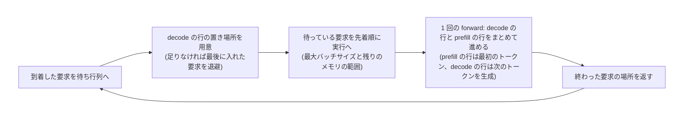
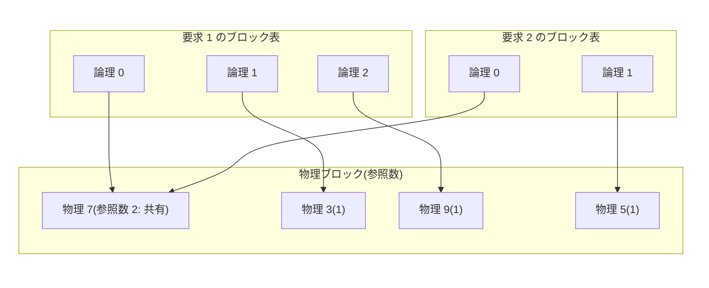

# 027. 推論サーバ: continuous batching と PagedAttention / Inference Serving: Continuous Batching and PagedAttention

## 1. 概要 / Overview

[010](https://zenn.dev/kojikojiprg/books/ai-theories-roadmap/viewer/010_kv_cache_and_inference_compute) は、**1 件の要求** の生成を KV キャッシュ(Key-Value Cache)で速くした。実際の推論サーバ(inference server)は、到着時刻も出力長も違う **多数の要求** を、1 つのデバイスの上で同時に進める。このとき、性能を決めるのは個々の演算ではなく、**どの要求をいつ同じバッチに入れるか(スケジューリング)** と、**要求ごとの KV キャッシュのメモリをどう割り当てるか(メモリ管理)** の 2 つである。

本トピックは、この 2 つを小型 GPT([008](https://zenn.dev/kojikojiprg/books/ai-theories-roadmap/viewer/008_decoding_strategies) の`main`)の上でスクラッチ実装し(`src/serving/`)、次を測る。

- **スケジューリング**: 組を固定してバッチの中で最も長い要求の終わりを待つ **static batching** と、反復ごとに終わった要求を抜いて待っている要求を入れる **continuous batching**(Orca の iteration-level scheduling)。
- **メモリ管理**: 最大長の分を前もって確保する方式と、KV キャッシュを固定長のブロックに分けてブロック表で参照する **PagedAttention**(vLLM)。接頭辞の共有(prefix caching)と書き込み時の複製(copy-on-write)を含む。

学習は行わず、推論だけを扱う。負荷は合成で作る(出力長の平均と変動係数、到着過程を指定する)。検証するのは次の 3 つで、いずれも判定つきである(各実験は 1 つの検証事項を扱う)。

- **実験 A**: 最大バッチサイズを揃え、出力長のばらつきが大きい水準で、continuous batching のスループットが static batching より高いか。
- **実験 B**: 出力長の平均を揃え、変動係数を 4 水準で変えたとき、実験 A の比(continuous / static)が変動係数とともに大きくなるか。隣り合う水準の 3 つの比較(B1・B2・B3)に分けて、部分ごとに判定する。理論の予測(バッチ内の最大長の期待値から求めた比)を診断量として併記する。
- **実験 C**: KV キャッシュの予算(トークン枠の数)を揃え、どちらも continuous batching で動かしたとき、PagedAttention の方が、最大長の分を前もって確保する方式より、反復あたりの実行中の要求数(平均)が多いか。

あわせて、判定を設けない観察として、(D)最大バッチサイズと到着の速さを変えたときの、スループットと、最初のトークンまでの時間(Time To First Token)・出力トークンあたりの時間(Time Per Output Token)の関係、(E)ブロックの大きさを変えたときの内部の断片化と 1 反復の時間、および全要求が同じ system prompt を持つ負荷での接頭辞の共有の効果を示す。観察 D は、アプリ(`apps/`)の段階 2 で最大バッチサイズを決める材料にする。

**この規模の限界(7.11 節)**: 008 の小型 GPT は KV キャッシュが 1 トークンあたり 8,192 バイトで、T4 のメモリに比べて小さく、メモリの制約は実際にはかからない。実験 C の予算は人工的に決めたものである。また、小型モデルの 1 反復の時間は、GPU の計算より Python とカーネルの起動の固定費が支配的になりうる。そのため、スループットの差には、計算量の差より **反復の回数の差**(1 反復は 1 回の forward)が強く効く。1 反復の時間の、行数と問い合わせのトークン数への依存を測って示す(6.3 節)。

### 1.1 実行の手順

手順は付録 A。本番実行は Google Colab T4 の 1 つのセッション(予算 120 分)で完結させる。

### 1.2 本番実行の結果の要約

本番は Google Colab の T4 で、1 つのセッション(全体 16.4 分、計画 0 = 削る段階なし、実験 A・B・C のシード数 8)で完結した。前提条件 P0〜P5 はすべて成立した。

| 実験(検証すること) | 対比量 | 閾値 | 最終判定 | 要約 |
|---|---|---|---|---|
| A: 変動係数 1.0 で continuous が static よりスループットが高いか | +0.9743 | 0.0577 | **支持** | スループットは continuous 2,025、static 768 トークン/秒で、比は 2.649。 |
| B1: 変動係数 0.25 → 0.5 で比が大きくなるか | +0.2883 | 0.0567 | **支持** | 比は 1.373 → 1.832。 |
| B2: 変動係数 0.5 → 0.75 で比が大きくなるか | +0.1760 | 0.0599 | **支持** | 比は 1.832 → 2.184。 |
| B3: 変動係数 0.75 → 1.0 で比が大きくなるか | +0.1930 | 0.0671 | **支持** | 比は 2.184 → 2.649。 |
| C: 同じ予算で PagedAttention の実行中の要求数が多いか | +7.419 | 0.317 | **支持** | 実行中の要求数は 3.94 → 11.36(スループットは 657 → 1,768 トークン/秒)。 |
| D・E: 最大バッチサイズ・到着の速さ、ブロックの大きさ・接頭辞の共有 | - | - | 判定なし | 7.7・7.8 節。 |

閾値は、対比量(8 シードの平均)の標準偏差の 2 倍である。

実験 B の 3 つの段はすべて支持で、宣言どおり「変動係数とともに比が単調に大きくなる」と読む。変動係数 1.0 で continuous batching のスループットは static batching の 2.649 倍で、スループットの比は反復の回数の比(2.642)とほぼ一致した。T4 では 2 つの方式の 1 反復の時間の差が -0.3%〜+1.8% で、forward 以外の時間は makespan の約 2% だった(固定費が支配的な小型モデル)。実測の比は理論の比(1.489〜3.172)より小さく、continuous の 1 反復あたりの行数が最大バッチサイズ 16 に届かない(13.12〜14.70)ことと合う(事後的な解釈。7.9 節)。同じ予算(1,024 トークン枠)で、PagedAttention の実行中の要求数は前もって確保する方式の 2.9 倍だが、理論の予測より差は小さい(7.42 と 8.96)。観察では、最大バッチサイズ 16 以上でスループットが飽和し、出力トークンあたりの時間は約 6 ms でほぼ変わらず、接頭辞の共有で使用ブロックは平均 22.0 → 12.8 に減ったが最初のトークンまでの時間は変わらなかった。選ばれた計画と時間は 7.1 節。

## 2. 参考論文 / References

1. Yu, G.-I., Jeong, J. S., Kim, G.-W., Kim, S., Chun, B.-G. "Orca: A Distributed Serving System for Transformer-Based Generative Models." *OSDI 2022*. https://www.usenix.org/conference/osdi22/presentation/yu — iteration-level scheduling(反復ごとのスケジューリング)と selective batching。**continuous batching の原典。**
2. Kwon, W., Li, Z., Zhuang, S., Sheng, Y., Zheng, L., Yu, C. H., Gonzalez, J. E., Zhang, H., Stoica, I. "Efficient Memory Management for Large Language Model Serving with PagedAttention." *SOSP 2023*. https://arxiv.org/abs/2309.06180 — **PagedAttention と vLLM の原典。** ブロック表・参照数・書き込み時の複製・接頭辞の共有・退避(再計算または swap)。
3. Agrawal, A., Panwar, A., Mohan, J., Kwatra, N., Gulavani, B. S., Ramjee, R. "SARATHI: Efficient LLM Inference by Piggybacking Decodes with Chunked Prefills." *arXiv:2308.16369*, 2023. https://arxiv.org/abs/2308.16369 — chunked prefill(位置づけのみ)。
4. Agrawal, A., Kedia, N., Panwar, A., Mohan, J., Kwatra, N., Gulavani, B. S., Tumanov, A., Ramjee, R. "Taming Throughput-Latency Tradeoff in LLM Inference with Sarathi-Serve." *OSDI 2024*. https://arxiv.org/abs/2403.02310 — スループットと待ち時間の交換(位置づけのみ)。
5. Leviathan, Y., Kalman, M., Matias, Y. "Fast Inference from Transformers via Speculative Decoding." *ICML 2023*. https://arxiv.org/abs/2211.17192 — speculative decoding(位置づけのみ)。

本文中で理論に言及する際は、上の番号で対応する論文を示す。KV キャッシュの閉形式と prefill・decode の性質は [010](https://zenn.dev/kojikojiprg/books/ai-theories-roadmap/viewer/010_kv_cache_and_inference_compute) による。

## 3. 理論 / Theory

### 3.1 推論サーバの指標

1 件の要求 $i$ は、書き出し(プロンプト)の長さ $P_i$、出力長 $O_i$、到着時刻 $a_i$ を持つ。出力長は、生成の途中の終端トークンでは止めず、要求に割り当てた長さで止める(出力長の分布を設計どおりに制御するため)。要求 $i$ が最初に実行に入った時刻を $s_i$、最初のトークンを生成した時刻を $f_i$、最後のトークンを生成した時刻を $e_i$ とする。

- **スループット**(throughput): $\Theta = \dfrac{\sum_i O_i}{\max_i e_i - \min_i a_i}$ [トークン / 秒]。
- **最初のトークンまでの時間**(Time To First Token): $W_i = f_i - a_i$。待ち行列の待ちと prefill の時間を含む。
- **出力トークンあたりの時間**(Time Per Output Token): $\tau_i = \dfrac{e_i - f_i}{O_i - 1}$($O_i \ge 2$)。decode の行を含む反復の時間で決まる。同じ反復に prefill の行が入ると、その反復は長くなる(3.3 節)。
- **待ち行列の待ち時間**: $q_i = s_i - a_i$。

1 反復(iteration)は、バッチの全行を **1 回の forward** で進める処理で、各要求は 1 反復に高々 1 トークンを生成する。1 回の forward の時間を、行数 $n$ と、forward が処理した問い合わせのトークン数 $T$($n$ に、最も長い問い合わせの長さ $Q$ を掛けた $T = nQ$。短い行を埋めた分を含む)の一次式 $t(n, T) = t_0 + t_1 n + t_2 (T - n)$ で近似する($t_0$ は Python とカーネルの起動などの固定費、$t_1$ は 1 行あたりの時間、$t_2$ は 1 行が 1 トークンより多く処理する分の 1 トークンあたりの時間)。decode の行だけなら $Q = 1$ で $T = n$ なので、$t(n) = t_0 + t_1 n$ になる。行数 $n$ の decode のスループットは $n / t(n)$ で、$n$ を増やすと固定費 $t_0$ が $n$ 行で割られて増え、$1 / t_1$ に近づく。一方、出力トークンあたりの時間は $t(n)$ で、$n$ とともに伸びる。**スループットと待ち時間の交換** は、この 2 つの動きから生じる(観察 D で測る)。

### 3.2 static batching の無駄

static batching は、要求の組 $\mathcal{B}$(最大 $B$ 件)を固定し、組の全員が終わるまで次の組を始めない。短い要求が先に終わっても、その行は(捨てる出力のために)計算され続ける。1 組の反復数は $\max_{i \in \mathcal{B}} O_i$、計算した行は $B \max_{i \in \mathcal{B}} O_i$ で、有効な行は $\sum_{i \in \mathcal{B}} O_i$ なので、無駄な行の割合は

$$
1 - \frac{\sum_{i \in \mathcal{B}} O_i}{B \max_{i \in \mathcal{B}} O_i}
$$

である。出力長が独立に同じ分布に従うとき、1 組の反復数の期待値は $\mathbb{E}[\max_B O]$(分布の累積分布関数を $F$ として $\sum_x x \left( F(x)^B - F(x-1)^B \right)$)になる。continuous batching が空いた行を隙間なく詰められる理想的な場合の反復数は $\sum_i O_i / B$ なので、$N$ 件の反復数の比は

$$
\rho_B = \frac{\mathbb{E}[\max_B O]}{\mathbb{E}[O]}
$$

になる(**理論の予測**)。正規分布で近似すると $\mathbb{E}[\max_B O] \approx m (1 + c_v z_B)$(平均 $m$、変動係数 $c_v$、$z_B$ は標準正規分布から $B$ 個を取ったときの最大値の期待値)で、$\rho_B$ は変動係数とともに増える。出力長が揃っている($c_v = 0$)なら $\rho_B = 1$ で、continuous batching の利点はない。ただし、これは **反復の回数の比** で、時間の比ではない。1 反復の時間は行数と問い合わせのトークン数で変わる(3.1 節)。continuous batching は、要求を入れ替える反復で forward に prefill の行が混ざり、その長さまで全行が埋められる(3.3 節)ので、その反復は decode の行だけの反復より長い。固定費 $t_0$ が支配的な小型モデルでは、この差は小さく、時間の比は反復の回数の比に近づく。

### 3.3 continuous batching(Orca)

Orca(論文 1)は、スケジューリングを **反復ごと**(iteration-level)に行う。1 反復の手順は次のとおりである(図 1)。

1. 到着した要求を待ち行列に入れる。
2. **decode の行の置き場所を用意する**。前の反復から実行中だった要求が、次のトークンを書き込む場所を、古い要求から順に用意する。足りなければ、最後に実行に入れた要求を取り下げて場所を空ける(退避。3.5 節)。実行中の要求が、新しい要求より先に場所を得る。
3. スケジューラが、最大バッチサイズ $B$ と残りのメモリ(KV キャッシュの置き場所)の範囲で、待っている要求を **先着順** に実行に入れる。先頭の要求が入れられないときは、後ろの要求を追い越さない。
4. **1 回の forward** で、前の反復から実行中だった要求の **decode の行**(直前に生成したトークンを入力に 1 トークン)と、新しく入れた要求の **prefill の行**(文脈の未計算の部分。書き出し全体)をまとめて進める。prefill の行は最初のトークンを、decode の行は次のトークンを生成する。
5. 終わった要求をバッチから抜き、場所を返す。

*図 1: 本トピックの実行ループ(1 反復 = 1 回の forward)。static batching は、バッチが空になるまで手順 3 で何も入れない点だけが違う(組を始める反復は prefill の行だけの forward になる)。*

Orca は、バッチの全行に共通の演算(射影・正規化・順伝播ネットワーク)は行をまとめ、注意機構だけを要求ごとに処理する **selective batching** で、prefill 中の要求と decode 中の要求を 1 回の forward に混ぜる。本トピックの実装も、prefill の行と decode の行を 1 回の forward に混ぜる。ただし、行ごとに問い合わせの長さが違う行を、**最長の問い合わせの長さまで埋めて 1 つのテンソルにまとめる**(埋めた位置は書き込まず、結果も使わない。共通の演算を平坦化して埋めを避ける Orca の実装とは違う)。そのため、decode の行も、同じ forward の最長の問い合わせの長さまでの計算を負担する(3.1 節の $T - n$ の項)。

**混ぜることの代償**: 1 回の forward は、その反復で最も長い問い合わせを処理する時間がかかる。長い prefill が入る反復では、decode の行もその長さの forward を待つので、出力トークンあたりの時間はその分伸びる。この伸びを抑えるために、長い prefill を小さな塊に分けて混ぜるのが chunked prefill(論文 3、4)で、位置づけのみとする(3.7 節)。

最初のトークンまでの時間は、到着から、その要求の prefill の行を含む forward が終わるまでで、待ち行列の待ちを含む。

### 3.4 KV キャッシュのメモリ管理の問題

1 トークンの KV キャッシュのバイト数は、010 の閉形式で

$$
m_{\mathrm{tok}} = 2 L g d_k \beta
$$

である($L$ は層数、$g$ は Key / Value ヘッド数、$d_k$ はヘッドあたりの次元、$\beta$ は 1 要素のバイト数)。本モデルでは $2 \times 4 \times 8 \times 32 \times 4 = 8192$ バイトである。デバイスに割り当てる KV キャッシュの予算を、トークン枠の数 $M$ で表す。

出力長は事前に分からないので、**最大長の分を前もって確保する方式** は、要求を受け入れるときにモデルの最大の文脈長 $S_{\max}$ の分を 1 つのスロットとして確保する。同時に処理できる要求の数は $\lfloor M / S_{\max} \rfloor$ に制限される。要求が実際に使う長さは $P + O - 1$(最後のトークンの Key / Value は書き込まれない)で、確保した枠のうち $S_{\max} - (P + O - 1)$ は使われない。これが **内部の断片化**(確保したが使わない枠)である。可変長の連続領域を確保する方式では、解放した領域の間に使えない隙間が生じる **外部の断片化** も起きる。固定長のスロットなら外部の断片化は起きないが、長さを事前に知れないので、最大長に固定する必要がある。

### 3.5 PagedAttention

PagedAttention(論文 2)は、KV キャッシュを **固定長のブロック**($b$ トークン)に分け、要求ごとの **ブロック表**(論理ブロック → 物理ブロック)で参照する(図 2)。要求 $r$ の位置 $p$ のトークンの Key / Value は、物理ブロック $\pi_r(\lfloor p / b \rfloor)$ の、ブロック内の位置 $p \bmod b$ に置く。

*図 2: ブロック表。物理 7 は 2 つの要求が共有している(接頭辞の共有、3.6 節)。*

注意機構の計算は変わらない。要求ごとの Query に対し、ブロック表が指す物理ブロックから過去の Key / Value を集めて

$$
\mathrm{softmax}\!\left( \frac{q K^{\top}}{\sqrt{d_k}} \right) V
$$

を計算する($q$ は Query、$K$・$V$ は集めた Key と Value)。本トピックでは、集める処理を PyTorch の添字による参照で書き、専用のカーネルは書かない(3.7 節)。

**無駄は、要求あたり最後のブロックの空きだけ** で、最大で $b - 1$ トークン、つまりブロック 1 つ分未満である。最後のブロックの埋まり方が一様なら、期待値は要求あたり $(b - 1)/2$ トークンになる。したがって、同時に載せられる要求の数は、おおよそ $M / (\bar{S} + (b-1)/2)$($\bar{S}$ は要求が実際に使う長さの平均)で、最大長の分を確保する方式の $\lfloor M / S_{\max} \rfloor$ より、$S_{\max}$ が $\bar{S}$ より大きいほど多い。

**ブロックの大きさ $b$ の選び方** は、断片化と参照の費用の交換である。$b$ が小さいと無駄は小さいが、ブロック表が長くなり、集める添字の数と管理の費用が増える。$b$ が大きいと無駄が増え、$b = S_{\max}$ では最大長の分を確保する方式と同じになる。観察 E で、内部の断片化と 1 反復の時間を測る。

**メモリが足りなくなったとき**(要求が伸びて次のブロックが取れないとき)は、実行中の要求を一時的に取り下げて、ブロックを解放する。方式は 2 つある(論文 2)。**swap** は Key / Value をホストのメモリへ退避し、後で戻す。**再計算**(recompute)は Key / Value を捨て、再開のときに、それまでの文脈(書き出しと生成済みのトークン)を prefill し直す。本トピックは **再計算** を実装する(貪欲法の生成では、再計算しても同じ続きが得られる)。swap は位置づけのみとする。取り下げる要求は、最後に実行に入れたものである。

### 3.6 接頭辞の共有(prefix caching)と書き込み時の複製

複数の要求が同じ接頭辞(system prompt など)を持つとき、その Key / Value は同じなので、物理ブロックを共有できる。各物理ブロックに **参照数** を持たせ、ブロックを共有する要求の数を数える。書き出しの先頭から完全に埋まったブロックごとに、「先頭からそのブロックの終わりまでのトークン列」をキーに登録し、後から来た要求の文脈がそのキーに一致すれば、計算済みのブロックを参照して、その部分の prefill を省く。共有できるのは完全に埋まったブロックだけである(内容が確定していて、書き込まれない)。最後のトークンの logits が要るので、少なくとも 1 トークンは計算し直す。要求が終わって参照数が 0 になった登録済みのブロックは、すぐには捨てず、メモリが足りなくなったときに、最も長く使われていないものから捨てる。

共有しているブロックに書き込むときは、先に複製して自分専用にする(**書き込み時の複製**、copy-on-write)。同じ文脈から複数の続きを生成する場合(並列サンプリング)は、書き込み先の部分的なブロックを共有したまま分岐するので、最初の書き込みで複製が起きる。本トピックの接頭辞の共有は完全なブロックだけを共有するので、実行ループの中で複製は起きない。複製は`fork`(参照数を増やすだけで分岐する)の経路で単体テストする。

### 3.7 位置づけのみの技術

- **chunked prefill**(論文 3、4): 長い prefill を小さな塊に分け、反復ごとに 1 塊ずつ decode の行と同じ forward に混ぜる。1 回の forward が処理するトークン数に上限を置くので、長い prefill が入る反復で decode の行が待たされる時間(出力トークンあたりの時間の伸び)を抑える。本トピックの設計の弱点(長い prefill が入る反復の forward が、decode の行にとっても長いこと。3.3 節)に直接効く。
- **speculative decoding**(論文 5): 小さなモデルで数トークンを下書きし、大きなモデルが 1 回の forward で検証する。1 反復で複数のトークンを進められる。
- **専用の注意機構のカーネル**: ブロック表を引きながら注意を計算する融合カーネル。本トピックでは、ブロック表の参照を PyTorch の添字(`keys[layer][first, second]`)で書く。集めた Key / Value は一度コピーされるので、メモリの移動量は専用のカーネルより多い。

### 3.8 本トピックの設計上の選択

- 出力長は、要求に割り当てた長さで止める。書き出しの長さと出力長の上限は、合わせてモデルの最大の文脈長(256)に収める。
- 比較する方式は、**同じエンジン**(同じ forward、同じ KV キャッシュの添字の仕組み)の上で、スケジューラとメモリの割り当てだけを入れ替える。違いが方式そのものに由来するようにするためである。
- 時刻は、デバイスの同期を取ってから読む。実行する要求も待っている要求もなく、次の到着まで待つ時間は、実際には待たずに時計を進める(仮想の時計)。計算に使った時間は実測である。

## 4. 実装方針 / Implementation Policy

アプリ(`apps/`)の段階 2 から再利用するため、実装はノートブックではなく`src/serving/`に置く(既存の`src/`の挙動は変えない)。ノートブックには、負荷の水準の定義、実験の実行と判定、図だけを書く。

| 部品 | 場所 | 内容 |
|---|---|---|
| 要求と状態 | `src/serving/requests.py` | 書き出し・出力長・到着時刻を持つ要求と、生成済みのトークンや各時刻を持つ状態 |
| 負荷の生成 | `src/serving/workload.py` | 平均と変動係数を指定した出力長の分布、最大値の期待値、Poisson 過程の到着、書き出しの組み立て |
| KV キャッシュの管理 | `src/serving/kv_store.py` | 最大長の分を前もって確保する方式(スロット)と、PagedAttention(ブロック表・参照数・書き込み時の複製・接頭辞の共有) |
| 実行器 | `src/serving/runner.py` | 長さの違う要求を 1 回の forward で進める(行ごとの RoPE の位置、ブロック表からの Key / Value の読み書き) |
| スケジューラ | `src/serving/scheduler.py` | static batching と continuous batching |
| 実行ループ | `src/serving/engine.py` | 反復ごとのスケジューリング(1 反復 = prefill の行と decode の行をまとめた 1 回の forward)、退避(再計算)、各時刻の記録 |
| 時計と費用モデル | `src/serving/clock.py` | デバイスの同期を取る時計と、1 回の forward の時間の 1 本の一次式(行数と問い合わせのトークン数)による見積もり用の時計 |
| 指標 | `src/serving/metrics.py` | スループット、最初のトークンまでの時間、出力トークンあたりの時間、メモリの使用状況 |
| 基準と許容誤差 | `src/serving/reference.py` | 010 の KV キャッシュによる 1 要求ずつの生成と、計算する型から導く許容誤差 |

**スクラッチ実装** するのは、スケジューラ、KV キャッシュの割り当て(ブロック管理)、バッチの forward である。学習済みの重み、正規化、順伝播ネットワーク、射影は、既存の層をそのまま使う(注意機構の部分だけを、行ごとの位置を扱う形で書き直した)。単体テストは`scripts/test_serving.py`にあり(5.4 節で実行する)、1 要求ずつの生成との一致、ブロックの確保と解放の整合、書き込み時の複製などを確かめる。

## 5. 実装 / Implementation

### 5.1 セットアップ

### 5.2 スケールの設定(`SMOKE_TEST`)

`SMOKE_TEST = True`は、コードの経路が最後まで通ることだけを確かめる縮小スケールで、数値に意味はない。縮小は本番の構造(比率・順序関係・一致関係)を保つ(付録 D)。

### 5.3 モデルとデータ

モデルは 008 の`main`(多頭注意機構)、トークナイザは`ai-theories-tokenizer-en`。要求の書き出しは、`ai-theories-corpus-en`の検証用の記事(コーパスの末尾 5%)の先頭から切り出す。検証用の記事はすべて、008 が事前学習で見た範囲(先頭の 356 記事の前半)の外にある。書き出しの内容は計測の対象ではない(出力長を割り当てた長さで止めるので、どの書き出しでも同じ量の処理になる)。

### 5.4 単体テストと、負荷・実行のヘルパー

`src/serving/`の単体テストを実行し、続いて負荷の生成・実行・見積もりのヘルパーを定義する。

## 6. 実験 / Experiments

### 6.1 実験宣言: 共通の設定・検証すること・判定基準・前提条件

**この節の内容は本番実行の前に確定させ、結果を見た後に変更しない。** 対比量の標準偏差の導出、検出力の事前確認、前提条件の閾値の根拠、揃えた量、水準の刻み、実行計画は付録 B・C。

#### 共通の設定

- **モデル**: 008 の`main`(層数 4、$d_{\mathrm{model}} = 256$、ヘッド数 8、最大の文脈長 256、語彙 8192)。FP32、評価モード。トークンの選択は貪欲法。
- **負荷**: 要求数 $N = 128$(観察 D・E は 96)。書き出しの長さは 16〜48 の一様な整数、出力長は平均 $m = 48$、範囲 1〜192 の切り詰めたガンマ分布の形(平均と変動係数が水準の値に一致するように数値で解く)。**書き出し + 出力は最大 240 で、モデルの最大の文脈長 256 に収まる。** 負荷はシードごとに決定的で、同じシードの負荷は、方式が違っても完全に同じ要求の列である。
- **最大バッチサイズ**: 実験 A・B・C は $B = 16$。
- **KV キャッシュの予算**: 実験 A・B と観察は、予算に制約がかからない(最大バッチサイズ分の最大長を載せられる)。実験 C だけ、予算を最大長のスロット 4 個分(1,024 トークン枠)に絞る。ブロックの大きさは $b = 16$ が既定。
- **時刻**: 各反復(= 1 回の forward)の前後でデバイスの同期を取ってから読む。一括処理(offline)は全要求が時刻 0 に到着する。オンラインは到着率 $\lambda$ の Poisson 過程で、要求も実行もない間は時計を次の到着まで進める。
- **シード**: 実験 A・B・C は $0, 1, \ldots$(個数は実行計画で 8・5・3・2 のどれか)。パイロット専用のシードは 90〜92。

#### 条件の対応表

| 記号 | スケジューラ | KV キャッシュの方式 | 使う実験 |
|---|---|---|---|
| S | static batching | PagedAttention(予算に制約なし) | A、B |
| K | continuous batching | PagedAttention(予算に制約なし) | A、B、観察 D・E |
| R | continuous batching | 最大長の分を前もって確保(予算あり) | C |
| P | continuous batching | PagedAttention(予算あり) | C |

$\Theta_{\mathrm{S}}$ などの添字は、この表の記号である。

#### 前提条件(判定とは独立な量で定義する)

- **P0(正しさ)**: エンジンを通した生成が、010 の KV キャッシュによる 1 要求ずつの生成とトークン列で完全に一致し、logits の差が計算する型から導いた許容誤差以内であること。長さの違う要求の混在、途中での入れ替え、終わった行を残す方式、接頭辞の共有、退避と再計算、到着の間の待ちを含む(6.2 節)。接頭辞の共有と退避の経路が実際に通ったことも含める。全実験に共通。
- **P1(負荷の実現)**: 実験で使う全シードをまとめた出力長の標本の平均と変動係数が、設計の値から、標本抽出のばらつき(分布から乱数で見積もった標準偏差)の 4 倍以内であること。出力長・書き出しの長さが範囲内であること。
- **P2(計測の安定)**: 同じ負荷・同じ条件の反復(5 回)のスループットの変動係数が 0.05 以下であること(実験 A・B)。
- **P3(改善の余地)**: 実験 A の水準の理論の比 $\rho_B$ が 1.5 以上であること(実験 A)。
- **P4(予算の制約)**: 最大長の分を確保する方式で同時に処理できる数(スロット数)が、最大バッチサイズより小さいこと(実験 C)。
- **P5(確保した枠の無駄)**: 確保した枠に占める、要求が実際に使う長さの割合(平均)が 0.5 以下であること(実験 C)。

前提条件が成立しなかった実験は、支持・反証・判定不能のいずれとも判定せず、**前提不成立** として記録する。

**判定の時点と、不成立のときの扱い**(事前の宣言): P0 と P2 はパイロットの時点で、P1・P3・P4・P5 は負荷と設計だけで決まるので実行の前に、すべて判定して印字する(6.5 節)。不成立と分かった実験は、その実験だけに使う実行を省き、前提不成立として記録して、他の実験を続ける。実験 A・B は実行を共有するので、P0 または P2 が不成立なら両方の実行を省く。一部の水準だけ P1 が不成立のときは実行を続け、その水準を含まない判定だけを行う。観察 D・E は判定を設けないので常に実行する。P0 が不成立のときは、観察の値は、エンジンの正しさを確かめられていない状態の値として読む。

#### 実験 A: continuous batching と static batching のスループット

**検証すること**: 最大バッチサイズ $B = 16$ を揃え、出力長の変動係数が大きい水準($c_v = 1.0$)で、continuous batching のスループットが static batching より高いか。同じシードの同じ負荷で、違いはスケジューラだけ。

**判定基準**: $\Delta_A = \frac{1}{n} \sum_s \left( \ln \Theta_{\mathrm{K},s} - \ln \Theta_{\mathrm{S},s} \right)$($s$ は負荷のシード、$n$ はシード数、$\Theta_{\mathrm{K},s}$・$\Theta_{\mathrm{S},s}$ は条件 K・S のスループット。正を期待)。標準偏差は $\sigma_A = \max\!\left( \mathrm{sd}_s(d_s) / \sqrt{n},\ \sqrt{2}\, \sigma_{\mathrm{rep}} / \sqrt{n} \right)$($d_s$ は各シードの差、$\sigma_{\mathrm{rep}}$ は同じ条件の反復の対数スループットの標準偏差でパイロットで測る)。$\Delta_A > 2\sigma_A$ なら支持、$\Delta_A < -2\sigma_A$ なら反証、それ以外は判定不能。

**前提条件**: P0、P1、P2、P3。

**作用点**: スケジューラが直接作用するのは、反復あたりに有効に進む要求の数(実行中の要求数)と、計算した行の無駄である。スループットはその数を 1 反復の時間で割った量で、1 反復の時間は、prefill の行が混ざる反復で(全行が最長の問い合わせまで埋められるぶん)長くなる(3.3 節)ので、作用点から 1 段離れている。診断量として、反復の回数の比、forward の回数の比(1 反復が 1 回の forward なので、反復の回数の比に等しい)、static batching の無駄な行の割合、continuous batching の混在した反復(prefill の行と decode の行が同じ forward に入る反復)の割合と、埋めた分の割合を併記する。

**1 反復の時間の内訳(診断量。判定には使わない)**: 1 反復あたりの時間(`makespan` / 反復の回数)を、水準・方式ごとに、forward(実行器の`step`の呼び出し。うち入力の配置)、反復の中のその他(スケジューラの判断、置き場所の確保と解放、行の組み立て、記録)、反復と反復の間の時間に分けて記録する(いずれもデバイスの同期を取ってから時刻を読む)。スループットの比は「反復の回数の比 × 1 反復の時間の比の逆数」に分解でき(2 つの方式は同じ負荷で、生成するトークン数が等しいので、等式が厳密に成り立つ)、1 反復の時間の差は、forward・その他・反復の間の 3 つの時間の差の和になる。あわせて、問い合わせのトークン数(埋めた分を含む)の平均と、費用モデルによる forward の見積もりに対する実測の比(式が形によって外れるかを見る量)を示す。

**解釈の注意**: 小型モデルでは固定費が支配的で、スループットの比は反復の回数の比に近い見込みである。ただし、prefill の行が混ざる反復は、その長さまで全行を埋めるので decode だけの反復より長く(6.3 節で測る費用モデルの第 3 項)、そのぶん時間の比は反復の回数の比より小さくなりうる。理論の比 $\rho_B$ は、一括処理の末尾(待つ要求がなくなって実行中の数が減る区間)を含まない上限に近い値である。

#### 実験 B: 変動係数と、continuous batching の利点(B1・B2・B3)

**検証すること**: 出力長の平均を揃え、変動係数を $c_v \in \{0.25, 0.5, 0.75, 1.0\}$ の 4 水準で変えたとき、実験 A の比 $\Theta_{\mathrm{K}} / \Theta_{\mathrm{S}}$ が変動係数とともに大きくなるか。「大きくなる」は、**隣り合う水準の 3 つの比較(B1: 0.25 → 0.5、B2: 0.5 → 0.75、B3: 0.75 → 1.0)に分けて、部分ごとに判定する**。実験 A の水準 $c_v = 1.0$ の実行は、B3 の高い側の水準の実行と同じである。

**判定基準**: $r_s(c) = \ln \Theta_{\mathrm{K},s}(c) - \ln \Theta_{\mathrm{S},s}(c)$($c$ は変動係数の水準)として、$\Delta_{B_k} = \bar{r}(c_{k+1}) - \bar{r}(c_k)$($\bar{r}$ はシードの平均。正を期待)。標準偏差は $\sigma_{B_k} = \max\!\left( \sqrt{ \left( \mathrm{var}_s(r(c_{k+1})) + \mathrm{var}_s(r(c_k)) \right) / n },\ 2\sigma_{\mathrm{rep}} / \sqrt{n} \right)$(水準が違えば負荷が独立なので、独立を仮定する)。各段で $\Delta_{B_k} > 2\sigma_{B_k}$ なら支持、$\Delta_{B_k} < -2\sigma_{B_k}$ なら反証、それ以外は判定不能。

**前提条件**: P0、P1(両側の水準)、P2。

**組み合わせの読み方**(事前の宣言。部分ごとの判定は別々に記録する): 3 段がすべて支持なら、変動係数とともに比が単調に大きくなる。いずれかが反証なら、単調ではない。それ以外(判定不能・前提不成立を含む)は、単調増加は部分的にしか言えない。

**診断量**: 理論の予測 $\rho_B = \mathbb{E}[\max_B O] / \mathbb{E}[O]$(水準ごと)、反復の回数の比、forward の回数の比(反復の回数の比に等しい)、continuous batching の混在した反復の割合と埋めた分の割合、水準・方式ごとの 1 反復の時間の内訳(実験 A と同じ形)。理論の比は反復の回数の比の予測で、スループットの比とは、固定費と埋めた分の費用だけ違う(3.2 節)。

#### 実験 C: 同じ予算での、実行中の要求数

**検証すること**: KV キャッシュの予算(トークン枠の数)を揃え、どちらも continuous batching で動かしたとき、条件 P(PagedAttention)の反復あたりの実行中の要求数(平均)が、条件 R(最大長の分を前もって確保する方式)より多いか。予算は 1,024 トークン枠で、R は最大長 256 のスロット 4 個(同時に処理できる数 4)、P は $b = 16$ のブロック 64 個。最大バッチサイズは 16 で、R の同時に処理できる数はこれより小さい(制約がかかる)。出力長の変動係数は 0.5。

**判定基準**: $\bar{N}_{c,s}$ を条件 $c$・シード $s$ の反復あたりの実行中の要求数(その反復でトークンを生成した要求の数)の平均として、$\Delta_C = \frac{1}{n} \sum_s \left( \bar{N}_{\mathrm{P},s} - \bar{N}_{\mathrm{R},s} \right)$(正を期待)。標準偏差は $\sigma_C = \mathrm{sd}_s(d_s) / \sqrt{n}$($d_s$ は各シードの差。スケジュールは負荷だけで決まり、実時間の揺らぎに依存しないので、反復のばらつきの下限は置かない)。$\Delta_C > 2\sigma_C$ なら支持、$\Delta_C < -2\sigma_C$ なら反証、それ以外は判定不能。

**前提条件**: P0、P1、P4、P5。

**作用点**: メモリ管理が直接作用するのは、同じ予算に同時に載せられる要求の数で、対比量(実行中の要求数)はそれに近い。診断量として、スループット、使用中の枠の割合(使っている枠 / 確保した枠)、退避の回数、方式ごとの 1 反復の時間の内訳(実験 A と同じ形)を併記する。

**解釈の注意**: PagedAttention は、実行中の要求 1 つあたり 1 ブロックの空きを残して受け入れ、足りなくなれば最後に入れた要求を退避して再計算する。退避が多いと、再計算の分だけ実行中の要求数は減る(退避の回数で確かめる)。「最大長の分を前もって確保する」のは、出力長が事前に分からないという前提による。出力長の上限が分かる場合は、確保する長さを短くできる。

#### 観察 D・E(判定基準を設けない)

- **観察 D**: 最大バッチサイズ $\{1, 2, 4, 8, 16, 32\}$ と、到着の速さ(基準の到着率に対する比 $\{0.4, 0.8, 1.2\}$)を変えたときの、スループット、最初のトークンまでの時間(平均と 95 パーセンタイル)、出力トークンあたりの時間、待ち行列の待ち時間。基準の到着率は、パイロットで測ったオフラインの処理能力(連続方式・最大バッチサイズ 16)から決める。
- **観察 E**: (E1)ブロックの大きさ $b \in \{4, 8, 16, 32, 64\}$ を変えたときの、内部の断片化(割り当てたが使っていない枠)と 1 反復の時間。理論 $(b - 1)/2$ と比べる。最大長の分を確保する方式は $b = 256$ にあたる。(E2)全要求が同じ system prompt(64 トークン)を持つ負荷での、接頭辞の共有の有無による、使用中のブロック数と最初のトークンまでの時間。

### 6.2 前提条件 P0(正しさ)

本物の重みで、実行するデバイスの上で、エンジンを通した生成を 010 の KV キャッシュによる 1 要求ずつの生成と比べる。許容誤差は、計算する型(FP32)の丸めの単位と logits の大きさから導く(`src/serving/reference.py`)。

### 6.3 スケーリングの計測と外挿(1 セッションの見積もり)

本番でデータ量や回数が大きくなる処理を、実行するデバイスの上で計測し、見積もり(6.5 節)に使う。1 反復は 1 回の forward なので、費用モデルは 1 本の一次式(固定の項 + 1 行あたりの項 × 行数 + 1 トークンあたりの項 × (問い合わせのトークン数 - 行数))である。decode の行だけ、prefill の行だけ、**両方を混ぜた** 3 通りの形の forward の時間を測ってあてはめ、混ぜない形だけから作った式が混ぜた形の時間を予測できるか(相対誤差)を確かめる。**1 反復の時間が行数にほとんど依存しない(固定費が支配的な)かどうかを、行数 1 に対する最大の行数の時間の倍率で示す。** あわせて、最も重い条件(最大バッチサイズ 1)で、要求数 3 点の実行時間からべき指数を推定する。詳細は付録 C。

### 6.4 パイロット(単一の条件の量だけ)

本番と同じセッションの冒頭で、条件間の比較や対比量の計算をせず、単一の条件の量だけを測る。同じ条件の反復のスループットの変動係数(P2)、単一の条件のスループットのシード間の標準偏差(検出力の事前確認)、基準の到着率、見積もりの検証用の比を求める。

### 6.5 検出力の事前確認・実行計画の選択・前提条件の判定

パイロットの標準偏差から、シード数ごとに **検出できる最小の効果** を見積もり、理論から予測した効果の保守側の値(理論の 0.5 倍)と比べる。比べて検出できない段階は候補から外す。残りの段階のうち、予算(120 分)に収まる最小の番号のものを、見積もりと経過時間のみから自動で選ぶ(付録 C)。

そのあと、パイロットと設計だけで分かる前提条件(P1・P3・P4・P5 と、P0・P2 の成否)を **実行の前に判定して印字** し、不成立と分かった実験の実行を省く(6.1 節の宣言どおり)。

### 6.6 本番の実行

選んだ計画のすべての条件を、順に 1 回ずつ実行する。実験 A・B は、時間の偏りを避けるため、同じシードの 2 つの方式の実行順を入れ替える。

### 6.7 実験 A・B(static batching と continuous batching のスループット)

判定のほかに、水準・方式ごとの 1 反復の時間の内訳と、スループットの比の分解(反復の回数の比 × 1 反復の時間の比の逆数)を出力する(診断量。6.1 節)。

### 6.8 実験 C(同じ予算での、実行中の要求数)

判定のほかに、方式ごとの 1 反復の時間の内訳を出力する(診断量。6.1 節)。

    

    

### 6.9 観察 D(最大バッチサイズ・到着の速さと、スループット・待ち時間)

    

    

### 6.10 観察 E(ブロックの大きさ・接頭辞の共有)

    

    

### 6.11 不変条件のアサーション

### 6.12 判定結果の一覧

## 7. 結果・考察 / Results and Discussion

この章の数値は、本番(Google Colab T4、コミット`830f599`、計画 0)のセル出力による。事前に宣言した判定基準による結論と、結果を見た後に立てた解釈は、節または段落を分け、後者には **事後的な解釈** と明記する。事後的な解釈は検証済みの結論ではなく、確かめる方法を添える。

### 7.1 実行環境と実行時間

セットアップセルの印字による環境は次のとおりである。

- GPU は Tesla T4(compute capability 7.5、総メモリ 14.56 GiB)、Python 3.13.15、torch 2.13.0+cu130(ビルド時の CUDA 13.0、cuDNN 92000)。計算の型は FP32。
- 実行したコミットは`830f599`(追跡しているファイルに未コミットの変更なし)、実行日時は 2026-10-19T23:31:58(UTC)。

実行時間と計画(6.2〜6.12 節の出力):

- モデルの構築 11.8 秒、コーパスの取得と書き出しの切り出し 15.5 秒、単体テスト(74 件)19.7 秒、前提条件 P0 の確認 17.7 秒。パイロットの後の経過時間は 3.0 分だった。
- 検出力の事前確認で、検出できる最小の効果が保守側の予測以下になったのは、シード数 8 だけだった(実験 A は 0.061 と 0.577、B は 0.086 と 0.163・0.128・0.088、C は 0.047 と 4.481)。シード数 5 以下は通らない(5 では B3 が 0.108 と 0.088)。
- 計画は、パイロットの後の経過時間 3.0 分に、計画 0 の残りの見積もり 20.2 分を足した 23.3 分で、すべての計画が予算 120 分に収まったので、**計画 0**(削らない)が選ばれた。見積もりの安全係数は 1.16(パイロットの 10 回の、実測 / 見積もりの最大)。
- 実験の実行 132 回は 13.3 分で、見積もり 15.2 分の 0.87 倍だった。全体の経過時間は 16.4 分(予算 120 分)。

### 7.2 正しさ(前提条件 P0)

エンジンを通した生成を、010 の KV キャッシュによる 1 要求ずつの生成と、T4 の FP32 で比べた(6.2 節)。

| 場合 | 要求 | トークン | 列の一致 | 最大の差 | 差 / 許容誤差 | 僅差の手 | 退避 | 共有 | 混在 | 再開 + decode |
|---|---|---|---|---|---|---|---|---|---|---|
| 連続・paged・入れ替え | 10 | 440 | 一致 | 6.68e-06 | 0.0031 | 3 | 0 | 0 | 7 | 0 |
| 連続・予約方式 | 10 | 440 | 一致 | 6.68e-06 | 0.0031 | 3 | 0 | 0 | 7 | 0 |
| static・終わった行を残す | 10 | 440 | 一致 | 6.68e-06 | 0.0031 | 3 | 0 | 0 | 0 | 0 |
| 接頭辞の共有 | 8 | 350 | 一致 | 8.58e-06 | 0.0044 | 3 | 0 | 24 | 6 | 0 |
| 退避と再計算 | 6 | 144 | 一致 | 6.68e-06 | 0.0036 | 2 | 4 | 0 | 2 | 2 |
| 到着の間の待ち | 6 | 203 | 一致 | 7.63e-06 | 0.0034 | 0 | 0 | 0 | 0 | 0 |

- 6 つの場合すべてで、生成したトークン列が完全に一致した。logits の最大の差は 8.58e-06 で、計算する型から導いた許容誤差の 0.0044 倍以下(約 230 倍の余裕)だった。
- 僅差の手(上位 2 つの logits の差が許容誤差の 2 倍以下の手)は 0〜3 手あったが、いずれもトークンは一致した。
- 接頭辞の共有(24 ブロック)、退避(4 回)、prefill の行と decode の行が同じ forward に入る反復(混在)、退避から戻した要求が decode の行と並ぶ反復(2 回)が実際に通った。static は混在せず、どの場合も 1 反復が 1 回の forward だった。前提条件 P0 は成立した。

### 7.3 1 反復の時間と固定費

forward の時間は、行数にほとんど依存しなかった(6.3 節)。

- decode の行だけの forward は、行数 1・2・4・8・16・32 で 5.86・5.75・5.85・6.08・6.39・6.67 ms で、行数 32 は行数 1 の 1.14 倍だった。32 倍の行を処理しても、時間は 14% しか増えない。
- 費用モデルは、時間 = 6.03 ms + 0.018 ms × 行数 + 0.0005 ms × (問い合わせのトークン数 − 行数)。行数 1 の decode の時間に占める固定の項の割合は 1.00 だった。決定係数は 0.109 と低く、予測の相対誤差の最大は 28.9% だった。決定係数が低いのは、時間が行数やトークン数にほとんど依存せず、時間の分散が小さいためで、式が悪いことを意味しない。相対誤差の最大は、prefill の行だけの 1 点(行数 8、問い合わせのトークン数 384、8.93 ms)の外れ値による(他の prefill の行だけの点は 5.7〜6.4 ms)。
- 混ぜた形の時間を、混ぜない形だけから作った式で予測した相対誤差(予測 - 実測を実測で割った値。正は過大な予測)は +7.4%・+17.8%・+10.1%・+15.9%(最大 17.8%)で、全体から作った式では +0.6%・+6.9%・+3.1%・+5.1%だった。
- 本番の実行では、費用モデルによる forward の見積もりに対する実測の比が、実験 A・B の 8 条件で 0.99〜1.01、実験 C の 2 方式で 0.97 と 1.01 だった。式は、実行の forward の時間を 3% 以内で見積もれた。
- 最大バッチサイズ 1 で要求数 24・48・96 の実行時間のべき指数は b = 1.217 だった。1 反復あたりの時間は 5.91・5.87・5.93 ms で一定で、反復の回数が 862・2,010・4,646 と増えたことによる。1 要求あたりの反復の回数(最大バッチサイズ 1 では出力トークンの数に等しい)が 35.9・41.9・48.4 と要求数によって違い、反復の回数が要求数に比例しないことがべき指数を 1 より大きくした。費用モデルの見積もりは実測の 0.97〜0.98 倍だった。
- 同じ条件の反復(5 回)のスループットの変動係数は 0.0178(P2 の閾値 0.05)で、前提条件 P2 は成立した。

### 7.4 実験 A

**判定**: 対比量 $\Delta_A$ = +0.9743(対数のスループットの比の、8 シードの平均)、対比量の標準偏差 0.0288(シード間の標準偏差 0.0815 を $\sqrt{8}$ で割った値。反復のばらつきから見積もった下限 0.0089 より大きい)、閾値 0.0577(対比量の標準偏差の 2 倍)、前提条件 P0〜P3 は成立、**最終判定は支持**。変動係数 1.0 で、continuous batching のスループットは 2,025 トークン/秒、static batching は 768 トークン/秒で、比は 2.649(8 シードの幾何平均)だった。

**1 反復の時間の内訳**(診断量。判定には使わない)。1 反復あたりの時間(シード平均、単位 ms)を、forward・反復の中のその他・反復と反復の間に分けた結果は次のとおりである。

| 変動係数 | 方式 | 反復の回数 | forward | 反復の中のその他 | 反復の間 | 合計 | 行数 | 問い合わせのトークン数 |
|---|---|---|---|---|---|---|---|---|
| 0.25 | continuous | 418 | 6.34 | 0.12 | 0.02 | 6.48 | 14.70 | 135.0 |
| 0.25 | static | 580 | 6.27 | 0.12 | 0.02 | 6.42 | 16.00 | 26.1 |
| 0.50 | continuous | 432 | 6.41 | 0.12 | 0.02 | 6.56 | 14.01 | 130.3 |
| 0.50 | static | 805 | 6.29 | 0.12 | 0.02 | 6.44 | 16.00 | 23.3 |
| 0.75 | continuous | 462 | 6.35 | 0.12 | 0.02 | 6.49 | 13.42 | 123.7 |
| 0.75 | static | 1007 | 6.35 | 0.13 | 0.02 | 6.50 | 16.00 | 21.8 |
| 1.00 | continuous | 464 | 6.34 | 0.12 | 0.02 | 6.48 | 13.12 | 123.5 |
| 1.00 | static | 1225 | 6.35 | 0.13 | 0.02 | 6.50 | 16.00 | 20.8 |

スループットの比は「反復の回数の比 × 1 反復の時間の比の逆数」に分解できる(幾何平均。1 反復の時間は makespan を反復の回数で割った値)。

| 変動係数 | スループットの比 | 反復の回数の比 | 1 反復の時間の比の逆数 | continuous の 1 反復の時間(static との差) |
|---|---|---|---|---|
| 0.25 | 1.373 | 1.387 | 0.990 | +1.0%(+0.07 ms) |
| 0.50 | 1.832 | 1.865 | 0.982 | +1.8%(+0.12 ms) |
| 0.75 | 2.184 | 2.182 | 1.001 | -0.1%(-0.01 ms) |
| 1.00 | 2.649 | 2.642 | 1.003 | -0.3%(-0.02 ms) |

- **スループットの差は、ほぼすべて反復の回数の差から生じた。** 1 反復の時間の比の逆数は 0.982〜1.003 で、2 つの方式の 1 反復の時間の差は -0.3%〜+1.8%(最大 0.12 ms)だった。変動係数 1.0 では、スループットの比 2.649 と反復の回数の比 2.642 がほぼ一致した。
- **forward 以外の時間は小さく、両方式でほぼ同じだった。** 反復の中のその他は 0.12〜0.13 ms、反復の間は 0.02 ms で、makespan の約 2%(その他 0.018〜0.020、反復の間 0.003)だった。1 反復の時間の差に、これらの差は 0.01 ms 以下しか寄与していない。
- **forward の時間の差もほぼなかった。** continuous の問い合わせのトークン数(埋めた分を含む)は static の約 6 倍(変動係数 1.0 で 123.5 と 20.8)で、埋めた分の割合は 0.82(変動係数 0.25〜1.0 で 0.820〜0.823)、混在した反復の割合は 0.209〜0.232 だったが、forward の時間は -0.01〜+0.12 ms しか違わなかった。continuous の、1 行に 1 トークンを超える分(変動係数 1.0 で 123.5 − 13.12 = 110.4 トークン)に、費用モデルの 1 トークンあたりの項(0.0005 ms)を掛けると約 0.055 ms で、forward の 6.34 ms の 1% 未満である(7.3 節)。
- **結論の範囲**: 固定費が支配的な小型モデル(7.3 節)での結論で、スループットの差が反復の回数で決まったのは、1 反復の時間が行数・埋めた分にほとんど依存しなかったためである。大きなモデルでは、埋めた分の計算が時間に表れうる(7.11 節)。

実測の比(2.649)が理論の比(3.172)より小さいことの解釈は 7.9 節(事後的な解釈)。

### 7.5 実験 B(B1・B2・B3)

**判定**: 3 つの段はすべて **支持** で、宣言した組み合わせの読み方により、**変動係数とともに比が単調に大きくなる**。

| 段 | 変動係数 | 対比量 | 対比量の標準偏差 | 閾値(標準偏差の 2 倍) | 最終判定 |
|---|---|---|---|---|---|
| B1 | 0.25 → 0.50 | +0.2883 | 0.0284 | 0.0567 | 支持 |
| B2 | 0.50 → 0.75 | +0.1760 | 0.0299 | 0.0599 | 支持 |
| B3 | 0.75 → 1.00 | +0.1930 | 0.0335 | 0.0671 | 支持 |

対比量の標準偏差は、2 つの水準それぞれの、対数の比のシード間の標準偏差(変動係数 0.25・0.50・0.75・1.00 で 0.0400・0.0695・0.0484・0.0815)を $\sqrt{8}$ で割った値を、二乗和の平方根で合成した値である(例: B1 は $\sqrt{(0.0400^2 + 0.0695^2) / 8} = 0.0284$)。いずれも、反復のばらつきから見積もった下限 0.0127 より大きい。対比量はいずれも閾値の 2.9〜5.1 倍だった(B1 は 5.1 倍、B2 は 2.9 倍、B3 は 2.9 倍)。前提条件 P0・P1・P2 は成立した。

**理論の比と実測の比**(診断量)。理論の比 $\rho_B$ は 3.2 節の $\mathbb{E}[\max_B O] / \mathbb{E}[O]$($B = 16$)、実測の比は continuous / static のスループットの比である。

| 変動係数 | 理論の比 | 実測の比 | 実測 / 理論 | continuous の行数 | 行数 / 16 | 理論の比 × 行数 / 16 |
|---|---|---|---|---|---|---|
| 0.25 | 1.489 | 1.373 | 0.922 | 14.70 | 0.919 | 1.368 |
| 0.50 | 2.062 | 1.832 | 0.888 | 14.01 | 0.876 | 1.806 |
| 0.75 | 2.661 | 2.184 | 0.821 | 13.42 | 0.839 | 2.232 |
| 1.00 | 3.172 | 2.649 | 0.835 | 13.12 | 0.820 | 2.601 |

- 実測の比は、すべての水準で理論の比より小さい(0.82〜0.92 倍)が、水準とともに単調に大きくなる点は理論と同じである。実測の ln 比と理論の ln 比の比は 0.80・0.84・0.80・0.84 で、実験 A・B の保守側の予測(理論の ln 比の 0.5 倍)より大きく、予測には余裕があった。
- 理論からのずれの解釈は 7.9 節(事後的な解釈)。

### 7.6 実験 C

**判定**: 対比量 $\Delta_C$ = +7.419(実行中の要求数の、シードごとの差の平均)、対比量の標準偏差 0.159(シードごとの差の標準偏差を $\sqrt{8}$ で割った値)、閾値 0.317(対比量の標準偏差の 2 倍)、前提条件 P0・P1・P4・P5 は成立(予約した枠に占める実際の長さは 0.307)、**最終判定は支持**。予算は 1,024 トークン枠(予約方式は最大長 256 のスロット 4 個、PagedAttention は $b = 16$ のブロック 64 個)で、最大バッチサイズは 16 である。

| 方式 | 実行中の要求数 | スループット(トークン/秒) | 使用中の枠の割合 | 退避(回/実行) | 反復の回数 |
|---|---|---|---|---|---|
| 最大長の分を前もって確保 | 3.94 ± 0.06 | 657 | 0.241 | 0.0 | 1,533 |
| PagedAttention | 11.36 ± 0.49 | 1,768 | 0.892 | 1.2 | 532 |

(実行中の要求数は反復の平均、± は各方式のシード間の標準偏差。対比量の標準偏差 0.159 は、この 2 方式の差(シードごと)の標準偏差を $\sqrt{8}$ で割った値で、± とは別の量である。)

**1 反復の時間の内訳**(診断量):

| 方式 | forward | うち入力の配置 | 反復の中のその他 | 反復の間 | 合計(ms) | 問い合わせのトークン数 | 行数 |
|---|---|---|---|---|---|---|---|
| 最大長の分を前もって確保 | 5.93 | 0.26 | 0.05 | 0.02 | 6.00 | 13.9 | 3.94 |
| PagedAttention | 6.29 | 0.39 | 0.11 | 0.02 | 6.42 | 69.0 | 11.36 |

- スループットの比 2.69(1,768 / 657)は、反復の回数の比 2.88(1,533 / 532)と、1 反復の時間の比の逆数 0.93(6.00 / 6.42)の積である。**差は反復の回数の差(同時に処理する要求数の差)から生じ、1 反復の時間は PagedAttention の方が 7% 長かった**(forward が +0.36 ms、うち入力の配置が +0.13 ms、反復の中のその他が +0.06 ms)。ブロック表の参照とブロックの管理の費用は、この範囲では固定費に比べて小さい。
- 使用中の枠の割合は 0.241 → 0.892 で、最大長の分を確保すると、確保した枠の 4 分の 3 以上が使われなかった(内部の断片化)。
- 差 7.42 は、設計時の理論の予測(同時に処理できる数の差 8.96)より小さい。解釈は 7.9 節(事後的な解釈)。

### 7.7 観察 D(判定なし)

最大バッチサイズと到着の速さを変えたときの、スループット・最初のトークンまでの時間・出力トークンあたりの時間(要求 96 件、出力長の変動係数 0.5、シード 2 つの平均)。到着の速さは、基準の到着率(オフラインの処理能力から決めた 41.048 要求 / 秒)に対する比である。

| 到着の速さ(比) | 最大バッチサイズ | スループット(トークン/秒) | 最初のトークンまでの時間(平均、ms) | 同(95 パーセンタイル、ms) | 出力トークンあたりの時間(ms) |
|---|---|---|---|---|---|
| 0.4 | 1 | 167.6 | 9,933 | 18,681 | 6.0 |
| 0.4 | 2 | 322.6 | 3,439 | 6,538 | 6.1 |
| 0.4 | 4 | 586.2 | 428 | 874 | 6.3 |
| 0.4 | 8 | 629.8 | 10 | 14 | 6.2 |
| 0.4 | 16 | 629.4 | 9 | 12 | 6.2 |
| 0.4 | 32 | 629.0 | 10 | 13 | 6.3 |
| 0.8 | 1 | 171.2 | 11,326 | 21,373 | 5.8 |
| 0.8 | 2 | 324.9 | 5,069 | 9,617 | 6.1 |
| 0.8 | 4 | 629.1 | 1,717 | 3,308 | 6.1 |
| 0.8 | 8 | 1,129.0 | 162 | 350 | 6.2 |
| 0.8 | 16 | 1,190.0 | 10 | 15 | 6.3 |
| 0.8 | 32 | 1,193.4 | 9 | 13 | 6.3 |
| 1.2 | 1 | 171.0 | 11,889 | 22,492 | 5.9 |
| 1.2 | 2 | 329.9 | 5,549 | 10,511 | 6.0 |
| 1.2 | 4 | 629.3 | 2,247 | 4,318 | 6.2 |
| 1.2 | 8 | 1,171.3 | 591 | 1,154 | 6.2 |
| 1.2 | 16 | 1,691.5 | 18 | 61 | 6.3 |
| 1.2 | 32 | 1,686.3 | 10 | 13 | 6.3 |

結果の読み方(観察。判定基準による結論ではない):

- **スループット**: 最大バッチサイズ 1・2 では、到着の速さによらず約 170・325 トークン/秒で、最大バッチサイズに比例して増える(1 反復の時間がほぼ一定なので、1 反復で進める要求が増えた分だけ増える)。4 では 586〜629 トークン/秒だった。到着の速さが基準の 1.2 倍でも、最大バッチサイズ 16 と 32 でスループットは同じ(1,691.5 と 1,686.3)で、16 以上に増やしても改善しない。最大バッチサイズ 8 は、1.2 倍で 1,171.3(16 の 0.69 倍)まで下がる。
- **最初のトークンまでの時間は、待ち行列の待ち時間が支配する。** 最初のトークンまでの時間の平均と待ち行列の待ち時間の差は、どの条件でも約 6〜7 ms(約 1 回の forward の時間)だった(例: 最大バッチサイズ 1 で 9,933 ms と 9,927 ms)。最大バッチサイズが小さいと待ち行列が伸びる(1.2 倍で 1 は 11.9 秒、4 は 2.2 秒、8 は 0.59 秒、16 は 18 ms)。
- **出力トークンあたりの時間は、最大バッチサイズによらず約 6 ms** だった(5.8〜6.3 ms。最大バッチサイズ 1 から 32 で 5〜9% の増加)。このモデルでは、最大バッチサイズを増やしても出力トークンあたりの時間はほとんど伸びないので、**スループットと待ち時間の交換はほとんど起きない**(増やすほど、スループットも最初のトークンまでの時間も良くなる)。
- 1 反復あたりの時間(表には載せない列)は 5.8〜6.3 ms で、最大バッチサイズによらず固定費が支配的だった。
- 結果から言えないこと: 1 つのモデル・1 つのデバイス・合成の負荷(出力長の変動係数 0.5、要求 96 件)での観察で、大きなモデルでは成り立たない(7.10・7.11 節)。

### 7.8 観察 E(判定なし)

**E1: ブロックの大きさと内部の断片化**(最大バッチサイズ 16、要求 96 件、出力長の変動係数 0.5、シード 2 つの平均)。

| 方式 | ブロックの大きさ | 無駄な枠(平均) | 要求あたりの無駄な枠 | 理論 (b - 1) / 2 | 使用率 | 1 反復の時間(ms) | スループット(トークン/秒) |
|---|---|---|---|---|---|---|---|
| PagedAttention | 4 | 21.4 | 1.50 | 1.50 | 0.976 | 6.43 | 2,213.7 |
| PagedAttention | 8 | 50.0 | 3.51 | 3.50 | 0.946 | 6.50 | 2,188.5 |
| PagedAttention | 16 | 107.1 | 7.51 | 7.50 | 0.891 | 6.30 | 2,256.8 |
| PagedAttention | 32 | 220.7 | 15.47 | 15.50 | 0.798 | 6.31 | 2,252.8 |
| PagedAttention | 64 | 405.9 | 28.45 | 31.50 | 0.683 | 6.35 | 2,240.9 |
| 最大長の分を確保 | 256 | 2,777.9 | 194.70 | - | 0.239 | 6.11 | 2,327.0 |

- **内部の断片化は、ブロック 4〜32 で理論の $(b - 1)/2$ と一致した**(要求あたり 1.50・3.51・7.51・15.47 と、1.50・3.50・7.50・15.50)。ブロック 64 では 28.45 と、理論の 31.50 より小さかった(0.90 倍。解釈は 7.9 節)。最大長の分を確保する方式(ブロックの大きさ 256 にあたる)では、要求あたり 194.70 枠が使われず、使用率は 0.239 だった。使用率は、ブロックが小さいほど 1 に近い(ブロック 4 で 0.976、64 で 0.683)。
- **1 反復の時間は、ブロックの大きさでほぼ変わらなかった**(6.30〜6.50 ms で、ブロックの大きさに対して単調な傾向がない)。ブロックを小さくすると、ブロック表が長くなり、集める添字が増えるはずだが(3.5 節)、この規模では固定費(約 6 ms)に埋もれて見えない。最大長の分を確保する方式(ブロック表を持たない)との差も 0.2〜0.4 ms(6.11 ms と 6.30〜6.50 ms)にとどまる。

**E2: 接頭辞の共有**(全要求が同じ system prompt 64 トークン = ブロック 16 の 4 つ分を持つ。到着の速さは基準の 0.4 倍、要求 96 件、シード 2 つの平均)。

| 接頭辞の共有 | 使用ブロック(平均) | 同(最大) | 共有で再利用したブロック | 最初のトークンまでの時間(平均、ms) | 同(95 パーセンタイル、ms) | スループット(トークン/秒) |
|---|---|---|---|---|---|---|
| なし | 22.0 | 64.5 | 0.0 | 10 | 13 | 516.3 |
| あり | 12.8 | 30.5 | 384.5 | 10 | 14 | 516.3 |

- 接頭辞の共有で、使用中のブロックは平均 22.0 → 12.8(42% 減)、最大 64.5 → 30.5(53% 減)に減った。共有で再利用したブロック 384.5 は、要求 96 件 × 4 ブロック = 384 にほぼ等しい(1 要求あたり、system prompt の 4 ブロックすべて)。
- **最初のトークンまでの時間とスループットは変わらなかった**(平均はどちらも 10 ms、95 パーセンタイルは 13 ms と 14 ms、スループットはどちらも 516.3 トークン/秒)。
- **実装は、共有した接頭辞の prefill の計算を省いている。** 要求を実行に入れるとき、ストアは、先頭から同じ内容が続く計算済みの完全なブロックの数を返し(`src/serving/kv_store.py`の`admit`)、エンジンは、その要求の prefill の行を「文脈の未計算の部分」だけにする(`src/serving/engine.py`で`context[cached:]`を forward の行に渡す)。共有した 64 トークンは、書き出し(64 トークンの system prompt + 8〜24 トークンの利用者の部分)の約 8 割にあたり、forward の問い合わせに入らない。単体テスト(`scripts/test_serving.py`)は、共有ありの生成が 1 要求ずつの生成と一致することを確かめている。
- 時間が変わらなかった理由(事後的な解釈)は 7.9 節。

### 7.9 理論や予測と差があった結果の「なぜそうなったか」(事後的な解釈。検証済みの結論ではない)

支持以外(反証・判定不能・前提不成立)になった実験はなかった。ここでは、支持された結果のうち、理論や設計時の予測と差があった 4 つについて、原因の候補・根拠・確かめる方法・教訓を書く。いずれも事後的な解釈で、検証済みの結論ではない。

**(1) 実測の比が理論の比より小さい(実験 A・B)**

- **原因の候補**: オフラインの負荷(要求 128 件)の終盤で、待っている要求がなくなり、continuous の 1 反復あたりの行数が最大バッチサイズ 16 を下回る。出力長のばらつきが大きいほど、最も長い要求が終わるまでの終盤の尾が長い。理論の比 $\rho_B$ は、continuous が行を隙間なく詰める(行数が常に 16)理想の反復数との比なので、実測の比はその上限を下回る。1 反復の時間の差(7.4 節)は -0.3%〜+1.8% なので、時間の差ではなく反復の回数の差に由来する。
- **根拠**:
  - static の反復の回数(580・805・1,007・1,225)は、設計値(要求 128 件 × 出力長の平均 48 ÷ 最大バッチサイズ 16 = 384 に理論の比を掛けた 572・792・1,022・1,218)と 1.7% 以内で一致する。したがって差は continuous の側にある。
  - continuous の 1 反復あたりの行数は 14.70・14.01・13.42・13.12 で、変動係数が大きいほど少ない。理論の比 × (行数 / 16) = 1.368・1.806・2.232・2.601 は、実測の比(1.373・1.832・2.184・2.649)と 2.2% 以内で合う。
  - ただし、この一致は、continuous の反復の回数 × 1 反復あたりの行数 = 総トークン数という関係と、static が理論どおりであることから、ほぼ自動的に成り立つ。**行数が 16 を下回る原因が終盤の尾であることの直接の証拠ではない。** 反復ごとの行数や待っている要求数の系列は、本番のセル出力に残っていない(実験 C のシード 0 の図に、終盤に実行中の要求数が段階的に減る様子が見える)。
- **確かめる方法**(実行はしていない): (a)実行の記録の、待っている要求数が 0 になった反復より前だけで、行数の平均を測る(16 に近ければ尾が原因)。(b)要求数 $N$ を増やす(例: 128 → 512)。尾の割合は約 $1/N$ で縮むので、実測の比が理論の比に近づくか。(c)オンライン(Poisson 過程の到着)の定常状態の区間で比を測る。
- **教訓**: 理論の比は、continuous が行を詰め続ける理想の上限として読む。有限のオフラインの負荷と比べるときは、実行中の行数で補正するか、定常状態の区間で測る。判定基準の事前の見積もり(理論の ln 比の 0.5 倍)は、実測の ln 比が理論の 0.80〜0.84 倍だったので、余裕があった。

**(2) 実験 C の差が理論の予測より小さい(7.42 と 8.96)**

- **原因の候補**: (a)PagedAttention の退避(1.2 回 / 実行)で、取り下げた要求を再計算する間、実行中の要求が減る。(b)(1)と同じ、終盤の行数の減り。(c)予測が平均の占有(書き出し + 出力長の平均の半分 + ブロックの空きの平均 + 余白のブロック)で割った値で、要求の長さのばらつきにより、同時に載せられる数が平均より減る(使用中の枠の割合は 0.892)。
- **根拠**: PagedAttention の実行中の要求数 11.36 は、予測した同時に処理できる数 12.96(予約方式のスロット数 4 に予測の差 8.96 を足した値)の 0.88 倍で、予約方式は 3.94 とスロット数 4 にほぼ等しい。実験 C のシード 0 の図で、PagedAttention の実行中の要求数は 10〜15 の範囲を推移し、終盤に減る。退避の回数は 1.2 回 / 実行。(a)(b)(c)それぞれが、差のどれだけを説明するかを示す数値はない。
- **確かめる方法**(実行はしていない): 要求数を増やして終盤の割合を減らす。余白のブロックを 0 にして、退避の回数と実行中の要求数の変化を見る。終盤を除いた区間で実行中の要求数を測る。予測式を、要求の長さの分布から数値で計算し直す(実行は不要)。
- **教訓**: 設計時の予測は上限に近い値で、保守側(0.5 倍 = 4.48)の予測で十分な余裕があった(実測 7.42)。予測式には、長さのばらつきと余白の影響を入れる。

**(3) 接頭辞の共有で、最初のトークンまでの時間が変わらない(観察 E)**

- **原因の候補**(実装は共有分の計算を省いているので、原因は「省いても時間に効かない」こと): (a)省いた計算は、費用モデルの 1 トークンあたりの項(0.0005 ms)で見積もると、1 要求あたり 64 トークンで約 0.03 ms で、固定の項(6.03 ms)の 1% 未満。(b)到着の速さが基準の 0.4 倍で、待ち行列がほとんどできない。(c)最初のトークンまでの時間の大半は、約 1 回の forward の時間(約 6 ms)で、計算量に依存しない。
- **根拠**: 1 反復の時間が 6.30〜6.50 ms で、問い合わせのトークン数に依存しない(7.3 節)。共有ありとなしでスループットが同じ 516.3 トークン/秒で、到着の速さで決まっている。最初のトークンまでの時間の平均が 10 ms で、forward 1 回分(約 6 ms)に待ちが少し加わった値。
- **確かめる方法**(実行はしていない): system prompt を長くし(例: 192 トークン)、到着の速さを基準の 1.2 倍にして、共有あり・なしで最初のトークンまでの時間とスループットを比べる。prefill が計算に律速される大きなモデルで同じ比較をする。
- **教訓**: 接頭辞の共有の利益は、小型モデルでは「使用ブロックが減る(メモリ)」側にしか表れない。時間の利益は、固定費が小さく計算が効く条件(大きなモデル、長い共通の接頭辞)で測る必要がある。

**(4) ブロック 64 の内部の断片化が理論より小さい(28.45 と 31.50)**

- **原因の候補**: 理論 $(b - 1)/2$ は、最後のブロックの埋まり方が一様であると仮定する。この負荷では、書き出しが 16〜48 トークン、出力長の平均が 48 で、要求の長さは最大 240 と短い。ブロック 64 では、要求の最初のブロックが書き出しの長さですでに埋まっている(空きは最大でも $b - 16 = 48$)うえ、1〜2 ブロックで終わる要求の割合が大きく、最後のブロックの埋まり方が一様にならない。ブロックが小さいほどこの影響は小さい。
- **根拠**: ブロック 4〜32 は理論と 0.5% 以内で一致し(1.50・3.51・7.51・15.47 と、1.50・3.50・7.50・15.50)、64 だけが 0.90 倍だった。要求の長さの分布の数値は出力に残っていない(根拠となる数値のない候補)。
- **確かめる方法**(実行は不要): 負荷の要求の長さの分布から、ブロックの大きさごとの無駄な枠の期待値を直接計算し、実測と比べる。
- **教訓**: 理論の $(b - 1)/2$ は、要求がブロックの大きさより十分長いときの近似で、ブロックを大きくするときは要求の長さの分布で確かめる。

### 7.10 アプリ(段階 2)への示唆

- **再利用する部分**: `src/serving/`の`ContinuousBatchScheduler`、`PagedKeyValueStore`(接頭辞の共有つき)、`ServingModel`・`ModelRunner`、時刻と内訳の記録(`WallClock`・`RunResult.time_breakdown()`)、費用モデルと`DryRunner`(見積もり)。
- **最大バッチサイズの既定値は 16、混雑に備えて 32 まで許す。** 観察 D では、到着の速さが基準の 1.2 倍でも、最大バッチサイズ 16 でスループットが飽和し(1,691.5 トークン/秒。32 は 1,686.3)、最初のトークンまでの時間は 18 ms(95 パーセンタイル 61 ms)だった。32 にすると 10 ms(同 13 ms)と余裕が増える。8 は、基準の 0.8 倍で 162 ms、1.2 倍で 591 ms と待ち行列が伸びる。到着の速さが基準の 1.2 倍のとき、同時に実行中の要求数は約 15(到着率 49.3 要求 / 秒 × 出力長の平均 48 × 1 反復 6.3 ms)で、16 でぎりぎり足り、32 は余裕がある(事後的な見積もり)。
- **大きなモデルでは成り立たない。** このモデルでは 1 反復の時間が行数にほとんど依存せず、出力トークンあたりの時間が最大バッチサイズによらなかった。1 反復の時間が行数や問い合わせのトークン数とともに伸びる(計算やメモリ帯域が律速する)モデルでは、最大バッチサイズを増やすと出力トークンあたりの時間が伸び、スループットと待ち時間の交換が生じる。アプリで使うモデルについて、観察 D を測り直して決める。
- **接頭辞の共有(段階 4 のチャットボットの system prompt)**: 小型モデルでは、時間の効果は見えなかったが、使用ブロックが約 4 割減る(同じ予算で同時に扱える会話が増える)。複数ターンの会話では、前のターンまでの文脈も共有の対象になる(位置づけ)。大きなモデルや長い system prompt では、省ける prefill の計算が時間にも効くので、7.9 節(3)の確かめる方法で測る。
- **形の変化に弱い環境での注意**: T4 の本番では、費用モデルによる forward の見積もりに対する実測の比が 0.97〜1.01 で、形(行数・問い合わせの長さ・集めた長さ)が反復ごとに変わることによる遅れは見えなかった。デバイスによっては、形が変わるたびに forward が遅くなりうるので、別のデバイスで動かすときは、この実測 / 見積もりの比と観察 D を測り直す。

### 7.11 制約と一般化の範囲

- **固定費が支配的な小型モデル**: 4 層・$d_{\mathrm{model}} = 256$ のモデルで、1 反復の時間は約 6 ms の固定費(Python とカーネルの起動)が支配的だった(7.3 節)。スループットの差が反復の回数でほぼ決まったのは、この性質による。大きなモデルや長い文脈では、計算量が効いて、埋めた分(混在した反復の埋めた分の割合 0.82)や、prefill の長さが時間に表れる。長い prefill が入る反復で decode の行が待たされる問題は、chunked prefill(3.7 節)が必要になる条件である。
- **人工的な KV キャッシュの予算**: 実験 C の予算 1,024 トークン枠は 8 MiB(1 トークン 8,192 バイト)で、T4 の総メモリ 14.56 GiB の 0.05% にすぎない。メモリの制約が実際にかかる大きなモデルや長い文脈では、制約の強さが違う。
- **オフラインの要求数 128 件**: 終盤の尾の影響を受ける(7.9 節の(1))。観察 D・E は 96 件で、さらに少ない。
- **結論が成り立つ範囲**: 1 つのモデル・1 つのデバイス(Tesla T4)・合成の負荷・貪欲法・FP32・出力長を割り当てた長さで止める評価・prefill の行と decode の行を最長の問い合わせの長さまで埋めて 1 回の forward にまとめる実装(平坦化しない)・8 シード(実験 A・B・C)。

### 7.12 次のトピックへの教訓

- **差の原因を切り分ける診断量を、判定と別に用意する。** 1 反復の時間の内訳(forward・その他・反復の間)で、スループットの差が反復の回数の差か時間の差かを、本番の出力だけで切り分けられた。
- **理論の予測は、前提(行が詰まり続ける)を満たす上限として読む。** 実測の比が理論より小さいときは、前提が成り立った区間(行数)で補正してから、理論との一致を議論する。
- **検出力の事前確認の見積もりの精度**: 実験 A・B の閾値(A 0.0577、B 0.0567〜0.0671)は、事前確認の最小の効果(A 0.061、B 0.086)以下で、独立を仮定した見積もりは保守的だった。一方、実験 C の閾値 0.317 は、パイロットの 3 シードから見積もった 0.047 より大きかった(効果の 7.42 に対しては十分小さかった)。少数のシードの標準偏差は、実際より小さく出うる。
- **決定係数は、従属変数の分散が小さいと低くなる。** 費用モデルの決定係数(0.109)は、時間が行数に依存しない(固定費が支配的な)ことの現れで、式の悪さではなかった。評価は、相対誤差(実行では 3% 以内)で行う。
- **実装した最適化が時間に効くかは、固定費に対して測る。** 接頭辞の共有は、計算を省いても、小型モデルでは時間に表れなかった。効果を測るには、計算が効く条件を設計に入れる。

付録(実行の手順・パイロット・設計の改訂の記録など)は、GitHub のノートブックを参照。

https://github.com/kojikojiprg/ai-theories/blob/main/theories/03_efficient_training/027_inference_serving.ipynb
